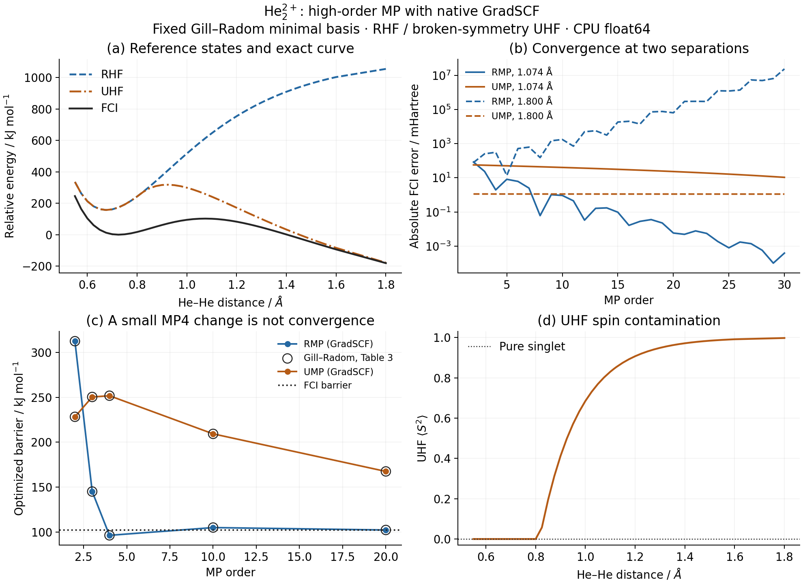
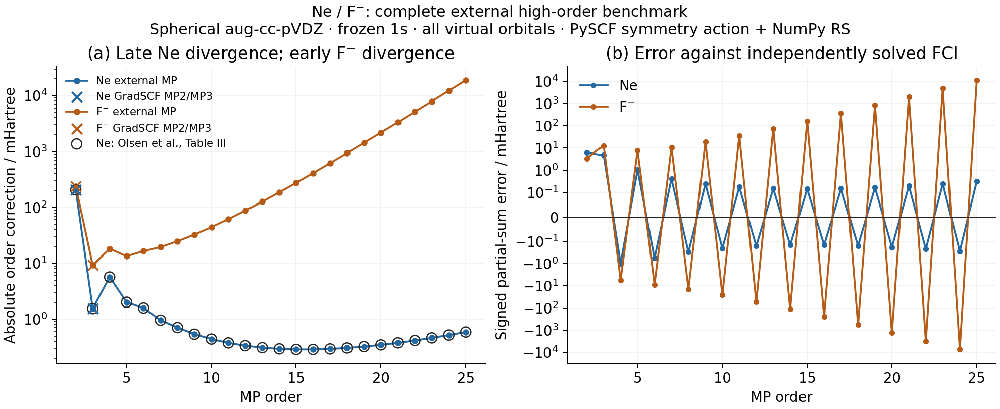

# High-order MP convergence benchmarks

See the [example index](README.md) for scripts and execution order.

These examples distinguish numerical agreement between implementations from
convergence of the physical perturbation series. A converged SCF solution does
not guarantee a convergent MP expansion. No virtual truncation, damping of MP
coefficients, resummation, or curve fitting is used to hide divergent terms.

## What runs in GradSCF

| Case | Native GradSCF | Independent external reference |
| --- | --- | --- |
| He2(2+), fixed minimal basis | RHF, broken-symmetry UHF, RMP/UMP2--30, FCI | PySCF HF/FCI and NumPy RS2--30 |
| Ne and F-, aug-cc-pVDZ | Spherical native integrals, RHF, frozen-core MP2/MP3 | Complete Ag/D2h PySCF Hamiltonian, NumPy RS2--25, compressed FCI |

**Atomic high-order results are external benchmarks, not native GradSCF MP
results and not differentiable calculations.** The existing native full
excitation-block representation is too large for these atoms. Developing a
compact native action remains a separate task.

Run from the repository root with an already built native CPU library and
the usual JAX, NumPy, SciPy, PySCF and matplotlib dependencies:

```bash
PYTHONPATH=src JAX_PLATFORMS=cpu python examples/mp/he2_convergence.py
PYTHONPATH=src JAX_PLATFORMS=cpu python examples/mp/compare_he2_convergence.py
PYTHONPATH=src JAX_PLATFORMS=cpu python examples/mp/ne_f_convergence.py
python examples/mp/plot_convergence.py
```

Raw JSON, logs, figures and the comparison summary live in ignored
`artifacts/mp_convergence/`. The plots are saved as PNG, PDF and SVG. The native
and external He examples are separate scripts; the atomic comparison clearly
separates its independent native and external preparation sections. All scripts
have editable top-level settings and no command-line parser.

## He2(2+): deceptive UMP convergence



Figure formats: [PNG](he2_convergence.png) · [SVG](he2_convergence.svg) ·
[PDF](he2_convergence.pdf). The potential-energy zero is the sampled molecular
FCI minimum. Lines join calculated points; no smoothing is applied.

Gill and Radom, *Chemical Physics Letters* **132**, 16--22 (1986),
[DOI 10.1016/0009-2614(86)80686-8](https://doi.org/10.1016/0009-2614(86)80686-8),
provide a minimal-basis sequence through MP50 and optimized barriers in Table 3.
This reproduction computes through MP30; it does not claim MP50 validation.

Their (3s)->[1s] basis is not STO-3G. We reconstruct it by combining the two
3-21G s contractions with the occupied RHF coefficients at R=0.7 Angstrom,
including the normalization of each input contracted AO. This one contraction
is then fixed for the entire scan. The native and external scripts reconstruct
it independently. The native raw rows, before final shell normalization, are:

| Exponent / bohr^-2 | Coefficient |
| ---: | ---: |
| 13.6267 | 0.07285253393590319 |
| 1.99935 | 0.3714689298559184 |
| 0.382993 | 0.2503930524532253 |

The two electrons occupy a singlet reference. A localized alpha/beta initial
density explicitly selects the broken-symmetry UHF solution when it exists;
using the default symmetric guess can instead converge to the RHF solution.
The example checks convergence and reports the UHF spin expectation. All
electrons and both spatial orbitals participate in MP and FCI. Independent
scalar searches optimize minima over 0.6--0.8 Angstrom and barriers over
0.9--1.4 Angstrom; these intervals are for the selected correlated orders, not
for locating the much longer-bond RHF maximum.

Measured native barriers, in kJ/mol:

| Order | RMP | UMP | Paper RMP | Paper UMP |
| ---: | ---: | ---: | ---: | ---: |
| 2 | 312.542 | 228.278 | 312.5 | 228.3 |
| 3 | 145.121 | 250.386 | 145.1 | 250.4 |
| 4 | 96.332 | 251.747 | 96.3 | 251.8 |
| 10 | 104.948 | 209.336 | 105.0 | 209.3 |
| 20 | 102.264 | 167.490 | 102.3 | 167.5 |

Native FCI gives 102.249 kJ/mol. Thus the small UMP3-to-UMP4 change is not
evidence of an accurate barrier; even UMP20 remains far from FCI. The stretched
RMP series also develops growing corrections. At 1.8 Angstrom the MP30
correction is approximately +17,211.944 Hartree, so relative as well as absolute
comparison tolerances are needed.

Independent HF/FCI energies agree within 3e-10 Hartree. All sampled E2--E30
coefficients pass `atol=2e-10, rtol=2e-9`. The largest absolute RMP difference
is 6.29e-8 Hartree at the very large stretched MP30 correction; the largest
UMP coefficient difference is 4.45e-11 Hartree.

**Unresolved original-table discrepancy:** the independently optimized UMP20
maximum is 1.10802246 Angstrom (GradSCF) and 1.10802244 Angstrom (PySCF), while
Table 3 prints 1.1146 Angstrom. The barrier heights closely agree, but this
geometry does not. We have not established whether this originates in the old
basis/contraction details, optimization, or the printed table. It is not
counted as an exact literature match.

## Ne and F-: complete external high-order reference



Figure formats: [PNG](ne_f_convergence.png) · [SVG](ne_f_convergence.svg) ·
[PDF](ne_f_convergence.pdf). Crosses mark native GradSCF MP2/MP3; high-order
curves come from the complete external reference. The signed-error panel uses
a symmetric logarithmic scale, linear within 0.1 milli-Hartree of zero.

The atomic settings are spherical aug-cc-pVDZ, a frozen doubly occupied 1s
orbital, and all virtual orbitals. Each atom has 23 spatial AOs; the active
problem has 22 orbitals and eight electrons. The 53,509,225 fixed-Ms determinant
coefficients reduce to 6,693,283 in the Ag/D2h block. This spatial-symmetry
restriction is exact for the reference sector and removes no excitation rank.

`symmetry_reference` in `_pyscf_reference.py` uses PySCF CASCI integral folding
only to remove the frozen core, without orbital optimization. PySCF's
`direct_spin1_symm.contract_2e` acts on the packed string blocks. The same
example-only NumPy Rayleigh--Schrodinger recurrence used by our smaller
comparisons supplies E2--E25; there is no native PySCF MP25 API being invoked.
FCI is solved independently with PySCF Davidson in the same packed space.

The recurrence uses the shifted partition H0=E_HF+F_N, so its printed first-order
correction is zero. Comparisons with the conventional partition start at E2;
all these higher-order corrections are unchanged by that constant shift.

The FCI energy tolerance is 1e-11 Hartree and its residual threshold is 1e-8
Hartree. `lindep=1e-20` is explicit: the default squared-norm cutoff of 1e-14
discarded a Ne search direction at residual 4.78e-8 Hartree, above the desired
residual threshold. No converged result is accepted solely because the energy
stops changing; the final Hamiltonian residual is evaluated again.

The native molecular grid facade currently accepts Cartesian AOs. To match the
paper's spherical basis exactly, the atomic example calls native integral
plans and `run_rhf_from_integrals`, then the usual pure-array MP2/MP3 API.
It does not substitute a Cartesian aug-cc-pVDZ calculation.

Measured results (Hartree):

| Quantity | Ne | F- |
| --- | ---: | ---: |
| Native RHF | -128.496349730541 | -99.428282441803 |
| Native E2 | -0.206873508539 | -0.237665735177 |
| Native E3 | -0.001547443201 | +0.009273579005 |
| External FCI | -128.709475548753 | -99.669368843138 |
| Recomputed FCI residual | 4.272e-9 | 5.176e-9 |
| Maximum native/external E2/E3 difference | 2.521e-12 | 1.650e-12 |

Ne E2--E25 matches Olsen's Table III within 1.009e-10 Hartree. Its correction
magnitude reaches a minimum at order 16 before growing again. For F-, E15 is
+0.2757162 Hartree and E25 is +18.8938827 Hartree, with alternating signs between
successive orders. Both independently solved FCI energies agree with the
six-decimal literature totals within 5e-7 Hartree. The whole-example wall times
were 133.9 s for Ne and 142.7 s for F-; native He calculations took 92.4 s.

`convergence_literature.json` identifies the external numerical tables:

- Olsen et al., *J. Chem. Phys.* **112**, 9736--9748 (2000),
  [Table III](https://trygvehelgaker.no/Publications/JChemPhys_112_09736_2000.pdf):
  Ne corrections E2--E25. The tabulated unit is milli-Hartree, not Hartree.
- Leininger et al., *J. Chem. Phys.* **112**, 9213--9222 (2000),
  [computational details and Table I](https://people.chem.ucsb.edu/kahn/kalju/library/private/Leininger_00.pdf):
  spherical functions, frozen cores, no virtual truncation, and independent
  confirmation of the Ne/F- convergence behavior.
- Forsberg et al., *Int. J. Quantum Chem.* **76**, 306--330 (2000),
  [Table II](https://s3.smu.edu/dedman/catco/publications/pdf/IJQC_76_306_2000.pdf):
  rounded FCI totals used as a second numerical check.

## Capacity and numerical scope

At total excitation ranks 4, 6 and 8, the current native tensor representation
would expand respectively 135,877,969; 425,817,757,009; and
742,691,180,074,321 elements for these atoms. These are representation counts,
not measured memory peaks. Merely increasing `max_tensor_elements` is not a
solution. The external symmetry action instead stores packed coefficient
vectors and contracts them without the native full antisymmetric expansion.

The computations use CPU float64 on Apple M4 Pro / 24 GB, Python 3.12.2,
JAX 0.8.1 and PySCF 2.9.0. Reported elapsed times are whole-example wall times,
including preparation/compilation and possible concurrent local activity;
they are not comparative performance benchmarks. No GPU or nuclear-gradient
validation is claimed here.

## Verification and implementation changes

Twenty focused tests passed: explicit-basis RHF/UHF versus PySCF, the compressed
external recurrence versus the uncompressed frozen-core recurrence, the
existing water example, basis library checks, and integral namespace checks.
The complete He comparison and atomic plotting assertions also passed.

The only production behavior change is allowing static raw shell lists and
per-element dictionaries through Cartesian AO construction, which previously
rejected the custom minimal basis before native SCF could start. Normalization
uses the existing implementation. Trainable basis parameters still use integral
plans; no new coefficient-derivative claim follows from this host-side fix.

The NumPy reference recurrence is shared between the old full-space examples
and the new symmetry-packed oracle. Neither a duplicate MP implementation nor
a new numerical solver was added to the production modules. The entire project
test suite was not run.
