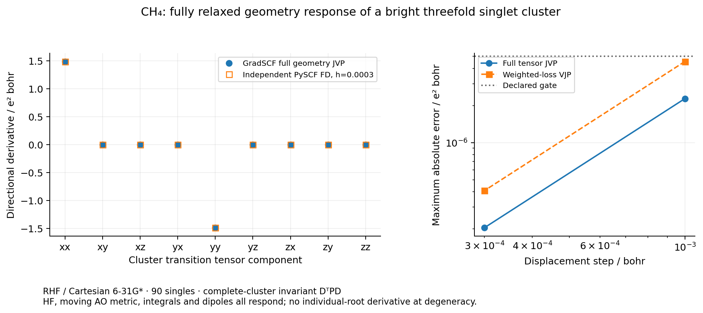

# CH4: complete-cluster VJP with fully relaxed molecular geometry

This example differentiates the physical transition tensor of a complete
bright, triply degenerate **singlet** CIS cluster. Native GradSCF supplies the
moving overlap, kinetic/nuclear/ERI integrals and dipoles, re-relaxed RHF,
noncanonical occupied/virtual Fock blocks and shared implicit subspace response.
It is the full geometry extension of the earlier fixed-reference benzene
example; no labeled root/eigenvector derivative is assigned at degeneracy.

The geometry is regular tetrahedral CH4, C–H=1.09 Å, with Cartesian 6-31G*,
23 AOs, ten electrons, five occupied and eighteen virtual orbitals: 90 singles.
Nuclear geometry is fixed for the demonstration, not optimized. The native
RHF energy is −40.19506116738129 Eh; its lowest internal electronic curvature
is +2.14149203. This is an internal stability check, not a global-minimum claim.

Full-spectrum forward discovery actually selects roots `[0:3]`:

| Quantity | Measured value |
|---|---:|
| Cluster excitation energy | 0.5148997411 Eh |
| Internal splitting | 3.77e-15 Eh |
| Exterior gap | 0.0412305464 Eh |
| Center transition tensor | approximately 1.4063491267 I e² bohr² |
| Center isotropy error | 1.72e-13 e² bohr² |

The main observable is `T=D.T @ P @ D`, with the moving singlet dipole probes
`D=-sqrt(2)*C_occ.T @ r_AO @ C_vir`. Production applies `P` to three probes;
it does not form the full 90-by-90 projector. Dense matrices are used only
for bounded forward discovery and the independent small oracle. The reported
tensor is not itself an energy-weighted oscillator strength.

The scalar loss is `Txx-Tyy+0.5*Txy`. The full VJP covers all fifteen Cartesian
coordinates. A normalized traceless geometric distortion supplies one JVP
and the independent FD direction; coordinates, direction, weights and all
fifteen gradient components are recorded in [gradscf.json](gradscf.json).

| Response check | Measured value |
|---|---:|
| Loss VJP contracted with the direction | 2.979947901223094 e² bohr |
| JVP–VJP duality discrepancy | 2.58e-10 e² bohr |
| Translation-sum discrepancy | 2.94e-12 e² bohr |
| Independent center RHF energy difference | 1.71e-13 Eh |
| Independent cluster energy-sum difference | 3.54e-13 Eh |
| Independent center tensor difference | 1.38e-10 e² bohr² |

[pyscf.json](pyscf.json) rebuilds its own RHF, AO integrals/dipoles and full
CIS matrix at the center and every displaced geometry. It shares physical
inputs and the fixed complete-cluster interval, not native orbitals, densities
or operator arrays. The original derivative gate is 5e-6 e² bohr.

| Step / bohr | Full-tensor JVP FD error / e² bohr | Weighted-loss VJP FD error / e² bohr |
|---:|---:|---:|
| 1e-3 | 2.27e-6 | 4.55e-6 |
| 3e-4 | 2.04e-7 | 4.08e-7 |

These are two independent directional checks of the tensor JVP and its
contraction with the full-coordinate VJP, not fifteen separate componentwise
finite differences. The cluster interval stays fixed and its exterior gaps
remain checked at every endpoint.

The separate [occupied/virtual frame test](frame_davidson_90.json) rotates both
MO blocks, keeping the full Fock blocks and moving-probe chain. Tensor and
15-coordinate VJP changes are 1.36e-10 e² bohr² and 2.49e-10 e² bohr.
The original-frame calculation uses Davidson capacity64; the arbitrary frame
requires capacity 90 at the unchanged 1e-10 Eh Ritz gate. Earlier capacities 32
and 64 had actual frame Ritz residuals 5.01e-6 and 1.61e-10 Eh and were rejected.
Their records remain archived. The final frame residual is 2.20e-14 Eh; no
tolerance was relaxed and no implicit dense fallback was used.

Both response calculations use shared GMRES rtol 1e-10, atol 1e-12, restart 40,
maxiter 100. `geometry_response` checks its primal auxiliary certificate before
the pullback, checks the JVP certificate, and rejects nonfinite derivatives.
It distinguishes nonconverged HF/Ritz states from invalid cluster boundaries.
Actual adjoint residuals/iterations are not exposed and remain `null`; the
shared checked solve enforces them internally. Nine focused tests pass,
including moving probes, dense/Davidson parity, frame invariance and invalid
primal/boundary/nonfinite-response handling. No shared solver was changed.

## Reproduction and evidence

The public functions are [ch4_cis_cluster.py](../../../examples/solvers/ch4_cis_cluster.py)
and [compare_ch4_cis_cluster.py](../../../examples/solvers/compare_ch4_cis_cluster.py).
Implementation is in [cis_cluster.py](../../../src/gradscf_tools/cis_cluster.py);
the optional [independent adapter](../../../src/gradscf_tools/cis_cluster_reference.py)
imports PySCF lazily and is not part of the native calculation. From the repo
root with `PYTHONPATH=src:.`, use fresh output directories and bounded processes.
The [example index](../../../examples/solvers/README.md) contains the runnable
sequence. This directory contains selected results and prose only.

All numerical work and plotting ran on c20, CPU float64, JAX 0.10.0 and
PySCF 2.13.0, shared CPU 32–47 with OMP/OpenBLAS/MKL/NUMEXPR=2. Main response:
69.40 s wrapper / 1,900,556 KiB RSS; independent five-geometry workflow:
4.26 s / 303,788 KiB; final frame check: 59.39 s / 1,606,188 KiB. These are different
workflows and are not a speed comparison. No basis/geometry convergence,
individual-root derivative, higher dipole-geometry response or performance
advantage is inferred.

[source_manifest.json](source_manifest.json) records source and data identities.
The remote snapshot is
`/home/yjiao/gradscf_checks/ad-showcase-ch4-cluster-20261016`, copied from the
authorized `ad-showcase-merge-20261016` baseline. Native library SHA256 is
`8176ca97f9758ba3810b727c5a2e90572ac4f8f205e4a16e0d7a7177221b1829`;
65 expected native source fingerprints were checked. Exact executed source,
RED/GREEN logs, rejected frame attempts and resource records are retained in
the central ignored `artifacts/ad_showcase/development/completion_20261016/cluster/`.
This scientific results folder contains no code. Later public comments are
checked to leave the executed numerical AST unchanged.
