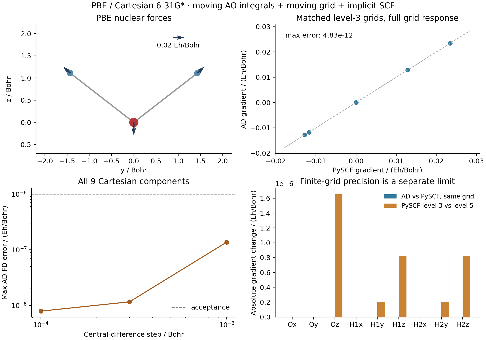

# Water PBE geometry gradient

This is the PBE component of G01 in the
[complete plan](../../../examples/AD_SHOWCASE_PLAN.md). The RHF component is
retained separately in [G01_water_rhf_gradient](../G01_water_rhf_gradient/).

Measured on 2026-10-15 on `jy_gpu_1` (hostname `c20`), CPU float64.



## Calculation and derivative

- PBE RKS, neutral closed-shell water, Cartesian 6-31G* with six Cartesian d
  functions on oxygen.
- Coordinates in Bohr: O `(0, 0, 0)`, H `(0, 1.43, 1.11)`,
  H `(0, -1.43, 1.11)`. The geometry is deliberately not optimized.
- Native overlap, kinetic, nuclear-attraction and electron-repulsion
  integrals; both nuclei and basis centers move.
- JAX atom-centered quadrature: level 3, Treutler-Ahlrichs radial grid,
  Lebedev angular grid with NWChem pruning, original Becke partition and
  Treutler atomic-radii adjustment. No density-based grid removal is used.
- The public `build_rks_integral_inputs` builder constructs all inputs inside
  the differentiated energy. Grid coordinates, partition weights, AO values
  and AO spatial derivatives retain their nuclear-coordinate dependence.
- The shared `minimize_roks_from_integrals` solver uses equal alpha/beta
  occupations and a common spatial-orbital frame, giving closed-shell RKS.
  An ordinary PBE calculation supplies the seed. Each displaced calculation
  transports the seed into the new overlap metric and relaxes it again.
- `jax.value_and_grad` differentiates the relaxed energy using the solver's
  implicit stationary-state response. No solver or response equations are
  implemented in the example.

The derivative includes overlap/moving-basis terms and the derivative of the
chosen finite quadrature. For a stationary energy the first-order orbital
variation cancels in the constrained formulation; this does not justify
freezing the AO metric or molecular grid. This example validates a first
nuclear derivative, not a Hessian or a mixed third derivative.

Initial RKS tolerances are `1e-12` Hartree for energy, `1e-11` for density and
`1e-10` for the orbital residual. The orbital-minimization stationarity
threshold is `1e-9`; the implicit linear-solve tolerance is `1e-10`.
Nonstationary or nonfinite results fail the calculation.

## Validation and grid precision

All nine Cartesian components are checked by central differences at steps
`1e-3`, `3e-4` and `1e-4` Bohr. Both displaced energies rebuild the molecular
grid and relax the electronic state. The force acceptance threshold is
`1e-6` Hartree/Bohr. Net force and torque are checked against `1e-8` in
Hartree/Bohr and Hartree, respectively.

The independent script imports PySCF without importing GradSCF. It builds
its own Cartesian basis, integrals and level-3 grid with the same radial,
angular and partition rules. `grid_response=True` explicitly includes grid
motion and partition-weight response in the PySCF analytic gradient.
PySCF SCF tolerances are `1e-12` Hartree and `1e-10` for the orbital gradient.

A second independent PySCF calculation uses level 5. Its difference from
level 3 estimates sensitivity to the numerical grid; it is not an AD error
and does not establish convergence to the complete-grid limit. Translation
invariance is preserved by the moving atom-centered grid. A finite angular
grid need not be exactly rotation invariant at an arbitrary orientation;
this symmetric water geometry suppresses the torque by symmetry.

## Results

| Quantity | Measured value |
| --- | ---: |
| GradSCF PBE energy / Hartree | -76.32186174420559 |
| Independent PySCF level-3 energy / Hartree | -76.32186174420661 |
| Level-3 physical grid points, both programs | 33,698 |
| Maximum AD–PySCF gradient difference / (Hartree/Bohr) | 4.833e-12 |
| Maximum AD–FD difference, step 1e-3 Bohr | 1.369e-7 |
| Maximum AD–FD difference, step 3e-4 Bohr | 1.163e-8 |
| Maximum AD–FD difference, step 1e-4 Bohr | 7.916e-9 |
| Largest absolute net-force component / (Hartree/Bohr) | 1.067e-14 |
| Largest absolute torque component / Hartree | 4.550e-15 |
| Independent PySCF level-5 physical grid points | 90,058 |
| Maximum level-3 to level-5 gradient change / (Hartree/Bohr) | 1.652e-6 |
| First JIT energy+gradient call / seconds | 104.170 |
| Subsequent energy+gradient call / seconds | 20.958 |

All finite-difference errors in the table are in Hartree/Bohr. The error falls
as the step is reduced, then begins to flatten near `1e-8` Hartree/Bohr.
The measured grid-level sensitivity is much larger than the matched-grid AD
error. In particular, passing the `1e-6` derivative-validation threshold does
not establish complete-grid forces to that precision.

The upper panels show the physical nuclear forces and componentwise agreement
with an independent analytic gradient. The lower panels distinguish the
finite-difference validation error from finite-grid sensitivity. The blue
matched-grid bars are too small to resolve on the lower-right linear scale;
their maximum is stated in the upper-right panel and the table.

## Reproduce

From the repository root on `jy_gpu_1`:

```sh
export CUDA_VISIBLE_DEVICES=
export JAX_PLATFORMS=cpu
export JAX_ENABLE_X64=1
export JAX_ENABLE_COMPILATION_CACHE=false
export OMP_NUM_THREADS=2
export OPENBLAS_NUM_THREADS=2
export PYTHONPATH=src

python examples/geometry/water_pbe_gradient.py
python examples/geometry/compare_water_pbe_pyscf.py
python examples/geometry/plot_water_pbe_gradient.py
```

The first script writes [gradscf.json](gradscf.json); the second writes
[pyscf.json](pyscf.json). The plot script reads these saved results, performs
no SCF calculation, and writes [PNG](gradient_checks.png) and
[PDF](gradient_checks.pdf) figures. Symmetry-related and zero components
overlap in the parity plot; all nine are included in the numerical checks.

Cold timing includes compilation and one synchronized energy-plus-gradient
call after the ordinary seed calculation. Warm timing is one synchronized
repeat. Neither is backward-only or a throughput benchmark. The independent
PySCF timing includes its own SCF and gradient and has a different scope.

## Execution record

- Interpreter: `/home/yjiao/opt/miniconda3/envs/jax_scf/bin/python`.
- All numerical execution and plotting took place on `jy_gpu_1`. The main,
  independent reference and plotting commands used 1800, 300 and 120 second
  timeouts, respectively. No local numerical test or plot was executed.
- CPU: Intel Xeon Platinum 8457C; `OMP_NUM_THREADS=2`,
  `OPENBLAS_NUM_THREADS=2`. These settings do not imply a process-wide cap on
  JAX threads.
- Python 3.11.15; JAX 0.10.0; NumPy 2.4.4; PySCF 2.13.0; device `cpu:0`.
  Persistent JAX compilation caching was disabled.
- Source base: `8f8c93d25fcc150aace9ad5c6a8e070c4f2937af`. No GradSCF source
  change was required for this calculation; only examples/results were added.
- Remote snapshot: `/home/yjiao/gradscf_checks/ad-showcase-20261015`.
- Raw logs are retained outside version control in
  `artifacts/ad_showcase/development/G01_water_pbe_gradient/` within the showcase worktree.

SHA256 of the native library used:

```text
326001ad230cee503056798f4feaaac0d25b5e488b001c8ef064fd47c0be7df4
```

Hashes of the scripts executed remotely:

| Script | SHA256 |
| --- | --- |
| `water_pbe_gradient.py` | `dc42597272e32355c0fe33adf0ceda3e1f0b36ebae624c63c5b30b990ee03a4f` |
| `compare_water_pbe_pyscf.py` | `b9b94f76773196f3f5f312153a4cb39557942d5a2704f249b01166f3fae6ef32` |
| `plot_water_pbe_gradient.py` | `0a06db0335a96e5b6c0b150ebbf8bb6007661c51e55bd538cbd511c3556203d0` |

Only trailing measured-output comments were added to the scripts after
execution. The PNG was visually checked after retrieval; no clipped labels,
overlapping annotations or hidden data were observed. The full project test
suite was not run for these example-only additions.
