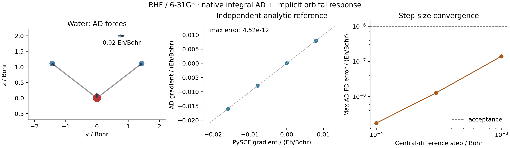

# Water RHF geometry gradient

Measured on 2026-10-15 on `jy_gpu_1` (hostname `c20`). This is the RHF component
of example G01 in the [complete plan](../../../examples/AD_SHOWCASE_PLAN.md).
It does not validate DFT, correlated forces, Hessians or IR/Raman response.



The three panels show nuclear forces at a nonoptimized water geometry,
componentwise AD versus independent PySCF analytic gradients, and the error
of central finite differences as the displacement is reduced. Symmetry-related
and zero components overlap in the parity plot; all nine components were
checked numerically. The arrow key is in Hartree/Bohr.

## Calculation

- RHF, neutral closed-shell water, Cartesian 6-31G* (six d functions on O).
- Coordinates in Bohr: O `(0, 0, 0)`, H `(0, 1.43, 1.11)`,
  H `(0, -1.43, 1.11)`.
- Native GradSCF AO integrals. Each displaced geometry is solved independently
  from the same orbital seed using the shared spatial-orbital solver.
- Gradient: JAX `value_and_grad`, native integral geometry VJP and implicit
  orbital response, with overlap and moving-basis dependence included.
- Initial SCF energy/density tolerances: `1e-12` / `1e-11`.
- Orbital stationarity threshold: `1e-9`; implicit solve tolerance: `1e-10`.
- Independent PySCF reference: RHF energy tolerance `1e-12`, orbital gradient
  tolerance `1e-10`. It runs in a separate script/process.

## Results

| Quantity | Measured value |
| --- | ---: |
| GradSCF total energy / Hartree | -76.01049281824514 |
| PySCF total energy / Hartree | -76.01049281824517 |
| Maximum AD–PySCF gradient difference / (Hartree/Bohr) | 4.521e-12 |
| Maximum AD–FD difference, step 1e-3 Bohr | 1.399e-7 |
| Maximum AD–FD difference, step 3e-4 Bohr | 1.267e-8 |
| Maximum AD–FD difference, step 1e-4 Bohr | 1.747e-9 |
| Largest absolute net-force component / (Hartree/Bohr) | 3.376e-14 |
| Largest absolute torque component / Hartree | 1.362e-14 |
| First JIT energy+gradient call / seconds | 13.767 |
| Subsequent energy+gradient call / seconds | 0.593 |

All finite-difference errors above are in Hartree/Bohr. The decrease is
consistent with the central-difference truncation regime before numerical
noise dominates. The force acceptance threshold was `1e-6` Hartree/Bohr;
net force and torque were checked against `1e-8` in their respective units.

The cold timing includes compilation and execution after the initial ordinary
RHF calculation; the warm timing is a single synchronized repeat. Neither
timing isolates the backward operation or constitutes a throughput benchmark.
The separate PySCF elapsed time includes its initial SCF and analytic gradient
and is not a directly comparable timing scope.

The underlying focused integral regression completed with
**10 passed, 9 deselected in 9.85 seconds**. The selected tests check native
geometry JVP/VJP, finite differences and adjoint identities for five integral
operators in Cartesian and spherical representations. The full suite was not
run for these example-only additions.

## Reproduce

From the repository root on `jy_gpu_1`, with the `jax_scf` environment:

```sh
export CUDA_VISIBLE_DEVICES=
export JAX_PLATFORMS=cpu
export JAX_ENABLE_X64=1
export JAX_ENABLE_COMPILATION_CACHE=false
export OMP_NUM_THREADS=2
export OPENBLAS_NUM_THREADS=2
export PYTHONPATH=src

python -m pytest -q tests/integrals/test_native_geometry_ad.py \
    -k geometry_jvp_vjp_fd_and_adjoint
python examples/geometry/water_rhf_gradient.py
python examples/geometry/compare_water_rhf_pyscf.py
python examples/geometry/plot_water_rhf_gradient.py
```

The measured run used the absolute interpreter
`/home/yjiao/opt/miniconda3/envs/jax_scf/bin/python`. Commands were bounded by
600, 1800, 180 and 120 second timeouts, respectively. No local numerical test
or local plotting calculation was used.

- CPU: Intel Xeon Platinum 8457C; `OMP_NUM_THREADS=2`, `OPENBLAS_NUM_THREADS=2`.
  These environment settings do not assert a process-wide cap on JAX threads.
- Python 3.11.15; JAX 0.10.0; NumPy 2.4.4; PySCF 2.13.0.
- Float64; CPU device `cpu:0`; persistent JAX compilation cache disabled.
- Source base: `8f8c93d25fcc150aace9ad5c6a8e070c4f2937af` plus the new example
  scripts. No `src/` changes were made for this calculation.
- Remote snapshot: `/home/yjiao/gradscf_checks/ad-showcase-20261015`.
- The native library was reused only after recursive source comparison with
  the previously built `graphite-r2scan-8509c60` snapshot showed no differences
  (excluding build products and Python caches).

SHA256 of the transferred source archive:

```text
461869759e835e12a19a07d9e201395034447b1349443286fd702f53435be27c
```

SHA256 of the native integral library:

```text
326001ad230cee503056798f4feaaac0d25b5e488b001c8ef064fd47c0be7df4
```

The scripts were updated after archive extraction to make the Cartesian basis
convention explicit. Hashes of the scripts actually executed remotely:

| Script | SHA256 |
| --- | --- |
| `water_rhf_gradient.py` | `e95b7f277dddc691a9cdd3004840c2c6f250eb7be320777e9da90f3b5f4aaff1` |
| `compare_water_rhf_pyscf.py` | `27ccd4fb0027f0a944b938106e605294d796ce4dda51a85fc06dc8aa6394fb07` |
| `plot_water_rhf_gradient.py` | `b889d3d2c8bc5f3429b7c9e759aa800e85590c5ec127271afa1ce58bd9687b99` |

Trailing measured-output comments were added locally after the run; they do
not change the executed computation. Full numerical inputs and outputs are
in [gradscf.json](gradscf.json) and [pyscf.json](pyscf.json). The plot script
reads these files directly and produces both [PNG](gradient_checks.png) and
[PDF](gradient_checks.pdf).
