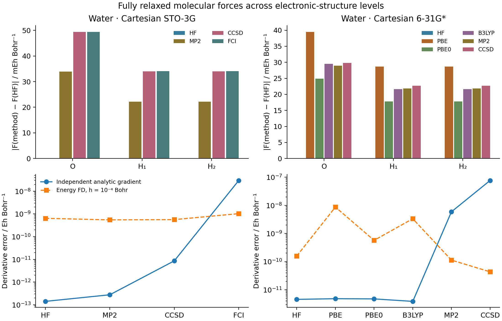

# G02: nuclear forces through correlated wavefunctions



The coordinates in bohr are O `(0,0,0)`, H `(0,1.43,1.11)`, and
H `(0,-1.43,1.11)`. This is a fixed geometry, not an optimized correlated
structure. Cartesian STO-3G and 6-31G* are separate comparisons. FCI uses
STO-3G only; its result is not a reference for the larger-basis energies.

The differentiated map is nuclear coordinates → native AO integrals and
overlap → stationary HF orbitals → MO integrals → correlated energy. MP2
uses canonical orbitals with the shared eigenvector response. CCSD follows
the converged amplitude equations in its implicit backward and supports
noncanonical occupied/virtual blocks. FCI follows an isolated lowest root.
No orbitals, overlap integrals, or correlated amplitudes are frozen.

| Basis | Method | Energy / Eh | Maximum gradient error versus PySCF / Eh Bohr^-1 |
| --- | --- | ---: | ---: |
| STO-3G | HF | -74.963082931333 | 1.414e-13 |
| STO-3G | MP2 | -74.998659586331 | 2.762e-13 |
| STO-3G | CCSD | -75.012562094035 | 8.614e-12 |
| STO-3G | FCI | -75.012678488615 | 2.979e-8 |
| 6-31G* | HF | -76.010492818245 | 4.554e-12 |
| 6-31G* | PBE | -76.321861744206 | 4.818e-12 |
| 6-31G* | PBE0 | -76.325587311744 | 4.739e-12 |
| 6-31G* | B3LYP | -76.408739551093 | 3.868e-12 |
| 6-31G* | MP2 | -76.199033408490 | 5.907e-9 |
| 6-31G* | CCSD | -76.207828747824 | 7.666e-8 |

The independent script uses PySCF analytic gradients; the FCI reference is
full-active-space CASCI. These reference errors and the independent
single-direction central differences are different diagnostics. The latter
use a normalized random Cartesian direction (seed 23) at steps `1e-3`,
`3e-4`, and `1e-4` bohr. Net force and torque are also checked. JSON files
retain every Cartesian component, the direction and all step sizes.

The DFT panel uses the same 6-31G* geometry and direction, with level-3
atom-centered quadrature (33698 points). Its geometry response includes the
moving grid, Becke weights and AO functions. PySCF uses `grid_response=True`
with matched radial, pruning and partition settings. B3LYP means the VWN-RPA
variant, explicitly `b3lypg` in the independent PySCF script. This is a matched
finite-grid derivative test; grid-convergence error remains separate from AD
error. The selected DFT records live in `dft_gradscf.json` and `dft_pyscf.json`.

The bars show each atom's force change relative to HF **within the same
basis**. The sign convention is force = minus energy gradient. They do not
measure accuracy against experiment. Basis convergence and larger correlated
systems are not established by this small validation.

```sh
PYTHONPATH=src python examples/geometry/water_correlated_forces.py
python examples/geometry/compare_water_correlated_pyscf.py
PYTHONPATH=src python examples/geometry/water_dft_forces.py
python examples/geometry/compare_water_dft_forces_pyscf.py
python examples/geometry/plot_water_correlated_forces.py
```

Recorded on `jy_gpu_1` / c20, Intel Xeon Platinum 8457C, CPU float64,
2026-10-15. Python 3.11.15, JAX/JAXlib 0.10.0, NumPy 2.4.4, PySCF 2.13.0.
The command environment uses `CUDA_VISIBLE_DEVICES=`, `JAX_PLATFORMS=cpu`,
`JAX_ENABLE_X64=1`, `JAX_ENABLE_COMPILATION_CACHE=false`, and
`OMP_NUM_THREADS=OPENBLAS_NUM_THREADS=2`. These thread settings do not cap
every JAX runtime thread. Cold energy-plus-gradient calls, including JIT,
took 9.87, 12.38, 23.72, and 13.06 s for the STO-3G rows and 16.39,
15.36, and 28.24 s for the 6-31G* rows. This is not a warm timing/scaling study.

The HF orbital stationarity tolerance is `1e-9`; implicit response uses
`1e-10`. CCSD energy/residual tolerances are `1e-11`/`1e-10`, and FCI Ritz
residual tolerance is `1e-10`. The scripts reject unconverged/nonfinite
results. The DFT records separately store their cold time and source hashes.
NH3 and full omegaB97X-D molecular response remain extensions of this panel.

On 2026-10-16 the seven correlated-script rows were rerun after replacing
duplicated MP2/CCSD assembly with the shared `CorrelatedEnergy` adapter.
[shared_adapter_check.json](shared_adapter_check.json) records every row:
the largest old/new energy difference is `1.42e-14 Eh`, and the largest
gradient difference `1.18e-13 Eh/bohr`. All multistep differences and existing
independent gradient comparisons pass. The original JSON and cold timings
above remain unchanged; this focused refactor check uses the later combined
source at `ad-showcase-integration-20261015`.
