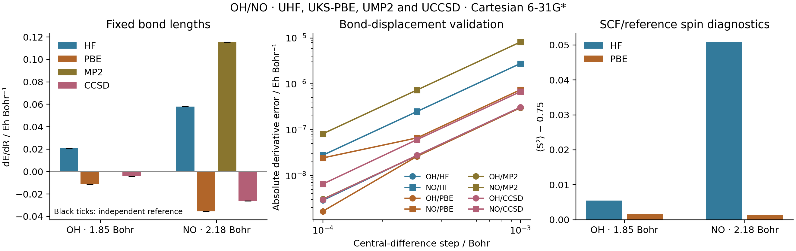

# G03: OH and NO open-shell nuclear gradients



All eight OH/NO calculations, covering real UHF, UKS-PBE, UMP2 and UCCSD,
passed native multistep energy differences and independent gradient comparisons
on `jy_gpu_1`. The correlated reference uses original PySCF gradient assembly
with a separately verified **SciPy augmented physical-pi-gauge UCPHF oracle**.
This does not claim that stock PySCF iterative response meets the same true
residual gate, or define arbitrary degenerate-orbital response.

The neutral molecules lie on the z axis: OH has O at the origin and H at
`z=1.85` bohr; NO has N at the origin and O at `z=2.18` bohr. Both use spin 1,
Cartesian 6-31G*, native full ERIs and float64. PBE uses a level-3 moving
atom-centered quadrature, including AO, grid-coordinate and weight response.
These are fixed test geometries, not optimized structures.

| System | Method | Energy / Eh | dE/dR / Eh bohr^-1 | SCF/reference <S^2> | Maximum independent gradient difference / Eh bohr^-1 |
| --- | --- | ---: | ---: | ---: | ---: |
| OH | UHF | -75.381864353303 | 0.020708807931 | 0.7554759724 | 6.08e-13 |
| OH | UKS-PBE | -75.636705513065 | -0.011179973529 | 0.7516626654 | 7.07e-15 |
| OH | UMP2 | -75.523206322195 | 0.000014409093 | 0.7554759724 | 5.79e-14 |
| OH | UCCSD | -75.537764482474 | -0.004092082817 | 0.7554759724 | 1.40e-12 |
| NO | UHF | -129.246305601263 | 0.058040664960 | 0.8007272608 | 1.40e-11 |
| NO | UKS-PBE | -129.758238960454 | -0.035350763953 | 0.7513955973 | 1.26e-14 |
| NO | UMP2 | -129.563367125459 | 0.115508670067 | 0.8007272608 | 9.33e-11 |
| NO | UCCSD | -129.573440843484 | -0.026092878617 | 0.8007272608 | 5.26e-11 |

The bond derivative uses the displacement `(-z/2,+z/2)` of the two atoms.
Forces have the opposite sign. Central differences at `1e-3`, `3e-4` and
`1e-4` bohr are saved, with smallest-step errors of `2.88e-9`, `1.67e-9`,
`3.05e-9`, `3.00e-9`, `2.78e-8`, `2.42e-8`, `8.15e-8` and `6.53e-9`
Eh/bohr in table order. The independent gates remain `2e-8 Eh` for energy
and `2e-6 Eh/bohr` for every Cartesian gradient component. Electron counts,
net force and torque are checked. `<S^2>` is the unrestricted determinant
diagnostic, with 0.75 as the pure-doublet value; a KS determinant's value is
not a measurement of the interacting many-electron state. For UMP2/UCCSD,
the reported density, spin and stability diagnostics belong to the **UHF
reference determinant**, not the correlated wavefunction. No frozen core is
used. Correlated energy/force response reuses the shared MP2/CCSD implementation
and implicit response, including converged CC amplitudes and Lambda response.

## Stationary energy and the pi orientation

The shared orbital solver writes the energy in unconstrained rotation
coordinates, `E(kappa,p)`, where `p` includes the moving AO metric and all
integral/grid inputs. At the selected stationary solution,

```
E_kappa = 0,
dE/dp = partial E/partial p,
d²E/dp dq = E_pq + E_p,kappa * (dkappa/dq).
```

`stationary_value` applies the first identity to the reported total energy.
The state remains differentiable, so the second expression still needs the
appropriate state response. The metric-dependent orthonormalization is inside
the energy chart; Pulay terms are retained. Forward iterations and their
convergence tests are unchanged. This rule is not applied to a nonvariational
MP2 or CC energy, nor does it choose a unique orbital orientation at degeneracy.

For OH/UHF the real pi-rotation curvature is approximately `7.53e-16 Eh`.
The pre-fix energy backward attempted to solve against a roundoff-sized
orbital RHS: norm `2.81e-14`, linear residual `3.00e-16`. This correctly failed
the requested relative tolerance `1e-10`. The energy envelope differential
removes that unnecessary RHS without changing the tolerance, while a genuinely
undefined density/orbital response remains invalid.

The independent PySCF script uses the native density only as an initial guess
to select the same real pi orientation. It rebuilds integrals, XC and SCF,
then checks its actual orbital residual, the density, spin diagnostic, energy
and analytic nuclear gradient. It enables `grid_response=True` for PBE.

## Independent correlated response and the physical pi gauge

The first NO/UMP2 comparison failed the unchanged force gate: the default
PySCF UCPHF response had `||Az+rhs||=1.9076e-4`, relative residual `1.8196e-3`
for `||rhs||=0.10483645`, and maximum gradient error `5.6486e-6 Eh/bohr`.
Increasing only `max_cycle`, or tightening only the requested tolerance,
did not fix it. Paired Krylov tolerance/linear-dependence changes improved
the force, but force agreement alone did not establish a converged response.
One bounded public `lib.krylov(..., x0=...)` refinement reached absolute
residual `2.6569e-11`, relative `2.5343e-10`, and still failed the `1e-10`
relative gate. [Controlled probes and logs](validation/README.md) retain
those failures. No native tolerance or physical force gate was relaxed.

For these small real z-axis diatomics, the reference constructs the original
UCPHF matrix `A=diag(epsilon_a-epsilon_i)+fvind`. Its one near-zero eigenvector
is checked against the normalized physical generator
`pi = concatenate(Cv_alpha.T Lz Co_alpha, Cv_beta.T Lz Co_beta)`, using the
public AO angular-momentum integral. The independent oracle solves

```
[ A      pi ] [ z      ] = [ -rhs ]
[ pi.T    0 ] [ lambda ]   [    0 ]
```

with `scipy.linalg.solve(..., assume_a="gen")`. The original matrix is not
symmetrized, shifted or spectrally truncated for that solve. A symmetric copy
is used only to diagnose the spectrum. Each case requires matrix asymmetry
below `1e-10`, exactly one `|eigenvalue|<1e-8 Eh`, overlap with physical pi above
`1-1e-8`, and RHS compatibility with that direction. The full **unprojected**
`Az+rhs` must meet both absolute `1e-10` and relative `1e-10` criteria; the
relative check includes `32*eps*(||rhs||+||Az||)` for arithmetic roundoff.
The gauge condition requires `|pi.T z|<1e-12`. A scoped `lib.temporary_env`
restores the original UCPHF entry point after the independent gradient assembly.

| Case | Dimension | ||rhs|| | Full residual L2 | Relative residual | Maximum residual component |
| --- | ---: | ---: | ---: | ---: | ---: |
| OH/UMP2 | 112 | 0.03715130 | 9.15e-17 | 2.46e-15 | 8.17e-17 |
| OH/UCCSD | 112 | 0.03512149 | 1.63e-16 | 4.63e-15 | 1.60e-16 |
| NO/UMP2 | 337 | 0.10483645 | 3.29e-15 | 3.14e-14 | 8.72e-16 |
| NO/UCCSD | 337 | 0.07258526 | 1.24e-16 | 1.70e-15 | 1.06e-16 |

All four physical-pi/null overlaps agree with unity within `1e-15`; the next
absolute eigenvalue is `0.1644478 Eh` for OH and `0.02655490 Eh` for NO.
These UCPHF coordinate eigenvalues are distinct from the normalized orbital
stability curvatures below. The separate NO/UMP2 gauge probe also inserts
`z+pi` and `z-pi` into the unchanged gradient assembly: forces change by at
most `1.5e-14 Eh/bohr`. Its measured `||A pi||=7.33e-12` is retained; no exact
zero was imposed. This supports fixing a redundant rotation for these
specific branches, not replacing a physically singular response generally.

The reference independently reconverges UHF (`conv_tol=1e-13`,
`conv_tol_grad=1e-11`, at most 250 cycles) and requires actual orbital residual
below `1e-10`. UCCSD uses energy tolerance `1e-12`, amplitude tolerance
`1e-11`, at most 200 cycles, and checks both amplitude and Lambda convergence.

## Complete internal stability check

The example explicitly uses the shared dense orbital-Hessian solver for
these small systems, with eigen-residual tolerance `1e-9` and stability
tolerance `1e-5` Eh per squared normalized orbital angle. The minimum
curvatures are:

| Case | Minimum curvature / Eh |
| --- | ---: |
| OH/UHF | 7.53e-16 |
| OH/PBE | 5.30e-5 |
| NO/UHF | -6.07e-13 |
| NO/PBE | -1.36e-6 |

All four finite real internal spectra were resolved. NO/PBE's negative value
is retained: `stable=True` means it lies within the stated tolerance, not
that all computed eigenvalues are positive. Small pi-orientation curvature
in finite quadrature must not be confused with an exact continuous rotational
symmetry. Complex-orbital instabilities and a global SCF minimum are not tested.

A prior Davidson estimate for the same NO/PBE density returned `0.39216685 Eh`
as its lowest root. A complete Hessian check found the near-zero direction
below it; density difference was exactly zero, and dense residuals were below
`3e-14`. This is a root-coverage limitation of partial Ritz estimates. Their
`spectrum_certified=False` flag was correct. The shared Davidson algorithm
was not changed for this example.

## Quadrature and validation limits

The PBE comparison validates derivatives of the same finite-grid functional.
It is not a grid-converged force prediction. A separate OH/PBE level-5 check
was rejected: 250 DIIS cycles and one bounded 80-cycle Newton restart did not
meet `conv_tol=1e-13` and `conv_tol_grad=1e-11`. Its measured orbital residual
was `6.67e-10`. No force from that rejected state is used here. The same-grid
comparison remains valid; tighter independent grid-convergence evidence is
still required. `run(case, check_grid=True)` requests that separate strict check.

The core stationary-value tests and their unchanged-response regressions are
listed in [the solver verification record](../../../tests/solvers/README.md).
A fresh combination with the AO-potential extension passed another 19 tests
in 315.02 s in `ad-showcase-integration-20261015`; that is focused integration
evidence, not a complete repository regression.

## Reproduction and timings

```sh
export CUDA_VISIBLE_DEVICES= JAX_PLATFORMS=cpu JAX_ENABLE_X64=1
export JAX_ENABLE_COMPILATION_CACHE=false OMP_NUM_THREADS=2 OPENBLAS_NUM_THREADS=2
export PYTHONPATH=src
python examples/geometry/open_shell_forces.py
python examples/geometry/compare_open_shell_forces_pyscf.py
python examples/geometry/plot_open_shell_forces.py
```

Recorded on c20 / `jy_gpu_1`, Intel Xeon Platinum 8457C, Python 3.11.15,
JAX/JAXlib 0.10.0, NumPy 2.4.4 and PySCF 2.13.0. Two native source families are
preserved: the four UHF/PBE cases ran in `ad-showcase-stationary-20261015`, and
the four correlated cases in `ad-showcase-integration-20261015`, both under
`/home/yjiao/gradscf_checks/`. The final correlated references ran in the
separate `ad-showcase-open-shell-reference-20261015` snapshot, with no GradSCF
import. These are not eight runs of one frozen source revision.

Native cases ran in fresh processes, each bounded to 1200 seconds; the final
four independent references together were bounded to 1800 seconds. The scripts
have no CLI. [provenance.json](provenance.json) associates each case with its
execution snapshot, native/reference JSON hashes and the selected source hashes
recorded during native execution. Those selected hashes are **not** a complete
source-tree hash. Convergence controls and every timing sample remain in JSON.
The exact executed final reference is archived in
[validation](../../../artifacts/ad_showcase/provenance/G03_open_shell_forces/validation/compare_open_shell_forces_pyscf_executed.py).
The native backend is the same built Linux library used by the frozen
omegaB97X-D response snapshot; no local numerical calculations were used.

| Case | First energy+gradient / s | Warm energy+gradient median / s | Warm energy median / s |
| --- | ---: | ---: | ---: |
| OH/UHF | 15.062 | 0.194 | 0.164 |
| OH/PBE | 73.412 | 4.003 | 4.110 |
| OH/UMP2 | 28.236 | 0.644 | 0.158 |
| OH/UCCSD | 34.034 | 6.666 | 0.414 |
| NO/UHF | 19.758 | 2.169 | 1.840 |
| NO/PBE | 81.625 | 27.805 | 24.771 |
| NO/UMP2 | 26.806 | 3.325 | 1.796 |
| NO/UCCSD | 60.105 | 34.955 | 3.788 |

First transformed calls include JIT after seed SCF and stability analysis.
Warm medians use three synchronized calls. These are shared-node observations,
not isolated backward timings or scaling estimates. The two thread variables
do not limit every JAX runtime thread. Figures and [summary.csv](summary.csv)
read saved data; all numerical execution and plotting occurred remotely.
