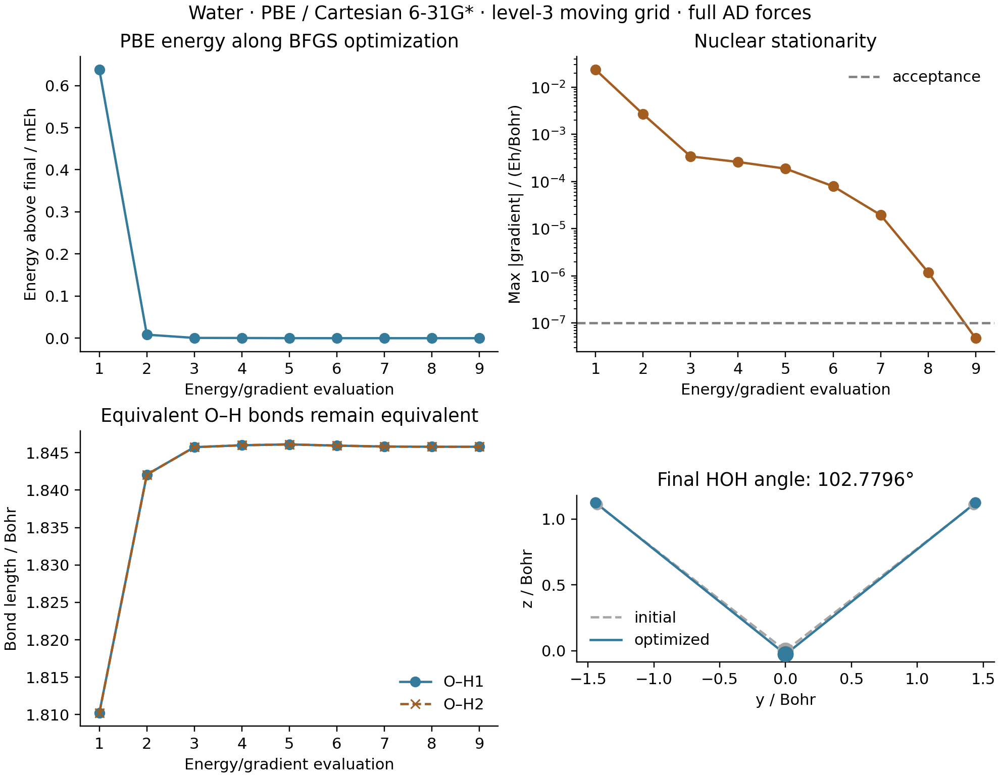

# G04: water PBE geometry optimization

Measured on 2026-10-15 on `jy_gpu_1` (hostname `c20`), CPU float64.
The initial geometry is the nonstationary
[G01 PBE geometry](../G01_water_pbe_gradient/README.md): O `(0,0,0)`,
H `(0,±1.43,1.11)` in Bohr. Both methods use Cartesian 6-31G*.



SciPy BFGS optimizes all nine Cartesian nuclear coordinates. Each objective
evaluation uses `MolecularEnergy` to rebuild native moving AO integrals and
the JAX level-3 molecular grid, including Becke weights and moving AO values.
The shared orbital optimizer relaxes the electrons, and JAX differentiates
the complete energy using implicit orbital response. No external program
provides energies or forces during optimization.

The finite quadrature is Treutler-Ahlrichs radial/Lebedev angular integration
with NWChem pruning, original Becke partitioning and Treutler radii adjustment.
All 33,698 physical points are retained. The seed PBE SCF uses energy/density/
orbital tolerances `1e-12`/`1e-11`/`1e-10`; the shared orbital stationarity
threshold is `1e-9`, and implicit response tolerance is `1e-10`.

| Quantity | Measured value |
| --- | ---: |
| BFGS iterations / objective evaluations | 8 / 9 |
| Optimizer status | success |
| Final energy / Hartree | -76.32249909544649 |
| Maximum final gradient / (Hartree/Bohr) | 4.77777e-8 |
| Both O–H lengths / Bohr | 1.84580194132 |
| HOH angle / degrees | 102.7796456871 |
| Independent PySCF energy / Hartree | -76.32249909544903 |
| Maximum AD–PySCF gradient difference / (Hartree/Bohr) | 5.121e-13 |
| Optimization plus final gradient check / seconds | 403.268 |
| Initial ordinary PBE SCF / seconds | 9.848 |

The maximum-gradient acceptance threshold is `1e-7` Hartree/Bohr. Net force
and torque pass `1e-8` in their respective atomic units. Independent PySCF
uses the same grid rules and `grid_response=True`; its own maximum gradient
also satisfies `1e-7` Hartree/Bohr. The reference SCF tolerances are `1e-13`
Hartree and `1e-11` for its orbital gradient.

[gradscf.json](gradscf.json) records every evaluated geometry, energy and
gradient norm, including line searches. The timing includes first-use AD
compilation and a synchronized final gradient check, and excludes the seed
SCF and Python imports. It does not isolate backward time. The figure's two
bond histories overlap because molecular symmetry is preserved.

This is a stationary geometry for the chosen finite grid.
[G05 PBE](../G05_water_pbe_hessian/README.md) examines the internal Hessian
curvatures and isotope modes. Optimization alone does not establish positive
curvatures or complete-grid convergence. The G01 level-3/level-5 comparison
already shows measurable grid sensitivity.

## Reproduce

Use `/home/yjiao/opt/miniconda3/envs/jax_scf/bin/python` from the repository root
on `jy_gpu_1`, with:

```sh
export CUDA_VISIBLE_DEVICES=
export JAX_PLATFORMS=cpu
export JAX_ENABLE_X64=1
export JAX_ENABLE_COMPILATION_CACHE=false
export OMP_NUM_THREADS=2
export OPENBLAS_NUM_THREADS=2
export PYTHONPATH=src

python examples/geometry/water_pbe_optimization.py
python examples/geometry/compare_water_pbe_optimization_pyscf.py
python examples/geometry/plot_water_pbe_optimization.py
```

The measured commands had 1800, 180 and 120 second timeouts. Data and plots
were generated remotely; only file inspection and visual review were local.
Runtime: Intel Xeon Platinum 8457C, Python 3.11.15, JAX 0.10.0, NumPy 2.4.4,
PySCF 2.13.0, CPU device `cpu:0`. Thread environment variables do not assert a
process-wide JAX thread cap.

Remote snapshot: `/home/yjiao/gradscf_checks/ad-showcase-20261015`, base
`8f8c93d25fcc150aace9ad5c6a8e070c4f2937af` plus the showcase workflow helpers.
The executed `MolecularEnergy` SHA256 is recorded in the JSON. Its PBE branch
uses the public `gradscf.scf.inputs.build_rks_integral_inputs` import.
The optimization process began before the subsequent G05 coordinate-power
second-derivative correction; its energies and first derivatives are
unchanged by that exact polynomial-AD correction. The independent PySCF
check validates the saved final gradient directly.

Raw logs are in the ignored `artifacts/ad_showcase/development/G04_water_pbe_optimization/`
directory. [Source hashes](source_hashes.sha256) identify the scripts and
helper executed remotely. Trailing measured-output comments were added after execution.
[pyscf.json](pyscf.json), [PNG](optimization.png), [PDF](optimization.pdf).
