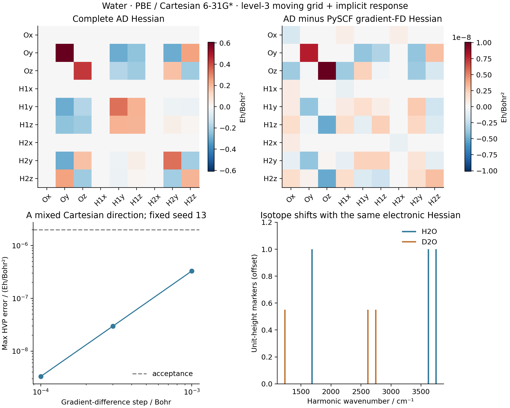

# G05/V04: water PBE Hessian and isotope modes

The geometry is the level-3 PBE minimum from
[G04](../G04_water_pbe_optimization/README.md). Cartesian 6-31G* and all grid
rules are identical to G04. Coordinates are in Bohr, Cartesian force
constants in Hartree/Bohr squared and displayed harmonic wavenumbers in
inverse centimetres.

Measured on 2026-10-15 on `jy_gpu_1` (hostname `c20`), CPU float64.



## Results

| Quantity | Measured value |
| --- | ---: |
| Max raw Cartesian Hessian asymmetry / (Hartree/Bohr²) | 2.440e-14 |
| AD-HVP versus gradient FD, step 1e-3 Bohr / (Hartree/Bohr²) | 3.297e-7 |
| AD-HVP versus gradient FD, step 3e-4 Bohr / (Hartree/Bohr²) | 2.965e-8 |
| AD-HVP versus gradient FD, step 1e-4 Bohr / (Hartree/Bohr²) | 3.306e-9 |
| AD versus full PySCF gradient-FD Hessian, step 3e-4 Bohr / (Hartree/Bohr²) | 3.290e-8 |
| AD versus full PySCF gradient-FD Hessian, step 1e-4 Bohr / (Hartree/Bohr²) | 1.009e-8 |
| Raw translation residual / (Hartree/Bohr²) | 2.469e-12 |
| Raw rotation residual, AD / (Hartree/Bohr) | 6.433424e-5 |
| Raw rotation residual, independent PySCF FD / (Hartree/Bohr) | 6.433458e-5 |
| Raw mass-weighted rigid residual, H2O / atomic units | 1.073e-8 |
| Raw mass-weighted rigid residual, D2O / atomic units | 5.470e-9 |
| Nine AD Hessian columns, including HVP compilation / seconds | 530.052 |

| Internal mode, ascending frequency | H2O / cm⁻¹ | D2O / cm⁻¹ |
| --- | ---: | ---: |
| 1 | 1683.336198 | 1231.628003 |
| 2 | 3625.115023 | 2614.080862 |
| 3 | 3751.508585 | 2746.755757 |

The independent PySCF harmonic analysis differs by at most `3.073e-5` cm⁻¹
for H2O and `1.863e-5` cm⁻¹ for D2O. The AD-HVP gradient-difference error
decreases quadratically over the three tested steps. The nonzero rotational
residual is reproduced by the independent full-grid reference; it is not
removed from the saved Hessian. Thus the finite-grid calculation has three
positive **projected internal modes**, but does not have six rigorously zero
raw rigid-mode curvatures. Finer-grid rotational convergence was not tested.

The Hessian timing includes first-use HVP compilation and nine synchronized
columns, and excludes the seed SCF, baseline gradient, validation differences
and normal-mode analysis. The first column took 188.883 seconds; subsequent
columns took 34.443–46.535 seconds. The independent PySCF run took 69.782
seconds including 37 separate SCF/gradient evaluations and harmonic analysis;
these are different timing scopes and are not a speed benchmark.

The [40-frame animation](water_modes.gif) displays the three H2O modes.
The PNG and animation layout were inspected after retrieval; frame 0 and
frame 10 were also confirmed to differ. Machine-readable results are in
[gradscf.json](gradscf.json) and [pyscf.json](pyscf.json); figures are available
as [PNG](harmonic_checks.png) and [PDF](harmonic_checks.pdf).

## Complete second derivative

`water_pbe_hessian.py` constructs nine columns with
`jax.jvp(jax.grad(energy), (coordinates,), (direction,))`. The energy is the
shared `MolecularEnergy` adapter, which includes native moving overlap/core/
electron-repulsion integrals, nuclear repulsion, JAX atom-centered grid
positions, Becke weights, AO values and spatial AO derivatives. The common
orbital solver supplies implicit electronic response at each AD order.
No force constants are constructed by finite differences in this calculation.

Every HVP is required to be finite. The raw Cartesian Hessian is checked for
symmetry before mode analysis, and its action on a random direction (seed 13)
is checked against a separately evaluated HVP. Three central differences of
relaxed AD gradients, at `1e-3`, `3e-4` and `1e-4` Bohr, validate that HVP.
The smallest-step tolerance is `2e-6` Hartree/Bohr squared. Displaced
electronic states are independently relaxed from the same fixed orbital seed.

The independent reference imports PySCF and does not import GradSCF. It uses
central differences of PySCF **analytic gradients with `grid_response=True`**
at two steps, `3e-4` and `1e-4` Bohr, for all nine Cartesian columns. It is a
finite-difference reference Hessian, not a PySCF analytic Hessian. Explicit
matching of radial/angular/pruning/partition rules and inclusion of grid
motion ensure that both calculations differentiate the same finite quadrature.
PySCF energy/orbital tolerances are `1e-13`/`1e-11`; the maximum allowed
AD–reference Hessian difference is `2e-6` Hartree/Bohr squared.

## Normal modes and finite-grid limits

`gradscf_tools.vibrations.normal_modes` reuses the shared Hermitian eigensolver.
It mass-weights the Hessian, reports the raw mass-weighted rigid-motion
residual, then projects the six rigid coordinates. No acoustic correction
or frequency floor is applied. Raw Hessian asymmetry, unweighted translation
and rotation residuals are saved before projection. Translation invariance
is checked against `1e-8` Hartree/Bohr squared. A finite angular grid can have
a nonzero rotational residual even at a symmetric stationary geometry;
projection does not establish rotational or complete-grid convergence.

The isotope masses in atomic mass units are oxygen-16 `15.99491461957`,
hydrogen-1 `1.00782503223` and hydrogen-2 `2.01410177812`. H2O and D2O share
the same optimized geometry and electronic Hessian. Mode vectors satisfy
`V.T M V = I`, with masses converted to electron-mass atomic units. Their
normal coordinate is in `Bohr * sqrt(electron mass)`. Mass and
Hartree-to-wavenumber conversion constants are saved in the JSON.

All three internal mode eigenvalues must be positive. This demonstrates
local nuclear stability in the projected internal space on the selected
electronic branch; it is not an electronic multistart/stability survey.
The independent PySCF harmonic analysis uses the same isotope masses and its
own finite-difference Hessian. Frequency markers have unit height, not IR
intensity; the animation scales displacements to 0.25 Bohr for visibility,
not to a temperature-dependent amplitude. No anharmonicity or experimental
frequency comparison is implied. Production grid-convergence assessment
remains separate from these matched-grid derivative checks.

## AO derivative correction and regression gates

The initial H2 PBE second-response gate exposed NaNs in the geometric second
derivative of `ao_deriv1`, while native integrals, grid weights, AO values,
field polarizability and local PBE second/third derivatives were finite.
The original array-valued integer-power rule could form `0 * x**-1` when
differentiating a linear Cartesian monomial twice on a coordinate plane.

The narrow correction in `integrals/grids/ao.py` gives these nonnegative
integer monomials their exact polynomial JVP. Lowered powers use the same
rule recursively, and the integer prefactors yield exact zero derivatives
when the derivative order exceeds the polynomial degree. No coordinate
epsilon, coordinate/density clipping, finite-difference fallback or physical approximation was
introduced. The forward values and first derivatives retain their meanings.

Before correction, independent AO tests failed for both STO-3G and 6-31G*.
After correction, `tests/test_grid_ao_jax.py` passed all three tests in
4.11 seconds, covering existing AO values/first derivatives plus comparisons
of higher directional derivatives with independent PySCF third spatial AO
derivatives on zero-coordinate planes (s, p and d functions).
The full H2/STO-3G level-0 PBE HVP gate then passed in 214.95 seconds:
`tests/test_molecular_energy.py -k pbe` gave **1 passed, 2 deselected**.
The helper's DFT input construction also required a two-line import fix to
use the existing public `gradscf.scf.inputs` API.

## Reproduce

Run G04 first. On `jy_gpu_1`, from the repository root, use interpreter
`/home/yjiao/opt/miniconda3/envs/jax_scf/bin/python` and:

```sh
export CUDA_VISIBLE_DEVICES=
export JAX_PLATFORMS=cpu
export JAX_ENABLE_X64=1
export JAX_ENABLE_COMPILATION_CACHE=false
export OMP_NUM_THREADS=2
export OPENBLAS_NUM_THREADS=2
export PYTHONPATH=src

python -m pytest -q tests/test_grid_ao_jax.py
python -m pytest -q tests/test_molecular_energy.py -k pbe
python examples/geometry/water_pbe_hessian.py
python examples/geometry/compare_water_pbe_hessian_pyscf.py
python examples/geometry/plot_water_pbe_modes.py
```

Source base: `8f8c93d25fcc150aace9ad5c6a8e070c4f2937af` plus the showcase
workflow helpers and the documented AO polynomial-AD correction. Remote
snapshot: `/home/yjiao/gradscf_checks/ad-showcase-20261015`.
Raw regression/diagnostic/runtime logs are retained in the ignored worktree
directory `artifacts/ad_showcase/development/G05_water_pbe_hessian/`.

The numerical and plotting commands ran remotely with timeouts of 300 seconds
for the AO tests, 900 seconds for the H2 gate, 3600 seconds for the water
Hessian, 600 seconds for the independent reference and 120 seconds for the
plots/animation. No local numerical calculation or plot was run. Runtime:
Intel Xeon Platinum 8457C, Python 3.11.15, JAX 0.10.0, NumPy 2.4.4, PySCF
2.13.0, CPU device `cpu:0`. Thread settings do not assert a process-wide JAX
thread cap. Persistent compilation caching was disabled.

[source_hashes.sha256](source_hashes.sha256) records the actual executed
workflow, normal-mode helper, AO implementation and three example scripts.
The core hashes were captured before the long Hessian run. Only trailing
measured-output comments were added to the example scripts after execution.
The complete project test suite and other DFT functionals were not tested
for this change.
