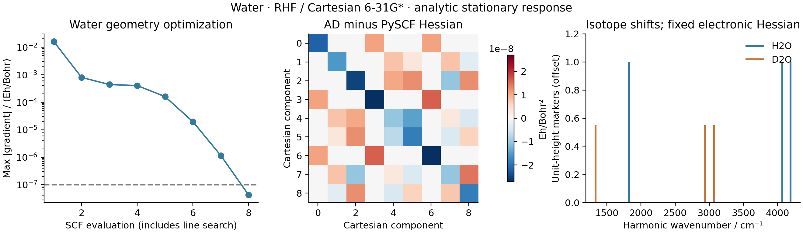
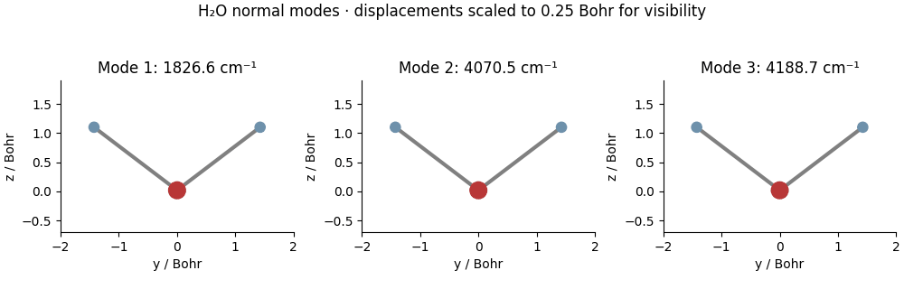

# G05 / V04: water Hessian and isotope shifts



The electronic calculation is RHF / Cartesian 6-31G* at the optimized G04
geometry. Each Cartesian Hessian column is a native second-integral plus
implicit SCF Hessian-vector product from `NativeRHF.response`. Finite
differences validate those columns; they do not generate the Hessian.

The independent PySCF analytic Hessian differs by at most **2.699e-8 Eh/bohr²**.
For a normalized random displacement (seed 13), gradient finite differences
give maximum HVP differences **4.002e-7**, **4.510e-8**, **4.888e-8 Eh/bohr²**
at steps `1e-3`, `3e-4`, `1e-4` bohr. The last two points show the numerical
noise floor rather than further asymptotic step convergence.

| Isotope | Bend / cm^-1 | Symmetric stretch / cm^-1 | Antisymmetric stretch / cm^-1 |
| --- | ---: | ---: | ---: |
| H2O | 1826.5534 | 4070.4599 | 4188.7049 |
| D2O | 1336.4583 | 2935.1235 | 3070.4307 |

These are harmonic RHF predictions, not experimental fundamentals. Isotope
substitution changes only the mass metric; both isotopologues use the same
electronic Hessian. Masses (amu): O-16 `15.99491461957`, H-1 `1.00782503223`,
H-2 `2.01410177812`. The JSON records the exact SciPy/CODATA conversion factors.
Displacements V obey `V.T M V = I` with M in electron masses; their normal
coordinate has units bohr*sqrt(electron mass).

The normal-mode helper reports raw Hessian asymmetry and raw mass-weighted
rigid-motion residual before projecting six rigid motions. Negative internal
curvatures are retained as signed imaginary wavenumbers; none occurs here.
The script rejects a residual above `1e-9` in atomic mass-weighted units.



The animation scales each mode to a maximum Cartesian component of 0.25 bohr
for visibility. Its display speed is common to all modes and is not physical
time. The frequency markers show positions only, not IR/Raman intensities.

Run on `jy_gpu_1`, from the repository root after G04:

```sh
PYTHONPATH=src python examples/geometry/water_rhf_hessian.py
python examples/geometry/compare_water_hessian_pyscf.py
python examples/geometry/plot_water_modes.py
```

Runtime and SCF settings are recorded in [G04](../G04_water_rhf_optimization/README.md).
The first nine-column Hessian run took **14.265 s**, including compilation.
This is a small-system measured time, not a scaling benchmark. Source base:
`8f8c93d` plus the new examples and `gradscf_tools.vibrations`. Saved JSON
contains the full 9x9 Hessian and both isotope mode arrays; PNG/PDF derive only
from saved data. The new helper's focused tests cover analytic diatomic and
isotope limits, linear/nonlinear rigid rank, invalid input and imaginary modes.
