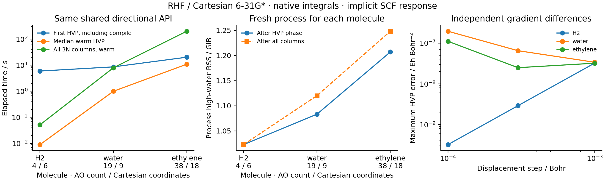

# G06: relaxed Hessian-vector products



H2, water and ethylene use Cartesian 6-31G* and the fixed geometries written
in the script and JSON. These are derivative benchmarks, not optimized
structures. The shared `NativeRHF.response` API computes the directional
derivative of the stationary Pulay gradient, including implicit density
response and native second integral derivatives. It also returns the screened
Fock response; the timings below include that existing API's additional output.
No nuclear ERI Jacobian or Cartesian Hessian is needed for one HVP.

| Molecule | AOs / Cartesian coordinates | First HVP / s | Median warm HVP / s | All Hessian columns, warm / s |
| --- | ---: | ---: | ---: | ---: |
| H2 | 4 / 6 | 5.930 | 0.009 | 0.052 |
| Water | 19 / 9 | 8.561 | 0.995 | 7.901 |
| Ethylene | 38 / 18 | 20.086 | 10.837 | 198.649 |

Each molecule runs in a fresh process. First-HVP time includes its JIT
compilation, after a separately timed initial SCF/gradient. Warm measurements
repeat the same normalized Cartesian direction five times. The full Hessian
is then assembled by applying the **same** warmed operator to every Cartesian
unit vector. Thus this is the cost of asking for one direction versus all
directions, not a comparison against an independently optimized dense-Hessian
algorithm. Three small systems do not establish an asymptotic scaling law.

Process high-water RSS after the HVP and all-column phases is respectively
1047.35/1047.35 MiB (H2), 1109.27/1146.96 MiB (water), and
1235.98/1278.11 MiB (ethylene). The second reading is cumulative. Both include
Python, JAX, compiled code, native allocations and full AO ERIs. They are not
Hessian-storage measurements and do not establish memory-linear electronic
structure. These small Hessians themselves are tiny compared with the runtime.

Every HVP matches the assembled Hessian action to `1e-8` Eh/Bohr^2, and raw
Hessian symmetry is checked to `2e-6` Eh/Bohr^2. A separate central difference
of reconverged analytic gradients uses seed 31 and steps `1e-3`, `3e-4`,
`1e-4` bohr. Errors at the smallest step are `3.215e-10`, `1.954e-7`, and
`1.108e-7` Eh/Bohr^2. Water/ethylene reach a finite-SCF-precision noise floor:
smaller steps do not uniformly improve the comparison. All step results are
retained in the figure and JSON; none were selected for a favorable trend.

```sh
PYTHONPATH=src python examples/geometry/hf_hessian_vectors.py
python examples/geometry/plot_hessian_vectors.py
```

Measured on `jy_gpu_1` / c20, Intel Xeon Platinum 8457C, CPU float64,
2026-10-15. Python 3.11.15, JAX/JAXlib 0.10.0, NumPy 2.4.4.
`CUDA_VISIBLE_DEVICES=` and `JAX_PLATFORMS=cpu` select CPU;
`JAX_ENABLE_COMPILATION_CACHE=false` prevents disk-cache reuse;
`OMP_NUM_THREADS=OPENBLAS_NUM_THREADS=2` set library thread controls, not a
hard limit on all JAX threads. Other bounded work shared this CPU, so these
are observed wall times rather than dedicated-node performance guarantees.
The output records the source hash of the reused response implementation,
backend, all five warm times, directions and full small validation Hessians.
