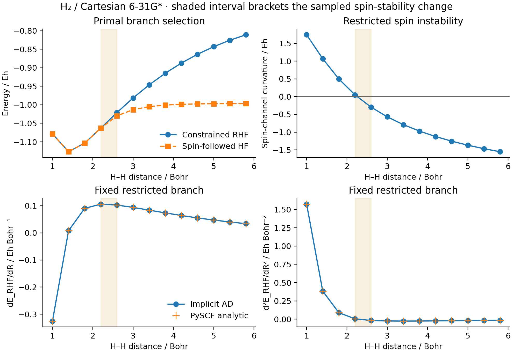

# G07: smooth RHF derivatives and a change of stable spin branch



H2 is stretched from 1.0 to 5.8 bohr in 0.4-bohr steps, using Cartesian
6-31G*. H1 is fixed at the origin; H2 is at `(0,0,R)`. The energy derivative
is therefore the z component of H2's nuclear gradient, and its second
derivative is the corresponding Hessian diagonal. The returned force has the
opposite sign to the first derivative.

The blue energy curve and both derivative panels follow a **fixed restricted
RHF occupation topology**. Each geometry is self-consistent. Cross-geometry
occupied overlaps are checked to prevent a hidden branch discontinuity.
The common stability API separately checks alpha/beta-opposite rotations and
follows a resolved negative mode into an unrestricted solution where needed.
The selected primal energy is plotted separately; this discrete selection is
not inside the differentiated function.

The sampled spin curvature is positive at R=2.2 bohr (`+0.04945` Eh) and
negative at R=2.6 bohr (`-0.29660` Eh). The shaded interval brackets a stability
change; it is not a precise fitted critical distance. Beyond it, restricted
SCF remains a stationary, smooth constrained solution but is unstable to
spin symmetry breaking. Its AD gradient and curvature remain well-defined
within that restricted branch. They must not be relabelled as derivatives of
the lower unrestricted branch. Negative nuclear bond curvature and negative
orbital spin curvature are also distinct quantities.

The spin-following facade is recorded as `UKS` with `xc="hf"`, physically an
unrestricted HF calculation. Its `<S^2>` increases toward 1 on dissociation
(`0.99629311` at 5.8 bohr), rather than the pure-singlet value 0. Lower UHF
energy does not restore spin purity. The JSON retains these diagnostics and
the branch-following status/restart count.

Independent PySCF RHF analytic gradients and Hessians agree to maximum
`7.258e-13` Eh/Bohr and `1.253e-13` Eh/Bohr^2. The independent UHF calculation
starts from its own alpha/beta-opposite orbital rotation; selected energies
agree within `2e-8` Eh. Central differences at `1e-3` and `3e-4` bohr validate
the native energy/gradient chain as well. All results, including overlaps,
finite-difference errors and spin diagnostics, are saved point by point.

```sh
PYTHONPATH=src python examples/geometry/h2_response_surface.py
python examples/geometry/compare_h2_surface_pyscf.py
python examples/geometry/plot_h2_surface.py
```

Measured on `jy_gpu_1` / c20, Intel Xeon Platinum 8457C, CPU float64,
2026-10-15: native workflow 142.38 s including compilation, independent
PySCF reference 1.80 s. These scopes differ: native includes all branch,
overlap and multistep AD checks; this is not an isolated timing comparison.
Python 3.11.15, JAX/JAXlib 0.10.0, NumPy 2.4.4, PySCF 2.13.0.
The remote command uses CPU only, disabled persistent JAX compilation cache,
and `OMP_NUM_THREADS=OPENBLAS_NUM_THREADS=2`.

Native energy/density/orbital-gradient tolerances are `1e-12`, `1e-11`,
`1e-10`, and the implicit response tolerance is `1e-10`. PySCF RHF uses
energy `1e-13` and orbital gradient `1e-11`; UHF uses `1e-13`/`1e-10`.
The stability test uses the existing spin-rotation convention; only its sign
and the resolved eigenvalue enter the branch decision.
