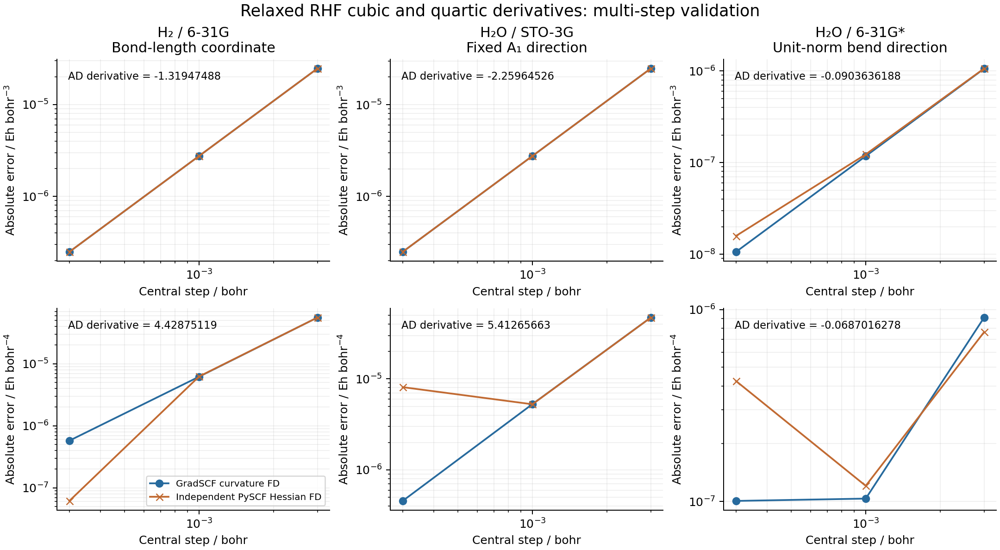
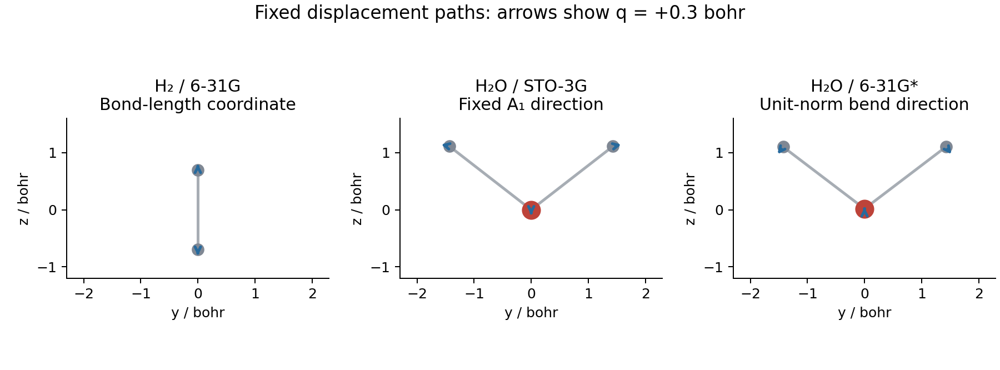

# G08 — relaxed molecular cubic and quartic derivatives

This example differentiates the RHF energy along the fixed path
`R(q) = R0 + q v`. Native overlap, kinetic, nuclear-attraction and full Coulomb
ERIs move with every basis center and nucleus. The shared orbital optimizer
relaxes the electronic state at each geometry, and its implicit response stays
in all derivative orders. The example contains no SCF or response solver.

The first energy derivative uses reverse AD; three nested JVPs give the fourth
derivative. The native third/fourth integral products apply exact Gaussian
center raising/lowering to the existing second-derivative kernels. Primitive
exponent weights, original Cartesian normalization, all AO legs, and each
nuclear potential center are retained. Finite differences occur only in the
validation code; the AD implementation evaluates no displaced integrals.

Results below were measured on **jy_gpu_1, 2026-10-16**, CPU float64 with
OMP/BLAS thread settings of two. These settings do not cap every JAX runtime
thread. All quantities are derivatives, without factorial denominators.
For a Taylor expansion, use `E0 + E1 q + E2 q²/2 + E3 q³/6 + E4 q⁴/24`.

| Case and coordinate | E1 / Eh Bohr⁻¹ | E2 / Eh Bohr⁻² | E3 / Eh Bohr⁻³ | E4 / Eh Bohr⁻⁴ |
|---|---:|---:|---:|---:|
| H₂/6-31G, bond-length change, R0 = 1.4 Bohr | 0.008177759272 | 0.383548013705 | −1.319474877751 | 4.428751185659 |
| H₂O/STO-3G, fixed unit-norm A1 direction | −0.058958185110 | 0.945432164657 | −2.259645261691 | 5.412656625653 |
| H₂O/6-31G*, unit-norm bend at the saved RHF minimum | 4.1074e−8 | 0.136647445237 | −0.090363618759 | −0.068701627807 |

**The water bend has a negative quartic derivative. Its Taylor polynomial is
not a globally bounded vibrational potential.** These results establish local
directional derivatives, not a full anharmonic model, VPT2 calculation, or
vibrational spectrum. The H₂ and STO-3G smoke geometries are not nuclear minima.
The 6-31G* water calculation reuses the geometry and lowest H₂O mode from
[G05](../G05_water_rhf_hessian/gradscf.json); its small nonzero E1 is retained.
The mode is rescaled to unit Euclidean Cartesian norm. The original
mass-normalized direction and `dq/dQ` are saved in the case JSON, so these
Bohr-coordinate derivatives are not mislabeled as mass-normalized derivatives.

At the three centers, actual orbital gradient norms are 4.58e−16, 3.60e−15 and
2.49e−14. Public dense internal RHF stability checks give positive lowest
curvatures 2.5291, 2.0929 and 1.4731. Density derivative norms are 0.2703, 0.4776
and 0.3010: the electronic response is not frozen. These are restricted internal
stability checks, not a search over other electronic branches.

The independent reference script imports PySCF, reconstructs every geometry,
reconverges RHF, and computes its analytic relaxed Hessian. Central differences
of the projected curvature give the independent cubic/quartic reference.
PySCF does not supply analytic third/fourth derivatives in this comparison.
SCF energy/gradient tolerances are 1e−13/1e−11; actual PySCF orbital gradient
norms must be below 1e−10, and CPHF tolerance is 1e−12. The native implicit
response tolerance is 1e−10. Both native and PySCF curvature checks use
steps 3e−3, 1e−3 and 3e−4 Bohr.

| Case | Native curvature FD E3 error | Native curvature FD E4 error | PySCF Hessian FD E3 error | PySCF Hessian FD E4 error |
|---|---:|---:|---:|---:|
| H₂/6-31G | 2.478e−7 | 5.760e−7 | 2.478e−7 | 6.155e−8 |
| H₂O/STO-3G | 2.481e−7 | 4.561e−7 | 2.483e−7 | 8.113e−6 |
| H₂O/6-31G* bend | 1.061e−8 | 1.006e−7 | 1.585e−8 | 4.244e−7 |

The table uses the smallest step and the corresponding derivative units.
The JSON and [CSV](derivative_checks.csv) retain every step. Quartic references
divide curvature noise by `h²`; the smallest step need not be the most accurate.
For example, the STO-3G PySCF quartic error is 5.260e−6 at h=1e−3 and grows to
8.113e−6 at h=3e−4. No step or unfavorable result was removed.




Run the ordinary Python scripts from the repository root after building the
native library. The explicit `run(case)` calls select stages; there is no CLI
or configuration framework. Stages do not silently reuse a prior result.

```sh
export CUDA_VISIBLE_DEVICES= JAX_PLATFORMS=cpu JAX_ENABLE_X64=1
export JAX_ENABLE_COMPILATION_CACHE=false OMP_NUM_THREADS=2 OPENBLAS_NUM_THREADS=2
export PYTHONPATH=src
python examples/geometry/molecular_cubic_quartic.py
python examples/geometry/compare_molecular_cubic_quartic_pyscf.py
python -c 'from examples.geometry.molecular_cubic_quartic import run; run("water_sto3g")'
python -c 'from examples.geometry.compare_molecular_cubic_quartic_pyscf import run; run("water_sto3g")'
python -c 'from examples.geometry.molecular_cubic_quartic import run; run("water_631gstar")'
python -c 'from examples.geometry.compare_molecular_cubic_quartic_pyscf import run; run("water_631gstar")'
python examples/geometry/plot_molecular_cubic_quartic.py
```

The measured Python was `/home/yjiao/opt/miniconda3/envs/jax_scf/bin/python` on
an Intel Xeon Platinum 8457C. Python 3.11.15, JAX/jaxlib 0.10.0, NumPy 2.4.4,
and PySCF 2.13.0 are recorded in [environment.json](environment.json).
The native build was offline with two build workers and the existing PySCF
LP64 OpenBLAS library; no vendor source was modified or dependency installed:

```sh
export LD_LIBRARY_PATH=/home/yjiao/opt/miniconda3/envs/jax_scf/lib/python3.11/site-packages/pyscf/lib
python -m gradscf.integrals._native.build --build-dir artifacts/native_build --jobs 2 \
  --blas-library "$LD_LIBRARY_PATH/libopenblas-r0-f650aae0.3.3.so"
```

Native library SHA256 is
`8176ca97f9758ba3810b727c5a2e90572ac4f8f205e4a16e0d7a7177221b1829`.
The isolated snapshot is
`jy_gpu_1:/home/yjiao/gradscf_checks/ad-showcase-native-higher-20261016`.
Its source came from the frozen X09 snapshot plus the listed G08 changes,
on base commit `8f8c93d25fcc150aace9ad5c6a8e070c4f2937af` with uncommitted
development changes. [source_sha256.txt](source_sha256.txt) records the actual
source and binary; [example_test_sha256.txt](example_test_sha256.txt) records
the scripts, tests and reused G05 input. Earlier M1/M2/X09 snapshots were not
rebuilt or overwritten.

Verification on that snapshot:

- 26 native higher-geometry tests passed in 307.66 s. They cover s/p/d shells,
  multiple primitives/contractions, independent AO and nuclear coordinates,
  mixed derivative permutations, nonlinear cotangents, all multilinear
  transpose slots, rigid translation, live zero directions and explicit
  fifth-order rejection.
- 54 existing geometry/Hessian/mixed-force tests passed in 57.41 s.
- Three `field=None` tests passed in 79.58 s: no-field/explicit-zero
  energy/gradient/HVP parity, real field dipole/polarizability response, and
  a complete H₂ cubic derivative. `None` statically omits unused dipole
  integrals; an explicit zero field remains differentiable.
- The complete H₂ cubic/quartic molecular regression passed in 45.18 s.

The s/p and d overlap/kinetic integral checks use existing JAX-reference AD.
For d nuclear attraction/ERI, direct PySCF integral mixed differences at
h=.03/.015/.0075 show approximately quadratic error reduction. Richardson
extrapolation gives full-tensor errors at most 1.30e−7/2.35e−7, below the
unchanged 3e−6 gate. This avoids the excessive compilation cost of fourth-order
Hermite-AD d-shell reference graphs. The original reference host-index error,
the deliberately terminated d nuclear compilation, and the incomplete dddd
reference attempt are preserved in the raw logs; none is labeled a successful
comparison. The final 26-test suite is complete.

Raw logs live in the ignored local directory
`artifacts/ad_showcase/development/G08_native_higher/` and the remote snapshot's `artifacts/`.
Each subsequent staged calculation has a remote exit-code file. The H₂ SSH
session reset after calculation; its complete JSON and independent reference
were verified through a fresh connection. First-call timings include compilation
and are saved separately for each derivative order. Water/6-31G* orders 0–4
took 7.79, 8.82, 13.03, 21.79 and 39.87 s; these are not a matched performance
benchmark against the independent reference.

Validated scope is CPU float64, Cartesian fixed-basis S/T/nuclear/full-Coulomb
geometry derivatives through order four and these relaxed RHF examples.
Higher spherical/dipole, range-separated ERI, mixed basis-parameter derivatives,
ECP/RI, GPU, fifth-order or `jax.experimental.jet` support is not established.
The implementation bounds original angular momentum at l≤10 for its shadow
workspace; numerical higher-order coverage here is s/p/d only.
