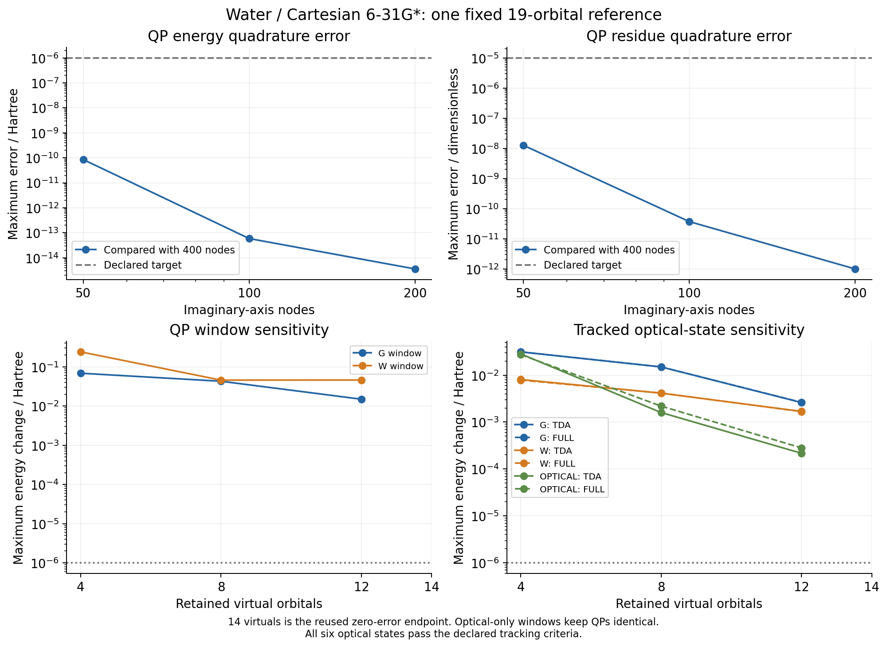
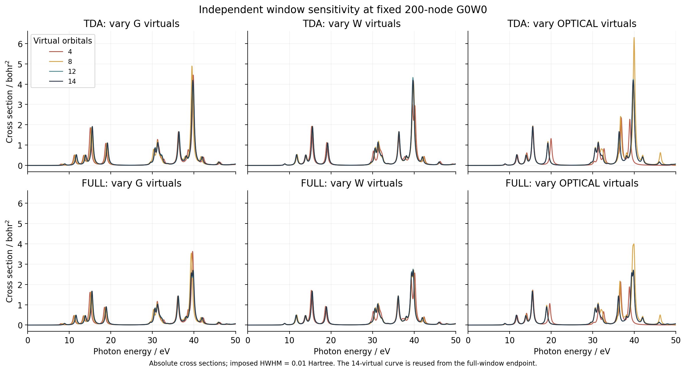
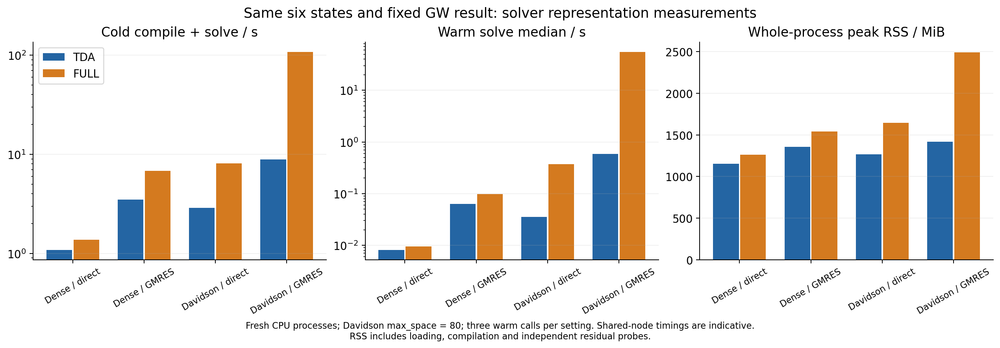

# Fixed-reference water GW/BSE forward checks

The G0W0 quadrature, independent window-sensitivity and BSE representation
checks completed on `jy_gpu_1` CPU on 2026-10-16. The same 19-orbital RHF
reference is reused throughout. All requested numerical solves converged;
smaller orbital windows nevertheless miss the declared approximation targets.
Dense/direct is the fastest and lowest whole-process-RSS choice measured for
this small molecule. Matrix-free capability is not a speedup claim.

## One physical reference

The geometry is the accepted [X02 water reference](../X02_water_gw_bse_response/README.md):
O(0,0,0), H(0,1.43,1.11), H(0,-1.43,1.11) bohr, RHF, Cartesian 6-31G*.
There are 5 occupied and 14 virtual orbitals. Native packed AO integrals are
factorized using the same symmetric pair square root and cutoff `1e-12` as
the geometry adapter: 190 stored factor directions, retained rank 165.
No auxiliary fitting basis or geometry optimization is introduced.

The one frozen [reference NPZ](reference.npz) supplies canonical orbitals,
integrals, factors and dipoles. Its SHA256 is
`851820ced312678a13efb99a8f5f6713a6946a7fadecc42251d496b808db3181`.
The new baseline agrees with X02 by at most `5.53e-12 Eh` for QP energies,
`5.43e-10` for Z, `8.11e-12 Eh` for optical energies and `1.49e-10` for
oscillator strengths; all original baseline gates pass
([record](baseline_comparison.json)).

The finite-eta CD equation uses `eta=1e-5 Eh`, Newton tolerance `1e-11 Eh`,
all 19 target QP levels and the recorded native branch anchors. Default
G/W/optical windows are complete within this basis. Optical spectra contain
all transitions of each selected space, on the same 0--50 eV, 1000-point grid,
with imposed HWHM `0.01 Eh`. This is a local anchored root calculation, not
a proof of global main-peak identity. Positive residues alone are insufficient
to certify such identity.

## Imaginary-axis quadrature

Only the number of imaginary-frequency nodes changes. These are separate
fresh processes; the 200-node calculation is the already checked baseline.

| Nodes compared with 400 | Maximum QP energy change / Eh | Maximum Z change | Maximum full-BSE energy change / Eh |
| ---: | ---: | ---: | ---: |
| 50 | 8.56e-11 | 1.27e-8 | 1.04e-10 |
| 100 | 5.86e-14 | 3.72e-11 | 5.73e-14 |
| 200 | 3.55e-15 | 9.95e-13 | 2.84e-14 |

The preregistered 200-to-400 gates are energies `1e-6 Eh`, Z/strength `1e-5`,
static polarizability `1e-4 bohr^3`, and common-grid spectral relative L1
`1e-4`. Every gate passes ([full comparison](quadrature_comparison.json)).
The near-roundoff changes at the finer grids do not measure basis error,
method error, experimental accuracy or a general quadrature guarantee.
No MolGW graphical-frequency scan was repeated for this test.

## Independent orbital windows

G virtuals, W virtuals and optical virtuals vary separately through 4, 8, 12
and 14; all 5 occupied orbitals and all 19 target QP levels remain included.
G/W roots are initialized successively from the converged 14→12→8→4 points.
Optical-only truncation reuses the exact saved full-window GW result. The
14-virtual endpoint is the same baseline, not three redundant calculations.

The six lowest optical states are matched in the fixed orthonormal MO frame
using the shared transition-density tracker: overlap at least 0.85,
best/runner-up margin at least 0.20, gap at least `1e-4 Eh`, with duplicate
matches rejected. All six states pass these criteria in the recorded cases.
These transition-density matches are not many-electron wavefunction overlaps.

| Only this window has 12 virtuals | Maximum QP error / Eh | Maximum tracked full-BSE error / Eh | Full-spectrum relative L1 error |
| --- | ---: | ---: | ---: |
| G | 0.0149048 | 0.0026330 | 0.078924 |
| W | 0.0459666 | 0.0016764 | 0.039047 |
| Optical | exactly 0 | 0.0002822 | 0.012759 |

None of the 4/8/12-virtual truncations reaches all the declared energy,
residue, strength, polarizability and spectral targets. This rejects those
truncations at the stated accuracy; it is not a solver failure or a statement
about every possible application tolerance. The QP comparisons concern local
anchored solutions of different truncated self-energies. Their substantial
Z changes must not be presented as a global root-selection certificate.
[Detailed matches and errors](window_comparison.json) retain each point.
Full 14-virtual space is only the endpoint of this fixed Gaussian basis;
there is no basis-convergence claim.

## Dense and matrix-free representations

These eight cases reuse the identical saved G0W0 result and compare the same
six isolated TDA or full-BSE states. Davidson requests `max_space=80`, capped
by the 70-dimensional transition space; the API default of 40 is not measured
here. BSE tolerance is `1e-10 Eh`. Screening uses rtol `1e-11`, atol `1e-13`,
GMRES restart 40 and maxiter 100. The common vector-response setting remains
enabled, with bounded direct response capacity 256.

Every comparison passes. Maximum differences are `3.55e-15 Eh` in energies
and `7.91e-14` in strengths. Independently reapplied original A/B equations
give residuals at most `8.11e-12 Eh`. Six named diagonal/transition-pair
screening probes have relative physical residuals at most `4.40e-14`.
The iterative full-BSE stability flag remains a converged Ritz diagnostic,
not the global certificate provided by the dense path.

| BSE / screening | TDA cold / s | TDA warm median / s | Full cold / s | Full warm median / s |
| --- | ---: | ---: | ---: | ---: |
| Dense / direct | 1.084 | 0.00812 | 1.374 | 0.00957 |
| Dense / GMRES | 3.507 | 0.06328 | 6.827 | 0.09788 |
| Davidson / direct | 2.893 | 0.03526 | 8.091 | 0.36941 |
| Davidson / GMRES | 8.840 | 0.58508 | 107.661 | 55.05541 |

Each fresh process compiles once and makes three warm calls to that compiled
executable. Converting its energy output to NumPy synchronizes the timed call.
There is no repeated SCF, GW calculation or Python recompilation in warm time.
The full Davidson/GMRES cost is therefore not solely a first-compilation cost.
Whole-process RSS ranges from 1,179,888 to 2,548,096 KiB. Full-BSE compiled
temporary buffers are about 13.5 MB for dense/direct, 149 MB for
Davidson/direct and 126 MB for Davidson/GMRES. TDA's iterative temporary
buffers are smaller, but its whole-process RSS is still larger in this case.

These are shared-node CPU measurements, not exclusive-hardware or asymptotic
scaling claims. RSS includes imports, compilation and independent residual
probes. Three warm samples per configuration do not establish a universal
performance ranking. [Exact errors, times and memory](representation_comparison.json)
and [per-case records](representations/) are retained.

## Bounded read-only cost decomposition

One additional CPU job used `jax.block_until_ready` on the entire returned
pytree, with the same reference, roots, tolerances and space-80 configuration.
It took 247.00 s wall time, 488.97 s user CPU and 19.42 s system CPU, within
the declared ten-minute budget. No core implementation changed during it.

| Existing-function stage | Warm time / s |
| --- | ---: |
| Matrix-free screening construction | 0.000577 |
| Six physical screening right-hand sides | 0.001802 |
| A/B diagonal construction | 0.028448 |
| A and B applied to six columns | 0.085140 |
| Full solve with energy-only response contract | 4.759799 |
| Full solve with vector-response contract, complete-result synchronization | 54.838022 |

The last timing agrees with the previous 55.0554 s energy-output-synchronized
measurement. The energy-only and vector-response calls produce exactly equal
forward energies and oscillator strengths in this diagnostic. Their AD
contracts differ: energy-only is not a substitute for differentiating vector
properties.

Source inspection identifies the extra primal work in
`solvers/eigen/structured_rpa.py::_attach_response`: it forms a zero-primal
correction through a metric-gauge response solve for each state. The default
direct response materializes the 140-dimensional operator, whose actions
contain GMRES screening. This is consistent with the roughly 50 s difference;
the full iterative solve itself still costs about 4.76 s in the control.
Separately compiled stage times are not an additive accounting of every
iteration. The current `LinearResult` and `RPAResult` do not expose iteration
counts, and the GMRES wrapper discards its info field; no counts are inferred.

The [complete decomposition](performance_breakdown.json),
[executed diagnostic](../../../artifacts/ad_showcase/provenance/GW_BSE_forward_gates/executed/performance_breakdown.py) and
[resource report](../../../artifacts/ad_showcase/provenance/GW_BSE_forward_gates/validation/performance-breakdown.resources) retain the
measured values and first-order scope. These are baseline measurements, not
evidence that a later lazy-response optimization has already been implemented.

## Examples and provenance

- [Prepare and run forward points](../../../examples/gw/water_forward_convergence.py).
- [Fixed-QP solver comparison](../../../examples/gw/water_bse_solver_comparison.py).
- [Independent saved-data checks](../../../examples/gw/compare_water_forward_convergence.py).
- [Saved-data figures](../../../examples/gw/plot_water_forward_convergence.py).

Use `PYTHONPATH=src:examples/gw` from the repository root. Prepare once, then
call `run(nw)` for each quadrature point. Window calls are
`run(200, window="g", count=12)` and analogous calls for W/optical, descending
through 12, 8 and 4. Each solver representation uses its own process calling
`water_bse_solver_comparison.run(tda=..., solver=..., screening=...)`.
The example files contain no CLI parser or alternative electronic solver.

The frozen remote snapshot is
`/home/yjiao/gradscf_checks/ad-showcase-water-forward-gates-20261016`.
It derives from the matched 8176 native source plus the separately validated
[BSE closure fix](../GW_BSE_response_gates/validation/nested_jit/README.md).
No core code changed during these forward checks. Source/runtime/file hashes
are in [manifest.json](manifest.json), exact executed sources in [executed/](../../../artifacts/ad_showcase/provenance/GW_BSE_forward_gates/executed),
and job commands, exits and resource reports in [validation/](validation/).
Measured-output comments were appended to the public examples after execution;
all four numerical ASTs match their archived executed versions exactly
([delivery hashes](delivery.json)).

The first preparation attempt accessed the intentionally empty full-ERI
placeholder instead of the public native `eri_pair_matrix` field. That
example-only setup failure and its original script are preserved; the
corrected baseline and every numerical point passed. Separate quadrature
and window-stage source versions are recorded without relabelling old runs.

This acceptance group covers G0W0 in the stated finite basis. Earlier evGW0/
evGW comparisons and geometry responses are separate evidence; they are not
promoted to quadrature/window convergence by these G0W0 results. Full-source
integration, broader bases and other physical regimes remain separate checks.
