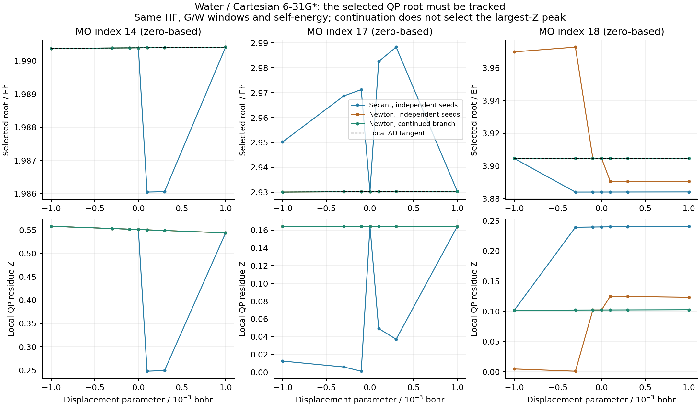

# Molecular GW/BSE response gates and root identity

These records separate a locally differentiable QP equation from an algorithm
that selects the same root at neighboring geometries. They do not establish
a completed GW/BSE showcase or differentiability of a global largest-weight
selector. The bounded host-only eta=0 seed selector described below is now
available; the finite-eta equation and geometric branch still need checking.
All numerical work and figures run on `jy_gpu_1`, CPU float64.



[Derivative convergence](qp_derivative_checks.png), [root table](qp_branches.csv)
and [derivative table](qp_derivative_checks.csv) retain the raw, unscaled values.

## Verified prerequisites

- The old traceable AO-pair spectral factors gave NaN J/K derivatives at
  repeated auxiliary eigenvalues (four failing tests). Full-shape factors now
  use the principal matrix square root and the shared matrix-function Frechet
  derivative. Six factor/matrix-function tests passed in 11.53 s, including
  water ERI/J-K reconstruction. The cutoff must stay separated from the
  active spectrum; no higher derivative at a degenerate cutoff is promised.
- The QP implicit rule now supplies JVP directly and VJP by transposition,
  retaining the same shared numerical root iteration and invalid-root checks.
  The initial three forward-JVP tests failed with the old custom VJP. The
  first combined root-method regression passed 25 tests in 118.19 s.
- H2/STO-3G complete nuclear response passed six tests in 186.01 s: G0W0,
  evGW0 and evGW QP energies/residues/W, plus TDA and full-BSE excitation and
  optical response, with JVP/VJP, reconverged differences and facade parity.
- A subsequent mixed group passed 15 tests and rejected an unconverged
  artificial complex-vertex fixture. The fixture was moved away from its G
  pole and its forward convergence checked before differentiating. With the
  explicit-seed extension, all 20 QP JVP/legacy tests passed in 53.15 s.
- Explicit QP tolerances preserve the old `1e-6` default while allowing the
  geometry adapter to request `1e-11 Eh`. The subsequent root/precision/
  molecular group passed 27 tests in 246.69 s. A later seven-case molecular
  group including native pole seeds passed in 197.36 s.

The [validation logs](validation/) retain the actual successive groups and
their failures. The file counts above are not additive independent coverage.

These are focused groups at successive recorded source states. Counts are
not a deduplicated whole-suite result. The frozen original integration source,
new `ad-showcase-gw-response-20261016` workspace and independent MolGW build
remain distinct.

## Water: a failed comparison using independently selected roots

The system is Cartesian 6-31G* water at `(0,0,0)`, `(0,1.43,1.11)` and
`(0,-1.43,1.11)` bohr. All 19 orbitals enter QP/G/W, with 5 occupied orbitals,
100 imaginary-axis points and real-frequency broadening `1e-5 Eh`.
The direction is the centered, normalized Gaussian sample from seed
`20261016`; its three central-difference steps are `1e-3`, `3e-4`, `1e-4` bohr.
No orbital window or tolerance was relaxed.

Independent secant starts at displaced geometries selected different local
roots for high virtual indices 14, 17 and 18. At `h=1e-4` bohr, the maximum
QP energy derivative discrepancy was `56.207 Eh/bohr`, while the HF/W0
spectrum discrepancy decreased to `7.29e-9 Eh/bohr`. HF orbital and BSE
transition-density overlap checks passed. The complete TDA geometry test was
rejected; it is not an accepted optical-response result.

AD-Newton from independent mean-field seeds improved indices 14 and 17, but
index 18 still switched branches. This is not repaired merely by obtaining a
smaller root residual. Several solutions of the same Dyson equation can have
small residuals and substantially different local spectral residues.

## Conditional continuation

An explicit `qp_initial` spectrum now seeds restricted nonlinear G0W0 without
changing its mean-field base, G or W. The batch root interface calls this
`initial_guess`. For `f(omega, R)=0`,

```
d omega / dR = - f_R / f_omega.
```

The initial-guess tangent is zero in this implicit response. The caller must
still verify convergence and root identity. An explicit seed does not choose
the largest-Z root or define a derivative across a discrete branch change.

Starting neighboring water calculations from the center geometry's Newton
roots produced smooth local branches over the tested steps. The maximum QP
energy derivative error at `h=1e-4` is `3.86e-7 Eh/bohr`; smaller subsets of
low-energy roots converge more tightly. Some followed roots have small Z and
are not the roots chosen by MolGW's largest-Z graphical selector. The full
BSE/residue derivative chain on these continued branches is checked separately.

The branch JSON records retain all 19 QP energies, W0 energies, Z factors,
Dyson residuals and convergence masks at every displacement. Their `sources`
fields identify selected executed files, not a complete source-tree hash.
The independent [MolGW build and comparisons](../MolGW_reference_build/README.md)
record graphical-grid precision and candidate-root selection separately.

## Full-BSE response: keep the shared linear solver explicit

The stable full-BSE reduction differentiates its Hermitian squared-frequency
problem. For a normalized isolated eigenvector `u`, its tangent solves a
projected equation of the form

```
[(M - lambda I) + u u^T] du = -(I - u u^T) dM u.
```

The six water response systems have measured condition numbers of about
3,463–30,233. Default restarted GMRES with restart 20 did not satisfy the
true-residual gate for two roots: the maximum unresolved residual was
`2.79e-4`. The energy tangents were finite but amplitude tangents were invalid.
Restart 70 and the existing bounded direct solver solved the same equations;
direct residuals were approximately `1e-16`. No tolerance was relaxed.

`BSEConfig.response_config` now forwards a shared `LinearSolverConfig` to the
TDA/full-BSE response. The underlying `solve_stable_rpa` and `solve_rpa`
interfaces accept the same option. The example explicitly chooses direct
response with `max_dense=256`; the general defaults remain unchanged. The
capacity is the actual response matrix dimension: N for dense RPA/TDA and
2N for the structured metric path. This is a small-system choice, not a
scaling prescription. Ten new configuration/physics tests passed in 93.54 s,
and six fresh-process existing groups passed 52 tests in total. Their exact
commands/results are in `validation/rpa-existing-regressions.json`.

The earlier local water branch passed complete TDA and full-BSE directional
checks after root precision refinement. Its largest error at `h=3e-5 bohr`
was `3.61e-6 /bohr` in the QP residue; full-BSE excitation/strength errors
were `3.59e-10 Eh/bohr` and `1.68e-9 /bohr`. Some high virtual roots on this
branch remain satellites. They are stored separately from the main-peak data.

## Native main-peak starting points

`gradscf.gw.branches.pole_seeds` builds the eta=0 arrowhead representation
from the existing native RHF/direct-RPA pole model. The shared dense Hermitian
solver supplies complete spectral projectors. Degenerate energy groups are
ranked by their summed central projection; a usable seed must be a separated
singleton with a positive weight gap and a nonzero bath-pole separation.
Ambiguous groups produce an invalid seed rather than an arbitrary eigenvector.
Dense capacity is checked before allocation, and JIT/AD tracing is rejected.

The finite-eta contour-deformation solver then refines these numerical seeds
and recomputes the actual residues. This does not differentiate the selector
and does not prove global maximum weight at finite eta. The initial guess
does not enter the implicit derivative of the accepted local root.

The [water primary calculation](../X02_water_gw_bse_response/primary/nw200/native.json)
retains all 19 orbitals and 70 optical states. Its largest actual QP residual
is `6.25e-16 Eh`. Complete TDA/full-BSE geometry checks on that branch pass
the original error gate at `h=1e-5 bohr`; the residue derivative error is
`3.34e-6 /bohr` and optical energy/strength errors are below `2e-9` in their
respective units. The earlier `3e-5`-step failure is retained, and its error
decreases quadratically as the step is reduced.

The first independent MolGW comparison passes QP energies, all optical
energies/strengths, static polarizability and cross sections. Its original
`5e-6 Eh` graphical step gives residue error `1.65e-4`, failing the original
`5e-5` gate. A separate `1e-6` run still fails at `6.39e-5`. The actual final
4,000,001-point run (`5e-7 Eh` spacing, same frequency interval and eta)
passes at `3.53e-5`. The QP energy difference is `3.12e-8 Eh`.

The final comparison explicitly uses that fine **QP-only** reference and the
original all-70-state optical reference in separate directories. No fine-grid
BSE rerun is implied. All original gates pass in
[comparison_refined.json](../X02_water_gw_bse_response/primary/nw200/comparison_refined.json);
the failed coarse comparisons remain separately retained. MolGW's adjacent-grid
slopes were also reconstructed from its own saved poles/residues, independently
of GradSCF, to explain their sign-changing grid error. That diagnostic did not
replace the actual final MolGW run or the independent acceptance gate.

## Outer self-consistency: convergence and branch identity are separate

For water with all 19 QP levels, fixed-point mixing at damping 0.3 did not
converge even after 600 steps. Greater damping can converge at the central
geometry while a displaced or composite GW/BSE call still fails. These runs
remain rejected; no QP window or residual threshold was reduced.

The existing shared nonlinear DIIS solver converged the same residual at
seven sampled geometries in roughly 20–91 iterations. It nevertheless found
different local roots: two central damping choices differed by `0.0829 Eh`
in a high virtual level. A small residual therefore cannot replace root
tracking in an outer self-consistent calculation either.

The array drivers now expose optional `diis_space` and `initial_guess`.
DIIS defaults to disabled; initial energies default to MF. Explicit seeds
initialize only requested levels, retain the original physical MF base/G/W
definitions, and have zero implicit tangent. The shared solver supplies
both the iteration and implicit response. No GW-specific DIIS was added.

Eight focused DIIS tests passed in 191.66 s after correcting an initial test
that incorrectly expected an unimplemented UGW residue output. Restricted
tests include Z; unrestricted tests cover the actual energies/W contract.
The seed extension then passed the complete affected outer-response group:
35 tests in 413.23 s, including the existing method tests. These are overlapping
groups, not counts to add together.

Water evGW0 -> TDA now passes the full all-orbital geometry gate with local
central-root continuation, shared DIIS space 8, damping 0.3, maximum 200 steps
and the unchanged `1e-10 Eh` outer residual tolerance. At `h=1e-5 bohr`,
maximum energy/residue errors are `5.75e-7 Eh/bohr` and `2.62e-6 /bohr`;
optical energy/strength errors are `3.85e-7 Eh/bohr` and `2.16e-7 /bohr`.
The smallest steps show a finite-convergence noise floor, so these errors
must not be described as monotonically quadratic. The separate full-BSE
evGW0 job also passed, with optical energy/strength errors `3.94e-7` and
`1.64e-7` in the same units.

Updated-W evGW now passes both TDA and full BSE on an explicitly continued
native center. Their final energy/residue errors are at most
`3.71e-8 Eh/bohr` and `1.26e-6 /bohr`; optical energy and strength errors
are at most `1.54e-8 Eh/bohr` and `1.91e-8 /bohr`. Both exit codes are zero;
the records and full five-step comparisons are in
[the water report](../X02_water_gw_bse_response/README.md#self-consistent-qp-spectra-and-complete-local-response).

The original MF-initialized evGW run failed with an OpenBLAS memory-region
error. Staged diagnostics retain a failed two-thread initialization and a
successful one-thread native center. Seeding that center made both final
two-BLAS-thread response runs pass; it does not repair or dismiss the
initial runtime failure. No affinity or system configuration was changed.
