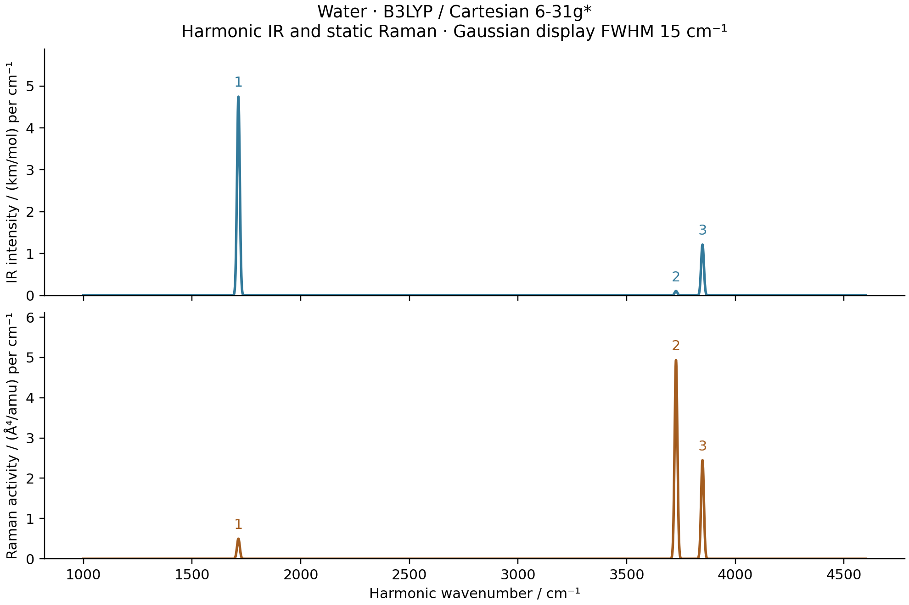

# M2: water B3LYP geometry, harmonic modes and IR/Raman

The complete optimization, AD Hessian, IR/Raman and independent comparisons
passed on 2026-10-15.

The calculation uses **B3LYP with VWN-RPA correlation**, Cartesian 6-31G*
and the level-3 moving molecular grid. The separate PySCF reference uses
`b3lypg` to make this convention independent of site configuration. No
dispersion correction is added to this B3LYP case.



| Mode | IR / km mol^-1 | Raman / Angstrom^4 amu^-1 | Depolarization |
| --- | ---: | ---: | ---: |
| Bend | 75.78589 | 7.97184 | 0.547123 |
| Symmetric stretch | 1.69215 | 78.84768 | 0.181973 |
| Antisymmetric stretch | 19.38562 | 39.08407 | 0.750000 |

## Optimized geometry and harmonic modes

| Quantity | Measured value |
| --- | ---: |
| Energy / Hartree | -76.40895384515667 |
| O–H bond length / bohr | 1.830645655695 |
| H–O–H angle / degree | 103.6513320486 |
| Maximum gradient / (Hartree/bohr) | 6.0505e-9 |
| BFGS iterations / objective evaluations | 8 / 9 |
| Independent PySCF gradient difference / (Hartree/bohr) | 2.0098e-13 |
| Optimization, excluding seed SCF / seconds | 417.476 |
| Nine AD Hessian columns including HVP compilation / seconds | 649.131 |

| Mode | H2O / cm^-1 | D2O / cm^-1 |
| --- | ---: | ---: |
| Bend | 1713.059491 | 1253.504092 |
| Symmetric stretch | 3727.047499 | 2687.308562 |
| Antisymmetric stretch | 3849.025367 | 2819.218544 |

Both isotopes use the same electronic Hessian. Masses are O-16
`15.99491461957`, H-1 `1.00782503223` and H-2 `2.01410177812` amu.
All three projected internal curvatures are positive. Independent frequency
differences are `7.833e-6` cm^-1 for H2O and `5.703e-6` for D2O.

| Hessian comparison | Step / bohr | Maximum error / (Hartree/bohr^2) |
| --- | ---: | ---: |
| AD HVP versus GradSCF gradient differences, normalized seed-13 direction | 1e-3 | 3.500e-7 |
| Same | 3e-4 | 3.152e-8 |
| Same | 1e-4 | 3.592e-9 |
| Full AD Hessian versus independent PySCF gradient differences | 3e-4 | 3.549e-8 |
| Same | 1e-4 | 1.120e-8 |

The raw AD Hessian asymmetry is `2.828e-14` Hartree/bohr squared and its
translation residual is `2.180e-12` Hartree/bohr squared. Its raw rotation
residual is **1.7346e-5 Hartree/bohr**, independently reproduced as
`1.7344e-5` by PySCF. This finite angular-grid effect remains in the saved
raw Hessian. Internal-mode projection does not establish six exact raw
zero modes or quadrature convergence.

The geometry reference took **66.021 seconds** for 37 SCFs. Its largest
actual orbital-gradient norm was `1.394e-11`, below the `1e-10` validation
gate. It uses full-grid analytic gradients (`grid_response=True`) and
central differences for the Hessian, not a PySCF analytic Hessian that
omits parts of grid response.

## IR/Raman validation

| Spectral validation, smaller mode step | Maximum difference |
| --- | ---: |
| AD–GradSCF dipole derivative, atomic normal-coordinate units | 3.986e-10 |
| AD–GradSCF Raman tensor component, same coordinate convention | 2.955e-9 |
| AD–PySCF dipole derivative | 3.986e-10 |
| AD–PySCF Raman tensor component | 1.199e-6 |
| Independent IR intensity / (km/mol) | 4.679e-6 |
| Independent Raman activity / (Angstrom^4/amu) | 1.742e-4 |

The two maximum Cartesian mode steps are `1e-3` and `3e-4` bohr, with
independently relaxed positive and negative displacements. The independent
PySCF polarizability uses an inner field step of `1e-4` au. Its zero-field
initial density is the mean of converged positive and negative z-field
densities, then fully reconverged with the original tolerances. This is a
nested finite-difference reference, not an analytic third derivative. Raw
reference tensors retain finite-field/SCF noise. The AD Raman tensor
symmetry residual is `9.437e-16`.

The complete spectral AD and displacement checks took **1921.625 seconds**,
including compilation and excluding seed SCF. The independent spectral
reference took **126.340 seconds** for 84 SCF/dipole evaluations, with no
Newton retries and maximum actual orbital-gradient norm `1.420e-11`.

## Calculation and reproduction

This case uses the same three shared scripts and calculation conventions
described in the [PBE0 workflow record](../M2_water_pbe0_spectra/README.md).
Every moving native integral, nuclear term, quadrature point, Becke weight,
AO value and AO gradient is included. The existing orbital optimizer and
implicit response are reused. SciPy BFGS requires a maximum nuclear gradient
below `1e-7` Hartree/bohr. The seed SCF energy/density/orbital thresholds are
`1e-12`/`1e-11`/`1e-10`; orbital minimization and implicit response use
`1e-9` and `1e-10`. The independent SCF uses `1e-13` energy and `1e-11`
orbital thresholds, with its actual final residual checked separately.

The shared spectral function differentiates the stationary total dipole,
retaining implicit density response, then takes normal-mode JVPs of dipole
and polarizability. It generates AD IR/Raman tensors; finite differences
serve only as validation. Normal coordinates use bohr times the square root
of electron mass. The separate PySCF implementation checks both the
derivative tensors and the intensity conversions.

The H2/STO-3G, level-0 B3LYP gate passed before this water calculation:
RFF `3.20123433417`, with errors `1.555e-8`/`1.765e-9` at steps
`3e-4`/`1e-4` bohr, and zero measured difference between stationary and
direct-energy polarizabilities. It is a small preliminary gate, not the
complete water validation.

From the repository root, using the CPU float64 environment in the PBE0
record and `/home/yjiao/opt/miniconda3/envs/jax_scf/bin/python`:

```sh
python -c 'import runpy; runpy.run_path("examples/vibrations/water_hybrid_spectra.py")["run"]("b3lyp")'
python -c 'import runpy; runpy.run_path("examples/vibrations/compare_water_hybrid_pyscf.py")["run"]("b3lyp")'
python -c 'import runpy; runpy.run_path("examples/vibrations/plot_water_hybrid_spectra.py")["run"]("b3lyp")'
```

The ordinary `run(xc)` function runs all stages. It does not automatically
skip completed files. Separate `optimize`, `harmonic` and `spectra` calls
allow explicit bounded jobs or restarting an unfinished stage. Water
production jobs run one method at a time, each limited to 7200 seconds;
independent references are limited to 1200 seconds per invocation.

The frozen snapshot is
`/home/yjiao/gradscf_checks/ad-showcase-hybrid-spectra-20261015`; it predates
the later stationary-value energy change. All numerical work and plotting
are remote on `jy_gpu_1`/`c20`, Intel Xeon Platinum 8457C, CPU float64,
with Python 3.11.15, JAX 0.10.0, NumPy 2.4.4, SciPy 1.17.1, PySCF 2.13.0
and Matplotlib 3.10.9. Persistent compilation caching is disabled. OpenMP
and OpenBLAS thread variables are two, but these do not cap all JAX worker
threads. Timings have distinct scopes and concurrent load; no speed
comparison is claimed.

The basis and grid are finite. Diffuse-basis/grid convergence, anharmonic
corrections and frequency-dependent Raman response are not established.
No empirical frequency scaling is applied. Gaussian FWHM 15 cm^-1 and
animation amplitude/phase are display settings, not lifetimes or thermal
motions. Raman activities exclude laser, temperature and collection factors.

The [frozen source manifest](frozen_source_hashes.sha256) pins selected core files,
XC implementation and actual native shared library. The
[executed example manifest](executed_example_sources.sha256) records the
shared scripts before measured tail comments. Raw logs remain in ignored
`artifacts/ad_showcase/development/M2_hybrid_spectra/`.

Data: [optimized geometry](geometry.json), [AD Hessian](hessian.json),
[independent geometry/Hessian](pyscf_geometry.json), [AD spectrum](gradscf.json),
[independent spectrum](pyscf.json).

Figures: [optimization PNG](optimization.png) / [PDF](optimization.pdf),
[Hessian/isotope PNG](harmonic_checks.png) / [PDF](harmonic_checks.pdf),
[IR/Raman PNG](ir_raman.png) / [PDF](ir_raman.pdf),
[40-frame mode animation](water_modes.gif).

Tables: [optimization](optimization.csv), [isotope frequencies](isotope_frequencies.csv),
[spectral sticks](sticks.csv), [broadened display curves](broadened.csv).
