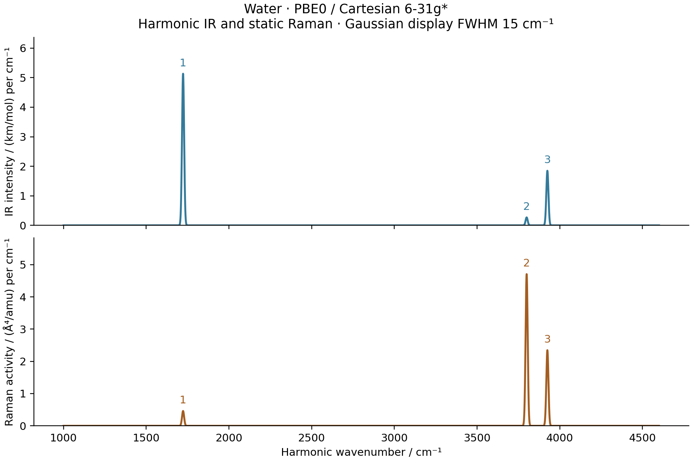

# M2: water PBE0 geometry, harmonic modes and IR/Raman

The complete optimization, AD Hessian, IR/Raman and independent comparisons
passed on 2026-10-15.

The method is PBE0 / Cartesian 6-31G*, with a level-3 moving molecular grid.
All calculations and plotting use `jy_gpu_1` (hostname `c20`), CPU float64.
The initial coordinates are O `(0,0,0)`, H `(0,±1.43,1.11)` bohr. Each hybrid
uses its own optimized geometry; the saved M1 HF/PBE results remain separate.



| Mode | IR / km mol^-1 | Raman / Angstrom^4 amu^-1 | Depolarization |
| --- | ---: | ---: | ---: |
| Bend | 81.96687 | 7.34430 | 0.539282 |
| Symmetric stretch | 4.31035 | 75.21781 | 0.179425 |
| Antisymmetric stretch | 29.53087 | 37.48955 | 0.750000 |

## Geometry and harmonic analysis

| Quantity | Measured value |
| --- | ---: |
| Optimized energy / Hartree | -76.3256740977825 |
| O–H bond length / bohr | 1.822923283782 |
| H–O–H angle / degree | 103.8046526747 |
| Maximum nuclear gradient / (Hartree/bohr) | 5.3163e-9 |
| BFGS iterations / objective evaluations | 7 / 8 |
| Independent PySCF gradient difference / (Hartree/bohr) | 6.0503e-13 |
| Optimization time, excluding seed SCF / seconds | 347.738 |
| Nine AD Hessian columns, including HVP compilation / seconds | 547.807 |

| Mode | H2O / cm^-1 | D2O / cm^-1 |
| --- | ---: | ---: |
| Bend | 1722.625337 | 1260.395299 |
| Symmetric stretch | 3799.703345 | 2739.931253 |
| Antisymmetric stretch | 3925.064132 | 2875.100484 |

Isotopes change only the nuclear masses, using the same electronic Hessian.
The masses are O-16 `15.99491461957`, H-1 `1.00782503223`, and H-2
`2.01410177812` atomic mass units. The three projected internal frequencies
are positive. Maximum frequency differences from the independent PySCF
gradient-FD Hessian are `1.890e-5` cm^-1 for H2O and `1.385e-5` for D2O.

| Hessian validation | Step / bohr | Maximum error / (Hartree/bohr^2) |
| --- | ---: | ---: |
| Mixed-direction AD HVP versus GradSCF gradient differences | 1e-3 | 3.609e-7 |
| Same | 3e-4 | 3.247e-8 |
| Same | 1e-4 | 3.635e-9 |
| Full AD Hessian versus independent PySCF gradient differences | 3e-4 | 3.754e-8 |
| Same | 1e-4 | 5.429e-9 |

The raw AD Hessian asymmetry is `1.837e-14` Hartree/bohr squared, and its
translation residual is `2.090e-12` Hartree/bohr squared. Its raw rotation
residual is **2.4683e-5 Hartree/bohr**, compared with `2.4681e-5` from PySCF.
This finite angular-grid error is retained in the data. Normal-mode analysis
projects the rigid-motion subspace; six exact raw zero modes are not claimed.

## Complete response and independent reference

The shared `MolecularEnergy` adapter moves every native integral, nuclear
term, molecular quadrature point, Becke weight, AO value and AO gradient with
the nuclei. It uses the existing orbital optimizer and implicit response;
the examples contain no independent implementation of these solvers.

The seed SCF uses tolerances `1e-12` Hartree in energy, `1e-11` in density
and `1e-10` in orbital gradient. Orbital minimization uses a `1e-9`
stationarity threshold and implicit response uses `1e-10`. SciPy BFGS
optimizes all nine Cartesian coordinates with a nuclear-gradient threshold
of `1e-7` Hartree/bohr. The Hessian consists of nine JVPs of the complete
AD gradient, not finite differences. A normalized seed-13 Cartesian
direction checks its action against three independently relaxed gradient
differences.

The independent PySCF calculation rebuilds its own Cartesian basis and
matching grid. It uses Treutler-Ahlrichs radial integration, NWChem pruning,
original Becke partitioning and Treutler radii adjustment; density-based
grid pruning and padding are disabled. Every analytic gradient has
`grid_response=True`. Its Hessian is a finite difference of those complete
analytic gradients, not a PySCF analytic Hessian with omitted grid response.

This geometry reference completed 37 SCF calculations in **56.085 seconds**.
Its energy/orbital-gradient tolerances were `1e-13`/`1e-11`; the largest
actual orbital-gradient norm was `1.246e-11`, below the separate `1e-10`
validation gate. Reference Hessians and raw rigid-motion diagnostics are
saved without force-constant corrections.

The shared IR/Raman calculation uses the stationary identity
`mu=sum(Z R)-Tr[D(R,F) r(R)]`, retaining the relaxed density's implicit
response. Polarizability is `dmu/dF`; normal-mode JVPs give `dmu/dQ` and
`dalpha/dQ`. The latter is the mixed third energy derivative. The normal
coordinate uses bohr times the square root of electron mass. All intensity
conversions and the two displaced-response checks are the same functions
used by the validated M1 HF/PBE examples.

With this normal coordinate, IR intensity uses the factor
`N_A*pi*alpha_fs^2*a0/3000` multiplying `|dmu/dQ|^2`. Let
`a=trace(dalpha/dQ)/3` and `gamma_squared=3/2*||dalpha/dQ-a I||_F^2`.
Raman activity uses `(45*a^2+7*gamma_squared)*a0_in_angstrom^4*m_u/m_e`;
the depolarization ratio is `3*gamma_squared/(45*a^2+4*gamma_squared)`.

| Spectral validation, smaller mode step | Maximum difference |
| --- | ---: |
| AD–GradSCF dipole derivative, atomic normal-coordinate units | 3.583e-10 |
| AD–GradSCF Raman tensor component, same coordinate convention | 2.544e-9 |
| AD–PySCF dipole derivative | 3.580e-10 |
| AD–PySCF Raman tensor component | 7.411e-7 |
| Independent IR intensity / (km/mol) | 5.187e-6 |
| Independent Raman activity / (Angstrom^4/amu) | 1.915e-4 |

Both maximum Cartesian mode steps, `1e-3` and `3e-4` bohr, reconverge the
electronic state at positive and negative displacement. The independent
PySCF polarizability additionally uses an inner field step of `1e-4` au.
Its zero-field density is initialized from the mean of converged positive
and negative z-field densities, then reconverged at zero field. This is an
independent nested finite-difference oracle, not an analytic third derivative.
Its raw tensors retain finite-field/SCF noise; they are not symmetrized to
hide it. The AD Raman tensor symmetry residual is `3.289e-15`.

The full spectral AD and displacement checks took **1633.565 seconds**,
including compilation and excluding seed SCF. The independent spectral
reference took **116.948 seconds**, with 84 SCF/dipole evaluations, no Newton
retries, and maximum actual orbital-gradient norm `1.283e-11`. These timing
scopes differ from each other and from the nine-column Hessian calculation.

The PBE0 H2/STO-3G, level-0 mixed-derivative gate passed before the water
run: RFF `3.21894569166`, finite-difference errors `2.697e-8` and `3.097e-9`
at steps `3e-4` and `1e-4` bohr. The stationary polarizability agreed with
direct energy AD. This small gate is recorded separately from the water
results; it is not a replacement for the water validation.

These are finite-basis, finite-grid harmonic predictions. Diffuse-basis
convergence, finer-grid convergence, anharmonic corrections and dynamic
Raman response have not been established. No frequency scaling is used.
The plotted Gaussian FWHM of 15 cm^-1 is a display choice, not a lifetime;
Raman activities exclude laser-frequency, temperature and collection factors.
The normal-mode animation uses an arbitrary display phase and displacements
scaled to 0.25 bohr; these are not thermal amplitudes or physical periods.

## Reproduction and provenance

The three ordinary scripts have a top-level `XC = "pbe0"`. The other supported
choices are `"b3lyp"` and `"wb97xd"`. There is no CLI/configuration framework.

```sh
export CUDA_VISIBLE_DEVICES=
export JAX_PLATFORMS=cpu
export JAX_ENABLE_X64=1
export JAX_ENABLE_COMPILATION_CACHE=false
export OMP_NUM_THREADS=2
export OPENBLAS_NUM_THREADS=2
export PYTHONPATH=src

python examples/vibrations/water_hybrid_spectra.py
python examples/vibrations/compare_water_hybrid_pyscf.py
python examples/vibrations/plot_water_hybrid_spectra.py
```

`run(xc)` always executes all stages. It does not silently skip existing
files. To split bounded jobs or restart an unfinished stage, call the
ordinary `optimize(xc)`, `harmonic(xc)` or `spectra(xc)` function explicitly;
the latter two read `geometry.json` or `hessian.json`. The reference similarly
offers `geometry_reference(xc)` independently of its spectral comparison.
The per-job limits are 7200 seconds for the main workflow and 1200 seconds
for each independent reference invocation.

The frozen snapshot is
`/home/yjiao/gradscf_checks/ad-showcase-hybrid-spectra-20261015`. It copies
the accepted LR/CHG core and adds the molecular-response adapter, the narrow
constant-grid cache fix and the normal-mode helper. It predates the later
`stationary_value` changes. Its selected core files, XC implementation and
actual bundled native library are preserved in the frozen source manifest.
The [frozen core manifest](frozen_source_hashes.sha256) includes the XC
implementation and actual native shared library. The
[executed example manifest](executed_example_sources.sha256) records the
shared calculation, reference and plot scripts before measured tail comments.
The corresponding selected-source/native and executed-script archives are
retained under ignored `artifacts/ad_showcase/development/M2_hybrid_spectra/`; they are
not a complete environment image. The full remote snapshot remains intact.

Runtime: Intel Xeon Platinum 8457C, Python 3.11.15, JAX 0.10.0, NumPy 2.4.4,
SciPy 1.17.1, PySCF 2.13.0 and Matplotlib 3.10.9; device `cpu:0`.
Persistent compilation caching is disabled.
The thread environment does not cap all JAX worker threads. Concurrent
jobs and different timing scopes preclude controlled speed comparisons.
Raw logs are retained under ignored `artifacts/ad_showcase/development/M2_hybrid_spectra/`.

Data: [geometry](geometry.json), [AD Hessian](hessian.json),
[independent geometry/Hessian](pyscf_geometry.json), [AD spectrum](gradscf.json),
[independent spectrum](pyscf.json).

Figures: [optimization PNG](optimization.png) / [PDF](optimization.pdf),
[Hessian/isotope PNG](harmonic_checks.png) / [PDF](harmonic_checks.pdf),
[IR/Raman PNG](ir_raman.png) / [PDF](ir_raman.pdf),
[40-frame mode animation](water_modes.gif).

Tables: [optimization](optimization.csv), [isotope frequencies](isotope_frequencies.csv),
[spectral sticks](sticks.csv), [broadened display curves](broadened.csv).
