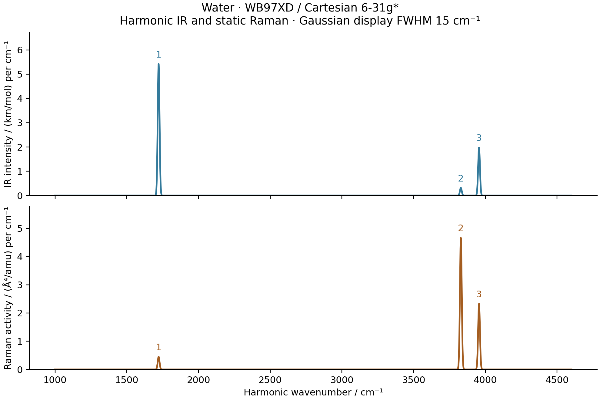

# M2: water original omegaB97X-D geometry, modes and IR/Raman

The complete optimization, AD Hessian, IR/Raman and independent comparisons
passed on 2026-10-15. The original CHG correction is included throughout
the geometry and harmonic calculation.

This case uses the **original omegaB97X-D functional**, selected by `wb97xd`,
with Cartesian 6-31G* and a level-3 moving grid. The model includes both
full and long-range exchange integrals and the original Chai–Head-Gordon
(CHG) atom-pair correction. The range parameter is `0.2 bohr^-1`, with a
short-range HF fraction `0.222036` and complete long-range HF exchange.
The original definition is in [Chai and Head-Gordon (2008), Eqs. 1–3 and
Table 1](https://web.phys.ntu.edu.tw/jdchai/Papers/p8.pdf).



| Mode | IR / km mol^-1 | Raman / Angstrom^4 amu^-1 | Depolarization |
| --- | ---: | ---: | ---: |
| Bend | 86.53866 | 7.15964 | 0.529037 |
| Symmetric stretch | 5.06518 | 74.51332 | 0.179507 |
| Antisymmetric stretch | 31.62827 | 37.18351 | 0.750000 |

## Optimized geometry

| Quantity | Measured value |
| --- | ---: |
| Total energy including original CHG / Hartree | -76.38707313719108 |
| O–H bond length / bohr | 1.820168356728 |
| H–O–H angle / degree | 104.1920249856 |
| Maximum nuclear gradient / (Hartree/bohr) | 8.2993e-9 |
| BFGS iterations / objective evaluations | 8 / 9 |
| Optimization, excluding seed SCF / seconds | 498.360 |
| Independent PySCF+CHG gradient difference / (Hartree/bohr) | 1.9055e-13 |
| Nine AD Hessian columns including HVP compilation / seconds | 996.851 |

The optimization uses all nine Cartesian coordinates and a maximum-gradient
threshold of `1e-7` Hartree/bohr. PySCF plus the independent original-CHG
correction reproduces the energy as `-76.38707313718727` Hartree. The CHG
part is `-2.74381906540e-5` Hartree and is separately saved in the reference.

## Harmonic modes and full Hessian checks

| Mode | H2O / cm^-1 | D2O / cm^-1 |
| --- | ---: | ---: |
| Bend | 1721.958912 | 1260.030490 |
| Symmetric stretch | 3829.104708 | 2760.863221 |
| Antisymmetric stretch | 3955.984306 | 2898.230674 |

The isotopes use one electronic Hessian. Masses are O-16 `15.99491461957`,
H-1 `1.00782503223` and H-2 `2.01410177812` amu. All three projected internal
curvatures are positive. Independent maximum frequency differences are
`1.659e-5` cm^-1 for H2O and `2.867e-5` for D2O.

| Hessian comparison | Step / bohr | Maximum error / (Hartree/bohr^2) |
| --- | ---: | ---: |
| AD HVP versus relaxed GradSCF gradient differences, normalized seed-13 direction | 1e-3 | 3.811e-7 |
| Same | 3e-4 | 3.430e-8 |
| Same | 1e-4 | 3.690e-9 |
| Full AD Hessian versus independent PySCF gradient differences plus CHG | 3e-4 | 3.803e-8 |
| Same | 1e-4 | 5.298e-9 |

The raw AD Hessian asymmetry is `4.502e-14` Hartree/bohr squared and its
translation residual is `1.870e-12` Hartree/bohr squared. Its raw rotation
residual is **5.262983e-4 Hartree/bohr**, independently reproduced as
`5.262999e-4` by PySCF. This is a substantial finite angular-grid limitation
of this level-3 discrete functional, larger than in the PBE0/B3LYP cases.
It remains in the saved raw Hessian. Internal-mode projection is not evidence
for six exact raw zero modes or grid convergence of the frequencies.

The independent geometry reference completed 37 SCFs in **76.349 seconds**.
Its largest actual orbital-gradient norm was `7.040e-12`, below the separate
`1e-10` gate. Every analytic gradient has full grid response. The reference
Hessian is a finite difference of these gradients plus the independent CHG
Hessian, not a PySCF analytic Hessian with omitted grid-response terms.

## Original CHG correction

The correction has no overall scaling factor. For one atom pair,

```
phi(r) = -C6_ij/r^6 / [1 + 6*(r/Rr)^(-12)]
       = -C*r^6/(r^12+A),  A=6*Rr^12,  Rr=R0_i+R0_j.
```

The dimensionless damping parameter is 6 and its exponent is 12. `A` in
the second expression is a different, dimensionful shorthand. This is the
original CHG damping form, with the original atomic parameter contract
used by the frozen core. The H/O inputs are listed explicitly:

| Atom | C6 / (J nm^6 mol^-1) | R0 / Angstrom |
| --- | ---: | ---: |
| H | 0.14 | 1.001 |
| O | 0.70 | 1.342 |

Cross coefficients use the geometric mean. The independent NumPy reference
converts these tabulated inputs using the SI Bohr radius, Hartree energy and
Avogadro constant. They are dispersion radii, distinct from the radii used
by the molecular quadrature partition.

For the independent Cartesian Hessian, define `t=r^12`, `u=(R_i-R_j)/r`:

```
phi'(r)  = 6*C*r^5*(t-A)/(t+A)^2
phi''(r) = 6*C*r^4*(-7*t^2+36*A*t-5*A^2)/(t+A)^3
K = (phi''-phi'/r)*outer(u,u) + (phi'/r)*I
```

Pair diagonal Hessian blocks receive `K`; the two off-diagonal blocks
receive `-K`. The gradients are `+phi'*u` and `-phi'*u`. This independent
implementation imports no GradSCF or JAX solver. Its derivatives were checked
against Cartesian differences of its own pair energy/gradient and against
the core AD implementation, at a nonsymmetric H2O geometry: **1 test passed
in 7.36 seconds**.

PySCF's raw `wb97xd` functional spelling supplies its electronic functional.
The reference explicitly disables automatic dispersion and adds original
CHG once to the SCF total energy and nuclear gradient. Its total Hessian is
the finite-difference Hessian of full-grid PySCF analytic gradients plus
the independently derived CHG Hessian at the central geometry. The saved
reference separates CHG energy, gradient and Hessian for inspection.

CHG depends only on nuclear geometry. Therefore it has no direct fixed-R
dipole or polarizability contribution. It does affect the optimized geometry
and harmonic Hessian, hence the normal directions and the final spectra.
Those geometry effects are retained throughout the main calculation.

## Complete response and independent spectral check

The shared `MolecularEnergy` adapter supplies the full relaxed `E(R,F)`.
Both full/LR ERIs and the geometry-dependent CHG energy are explicit leaves
of the same orbital solver. No SCF or response solver is copied. The moving
grid, Becke weights, AO values and AO gradients are all differentiated.
The Hessian is built with nine JVPs of the complete gradient. H2O/D2O modes
reuse this same electronic Hessian with different isotope masses.

IR and static Raman use normal-mode JVPs of the stationary dipole and its
field derivative. The relaxed density retains implicit response. Finite
differences validate the tensors; they do not construct the AD spectrum.
All steps, units, numerical tolerances and display conventions are shared
with the [PBE0 workflow](../M2_water_pbe0_spectra/README.md).

| Spectral validation, smaller mode step | Maximum difference |
| --- | ---: |
| AD–GradSCF dipole derivative, atomic normal-coordinate units | 3.088e-10 |
| AD–GradSCF Raman tensor component, same coordinate convention | 1.849e-9 |
| AD–PySCF dipole derivative | 3.087e-10 |
| AD–PySCF Raman tensor component | 2.379e-7 |
| Independent IR intensity / (km/mol) | 4.630e-6 |
| Independent Raman activity / (Angstrom^4/amu) | 4.782e-5 |

The normal coordinate is in bohr times the square root of electron mass.
Both maximum Cartesian mode steps, `1e-3` and `3e-4` bohr, independently
reconverge the electronic state at positive and negative displacement. The
PySCF reference uses an inner field step of `1e-4` au. Its zero-field density
starts from the mean of converged positive and negative z-field densities,
then is fully reconverged under the same strict tolerances. The independent
reference is nested finite differences, not analytic third derivatives.
Reference tensors retain their raw finite-field/SCF noise; the AD tensor
symmetry residual is `2.331e-15`.

The spectral AD and displaced checks took **2800.513 seconds**, including
compilation and excluding seed SCF. The independent spectral reference took
**144.166 seconds** for 84 SCF/dipole evaluations, with no Newton retries and
maximum actual orbital-gradient norm `9.864e-12`. These timing scopes differ
from the nine-column Hessian and optimization stages.

The seed SCF uses energy/density/orbital tolerances `1e-12`/`1e-11`/`1e-10`;
orbital minimization and implicit response use `1e-9` and `1e-10`. The
independent PySCF energy/orbital thresholds are `1e-13`/`1e-11`, with a
separate actual orbital-gradient gate of `1e-10`. Matching grids use
Treutler-Ahlrichs radial integration, NWChem pruning, original Becke weights
and Treutler radii adjustment; density pruning and grid padding are disabled.

## Preliminary mixed-derivative gate

The preliminary H2/STO-3G, level-0 test used a z field of `0.001` au and a
bond-stretch direction `[(0,0,-0.5),(0,0,0.5)]`. The mixed derivative was
`3.00222034661` in atomic units. Central-difference errors at steps `3e-4`
and `1e-4` bohr were `4.370e-7` and `4.854e-8`; the stationary and direct
energy-AD polarizabilities differed by `1.776e-15`. The test completed as
**1 passed, 2 deselected in 486.69 seconds**. This is a preliminary small
gate and does not replace the water calculation or its independent checks.

## Reproduction and scope

From the repository root, using the CPU float64 environment in the PBE0
record and `/home/yjiao/opt/miniconda3/envs/jax_scf/bin/python`:

```sh
python -c 'import runpy; runpy.run_path("examples/vibrations/water_hybrid_spectra.py")["optimize"]("wb97xd")'
python -c 'import runpy; runpy.run_path("examples/vibrations/water_hybrid_spectra.py")["harmonic"]("wb97xd")'
python -c 'import runpy; runpy.run_path("examples/vibrations/water_hybrid_spectra.py")["spectra"]("wb97xd")'
python -c 'import runpy; runpy.run_path("examples/vibrations/compare_water_hybrid_pyscf.py")["run"]("wb97xd")'
python -c 'import runpy; runpy.run_path("examples/vibrations/plot_water_hybrid_spectra.py")["run"]("wb97xd")'
```

`run(xc)` always runs the stages. Separate `optimize`, `harmonic` and
`spectra` calls allow explicit stage restarts or separate bounded jobs;
there is no silent skipping or CLI framework. Each water production job
has a 7200-second limit, and independent references a 1200-second limit.

The original combined invocation completed optimization and Hessian checks.
At **34 min 27 s**, just after entering spectral mode 1, its own Python PID
was deliberately terminated (exit 143) to give spectra a separate bounded
job. No spectral mode from that invocation was accepted. The saved geometry
and Hessian were reused by `spectra("wb97xd")`; they were not recomputed.
This was a resource-stage split, not a numerical failure or timeout. Both
logs and the exact process/elapsed record are retained under ignored
`artifacts/ad_showcase/development/M2_hybrid_spectra/`.

All numerical work and plots use the frozen snapshot
`/home/yjiao/gradscf_checks/ad-showcase-hybrid-spectra-20261015` on
`jy_gpu_1`/`c20`, CPU float64. Its native library and the stable high-order
XC implementation are pinned by the frozen source manifest. It predates
the later stationary-value energy change. Timings are scope-specific and
affected by concurrent load; they are not controlled speed comparisons.

Runtime: Intel Xeon Platinum 8457C, Python 3.11.15, JAX 0.10.0,
NumPy 2.4.4, SciPy 1.17.1, PySCF 2.13.0 and Matplotlib 3.10.9; device
`cpu:0`. Persistent compilation caching is disabled. OpenMP and OpenBLAS
thread variables are two; these variables do not cap all JAX worker threads.
Selected frozen-source/native and executed-script archives are retained
under the ignored artifact directory, not as a complete environment image.

This is a finite-basis, finite-grid harmonic calculation, with
no empirical frequency scaling. Raw rigid-motion residuals are retained
before internal-mode projection. Finer-grid/diffuse-basis convergence,
anharmonicity and frequency-dependent Raman response are outside its scope.
The Gaussian plot width and animation amplitude/phase are display choices.
The Gaussian FWHM is 15 cm^-1; animation displacements are scaled to 0.25
bohr. They are not lifetimes, thermal amplitudes or physical periods. Raman
activities exclude laser-frequency, temperature and collection factors.

The [frozen source manifest](frozen_source_hashes.sha256) pins selected core
files, the stable high-order XC implementation and actual native library.
The [executed example manifest](executed_example_sources.sha256) records the
shared scripts before measured tail comments.

Data: [optimized geometry](geometry.json), [AD Hessian](hessian.json),
[independent geometry/Hessian](pyscf_geometry.json), [AD spectrum](gradscf.json),
[independent spectrum](pyscf.json).

Figures: [optimization PNG](optimization.png) / [PDF](optimization.pdf),
[Hessian/isotope PNG](harmonic_checks.png) / [PDF](harmonic_checks.pdf),
[IR/Raman PNG](ir_raman.png) / [PDF](ir_raman.pdf),
[40-frame mode animation](water_modes.gif).

Tables: [optimization](optimization.csv), [isotope frequencies](isotope_frequencies.csv),
[spectral sticks](sticks.csv), [broadened display curves](broadened.csv).
