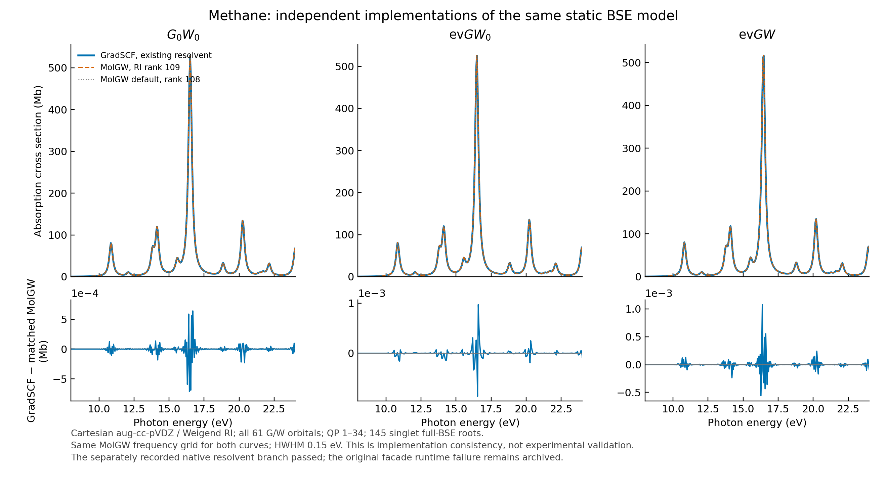

# Methane: formal native resolvent example and six independent MolGW runs

The 2026-10-16 `jy_gpu_1` replay passed the original matched-reference gates
for G0W0, evGW0 and evGW: all 34 requested QP energies, all 145 full singlet
BSE energies and oscillator strengths, static polarizability, and the
cross section on MolGW's actual 1000-point grid. The native calculation uses
the **existing public finite-eta resolvent branch** of the CD driver.
The unchanged original facade attempt failed at runtime and is retained below;
it is not reported as repaired or successfully rerun.

The ordinary [native example](../../../../examples/gw/methane_resolvent_spectrum.py)
uses `gto.M`, `RHF`, `mf.to_reference()`, the public GW drivers and
`BSEReference.from_gw_result`. It has no CLI, PySCF calculation, `runpy`,
source replacement or monkeypatch. The existing
[collector](../../../../tests/comparisons/collect_methane_molgw.py) and
[plot script](../../../../examples/gw/plot_methane_resolvent_spectrum.py)
are independent of the native calculation. Only the collector's runtime
provenance was updated; its numerical comparisons and gates were unchanged.

The 2026-10-16 Linux replay retains the historical methane/Cartesian
aug-cc-pVDZ geometry, Weigend auxiliary basis, QP orbitals 1--34,
all 61 orbitals in G and W, and all 145 singlet full-BSE roots in the
selected optical space. The historical Apple M4 evidence in
`reproducibility/gw_bse/methane_aug_cc_pvdz` is preserved separately.

Native RHF uses `conv_tol=1e-12`. The archived MolGW inputs retain `tolscf=1e-10`,
their independently converged SCF, and the original graphical grid of 4001
points at `5e-4 Eh` spacing. Both use GW eta `1e-5 Eh`; native CD uses 200
imaginary nodes. Native evGW0/evGW retain max 80 cycles, residual tolerance
`1e-8 Eh` and damping 0.3. MolGW performs 40 updates plus one independent
extra update; matched-case extra changes are `9.99e-16` and `4.00e-15 Eh`.
BSE uses W0 for G0W0/evGW0 and the recorded updated W for evGW. The optical
half width is `0.15 eV`, without rescaling. No orbital window was reduced.

## Measured independent comparison

| Matched RI rank 109 | Maximum QP difference / Eh | BSE difference / Eh | Oscillator-strength difference | Static alpha difference / bohr^3 | Cross-section difference / Mb |
| --- | ---: | ---: | ---: | ---: | ---: |
| G0W0 | 1.49624e-8 | 2.15147e-8 | 1.03420e-8 | 4.96284e-8 | 7.94275e-4 |
| evGW0 | 2.22792e-9 | 2.01447e-8 | 5.13597e-9 | 3.15195e-8 | 9.72699e-4 |
| evGW | 3.60209e-9 | 1.63034e-8 | 5.39435e-9 | 1.32707e-8 | 1.07669e-3 |

The original gates are QP `2e-6 Eh`, BSE `3e-6 Eh`, oscillator strength
`2e-5`, static alpha `3e-4 bohr^3`, and cross section `2e-4 bohr^2`.
The last gate is applied in atomic units using the collector's existing
conversion; the table reports Mb. The HF energy difference is `4.30e-11 Eh`.
The [JSON](native/molgw_comparison.json), [CSV](native/summary.csv) and
[actual collector log](../../../../artifacts/ad_showcase/provenance/MolGW_reference_build/methane_replay/logs/methane-canonical-comparison.log) retain all six
reference cases and every original test quantity.

Default MolGW discards one auxiliary direction because its metric eigenvalue
`2.451575e-7` is below `1e-6`: it keeps 108 directions, while the native
Cholesky and the explicitly named `1e-10` MolGW variant keep 109. Default
differences are about `1.98e-4 Eh` in QP energies and `0.0050 eV` in BSE
energies. They are recorded as different RI approximations, not accepted by
loosening the matched-equation gates. The same-window stock/adapter control
gave exactly zero printed differences in energy, strength and all cross-section
columns; see [the control](molgw/driver-control.json).



The figure uses the same actual MolGW frequency grid for both curves and
shows 8--24 eV; the numerical cross-section comparison covers the full output
grid through 50 eV. [PDF](native/methane_reference_replay.pdf) is also retained.
This is fixed-geometry implementation consistency, not experimental validation
or convergence with respect to basis, window, continuum or broadening.

## Same-CD implementation gate and provenance

Before the new native run, all `61 x 61` W elements at the same 200 imaginary
nodes and W(0) were compared with serial SciPy solutions of the original
109-dimensional auxiliary dielectric equation. Their maximum differences
were `9.77e-15` and `8.44e-15 Eh`. Real-axis probes included the first RPA pole
and offsets `+/- eta`, `+/-1e-4` and `+/-1e-3 Eh`, retaining the original
asymmetric `2*i*eta` convention. Maximum absolute/scaled differences were
`3.40e-10 Eh` and `1.46e-10`. Maximum actual residual divided by RHS norm was
`1.51e-14` for the direct oracle and `3.52e-12` for selected shared shifted
solves. The [gate](diagnostics/resolvent_equivalence.json) records every probe,
the original thresholds, and scaled backward residuals. This was a change
of existing W representation, not a change to the discrete CD equation.

The formal script was then executed separately from the private diagnostic.
Its QP energies, screening energies and Z values exactly matched the private
run; maximum BSE energy/strength differences were `1.05e-11 eV` / `8.27e-13`.
See [the equivalence record](native/formal_private_equivalence.json).
All 145 roots in each method were stable and converged. Formal RHF took
13.53 s; G0W0/evGW0/evGW including BSE took 39.91/3.41/13.90 s, respectively.
These shared-CPU/JIT workflow times are not an exclusive performance ranking.

The frozen source is `ad-showcase-integration-20261015/src`, Python-source-tree
SHA256 `c792320a88f24c695049469ac317d26953efc0888cd3236c44cb0fb393220abc`.
The executed formal native script SHA256 is
`aa28b9a054e1d2ceae4e39060c5737efc9626a6341183995af58d2f24805cefa`;
the actual collector SHA256 is
`8eeb41167c9b7ddbe7a4d49d9ef6d0b4fa1fee5752e4239885b7e5e660e44a45`.
[Provenance](native/provenance.json) records commands, environment and hashes
of every native output, including the complete NPZ snapshots retained remotely
under `native-methane-formal/outputs/methane_resolvent_spectrum`.
The compact local record includes [executed recipes](../../../../artifacts/ad_showcase/provenance/MolGW_reference_build/methane_replay/recipes), raw MolGW
inputs/stdout/YAML/QP files, measured JSON/CSV, PNG/PDF, and logs.

From the repository root, with the stated native environment and the six
MolGW runs in `reference_runs`:

```sh
python examples/gw/methane_resolvent_spectrum.py
python tests/comparisons/collect_methane_molgw.py \
  --runs reference_runs \
  --native-output outputs/methane_resolvent_spectrum \
  --archive outputs/methane_resolvent_spectrum
python examples/gw/plot_methane_resolvent_spectrum.py
```

## Original runtime failures remain distinct

The first native attempt used the unchanged original `methane_gw_spectrum.py`
and frozen `ad-showcase-integration-20261015/src`. It reached RHF energy
`-40.199597689343 Eh`, then exited with status 139 while entering GW.
No fresh GW/BSE NPZ was produced. The log reports OpenBLAS's
`precompiled NUM_THREADS exceeded` warning and repeated bad-memory-
deallocation messages. This failure does not establish a numerical
GW/BSE discrepancy or a successful current-source comparison.

The [failure log](../../../../artifacts/ad_showcase/provenance/MolGW_reference_build/methane_replay/failures/native-methane.log),
[exit status](../../../../artifacts/ad_showcase/provenance/MolGW_reference_build/methane_replay/failures/native-methane.exit), and independent read-only
[runtime diagnostic](failures/methane-blas-diagnostic.json) are retained.
The diagnostic repeats only the unchanged RHF prefix and a 2-by-2 JAX
linear solve to load the runtime LAPACK library. It observes 192 allowed
CPUs and 637 process threads. `OMP_NUM_THREADS=2` and
`OPENBLAS_NUM_THREADS=2` were set. NumPy and SciPy OpenBLAS report two
threads and `MAX_THREADS=64`; the PySCF LP64 OpenBLAS reports
`SINGLE_THREADED` and one actual thread. These observations support a
thread-concurrency hypothesis, but do not identify the precise failing
library or establish a remedy. No CPU affinity or library was changed.

The independent MolGW jobs can complete without this native checkpoint.
Their per-run records originally say native comparison pending; the separately
executed formal collector above supplies the later comparison. No historical
checkpoint was substituted for the current native output. Turning off XLA's
multithreaded Eigen setting in a separate diagnostic left 639 process threads,
so it was not reported as a solution or used to relaunch the failing facade.

The first external methane attempt also stopped before integral evaluation
because the historical uppercase `AUG-CC-PVDZ` input did not match Linux's
case-sensitive official filenames. A private [basis directory](basis/manifest.json)
contains unchanged C/H aug-cc-pVDZ and Weigend files, with uppercase filename
aliases only. Every copied file's SHA256 was checked. Only `basis_path` changes
in the original input; [the failure](molgw/failures/matched-g0w0-basis-case/)
and all original input hashes remain recorded. Neither the fixed MolGW source
nor any shared library was edited.
