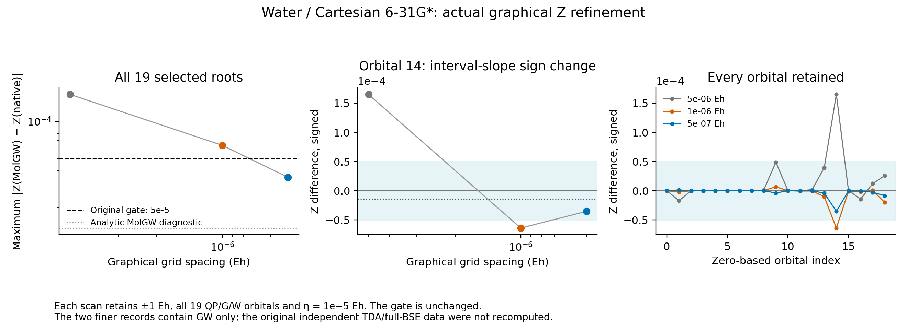

# Water single-point G0W0 and BSE reference

Pinned MolGW completed a **single-geometry independent forward reference**:
all 19 QP energies, their reported Z values, and all 70 singlet TDA/full-BSE
excitations. This record does not establish agreement with a particular native
QP branch or validate nuclear derivatives. Native local-root continuation and
MolGW's graphical selection have different root-selection contracts.

The geometry is `O (0,0,0)`, `H (0,1.43,1.11)`, `H (0,-1.43,1.11)` in bohr.
The basis is Cartesian 6-31G* (MolGW filename alias `6-31Gs`), with full AO
integrals, no auxiliary basis and no frozen core. All 19 MOs enter QP, G and W;
the optical space is all `5 occupied × 14 virtual` transitions. HF requires
`tolscf=1e-12`, at most 100 SCF cycles. GW uses eta `1e-5 Eh`; the graphical
grid has 400001 points at `5e-6 Eh` spacing, from -1 to +1 Eh around each input
HF energy. The optical output uses eta `0.01 Eh` for its sampled cross section.

The independently calculated HF energy is `-76.0104928182 Eh` at the printed
precision. The GW stage took 114.845 s. Both optical calculations used the
finalized, independently converged RHF restart from that stage. No native
GradSCF energy, QP seed or transition quantity entered MolGW.

## Root-selection evidence

[reference.json](g0w0/reference.json) contains every selected QP/Z and both
70-root optical datasets. [selected-roots.csv](g0w0/selected-roots.csv) provides
the per-orbital table, while [root-selection.json](g0w0/root-selection.json)
retains every candidate printed by MolGW and binds them to the final reference
JSON hash. The raw [GW stdout](g0w0/gw.out), [YAML](g0w0/gw.yaml) and
[ENERGY_QP](g0w0/ENERGY_QP) are included.

In the pinned `m_selfenergy_tools.f90`, `find_fixed_point` detects adjacent-grid
sign changes, linearly interpolates each root and estimates Z from the interval
slope. It discards `Z<1e-5`, keeps up to four candidates with greatest Z, and
`find_qp_energy_graphical` chooses the greatest-Z candidate. This selection is
restricted to the scanned window; it is not a proof of a global maximum over
the entire real axis. No no-root fallback occurred for these 19 orbitals.
The candidate stdout table has six decimal places in eV and Z; selected energies
use the higher-precision `ENERGY_QP`, and selected Z uses YAML. Grid-slope Z is
not an exact analytic derivative of the self-energy.

## Actual graphical-Z refinement

Comparison with the independently generated native primary-root record revealed
that the original grid's largest Z difference exceeded the existing `5e-5`
gate. The selected energies were already within the original `2e-6 Eh` gate.
Every refinement retained the same pinned binary, RHF state, basis, full 19
QP/G/W orbitals, eta `1e-5 Eh` and `+/-1 Eh` scan interval. Only the number
of points and spacing changed; neither the gate nor the physical model was
adjusted to make the comparison pass.

| Actual MolGW run | Spacing / Eh | Maximum QP difference / Eh | Maximum Z difference | Original Z gate |
| --- | ---: | ---: | ---: | --- |
| [400001 points](g0w0/reference.json) | 5e-6 | 3.16186e-8 | 1.65073e-4 | Failed |
| [2000001 points](g0w0_grid1e-6/grid_convergence.json) | 1e-6 | 3.12286e-8 | 6.39444e-5 | Failed |
| [4000001 points](g0w0_grid5e-7/grid_convergence.json) | 5e-7 | 3.12254e-8 | 3.52844e-5 | Passed |

Both finer runs are **GW-only references**. Their standard
[intermediate](g0w0_grid1e-6/reference.json) and
[final](g0w0_grid5e-7/reference.json) JSON records have `optical=[]` and
`full_gw_bse_complete=false`. Their input/stdout/YAML/ENERGY_QP files are
kept beside each record. The original TDA/full-BSE and cross-section arrays
remain only in `g0w0/`; no finer-grid BSE calculation is implied. A comparison
using final QP/Z and original optical data must name these two directories.

[PDF](water-grid-convergence/graphical_z_convergence.pdf) and
[all-orbital CSV](water-grid-convergence/grid_summary.csv) retain both failures
and the successful final observation. The all-orbital maximum and the signed
orbital-14 difference show why an interval slope need not converge monotonically
from one side of the exact local derivative.

The [independent slope diagnostic](water-graphical-slope-probe.json) reads
MolGW's own full-precision `RESTART` and `SCREENED_COULOMB` Fortran records,
then evaluates its pinned analytic pole/residue self-energy. No GradSCF import
or native AD value enters that reconstruction. It reproduces both executed
coarse/intermediate interval-slope Z tables to `1.12e-9` over all 19 states.
For orbital 14, the analytic root is `1.9903892614309007 Eh` and Z is
`0.5510231050901`. The coarse/intermediate interval midpoints lie respectively
`+1.56168e-6` and `-4.38317e-7 Eh` from that root, explaining the sign reversal.
The predicted next-grid maximum difference was `3.52845e-5`; this prediction
was used only to justify one final run, whose **actual output** passed above.
The remaining analytic-MolGW/native local-derivative difference is at most
`1.37003e-5` at the stated finite eta; this is not an eta-to-zero extrapolation.

The two finer GW jobs took 622.49 and 1556.87 seconds. Each had a 1800-second
outer limit and a process-local 256 MiB stack for the larger Fortran automatic
arrays. No system setting, library, CPU affinity or solver source was changed.
Exact [recipes](../../../../artifacts/ad_showcase/provenance/MolGW_reference_build/water_forward/grid_recipes) and [logs](grid_logs/) preserve the intermediate
failed assertion and final successful exit status.

Three orbitals that need particular attention in native branch tracking are:

| Orbital (zero based) | Selected QP / Eh | Selected Z | Other printed candidate Z values |
| --- | ---: | ---: | --- |
| 14 | 1.99038926182694 | 0.551201878 | 0.247242, 0.082290, 0.061713 |
| 17 | 2.80608115478853 | 0.260569354 | 0.174663, 0.164252, 0.049211 |
| 18 | 3.88407313169662 | 0.239747739 | 0.125232, 0.102388, 0.084239 |

Comparing only the largest error over orbitals would conflate a different
chosen local root with a difference between self-energy models. The full
per-orbital/candidate data are retained for that distinction. No orbital was
removed from the window to obtain this reference.

## Runtime and metadata failures retained

The first run reached graphical root finding and failed with Intel Fortran
SIGSEGV 174. The default process stack was 8192 KiB; the routine's large
automatic arrays exceed that size. Address lookup identified
`m_selfenergy_tools_mp_find_qp_energy_graphical_`. Changing only this reference
process's stack limit to 65536 KiB made the same binary, geometry, full orbital
window and frequency grid complete. No system limit, compiler source or
numerical threshold was changed. The failed stage remains separate under
[failures](failures/).

The initial Python wrapper then incorrectly treated the omitted SCF-convergence
YAML key as false for a BSE restart. The original TDA stdout explicitly says
`Restarting from a finalized RESTART file` and contains completed optical output;
there was no new unconverged SCF loop. The correction checks the finalized
restart marker, original converged GW-stage RHF state and normal program end.
It reused the completed TDA output and executed only full BSE afterward.
[The original metadata-failure record](g0w0/reference-wrapper-metadata-failure.json)
and the executed [resume script](../../../../artifacts/ad_showcase/provenance/MolGW_reference_build/recipes/resume_water_optics.py) preserve
that distinction. The current [water driver](../../../../artifacts/ad_showcase/provenance/MolGW_reference_build/recipes/water_forward.py)
includes the corrected check; [the original executed driver](../../../../artifacts/ad_showcase/provenance/MolGW_reference_build/recipes/water_forward_executed.py)
is also retained with its original hash.

All physical calculations ran on `jy_gpu_1`, CPU float64, with
`OMP_NUM_THREADS=2` and `OPENBLAS_NUM_THREADS=2`, under a 1800-second job limit.
The optical-only resume was bounded to 300 seconds. No geometry scan or new
native GW source was used. The verified executable and dependency details are
in [the build record](../README.md).
