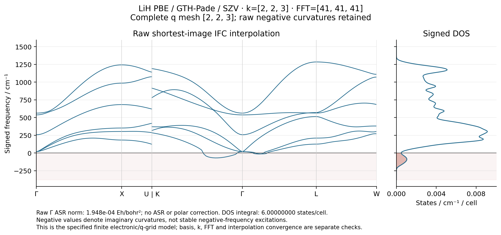
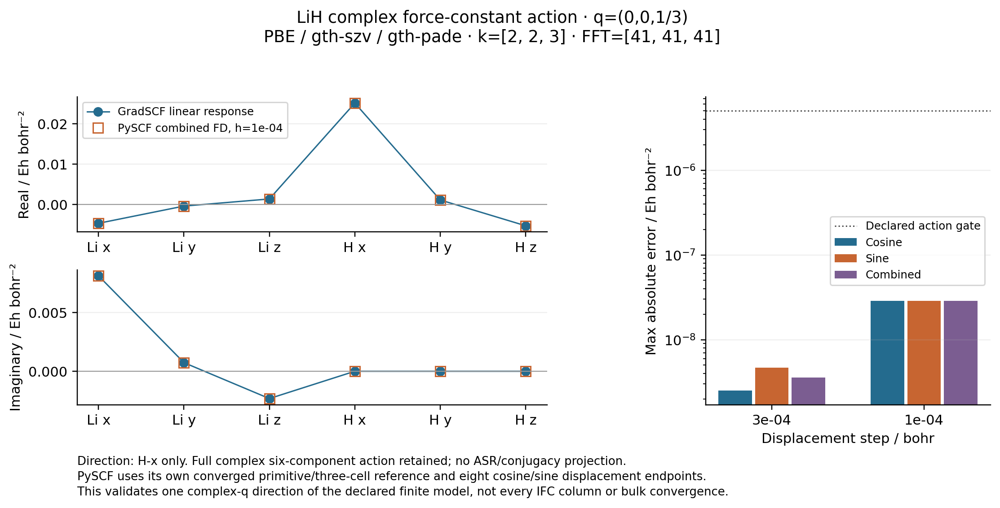

# P03 — complex-q response and complete-mesh IFC interpolation

The independent q-half negative-direction gate is complete and remains in
[the separate self-inverse-point record](../P03_lih_zone_boundary/README.md).
The complete twelve-point raw q mesh, IFC bands, signed DOS, selected-mode
animation and independent Phonopy interpolation check are complete at FFT41.
The first general complex-q pair passed at FFT31. A later mixed-q pair failed
the unchanged raw conjugacy gate at FFT31 and passed after changing only the
FFT resolution to 41. That failed result remains archived.
It retains the fixed P03 geometry and all negative curvatures; no ASR or
conjugacy projection is allowed before the raw checks.

The first model is PBE / GTH-Pade / Cartesian GTH-SZV, four explicit electrons,
two atoms, `a=7.780032276700287 bohr`, initially FFT31³, and a full equal-weight k mesh
`(2,2,3)`. This mesh change is required for q=(0,0,±1/3). It is a distinct
finite electronic model from the old k2³ results. Neither the old Gamma FFT71
matrix nor the old k2³ electric tensors may be inserted into its IFC mesh.

## Source and checkpoint boundary

The shared P03/P05 snapshot is
`/home/yjiao/gradscf_checks/p03-lih-qmesh-20261016-agent`.
It copies the validated `ad-showcase-crystal-ir-20261016` production source and
adds the already independently checked `polar_ifc.py`. Python source SHA256:
`acc255538482dbbd7b243b5e3a577e2bd820086936fe29d67f6aaa28c66ef9b5`.
Relative to the old q-half production snapshot, the only modified Python file
is `pbc/vibrational.py`; `dfpt/electric.py`, `pbc/polarization.py` and
`pbc/polar_ifc.py` are additions. The mechanical, SCF, FFT and finite-q paths
are unchanged byte for byte. `source_manifest.json` records these identities.

[`lih_qmesh_phonons.py`](../../../examples/pbc/lih_qmesh_phonons.py) computes
one actual q matrix per invocation. Each of six columns is saved atomically
before proceeding. The JSON identity includes production/script/helper hashes,
settings, q, masses, response controls and gates. The initial reference density
has its own immutable checksum. A resumed partial job reconverges that seed,
checks density/energy changes and preserves completed columns. A complete
failed record is not silently reused as passing.

The two synthetic checkpoint regressions passed remotely after their expected
missing-implementation RED: changing source/q rejects reuse, while a saved
partial column cannot imply a completed result. These are I/O checks, not
physical response validation.

## Predeclared first gate

Compute q=(0,0,+1/3) and q=(0,0,−1/3) in separate processes, all six columns
at each point. Neither matrix is generated from its partner. The convention is
`Phi_ab(q)=sum_R C_ab(R) exp(2 pi i q.R)` with lattice translations only.

| Quantity | Acceptance gate |
|---|---:|
| Maximum true linear residual, each column | 1e-9 |
| Raw Hermiticity maximum, each matrix | 1e-8 Eh/bohr² |
| Raw `Phi(-q)-Phi(q).conj()` maximum | 1e-8 Eh/bohr² |

The imaginary matrix components are retained and reported. General complex q
does not have a zero-imaginary-component gate. Every solve uses shared GMRES
with rtol=1e-10, atol=1e-12, restart=40 and maxiter=100. No solver is copied.
The first processes are bounded by actual RSS 32 GiB and timeout 1800 s,
with default affinity, CPU float64/complex128 and OMP/OpenBLAS=2.

For nk=12 and nao=3, the finite-q real response has 432 variables. The primary
AO array `(12,4,29791,3)` occupies about 68.6 MiB in complex128. The conservative
pair-workspace count is 38,609,136 elements (about 589 MiB for one complex128
array), bounded explicitly by 30,000 grid points and 40,000,000 pair elements.
These are individual-array estimates, not a prediction of the process peak.

The two independent first-pair runs completed in 303.35 and 306.02 s, with
9,310,024 and 9,372,448 KiB peak RSS (about 8.88 and 8.94 GiB). Maximum true
linear residual is 1.251e-12; each raw Hermiticity error is below 8.60e-14
Eh/bohr². The measured raw conjugacy error is 1.9504e-14 Eh/bohr², while the
largest imaginary component is 0.01069655 Eh/bohr². Thus this is a genuinely
complex force-constant pair, unlike the self-inverse q-half check. These two
points alone do not establish the complete q mesh or an independent physical
finite-difference comparison.

The next independently computed pair, q=(1/2,0,±1/3), had a raw conjugacy
error of **2.04678e-8 Eh/bohr² at FFT31**, exceeding the original 1e-8 gate.
Both individual matrices had converged response solves and raw Hermiticity
errors below 4.6e-14 Eh/bohr². This failed pair remains in
`k2x2x3_fft31/pair_mixed.json`; it is not averaged, projected or relabeled.
With only FFT31→41 changed, the same raw pair gave **8.79935e-12 Eh/bohr²**
conjugacy error and an imaginary component as large as 0.01231518 Eh/bohr².
The two FFT41 jobs took 483.01 and 485.79 s, with 12,731,560 and 12,831,448 KiB
peak RSS. This is evidence of FFT sensitivity of the reciprocal-wrap error,
not a general basis/k-grid convergence claim.

At FFT41, the independent z-third pair also passed (raw conjugacy 5.4332e-15
Eh/bohr²). All twelve required q matrices are now complete. FFT41 uses 68,921
grid points, about 151.4 MiB for the primary complex AO array and 89,321,616 conservative pair elements
(about 1.33 GiB for one complex128 array). Explicit bounds are 70,000 grid
points and 90,000,000 pair elements. Measured process RSS remains below
12.63 GiB; the unchanged job limit is 32 GiB actual RSS / 1800 s.



| Complete-grid check | Measured maximum/value |
|---|---:|
| Raw Hermiticity | 8.498e-14 Eh/bohr² |
| Raw q/-q conjugacy | 2.855e-11 Eh/bohr² |
| Sampled IFC reconstruction | 1.428e-11 Eh/bohr² |
| Reciprocal periodicity | 3.123e-17 Eh/bohr² |
| Raw Gamma ASR norm, retained | 1.94794e-4 Eh/bohr² |
| Signed DOS integral | 6.0000000000 states/cell |
| Phonopy off-grid matrix difference | 2.430e-17 Eh/bohr² |
| Phonopy full-path frequency difference | 1.106e-14 Eh |

The signed DOS uses a 10³ sampling mesh and Gaussian sigma 25 cm⁻¹. There are
152 negative signed-mode samples among its 6000 mode samples; none is clipped.
The [selected-mode GIF](k2x2x3_fft41/ifc_raw/lih_positive_mode.gif) shows the
positive sixth mode at q=(0,0,1/3), 991.4612 cm⁻¹, in three primitive cells.
All spatial coordinates are in bohr; the amplitude 0.25 bohr is illustrative,
not a molecular-dynamics or finite-temperature prediction.

Final raw postprocessing took 32.63 s including its watchdog, with 1,222,312 KiB
peak RSS. The independent pinned Phonopy run took 0.753 s / 68,760 KiB. Hardware
is c20, Intel Xeon Platinum 8457C, CPU float64/complex128; full metadata is in
`hardware.json`. The complete numerical matrix data and source checks are in
`k2x2x3_fft41/ifc_raw/results.json`, `ifc_data.npz` and `phonopy.json`.

## Complete-mesh and independent validation sequence

After the first pair and resource gate, check the mixed pair
q=(1/2,0,±1/3), then calculate the remaining points of the complete `(2,2,3)`
q mesh. All twelve matrices must share the same physical model and source.
Check every raw conjugate pair before passing the matrices to the existing
`ForceConstants.from_qmesh(..., asr=False)`. Retain raw Gamma ASR error, signed
frequencies, sampled-matrix reconstruction error and every failed point.

For an independent complex-q action, use PySCF's own primitive reference and a
three-cell z supercell: six atoms, twelve electrons, k=(2,2,1), with its z FFT
dimension tripled. The initial FFT31 folding gate passed: energy/3 error
3.553e-15 Eh, relative density error 5.071e-11, and native primitive energy
difference 5.209e-8 Eh. The independent SCFs took 123.22 s (primitive) and
862.48 s (supercell); the bounded invocation used 409,096 KiB peak RSS.
These reference densities may initialize the FFT41 SCFs only after a strict
same-model/checksum check; both FFT41 SCFs and their folding are recomputed.
The two seed-compatibility regressions passed remotely after their expected
missing-adapter RED. The original FFT31 oracle script is archived separately
so its checkpoint identity is preserved.

The FFT41 independent folding gate is now passed: energy/3 difference 0 at
recorded precision, relative density error 1.33867e-11, and native energy
difference 2.49933e-12 Eh. Both new-grid references were fully reconverged;
the bounded invocation took 801.03 s / 713,156 KiB. All eight cosine/sine gradient
endpoints are now complete, and the independent H-x complex action passes both
step sizes and the original step-stability gate.

The independent folding gates are energy/3 within 1e-8 Eh and relative density
within 1e-7; primitive native/reference energy must agree within 2e-6 Eh.
For `phase_l=exp(2 pi i l/3)` and one unit Cartesian direction u, independently
reconverged cosine and sine displacement endpoints give gradient derivatives
`g'_cos,l` and `g'_sin,l`. The complex force-constant action is

`Phi(q)u = sum_l phase_l.conj() * (g'_cos,l + i*g'_sin,l) / 3`.

The separate cosine and sine reconstructions have factors `2/3` and `2i/3`;
these factors do not apply to a self-inverse q. Two steps, 3e-4 and 1e-4 bohr,
must meet the existing 5e-6 Eh/bohr² action and step-stability gates. Each real
endpoint receives its own checkpoint and bounded job. No native density or
orbitals enter the independent SCF.



| Independent complex-q check | Maximum error / Eh/bohr² |
|---|---:|
| Action, h=3e-4 bohr, across cosine/sine/combined reconstructions | 4.673e-9 |
| Action, h=1e-4 bohr, across cosine/sine/combined reconstructions | 2.870e-8 |
| Cosine versus sine, h=3e-4 bohr | 2.174e-9 |
| Cosine versus sine, h=1e-4 bohr | 2.033e-10 |
| Combined reconstruction change between steps | 2.578e-8 |

The [complete independent record](k2x2x3_fft41/pyscf_zthird/finite_differences.json)
contains all six complex components of `Phi(q)u` for the H-x direction at
q=(0,0,1/3). The smaller step is slightly less accurate against the native
action; no quadratic convergence or extrapolated result is claimed. This
checks one nonzero physical direction, not every independent Hessian entry.
Endpoint wrapper times range from 1753 to 2939 s, with peak RSS about
3,027,272 KiB. These endpoint times cross the CPU-policy change described below.

The complete-mesh artifacts and independent interpolation checks above are
finished. An off-grid electronic comparison needs the **same** denser
closed electronic k mesh on both sides: the planned `(2,2,6)` stage recomputes
the coarse q mesh and evaluates held-out points such as q=(0,0,1/6). At the
2026-10-16 checkpoint, seven of twelve coarse matrices and both independent
q=(0,0,±1/6) matrices have passed their column and raw Hermiticity gates.
The raw conjugacy errors for the ±1/6 and ±1/3 pairs are 2.459e-14 and
6.450e-15 Eh/bohr². The denser comparison was deliberately stopped here when
the scope was reduced to a functionality showcase. Five coarse points and
the same-model held-out interpolation comparison were not computed; the
completed k223 bands/DOS capsule is the delivered finite-model demonstration. Old k223
matrices cannot be mixed into that comparison. Reconstruction on a finer
sampled q mesh is not itself proof of fine-grid off-grid convergence.

This is a controlled finite-model response/interpolation demonstration.
Resolving the basis/k/FFT dependence of the negative curvatures and converging
bulk LiH are distinct scientific questions. Matched Born/dielectric tensors
and finite-field validation now support the separate
[P05 material polar capsule](../P05_lih_polar_bands/README.md), which explicitly
retains the observed coarse-q decomposition-width sensitivity.

## Reproduction entry points

The public examples use ordinary Python function parameters and direct
`run(...)` calls. Run numerical work with CPU float64 enabled and
`PYTHONPATH=src:.`; the current remote wrapper uses the shared CPU 16–31 pool
and sets OMP/OpenBLAS/MKL/NUMEXPR threads to 2.
The actual bounded commands, return codes and peak RSS are stored in
`verification/*_resources.json` and `verification/jobs/`. `artifacts/ad_showcase/provenance/P03_lih_qmesh/executed` preserves the workflow/helper
scripts, including the original FFT31 oracle; `artifacts/ad_showcase/provenance/P03_lih_qmesh/verification/source` contains
the thirteen matched key production files and `all_python_file_sha256.json`
records all 486 production Python file hashes.

For one new raw FFT41 point, call this inside the existing bounded wrapper,
using a fresh output directory:

```python
from examples.pbc.lih_qmesh_phonons import run

run((0., 0., 1/3), kmesh=(2, 2, 3), mesh=41,
    max_grid=70000, max_pair_elements=90000000,
    output="artifacts/ad_showcase/P03_qmesh_example")
```

Only after all twelve source-consistent matrices pass, the postprocessing is:

```python
from examples.pbc.lih_ifc_bands import run as plot_ifc
from examples.pbc.compare_lih_ifc_phonopy import run as check_phonopy

plot_ifc("reproducibility/ad_showcase/P03_lih_qmesh/k2x2x3_fft41",
         qmesh=(2, 2, 3), output="artifacts/ad_showcase/P03_ifc_replay")
check_phonopy("artifacts/ad_showcase/P03_ifc_replay")
```

The Phonopy check additionally prepends the pinned oracle-dependency folder
`/home/yjiao/gradscf_checks/ad-showcase-polar-ifc-20261016/oracle_deps`
to `PYTHONPATH`; it requires Phonopy 2.44.0, Spglib 2.5.0 and Symfc 1.5.0.
It independently reconstructs supercell force constants from the raw q data,
converts the atomic-position phase to the native lattice-only phase, and checks
both sampled and nonsampled matrices plus the entire plotted frequency path.
Sharing electronic IFC input does not make this an independent electronic
structure calculation; that role belongs to the separate PySCF gradient FD.

`check_lih_ifc_holdout.py` compares a complete coarse IFC with direct positive
and negative held-out points. It rejects changes in the electronic model and
reciprocal copies of sampled points. The two corresponding regression tests
passed remotely after the expected missing-implementation RED. The report
distinguishes successful raw/provenance checks from the measured interpolation
errors; it does not label interpolation converged merely because it ran.

Historical CLI scripts are preserved in `artifacts/ad_showcase/provenance/P03_lih_qmesh/executed/cli_before_function_api`;
the original frozen remote snapshot and its command records remain unchanged.
The conversion manifest at
`artifacts/ad_showcase/development/public_example_api/migration_manifest.json` verifies
unchanged numerical-helper and computation-body ASTs. It is a static interface
equivalence check, not a new numerical benchmark.

During the eight complex-q FD endpoints and the first k226 probe, the user
introduced a project-wide 64-logical-CPU limit and explicitly authorized
affinity. Root assigned this line the shared CPU 16–31 pool at the recorded
policy change. Those nine jobs span both resource policies; their whole-job
times are not comparable as a fixed-policy benchmark. The completed k223
raw/polar figures predate the change. See
[cpu_policy_transition.json](cpu_policy_transition.json) for the affected
jobs, old recorded environment and the required new launch configuration.
