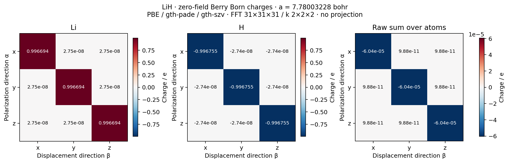
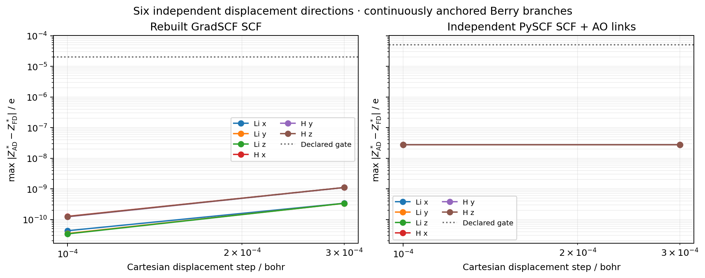
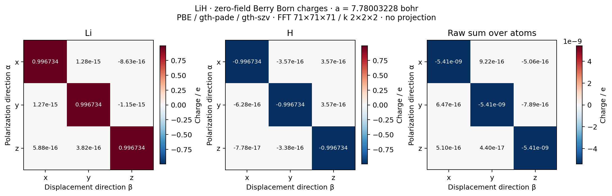
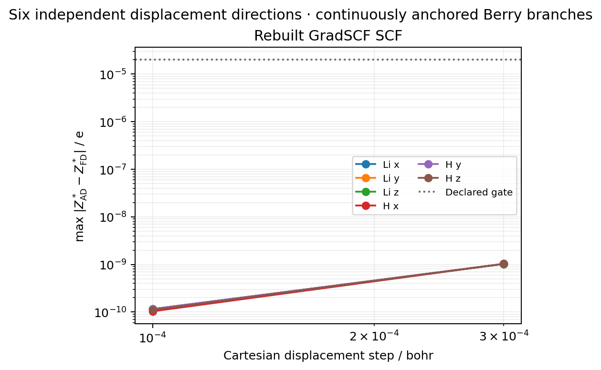

# P04 — Zero-field Born charges from periodic Berry polarization

The original FFT31 benchmark and its independent PySCF comparison are retained
below. A subsequent **matched FFT71** native result is recorded at the end;
the two datasets and source stages are kept separate.

This example differentiates the relaxed zero-field polarization of a small
rocksalt LiH model. It computes **Born effective charges, not the dielectric
tensor**. The latter needs a genuine macroscopic electric-field perturbation,
which is not established by this Born-charge record.

[Native example](../../../examples/pbc/lih_born_charges.py) ·
[Independent PySCF comparison](../../../examples/pbc/compare_lih_born_pyscf.py) ·
[Plotting](../../../examples/pbc/plot_lih_born_charges.py) ·
[Born adapter](../../../src/gradscf/dfpt/electric.py) ·
[Berry implementation](../../../src/gradscf/pbc/polarization.py)

## Model and shared geometry

The final calculation uses PBE, GTH-Pade pseudopotentials and Cartesian GTH-SZV
orbitals, with FFT31³ and the full equal-weight k2³ mesh. Li q3 and H q1 give
four explicit electrons, `(2,2)` occupied orbitals per spin and three AOs per k.
The two-atom FCC primitive row lattice is
`(a/2)*[[0,1,1],[1,0,1],[1,1,0]]`, with fractional sites `(0,0,0)` and
`(1/2,1/2,1/2)`.

The lattice constant is **7.780032276700287 bohr**, the saved P02 minimum of
this particular SZV/k2³/FFT31³ model. It is also the geometry selected for the
P03 Gamma-Hessian work. All derivatives here keep this lattice fixed; using
the lattice minimum does not introduce a cell response or establish mechanical
or basis-set convergence.

The final freshly converged reference has energy `−8.00763182486617 Eh`,
sampled indirect gap `0.14272638774851437 Eh`, and minimum occupied Berry-link
singular value `0.7427081003725751`. Integer occupations, orbital metric,
occupied/empty subspace stationarity, gap and links are checked before response.
No broadening or metallic polarization prescription is used.

`probe.json` is a separate one-direction resource probe at **a=7.6 bohr**.
It is not used in the final tensor or combined with phonons at the P02 minimum.
Its `full_tensor=false` field and saved settings retain that distinction.

## Differentiated quantity and implementation

The tensor convention is

```
Z*[atom, alpha, beta] = V * d P_alpha / d R_atom,beta
```

with polarization in `e/bohr²`, Cartesian displacement in bohr and volume in
bohr³. Thus reported charges are in units of the positive elementary charge e;
rows label polarization direction and columns label atomic displacement.

For each explicit spin, the occupied projector obeys `Q S Q = Q`. The existing
`periodic_problem` supplies the stationary density equations and shared linear
response solve. The Born adapter changes their inputs through the existing
geometry-dependent integral builder. It copies no SCF iteration or solver.

From the perturbed projector, a fixed local reference frame gives
`Y = Q S Cref`, `L L† = Y† S Y`, `Cocc = Y L^(−†)`. Cholesky provides a smooth
local occupied frame without differentiating individual canonical eigenvectors.
The original reference is checked using occupied/empty invariant subspaces,
so arbitrary unitary transformations inside a nondegenerate occupied manifold
remain valid gauges. Empty-frame construction is unnecessary for the Berry
observable; its spectral separation is checked at the reference.

The same Berry phase implementation is reused by the ordinary SCF observer and
the DFPT observer. Cross-k AO links include the reciprocal folding phase and
the last-to-first link of every string. Geometry response includes the moving
AO centers, cross-k overlaps, overlap metric, relaxed density and the explicit
ionic polarization `sum(Zion*R)/V`. Neither the density nor the AO links are
frozen in the derivative.

Reference string phases explicitly anchor a local branch. This matters for
centrosymmetric cells whose principal phase can be at a branch cut: a finite
forward polarization exists, but a local branch is required for its derivative.
The derivative is local, with no inferred winding number for a long path.

## Native result and checks

The average diagonal charges are

| Atom | Average diagonal Z* / e | Explicit ionic charge / e |
| --- | ---: | ---: |
| Li | +0.9966941800957084 | +3 |
| H | −0.9967546291835733 | +1 |

The complete raw tensors are in [gradscf.json](gradscf.json). Off-diagonal
entries are approximately `2.75e−8 e`. The original acoustic charge sum is
approximately `−6.0449e−5 e` on its diagonal. No acoustic, charge-neutrality,
cubic-symmetry or tensor-symmetry projection has been applied. A small
implementation error against finite differences does not eliminate this
finite-grid translation residual or prove material convergence.

All six atom/Cartesian directions were solved with the shared GMRES. The
largest actual linear residual is `8.53e−13`. Independently rebuilt and
reconverged native SCF calculations at `±3e−4` and `±1e−4 bohr` provide 12
central-difference records, covering 24 displaced endpoints. The maximum Born
error is `1.1093e−9 e`; the largest smaller-step error is `1.2659e−10 e`, both
within the predeclared `2e−5 e` gate. The raw density-response differences,
displaced gaps and link singular values are also retained.

The full native workflow took **123.76 s** with peak RSS **5,145,848 KiB**.
The first directional response took 51.35 s including compilation; subsequent
directions took approximately 1.1 s each. The total also includes the fresh
reference, response construction, finite-displacement compilation and all
displaced SCFs. It is not an exclusive-core scaling benchmark.

The smaller periodic H2 test additionally checks the full density/metric/AO/
ionic derivative chain: at `h=3e−5 bohr`, the maximum polarization-derivative
error is `5.93e−12 e/bohr³` and the density-response error is `5.68e−10`.
It passed in 42.56 s, peak RSS 2,013,784 KiB. Extracting the common Berry phase
kernel retained **22 passing phase/gauge/AD/PySCF-link tests in 59.60 s**.

## Independent reference and scope

The separate PySCF script imports no GradSCF physics. It uses the saved actual
basis and pseudopotential parameters, lattice, ordered k representatives and
uniform grid. Its links integrate full Bloch AOs with `exp(−i*q.r)`, providing
an independent implementation of the native periodic-factor/folding route.
Restricted PySCF orbitals carry their explicit factor of two. Every displaced
reference SCF is cold-converged, and both displacement steps are retained.

The independent full-tensor comparison is complete: all 25 cold-SCF endpoints
(one base and 24 displaced states) and all 12 central differences passed.
The largest charge difference is **2.75927e−8 e**, below the predeclared
`5e−5 e` gate. The base energy difference is `5.37989e−8 Eh`.
The final values and endpoint hashes are retained in [pyscf.json](pyscf.json).

The first completed Li-x pair at `h=3e−4 bohr` agreed within `2.76e−8 e`.
After this pair, the original process was stopped for an I/O checkpoint upgrade
(shell exit 143); this is recorded as an interrupted run, not a failed numerical
comparison. The `calculate` function was checked byte-for-byte unchanged.
Its three completed endpoints were imported without rerunning their cold SCFs.
Subsequent endpoint files are written atomically and checked against hashes of
the complete native input, coordinates, branch anchor, scientific function,
dependency versions and returned data. Bounded batches can therefore resume
the remaining endpoints without repeating completed calculations. The first
bounded checkpoint batch reached its 1800 s limit with 18 of 25 endpoints
saved (exit 124). The resumed batch reused all 18 and completed the remaining
seven in 810.97 s (exit 0). Its peak RSS was 218,200 KiB. The 22 newly timed
endpoints sum to 2578.67 s; the original three do not have individual timings.
These cold-reference timings include neither an exclusive-core allocation nor
a matched warmup, and should not be read as a software scaling comparison.





The [source manifest](source_manifest.json) distinguishes the actual frozen
Born calculation source from later field-response development. The compact
[verification records](verification/) retain commands, resource use, true
batch exits and the checkpoint migration. No completed SCF was rerun merely
to produce a single continuous log.

This stage certifies first zero-field geometry response on the declared finite
model. It does not establish `dP/dE`, a dielectric tensor, LO–TO splitting,
crystal IR/Raman, finite-temperature response or material convergence. External
functional parameters remain in the shared residual, but no new neural-XC Born
coverage is claimed by these HF/PBE checks.

The pending finer-grid phonon checks may select a different FFT mesh. This
FFT31 Born tensor must not be combined with phonons computed on another mesh
and presented as one converged IR model.

## Matched FFT71 native tensor

After the P03 phonon workflow passed its original unprojected FFT gates at
71³, this calculation was repeated on that same mesh, at the same
`a=7.780032276700287 bohr`, PBE/GTH-Pade/SZV and full k2³. The original
FFT31 JSON and 25 independent PySCF endpoints were not changed or rerun.

[fft71.json](fft71.json) contains all six native Born response columns and
12 displacement pairs. The average diagonal charges are Li
`+0.9967341373414307 e` and H `−0.9967341427539095 e`. The raw maximum
acoustic charge sum is **5.41248e−9 e**, and the maximum cubic/off-diagonal
defect is `1.28e−15 e`. No projection has been used. The largest true linear
residual is `1.81e−13`; the largest two-step native FD error is `1.03224e−9 e`.

The single-direction resource probe passed at 98.35 s and 16,895,088 KiB.
The full calculation passed at 440.49 s and 18,810,928 KiB. Both actual
exits are zero and both watchdog reports accepted the run under the
64 GiB single-process RSS cap and 3600 s timeout. These shared-node timings
include compilation and cannot be compared as exclusive-core speed tests.





This is a matching finite-model result for the P03 Gamma phonons, not a new
independent FFT71 PySCF benchmark or basis/k convergence study. The FFT71
source archive and combined electric-response evidence are linked from the
[matched dielectric record](../P04_lih_dielectric/README.md).
