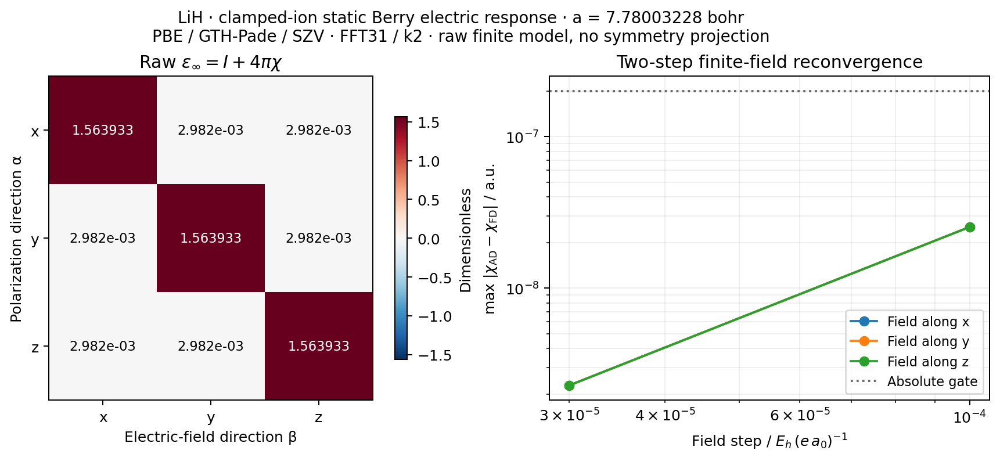

# P04 — Macroscopic electric-field response of a finite LiH model

The original FFT31 field record is retained below. Subsequent matched FFT71
data use separate `fft71*.json` files and a separately frozen source record.

This calculation differentiates periodic Berry polarization with respect to a
genuine homogeneous electric field. The observable is the clamped-ion static
electronic susceptibility `chi[alpha,beta] = dP_alpha/dE_beta`; the electronic
dielectric tensor convention is `epsilon_inf = I + 4*pi*chi`. Here `inf`
excludes the nuclear response; it does not mean an infinite-frequency optical
limit. Polarization is in `e/bohr²`, field in `Eh/(e bohr)` and susceptibility
in atomic units. The per-cell polarizability is `V*chi`.

[Response example](../../../examples/pbc/lih_dielectric.py) ·
[Finite-field validation](../../../examples/pbc/check_lih_finite_field.py) ·
[Plotting](../../../examples/pbc/plot_lih_dielectric.py) ·
[Field adapter](../../../src/gradscf/dfpt/electric.py) ·
[Born-charge record](../P04_lih_born/README.md)

## Model and derivative

The reference matches the saved P02 minimum and the separate P04 Born model:
rocksalt LiH, `a=7.780032276700287 bohr`, PBE/GTH-Pade/GTH-SZV, Cartesian AOs,
full equal-weight k2³ and FFT31³. There are four pseudopotential electrons and
three AOs per k. Nuclei, lattice, basis and grids are held fixed. This is a
finite-model implementation gate, not a basis/grid/k convergence result or an
experimental comparison. In particular, no dielectric or cubic projection is
applied, and this tensor must not be combined with a different-grid phonon
calculation to make a nominally matched IR model.

The energy minimized locally is the discrete electric enthalpy

```
F[D,E] = E_KS[D] - V E . P_Berry[D].
```

The occupied frame is constructed in a fixed local chart:
`Y = Herm(D) S Cref`, `G = Y† S Y`, `C = Y chol(G)^(-†)`.
This Cholesky extension remains smooth for non-idempotent nearby densities,
while the original KS residual enforces `D S D = D` at its root. Imposing an
idempotency validator inside the energy differentiation would incorrectly
remove the open neighborhood needed to calculate its gradient. Cross-k AO
links, all end-of-string links and a fixed local phase anchor use the same
implementation as the zero-field polarization and Born response.

For JAX's real-energy complex gradient `g`, `dB = Re sum(g*dD)`. The physical
AO convention is `dB = Re sum_k w_k Tr(F_B*dD)`, so the field contribution is
`F_B = Herm(g.T/w_k)`. Every explicit spin has unit occupations; there is no
additional restricted factor of two. This is an energy-derived, density- and
k-coupled field operator, not a chosen local AO potential or XC substitution.

`electric_problem(mf)` uses the shared Hermitian KS projector equations and
linear response. Finite-field checks reuse the shared nonlinear root solver
and its implicit differentiation. The Jacobi diagonal (`oo:+1`, `vv:-1`,
`ov:gap`) changes only numerical forward iterations. The physical residual and
its implicit Jacobian retain the complete coupled field and PBE kernels.
Canonical eigenvector differentiation and `stationary_value` on constrained
raw densities are not used.

## Independent foundation gates

The tests use an analytically solvable discrete dimer to check susceptibility,
electronic sign, spin count and equal-weight normalization under transverse
mesh replication. A nonorthogonal complex AO transform and noncanonical
occupied gauge check the metric and complex-gradient convention. An independent
SciPy scalar root checks finite fields. These five tests passed in 128.03 s.

A sixth, small periodic H2/HF test checks all three response columns and two
field steps per direction. Its separate NumPy full-Bloch AO-link and analytic
orbital-gradient implementation, solved by SciPy in an exponential orbital
chart, shares the zero-field integrals and energy. It is an independent field
solver and parameterization, not a second electronic-structure code. It passed
in 59.69 s; the independent orbital residual was `9.33e-17` and polarization
error `5.89e-18 e/bohr²`.

A seventh test differentiates the **full constrained implicit root** twice:
the electric-enthalpy Hessian must be `F_EE = -V*chi_analytic`. Both
forward-over-reverse and reverse-over-reverse give a maximum error of
`6.94e-18`, and agree with each other. It passed in 91.61 s, peak RSS
2,024,112 KiB. This check includes the second projector response; a successful
first derivative of `P(E)` alone would not establish that energy identity.

The original Berry and H2 Born regression tests also passed (23 tests,
93.05 s) after sharing the smooth frame kernel.

## LiH results and verification

The one-column resource probe passed with `chi[:,x] = [0.0448763601441,
0.000237280363338, 0.000237280363338]`, true linear residual `1.83e-15`, total
118.69 s and peak RSS 4,979,516 KiB. The raw off-diagonal response is retained.
The complete three-column calculation passed, with maximum true linear
residual `2.03e-15`. Its unprojected dielectric tensor is

```
[[1.563932973394, 0.002981752985, 0.002981752985],
 [0.002981752985, 1.563932973394, 0.002981752985],
 [0.002981752985, 0.002981752985, 1.563932973394]].
```

The raw susceptibility asymmetry is `1.35e-17`; its nonzero off-diagonal
elements are retained as a limitation of this discrete finite model. The
full workflow took **118.84 s**, peak RSS **5,646,932 KiB**, including the
fresh SCF and compilation. Its first response took 75.10 s and the subsequent
directions approximately 1.0 s each. These are process measurements on the
shared CPU node, not exclusive-core scaling results.

All **12 finite-field endpoints and six central differences** also passed
(exit 0). The maximum susceptibility errors are `2.5344e-8` at `h=1e-4` and
`2.2810e-9` at `h=3e-5`, consistent with central-difference truncation. The
declared elementwise gate is `2e-7 + 2e-5*abs(chi_AD)`. This separate workflow
took **123.11 s**, peak RSS **7,614,116 KiB**; endpoint iteration counts were
6–8, with actual residuals below `2.98e-13`.

Each finite-field endpoint additionally checks density Hermiticity,
idempotency, electron count and occupied rank; occupied and empty chart Gram
eigenvalues; overlap with the original occupied subspace; Berry-link rank and
local phase displacement; and the occupied/empty spectrum of its actual
effective Fock matrix. That effective Fock gap is a branch diagnostic, not a
quasiparticle gap or a proof of full variational stability. The declared fields
are `±1e-4` and `±3e-5` a.u. along each Cartesian axis.

Across all endpoints, the largest idempotency error is `2.23e-12`, the largest
electron-number error is `1.78e-15`, the minimum chart Gram eigenvalue is
`0.999999842`, and the minimum occupied-subspace overlap with the reference is
`0.999999921`. The effective indirect Fock gap stays above `0.14272639 Eh`,
the smallest Berry-link singular value is `0.74270805`, and no string phase
changes by more than `6.68e-4 rad`. All values are saved per endpoint in
[finite_field.json](finite_field.json), alongside [the full response](gradscf.json).

Centrosymmetric reference strings can lie at a principal-phase cut. The
fixed anchor chooses a local branch whose absolute polarization and linear
field-enthalpy constant depend on that choice. We validate same-branch
polarization differences, susceptibility and energy curvature; the reported
reference polarization is not interpreted as spontaneous polarization, and
no global transverse-branch or winding reconstruction is asserted.



The three Cartesian error curves nearly coincide; none is omitted. The
[source manifest](source_manifest.json) and [verification records](verification/)
retain actual source hashes, commands, all successful exits and resource use.
Calculation source was frozen; output comments added to the public example
afterward left its Python AST identical to the executed script at that
archival checkpoint. The current example additionally exports physical model
metadata for subsequent FFT meshes; the manifest identifies the FFT31
checkpoint, whose original JSON and executed-source archive remain unchanged.

Joint nuclear/field Maxwell derivatives, mixed higher responses, ionic
dielectric response and converged crystal IR are outside this record.

## Matched FFT71 zero-field result

The P03 Gamma-phonon FFT acceptance tests selected FFT71³ at the same fixed
lattice constant and full k2³. The matched [fft71.json](fft71.json) includes
the full three-column susceptibility together with explicit lattice,
coordinates, pseudopotential charges and spin occupation counts, so downstream
spectra can reject physically mismatched inputs. It retains the PBE/GTH-Pade/
SZV finite model; this FFT check does not establish basis or k convergence.

The raw diagonal dielectric entry is `1.56392541050588`, and the raw
off-diagonal entry is `0.00298153041610`. The susceptibility asymmetry is
`1.36e-17`. The nonzero off-diagonal response persists after FFT refinement;
further k/string-discretization checks are needed before assigning a cubic
material interpretation. No symmetrization is used to remove it.

The one-column probe passed in 190.15 s with peak RSS 19,114,420 KiB. The
full three-column run passed in 206.19 s with peak RSS 18,960,976 KiB and
maximum true linear residual `2.38e-13`. Both actual exits are zero and their
64 GiB single-process/3600 s watchdogs accepted the runs.

All **12 FFT71 finite-field endpoints and six central differences** also
passed with actual exit zero and watchdog acceptance. The maximum chi errors
are `2.53445e-8` at `1e-4` a.u. and `2.28114e-9` at `3e-5` a.u., against
the original elementwise gate `2e-7+2e-5*abs(chi_AD)`. The workflow took
490.18 s with peak RSS 45,789,376 KiB, within the 64 GiB cap.

The actual nonlinear residual never exceeds `2.98e-13`; maximum idempotency
and electron-number errors are `2.23e-12` and `1.78e-15`. The minimum Gram
eigenvalue and occupied-subspace continuity singular value are `0.999999842`
and `0.999999921`, respectively. The effective Fock gap remains above
`0.1427275156 Eh`, the smallest Berry-link singular value is `0.7427085153`,
and no phase changes by more than `6.68e-4 rad` from its fixed local anchor.
All endpoint records are in [fft71_finite_field.json](fft71_finite_field.json).


The [FFT71 manifest](fft71_source_manifest.json) and
[separate verification records](verification_fft71/) cover both the Born and
electric datasets, physical-model metadata, source hashes and all five
resource-bounded scientific jobs. This stage uses the verified field source
preceding the subsequent joint-input Maxwell wrapper. The separately
[verified dimer/H2 mixed-response stage](../P04_electric_mixed/README.md)
does not retroactively change these material calculation hashes.
