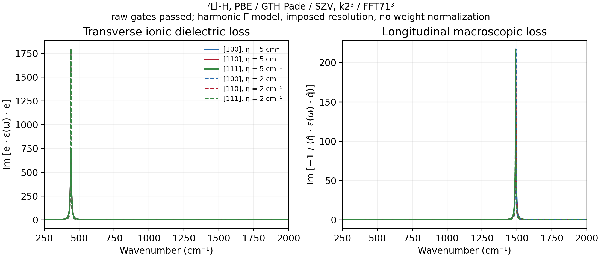
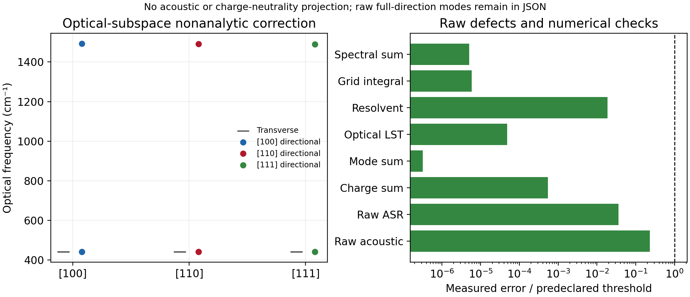

# P05: matched-grid LiH Gamma infrared response

The [calculation](../../../examples/pbc/lih_infrared.py) combines raw Gamma
force constants, Born charges and clamped-ion dielectric response from the
**same** PBE/GTH-Pade/GTH-SZV rocksalt LiH model. Its primitive cell contains
7Li and 1H, four explicit electrons, full k2³ sampling and FFT71³. The fixed
conventional lattice parameter is 7.780032276700287 bohr. The script checks
the actual basis/pseudopotential assets, geometry, k points, settings and
reference energies before combining the three files.

Upstream evidence is recorded separately for
[raw Gamma phonons](../P03_lih_gamma_phonons/README.md),
[Born charges](../P04_lih_born/README.md) and
[electronic dielectric response](../P04_lih_dielectric/README.md).
The assembly's checks and all 12 final P04 FFT71 finite-field endpoints passed.
At field steps 1e-4 and 3e-5 a.u., the largest susceptibility errors are
2.53445e-8 and 2.28114e-9. Gap, electron count, idempotency and local phase
continuity pass separately. The [delivery manifest](source_manifest.json)
checks the exact input hashes against that finite-field record and the final
Gamma-grid gate; a small postprocessing pass alone is not the validation chain.

## Quantities and approximations

The [shared kernels and conventions](../../../src/gradscf/pbc/INFRARED.md)
return the ionic dielectric tensor from transverse optical modes and add the
direction-dependent nonanalytic Gamma force constants before the shared
Hermitian eigensolve. Modes are identified by mass-weighted translation
overlap; the three optical modes enter the dielectric sum. No acoustic or
charge-neutrality projection is performed. The full raw corrected spectra,
excluded acoustic strength and original charge/force-constant defects remain
in [the numerical record](fft71.json).

The plotted transverse quantity is Im[e.epsilon(w).e]. The longitudinal
quantity is Im[-1/(q.epsilon(w).q)], using the same causal dielectric model.
These are macroscopic dielectric losses, not calibrated photon/electron
cross sections. The widths eta=5 and 2 cm^-1 are imposed resolution; no
phonon lifetime is calculated. There is no finite-q dipolar interpolation.

| Quantity | FFT71 result |
| --- | ---: |
| Three transverse optical modes | 441.4102973 cm^-1 |
| Highest [100] directional optical mode | 1492.6684805 cm^-1 |
| Highest [110] directional optical mode | 1491.3719735 cm^-1 |
| Highest [111] directional optical mode | 1490.0792694 cm^-1 |
| Diagonal epsilon-infinity | 1.5639254105 |
| Raw off-diagonal epsilon-infinity | 0.0029815304 |
| Diagonal static optical-subspace epsilon | 17.8837191135 |
| Largest raw acoustic frequency | 0.2312534 cm^-1 |
| Raw ASR Frobenius norm | 3.59661e-8 Eh/bohr² |
| Largest Born charge-sum component | 5.41248e-9 e |

The small direction dependence reflects the retained raw dielectric tensor
of this finite discretization. It must not be interpreted as physical
anisotropy of a converged cubic crystal. FFT force-constant convergence is
verified at fixed basis/k mesh; basis and k convergence of this IR model
remain open. In particular, the minimal Gaussian basis and coarse Berry
sampling do not support a quantitative experimental LiH prediction.

## Numerical gates and raw weights

The optical-subspace Lyddane–Sachs–Teller determinant identity has maximum
error 4.80e-14. A separate Cartesian resolvent agrees with the mode sum within
1.87e-10. The complete-mode charge-tensor weight identity agrees within
3.25e-19 e²/me. Last-grid integrated-spectrum change is 1.17e-9 relative,
below the fixed 2e-4 gate. Neither degenerate optical modes nor polarization
components are normalized independently.

The spectral grid spans 0–2000 cm^-1 at 0.25 cm^-1 spacing, covering both TO
and LO poles. The weighted dielectric integral is checked against its exact
finite-window Lorentz integral, with relative error at most 1.01e-11.
The full optical weight integral is 1.0369332619e-4 Eh² per Cartesian
direction; omitted high-frequency tails are about 3.41276e-7 Eh² at eta=5
and 1.36511e-7 Eh² at eta=2. They remain explicit in JSON. This harmonic
ionic weight identity is not an electronic TRK completeness statement.

The same script's FFT31 diagnostic correctly fails the original acoustic,
ASR and charge-sum gates: 74.36 cm^-1, 3.04e-3 Eh/bohr² and 6.04e-5 e.
Its [data](fft31.json) and [figure](lih_infrared_fft31.png) remain labelled as
failed diagnostics. The first plot used a TO-sized window that missed the
LO pole; a larger window at unchanged resolution was then verified. The old
window/output is retained in ignored job artifacts. No physical threshold
was loosened and no missing spectral weight was renormalized.

The FFT71 postprocessing took 7.836 s, or 9.83 s total process wall time,
with peak RSS 991,836 KiB (0.95 GiB), on `jy_gpu_1` CPU float64/JAX 0.10.0.
This excludes the separately recorded SCF, phonon and electric-response
calculations. Plotting is a [separate script](../../../examples/pbc/plot_lih_infrared.py).
All numerical work and plotting ran remotely; local review inspected the
downloaded figures and source hashes.

The [executed scripts](../../../artifacts/ad_showcase/provenance/P05_lih_infrared/executed) and [validation logs](validation/) retain
both failed coarse-grid and accepted fine-grid runs. Production source is
identical to the frozen crystal-response snapshot used for
[P07 strain](../P07_periodic_strain/README.md); its full-source archive hash is
recorded in the manifest. P05 execution copies are stored separately because
they were added later. Public scripts subsequently gained output comments only.
