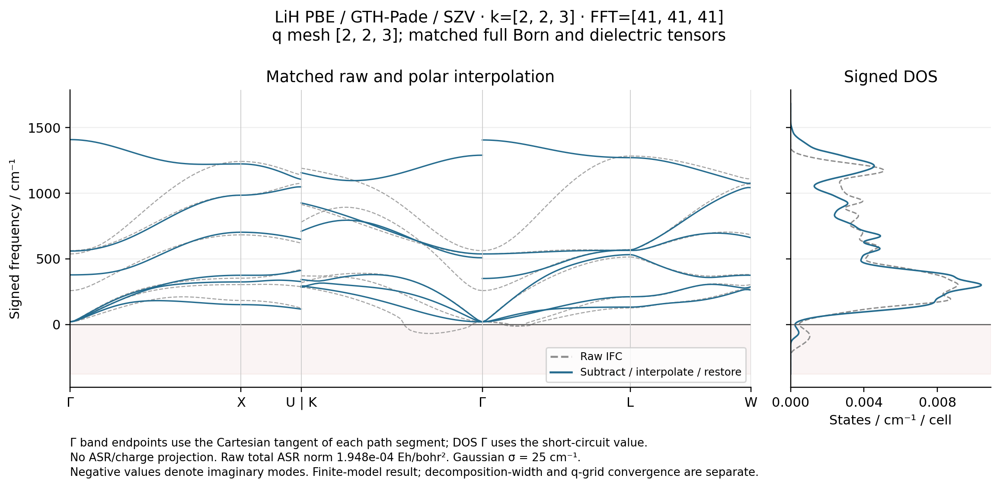

# P05 — matched LiH polar IFC bands and signed DOS

This capsule combines the complete P03 raw q mesh with GradSCF Born charges
and clamped-ion dielectric tensors from exactly the same finite electronic
model. All mechanical/electric model, geometry, energy and source checks
passed before interpolation. No ASR, acoustic-charge or cubic projection is
applied. The raw negative modes and anisotropic tensors are retained.



The calculation is LiH PBE / Cartesian GTH-SZV / GTH-Pade, four explicit
electrons, a=7.780032276700287 bohr, electronic k=(2,2,3), FFT41³, and complete
q=(2,2,3). The primitive energy is −8.035799168470177 Eh. It is a controlled
finite-model demonstration, not a converged bulk-LiH or experimental spectrum.

## Verified inputs and operations

The shared frozen snapshot is
`/home/yjiao/gradscf_checks/p03-lih-qmesh-20261016-agent`, with complete Python
source SHA256 `acc255538482dbbd7b243b5e3a577e2bd820086936fe29d67f6aaa28c66ef9b5`.
Matched input copies and their checksums are in [input_archive.json](input_archive.json)
and [inputs/](inputs/). They include the complete raw IFC matrices, full Born
tensor and its two-step displacement FD checks, full susceptibility, and all
twelve finite-electric-field endpoints/differences. The original three
electric job directories, commands and RSS/time reports are archived under
[verification/jobs/](verification/jobs/).

`PolarForceConstants.from_qmesh` subtracts the reciprocal dipole model on the
sampled q mesh, interpolates the residual through the existing shortest-image
IFC implementation, then restores the dipole model at the target point.
The main Gaussian decomposition width is 0.35 bohr⁻¹ and reciprocal cube
half-width 5. Full Born and dielectric tensors are in [gradscf.json](gradscf.json).
The raw Born charge-sum defect is about 3.64e-6 e. The total raw Gamma ASR norm
is 1.94793835933e-4 Eh/bohr²; the residual short-range norm is 7.36062001473e-4
Eh/bohr². These are distinct diagnostics and neither is projected away.

At Gamma the band plot uses the Cartesian tangent of each path segment for
the directional nonanalytic limit. Different approaches to Gamma can therefore
have different endpoint frequencies. The DOS uses the short-circuit value at
its single sampled Gamma point. It uses a 10³ q mesh and Gaussian sigma 25 cm⁻¹;
raw and polar DOS each integrate to 6 states per primitive cell.

## Measured validation and convergence boundary

| Check | Measured maximum |
|---|---:|
| Total sampled-matrix reconstruction | 1.428e-11 Eh/bohr² |
| Dipole cutoff 5 versus 6 at checked targets | 6.94e-18 Eh/bohr² |
| Dipole reciprocal-periodicity defect at cutoff 5 | 3.63e-17 Eh/bohr² |
| Actual LiH dipole model versus Phonopy, non-Gamma | 1.81e-17 Eh/bohr² |
| Phonopy short-circuit Gamma difference | 9.49e-20 Eh/bohr² |
| Phonopy directional Gamma difference | 6.94e-18 Eh/bohr² |

**Coarse-q polar interpolation is not established as converged.** Keeping the
sampled total IFCs fixed while changing the decomposition width to 0.25 or
0.45 bohr⁻¹ changes selected off-grid matrices by 0.00742119 or 0.00194668
Eh/bohr² relative to 0.35. The small reciprocal-cutoff error does not remove
this q-mesh/decomposition sensitivity. `interpolation_convergence_established`
is explicitly false in the report. More q points must use the same electronic
model; k223 and k226 matrices must not be mixed to imply convergence.

The [P03 independent Phonopy interpolation check](../P03_lih_qmesh/k2x2x3_fft41/ifc_raw/phonopy.json)
validates Fourier/image/phase/mass conventions for the raw IFC data. This
capsule's [Phonopy check](phonopy_dipole.json) independently evaluates the
actual-material reciprocal dipole model using the pinned C kernel. These
checks share the electronic input tensors; they are not new independent SCF
calculations. The separate
[complex-q PySCF gradient finite differences](../P03_lih_qmesh/k2x2x3_fft41/pyscf_zthird/finite_differences.json)
now pass the original 5e-6 Eh/bohr² action and step-stability gates at both
3e-4 and 1e-4 bohr. The maximum action errors are 4.67e-9 and 2.87e-8 Eh/bohr²;
the smaller step is not more accurate. This checks the nonzero H-x action at
q=(0,0,1/3), not the complete matrix or bulk convergence.

## Execution and reproduction

All numerical work and plotting ran remotely on c20, Intel Xeon Platinum 8457C,
CPU float64/complex128, OMP/OpenBLAS=2, with unchanged default affinity and
actual-RSS/time watchdogs. The final native material postprocessing took 31.37 s
and 1,322,908 KiB peak RSS; the independent kernel check took 0.753 s / 67,336 KiB.
Three focused RED→GREEN tests reject mixed FFT, mixed geometry and unvalidated
Born tensors. The source SCF/IFC factory is eager; this example adds no new
mode solver or derivative promise for individual degenerate modes.

The public examples use ordinary function parameters. With the pinned oracle
folder on `PYTHONPATH`, the following replays the archived inputs into a fresh
output folder:

```python
from examples.pbc.lih_polar_bands import run
from examples.pbc.compare_lih_polar_phonopy import run as check_phonopy

base = "reproducibility/ad_showcase"
output = "artifacts/ad_showcase/P05_polar_replay"
run(f"{base}/P03_lih_qmesh/k2x2x3_fft41/ifc_raw",
    f"{base}/P04_lih_born/k223_fft41.json",
    f"{base}/P04_lih_dielectric/k223_fft41.json",
    f"{base}/P04_lih_dielectric/k223_fft41_finite_field.json",
    output=output)
check_phonopy(output)
```

The independent check uses
Phonopy 2.44.0 / Spglib 2.5.0 / Symfc 1.5.0 in the existing isolated oracle folder;
it imports no GradSCF module. Exact executed scripts, relevant production
source copies, input hashes and command/resource records are included here.
The frozen remote CLI version remains unchanged; copies are preserved under
`artifacts/ad_showcase/provenance/P05_lih_polar_bands/executed/cli_before_function_api`. The interface-conversion manifest at
`artifacts/ad_showcase/development/public_example_api/migration_manifest.json` verifies
unchanged numerical-helper and computation-body ASTs. Current remote replays
must use the shared CPU 16–31 pool and two OMP/BLAS/MKL/NUMEXPR threads, even
though the original measurements above predate that policy.
