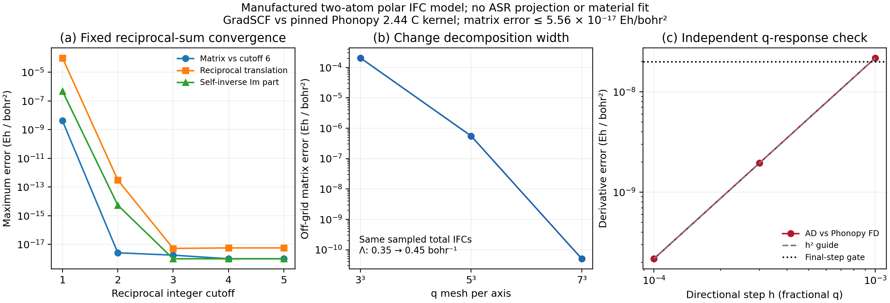

# Polar force-constant interpolation: independent kernel validation

This capsule validates the long-range subtraction/interpolation/restoration
implementation on a manufactured two-atom model. It does **not** contain a
material phonon dispersion or a new electronic-structure reference. All
numerical calculations and plotting ran on `jy_gpu_1` on 2026-10-16, in
float64 on CPU. The example uses the shared IFC interpolator and linear/
eigenvalue infrastructure; no replacement solver is introduced.



## Model and conventions

Lattice vectors are rows, in bohr; reciprocal fractional q uses the phase
`exp(2 pi i q.R)`. For angular reciprocal vectors

\[
\mathbf Q=(\mathbf G+\mathbf q)2\pi A^{-T},\qquad
b_{a\alpha}(\mathbf Q)=e^{i\mathbf Q\cdot\tau_a}
\sum_i Q_i Z^*_{ai\alpha},
\]

the fixed reciprocal model is

\[
L(\mathbf q)=\frac{4\pi}{V}\sum_{\mathbf G}
\frac{b(\mathbf Q)b(\mathbf Q)^\dagger}
{\mathbf Q^T\epsilon_\infty\mathbf Q}
\exp\left[-\frac{\mathbf Q^T\epsilon_\infty\mathbf Q}{4\Lambda^2}\right].
\]

The implementation uses a finite integer cube, without differentiating a
cutoff or wrapping q. Matrices are unweighted force constants in Eh/bohr².
Born tensors use polarization index first and displacement index second.
The model deliberately contains nonsymmetric Born tensors and an anisotropic
dielectric tensor. Full numerical inputs are in [gradscf.json](gradscf.json).

At Gamma, `gamma()` excludes G=0; `gamma(direction)` adds the directional
nonanalytic limit in a specified Cartesian direction. There is no unique
q derivative at Gamma. Parameter derivatives of these specified limits are
well-defined and tested separately.

The total interpolation is

\[
\Phi_{\mathrm{interp}}(q)
=\operatorname{FourierInterpolate}[\Phi(q_m)-L(q_m)]+L(q).
\]

A consistent q-independent onsite convention cancels between subtraction
and restoration. The example intentionally retains a raw translational defect
of 0.79989235399 Eh/bohr²; this manufactured matrix is not a physical stable
crystal. The total and short-range ASR residuals are stored separately. No
ASR or charge-neutrality projection is applied.

## Measured checks

| Check | Maximum error |
| --- | ---: |
| Non-Gamma matrices vs Phonopy | 1.23e-17 Eh/bohr² |
| Gamma without macroscopic field | 8.68e-19 Eh/bohr² |
| Directional Gamma limit | 1.39e-17 Eh/bohr² |
| Restored off-grid total matrix | 5.56e-17 Eh/bohr² |
| q JVP vs independent FD, h=1e-3 | 2.175e-8 Eh/bohr² |
| q JVP vs independent FD, h=3e-4 | 1.957e-9 Eh/bohr² |
| q JVP vs independent FD, h=1e-4 | 2.175e-10 Eh/bohr² |

The derivative direction is `[0.2, -0.1, 0.3]` in fractional q. The derivative
error decreases quadratically with the finite-difference step. The declared
matrix and final-step derivative thresholds are 1e-11 and 2e-8, respectively.

Keeping the sampled total matrices fixed while changing the decomposition
width from 0.35 to 0.45 bohr⁻¹ gives off-grid errors of 2.057e-4, 5.572e-7
and 5.049e-11 Eh/bohr² on 3³, 5³ and 7³ q meshes. Reciprocal-cutoff and
q-mesh convergence are distinct tests; a finite reciprocal sum is only
approximately periodic before its cutoff converges.

The independent program imports no GradSCF module. It calls the reciprocal
C kernel of **Phonopy 2.44.0**, with isolated Spglib 2.5.0 and Symfc 1.5.0.
The reference uses reciprocal cycles, so its Gaussian width is
`Lambda_angular/(2*pi)`. Its atomic gauge is transformed to the same lattice
gauge with `U_a=exp(i q_cart.tau_a)`. The pinned private API is intentional;
using another Phonopy version requires a fresh API and numerical check.

The underlying implementation follows the reciprocal dipole decomposition
described by [Gonze and Lee (1997)](https://doi.org/10.1103/PhysRevB.55.10355)
and the Phonopy implementation described by
[Togo et al. (2023)](https://doi.org/10.1088/1361-648X/acd831).

## Execution and provenance

- Native example: 24.14 s numerical body; 27.53 s including the watchdog;
  peak RSS 1,638,228 KiB.
- Independent Phonopy comparison: 1.50 s including the watchdog;
  peak RSS 69,244 KiB. Both jobs exited zero within their bounds.
- Related regression group: 18 new polar tests plus 11 existing IFC tests,
  **29 passed in 142.60 s**. Checks include q/-q conjugacy, reimaging,
  rotations, invalid dynamic inputs, parameter/q AD, onsite equivalence,
  and deliberately rejected underresolved reciprocal sums.

Run from the repository root using the environment recorded in the
[validation commands](validation/):

```python
# GradSCF and Phonopy are separate executions/environments.
from examples.pbc.polar_interpolation import run
run()
```

The ordinary scripts are
[native](../../../examples/pbc/polar_interpolation.py),
[independent reference](../../../examples/pbc/compare_polar_ifc_phonopy.py)
and [plotting](../../../examples/pbc/plot_polar_interpolation.py).
Exact executed versions are in [executed/](../../../artifacts/ad_showcase/provenance/P05_polar_interpolation/executed), with
[source hashes](source_manifest.json), [oracle data](phonopy.json), and the
[source archive checksum](source_archive_sha256.txt). The local source archive
is retained under ignored `artifacts/ad_showcase/development/P05_infrared/polar-source.tar.gz`.

Material finite-q interpolation still requires matched force constants,
Born charges, dielectric data and separate discretization convergence.
The eager IFC factory does not differentiate back through the source SCF.
