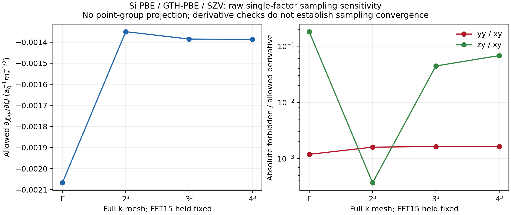
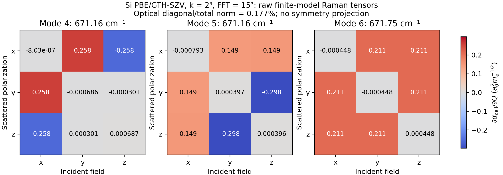
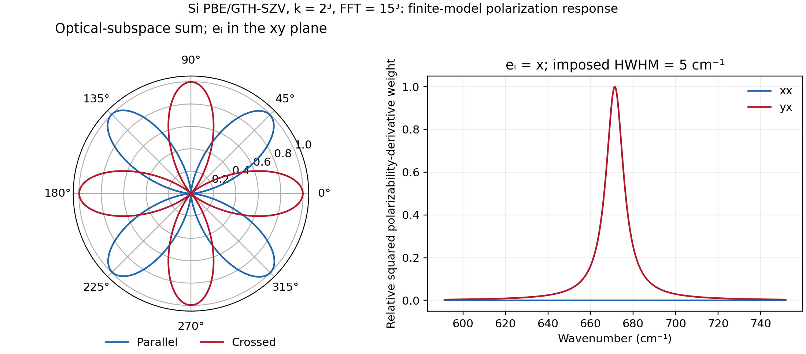
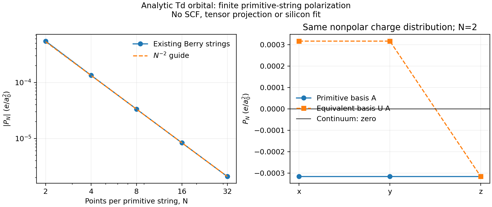

# P06 — Crystal Raman response and sampling sensitivity

The Si Gamma/FFT15 and k2/FFT15 calculations have complete raw mode tensors,
matched Gamma phonons, fixed-anchor orbital-gauge checks, zero/translation
checks, and independently reconverged two-step finite differences. Their
static reciprocity errors in dchi/dQ are 1.15e-16 and 2.84e-15 atomic units,
respectively.
**These derivative checks do not establish a converged silicon spectrum.**
The forbidden components vary nonmonotonically between Gamma, k2, k3 and k4.
All raw tensors, acoustic defects and negative frequencies are retained.

The separate small LiH calculation closes an inversion-forbidden Raman test:
its raw AD derivative is below 5.64e-17, and the independent finite-difference
error is 4.55e-14. This is a secondary material check, with its own geometry,
pseudopotentials, isotope masses and FFT15 grid.

## Examples and recorded outputs

- [Single-column Si response](../../../examples/pbc/silicon_raman.py)
- [Gauge, invariant and cold-SCF checks](../../../examples/pbc/check_silicon_raman.py)
- [Matched phonons and complete tensors](../../../examples/pbc/silicon_raman_tensor.py)
- [Raw tensors, polarization and sampling plots](../../../examples/pbc/plot_silicon_raman.py)
- [Independent LiH inversion check](../../../examples/pbc/lih_raman_selection.py)







The corresponding PDFs and CSV tables are stored alongside these images.
[Gamma tensors](gamma_fft15_raw_tensors.png) and
[Gamma polarization response](gamma_fft15_polarized_response.png) show the
larger coarse-model defects instead of replacing them with the k2 result.
The display half width is 5 cm^-1; it is not a calculated lifetime.

## Physical model and normalization

Si uses PBE/GTH-PBE/GTH-SZV, a two-atom FCC primitive cell at a=5.43 Angstrom,
zero temperature, and a fixed lattice. Sites are ±a(1,1,1)/8, placing the
inversion center at the FFT origin. Each spin has four occupied orbitals;
there are eight AOs. The chosen mass is 28.0855 u per atom. Atomic mass units
are converted explicitly to electron masses.

For a mass-weighted unit eigenvector e_nu, the displacement is

```
u_(kappa,nu) = e_(kappa,nu) / sqrt(M_kappa in electron masses)
R(Q_nu) = R0 + Q_nu*u_nu,       Q_nu in sqrt(me)*bohr
sum_kappa M_kappa |u_(kappa,nu)|² = 1.
```

The primary probe uses the normalized optical z direction
`e=(+z,-z)/sqrt(2)` without assigning a frequency. The complete calculation
then obtains the actual raw Gamma Hessian of the same electronic model and
contracts all six mass-scaled Cartesian responses with its eigenvectors.
It does not import frequencies from another k mesh, grid or geometry.

The field enters through the electric enthalpy

```
F(x;R,E) = E_KS(x;R) - V*E·P(x;R),       R_SCF(x;R,E) = 0.
```

The projector residual supplies implicit derivatives of the stationary state.
The Berry polarization observer uses a fixed reference chart and branch anchor,
while overlap, AO grid values and geometry inputs move. Two nested JVPs give

```
chi_(alpha,beta) = dP_alpha/dE_beta
dchi_(alpha,beta)/dQ_nu = d/dQ_nu [dP_alpha/dE_beta]
Raman_nu = d alpha_cell/dQ_nu = V*dchi/dQ_nu
          = -d³ F_stationary/(dQ_nu dE_alpha dE_beta).
```

This is a third energy derivative. No canonical-orbital eigenvector derivative,
SCF-trajectory differentiation, copied response solver, or Taylor-jet rule is
used. The actual differentiated residual is independently evaluated with
`x=x0+Q*x_Q+E*x_E+Q*E*x_QE`; its first-field and mixed derivatives must pass
the numerical residual gate.

`d epsilon_inf/dQ = 4*pi*dchi/dQ`, `d alpha_cell/dQ = V*dchi/dQ`, and the
conventional susceptibility `sqrt(V)*dchi/dQ` are distinct normalizations.
The mass and volume conventions follow
[Veithen, Gonze and Ghosez, PRB 71, 125107](https://arxiv.org/pdf/cond-mat/0409067)
and the [ABINIT nonlinear-response tutorial](https://docs.abinit.org/tutorial/nlo/).
The plotted cell-polarizability derivative has units `bohr²/sqrt(me)`.

## Derivative validation

The fixed settings use SCF energy/density/gradient thresholds
1e-12/1e-11/1e-10, GMRES rtol/atol=1e-10/1e-12, and a nonlinear residual
threshold of 1e-11. Actual reference, field and mixed residual maxima must be
below 1e-10. Zero/translation/gauge errors must be below 1e-8. Each FD step
rebuilds and independently reconverges the displaced zero-field SCF and its
field-response root; no finite difference generates the reported Raman slope.

| Si k mesh, FFT15 | Zero tangent | Maximum translation derivative | Gauge column error | FD error, 3e-4 bohr | FD error, 1e-4 bohr |
|---|---:|---:|---:|---:|---:|
| Gamma | 0 | 8.09e-17 | 1.79e-18 | 1.192e-9 | 1.227e-10 |
| 2x2x2 | 0 | 1.21e-18 | 4.68e-17 | 5.790e-10 | 7.886e-11 |

FD steps are the maximum Cartesian displacement of any atom:
`delta_Q=h/max(abs(u))`. The predeclared elementwise gate is
`abs(FD-AD) < 2e-8 + 5e-4*abs(AD)`.
For k3, separate probe-only two-step FD records confirm the surprising
nonzero zy component: errors in that component are 1.554e-10 and 1.756e-11.
These records do not substitute for a complete k3 invariant/gauge validation.

Complex unitary occupied/empty rotations use the same saved physical reference
and original Berry anchor. The material gauge checks preserve the density and
baseline polarization. The complete tensors also recover the original
normalized optical column to 8.24e-18 (Gamma) and 4.45e-15 (k2), checking the
Cartesian-to-mode normalization and field-index convention.

## Point-group defects and sampling

For the ideal diamond-Si T2g triplet, a z optical displacement selects xy/yx
Raman components. The point-group identification is discussed in this
[primary Raman study](https://doi.org/10.1088/1361-648X/ae1c0b).
Static reciprocity, numerical differentiability and point-group selection are
separate checks. No crystal-symmetry projection is applied here.

| Full k mesh, fixed FFT15 | dchi_xy/dQ | dchi_yy/dQ | dchi_zy/dQ | abs(zy/xy) |
|---|---:|---:|---:|---:|
| Gamma | -2.067423991e-3 | 2.457485829e-6 | -3.758335665e-4 | 18.1788% |
| 2x2x2 | -1.350283758e-3 | 2.156330454e-6 | -4.992181060e-7 | 0.0370% |
| 3x3x3 | -1.385258012e-3 | 2.264156385e-6 | 6.174147972e-5 | 4.4570% |
| 4x4x4 | -1.386857612e-3 | 2.266540346e-6 | 9.457595233e-5 | 6.8194% |

The k2 minimum is not a convergence estimate. The sign and magnitude of the
k3 defect are independently reproduced by cold-SCF finite differences.
The k4 row passes actual residual checks but does not yet have an independent
finite-difference validation. Its larger defect rules out treating k2 as a
converged result; FFT resolution at fixed k4 is the next controlled variable.
The full optical-subspace diagnostic

```
sqrt(sum_nu,i |R_nu,ii|²) / sqrt(sum_nu ||R_nu||_F²)
```

is invariant to orthogonal changes of basis within the complete triplet.
It is 24.1974% for Gamma and 0.176574% for k2. The off-diagonal coefficient
singular values `(sqrt(2)*R_yz, sqrt(2)*R_zx, sqrt(2)*R_xy)` are
`[1.076862,0.646169,0.646169]` and `[0.516175,0.515603,0.515603]`, respectively.
They are reported as raw diagnostics, without an invented acceptance threshold.
Individual normal-mode signs and bases within exactly degenerate groups are
arbitrary. Comparisons between sampling meshes use the complete optical
subspace diagnostics and summed polarization weights. The frequency-resolved
plots retain the actual diagonalizing modes and their associated frequencies.

The original k4/FFT15 attempt converged SCF but aborted in LLVM section-memory
allocation after 1083.51 s. Peak RSS was 19,687,304 KiB, below the 32 GiB limit;
this was neither a time limit nor a failed physical residual. Its incomplete
record and actual failure log are preserved. An example-only JIT staging
change now passes the reference AO/grid data and coordinates as runtime
operands. Gamma and k2 optical/zero/translation outputs and all reported
residuals reproduce the original values exactly. Nested-JAX-graph captured
array bytes fall from 3,780,694 to 2,726,566 (Gamma), and from 17,445,483 to
3,415,939 (k2). These counts are not LLVM allocation sizes or VMA counts.
The instrumented k4 retry also aborted in LLVM allocation after 1157.79 s,
with peak RSS 19,343,656 KiB and no memory-budget violation. The final sampled
mapping count was 63,703, about 0.55 s before the fatal allocation, against
the node ceiling of 65,530. This is evidence of rapid mapping growth near the
limit; the exact ceiling was not observed. Neither failed attempt produced
an accepted response.
A follow-up batches the existing Hermitian coordinates in the shared KS
residual. Before modification, 2 to 32 blocks grew real residual/JVP graphs
from 242/316 to 3578/4498 operations and complex graphs from 298/410 to
4474/6002. The corresponding batched counts are constant at 107/141 and
135/188. Nineteen focused tests pass, including exact coordinate order,
empty/partial/full occupations, real/complex AD and third-order Taylor.
Sixteen existing molecular, periodic, electric and mixed-response tests
also pass (907.70 s; peak RSS 6,277,560 KiB). These later runs use the
explicitly authorized CPU32-47 affinity pool, with BLAS/OpenMP limits of 2.
The saved-value Si k2 parity check also passes: the optical derivative
changes by 2.39e-18, zero displacement remains zero, and the translation
derivative changes by 3.31e-20. All actual residuals stay below 1e-10.
This run took 414.26 s with 9,937,356 KiB peak RSS and 14,450 observed VMAs.
The same k4/FFT15 model subsequently completed in 331.59 s, with peak RSS
12,118,004 KiB and 14,617 observed VMAs. Its actual reference/field/mixed
residuals are 6.66e-16 / 1.03e-11 / 2.33e-13. The SCF energy, gap and minimum
Berry link match the failed attempts exactly. Since affinity also changed,
feasibility cannot be attributed solely to batching.
The independent graph-size regression establishes the removal of block
expansion; neither test subset establishes a converged Raman spectrum.
An additional input guard preserves the original rejection of zero spin/k
blocks (11 final batching tests pass). Empty occupied sectors remain valid.
It does not change any nonempty physical branch. At fixed k4, FFT25 completed
with raw `dchi[:,y]/dQ = [-1.385819328e-3, -1.032028221e-8, 9.330841514e-5]`.
The yy component decreases strongly, while abs(zy/xy) remains about 6.73%.
Its field/mixed residuals are 1.87e-11 / 2.58e-13; elapsed time is 448.41 s
and peak RSS is 21,084,116 KiB. This separates an FFT-sensitive component
from a defect that has not disappeared with that refinement.

One authorized FFT31 attempt exceeded the unchanged memory cap and was
stopped by the RSS watchdog after 501.33 s (33,683,996 KiB versus the
33,554,432 KiB limit). The partial reference and compiler log are retained;
there is no accepted FFT31 Raman value. The first FFT25 cold-SCF FD attempt
also exceeded that cap, before an endpoint result was available. An
example-only staging repair now builds each endpoint's integrals once,
passes them to the ordinary cold SCF as JIT operands, and likewise passes
the field root's reference inputs explicitly. The physical definitions,
Berry anchor, independent endpoint SCFs, step sizes and numerical gates
are unchanged. Its Gamma/k2 baseline parity and final FFT25 FD checks remain
pending. Neither resource failure is reported as a physical residual failure.

## Independent finite-string diagnostic



This separate analytic model has four equal orbital probabilities at
`d*(1,1,1)`, `d*(1,-1,-1)`, `d*(-1,1,-1)`, `d*(-1,-1,1)`, with d=0.2 bohr.
Its continuum polarization is exactly zero. Its overlap is known without
SCF or FFT quadrature:

```
S(q) = cos(qx*d)*cos(qy*d)*cos(qz*d)
       + i*sin(qx*d)*sin(qy*d)*sin(qz*d).
```

Using these overlaps in the existing `_berry` string algebra agrees with
`N*arg(S(b_i/N))` to at most 2.55e-21. Nevertheless, reconstructing a vector
from only the three FCC primitive directions gives a finite nonpolar-symmetry
defect. Its norm falls from 5.4763e-4 at N=2 to 2.0870e-6 at N=32 e/bohr²;
`N²*|P_N|` approaches 0.002137. A C2z rotation maps the primitive basis through
an integer determinant-one matrix and leaves the same Td distribution
unchanged. Coordinate covariance is exact, but the finite result differs
between these equivalent basis choices. No averaging or symmetry correction
is applied.

The primitive-string functional is the discretized construction in
[Souza, Iniguez and Vanderbilt (2002)](https://arxiv.org/abs/cond-mat/0205633).
The Td counterexample and its implication for this implementation are our
independent diagnostic, not a claim made by that paper. It demonstrates that
correct AD/phase algebra does not by itself enforce a continuum point-group
constraint at finite N. It does not quantitatively assign the silicon
Raman leakage to this mechanism or rule out every other core issue.
Raw records and the exact source hash are in
[berry_stencil_toy/result.json](berry_stencil_toy/result.json).

## Matched raw frequencies and polarization weights

| Model | Raw acoustic frequencies (cm^-1) | Raw optical frequencies (cm^-1) | Raw ASR norm (Eh/bohr²) |
|---|---|---|---:|
| Gamma / FFT15 | -9.1669, 10.5369, 10.5369 | 859.5752, 859.5919, 859.5919 | 2.67683e-4 |
| k2 / FFT15 | -22.5511, -22.5511, 16.9475 | 671.1601, 671.1601, 671.7498 | 1.16405e-3 |

Negative signed frequencies denote negative raw curvatures. No acoustic sum
rule projection is applied. These are fixed-geometry finite-model values;
they are not a prediction of experimental silicon stability or frequencies.
The mass-weighted eigenvectors and full raw matrices are available in the
`*_phonons.json` records.

The figures use `|e_s^T R_nu e_i|²` and a single common normalization for the
parallel/crossed comparison. The broadened optical weights use actual matched
frequencies and the declared display width. Photon/thermal prefactors,
resonant enhancement and absolute Raman cross sections are not included.
All six raw modes, including the negative acoustic modes, remain in the CSV.

## Independent LiH inversion check

[lih_k2_fft15_selection.json](lih_k2_fft15_selection.json) uses the P03/P04
lattice parameter 7.780032276700287 bohr, PBE/GTH-Pade/GTH-SZV, k2, FFT15,
and masses 7.0160034366 u (7Li), 1.00782503223 u (1H). The optical mass-weighted
vector is orthogonal to translation and its Cartesian displacement has unit
mass norm. It is not assigned an FFT71 frequency.
Inversion maps this optical coordinate from Q to -Q while leaving the
susceptibility invariant, so its first Raman derivative must vanish. The
check reconverges both displaced structures instead of imposing that zero.

The forbidden raw AD column has maximum magnitude 5.63413e-17, actual mixed
residual 1.22333e-14, and reconverged inversion-related FD error 4.54201e-14.
The run completed with exit zero in 527.33 s and peak RSS 11,881,960 KiB.
This validated inversion rule does not replace the unresolved Si k/FFT study.

## Execution and source records

All calculations and plots ran on `jy_gpu_1`, CPU float64, JAX 0.10.0. Timing
records include compilation and do not describe exclusive-core benchmarks.
Full Gamma/k2 tensor jobs took 378.91/440.26 s at the watchdog level, with
peak RSS 10,324,500/11,492,252 KiB. Every job used a separate actual-RSS
watchdog and timeout. Early runs had no affinity restriction; later runs use
the explicitly authorized CPU32-47 pool. Global cache policy and VM limits
were not changed. These timings are not isolated single-factor speedups.

[validation/](validation/) contains selected exact commands, exits and budget
records. [executed_sources.json](executed_sources.json) identifies the frozen
example versions used by the completed calculations. The checkpoint loader
stores optional None fields as ordinary string metadata and never enables
pickle loading. Its two focused regression tests pass on the remote CPU.
The original checkpoint-loading/dtype failures are retained as execution
history; neither generated a physical gauge result.

`run_tensors(resume=True)` requires identical settings, source hashes and the
same phonon record. A fresh invocation after recomputing phonons uses
`resume=False`; it never claims reuse of the previous phonon hash. Public
examples use ordinary Python calls and contain no command-line parser.
