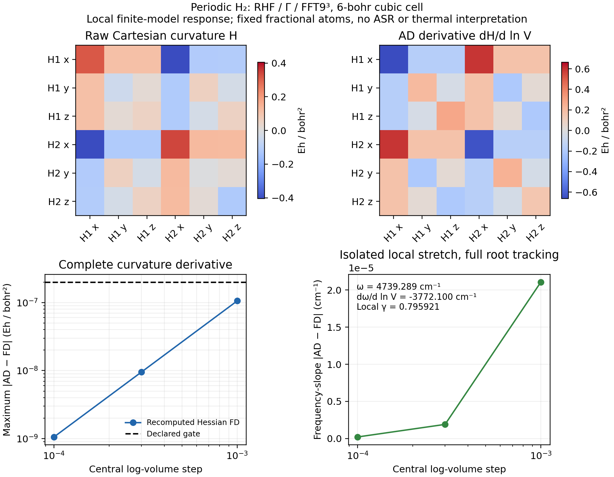

# P07: local periodic curvature response to volume

The [plain example](../../../examples/pbc/h2_strain_response.py) differentiates
a periodic RHF energy three times through the existing Gaussian FFT integrals
and implicit SCF. No production solver changes were needed. The
[separate plotting script](../../../examples/pbc/plot_h2_strain_response.py)
uses the saved data.

This is a small **finite-model derivative check**, not a stable material
prediction. H2 occupies a 6-bohr cubic cell, at coordinates
(0.4, 0.5, 0.6) and (1.8, 0.8, 0.9) bohr, with the default GTH-SZV/GTH-Pade
assets recorded explicitly in JSON, Gamma sampling and FFT9³.
The supplied geometry is not optimized; the raw curvature has three negative
eigenvalues. They are preserved. Only the isolated highest, stretch-like
positive curvature is used for the local mode-sensitivity demonstration.

## Differentiated quantity

Let s=ln(V/V0), and let u contain independent Cartesian displacements:

\[
A(s)=e^{s/3}A_0,\quad R(s,u)=e^{s/3}R_0+u,
\quad H_{ab}(s)=\left.\partial_{u_a}\partial_{u_b}E(s,u)\right|_{u=0}.
\]

Fractional equilibrium coordinates and fractional k points stay fixed under
strain. The displacement u remains Cartesian and does not scale with s.
AD calculates H and dH/ds. A second construction uses all six Cartesian
force-response columns from the existing `dfpt.atomic_problem`; it checks
the energy-Hessian path against the established projector/Pulay response.
It is an independent assembly on the same electronic model, not an external
electronic-structure code.

For fixed masses, D=M^(-1/2)HM^(-1/2). For one isolated normalized mode e,

\[
\lambda'=e^\dagger D'e,\quad \omega'=\lambda'/(2\omega),
\quad \gamma_{\rm local}=-\partial_{\ln V}\ln\omega=-\lambda'/(2\lambda).
\]

The example uses the shared Hermitian solver and checks the selected spectral
gap and overlap at every displaced volume. It does not differentiate a sorted
root through a degeneracy or wrap the eager `Phonons.kernel` facade in AD.
For a degenerate group, a complete-subspace invariant would be required.

## Measured checks

The native energy is -1.2297088021737443 Eh. Energy-Hessian versus DFPT maximum
error is **1.19e-15 Eh/bohr²**, below the fixed 2e-8 gate.

| Central log-volume step | Max dH/d ln V error / Eh bohr^-2 | Selected dω/d ln V error / Eh |
| --- | ---: | ---: |
| 1e-3 | 1.05677e-7 | 9.60583e-11 |
| 3e-4 | 9.51042e-9 | 8.66233e-12 |
| 1e-4 | 1.05959e-9 | 9.48592e-13 |

The smallest-step gates are 2e-7 Eh/bohr² and 2e-9 Eh, respectively.
Both sequences exhibit the expected central-difference convergence.
The selected frequency is 0.021593788194509175 Eh,
dω/d ln V = -0.017186951453135358 Eh and the local sensitivity
gamma = **0.7959210907470892**. These numbers characterize the specified raw
finite model; they are not a relaxed-volume or bulk thermodynamic Grüneisen
parameter. No ASR or clipping changes the spectrum.

The formal workflow completed on `jy_gpu_1`, CPU float64/JAX 0.10.0,
in 61.967 s including compilation, with peak RSS 2,369,960 KiB (2.26 GiB).
The exact execution command, software, source hashes and hardware are in the
[manifest](source_manifest.json); [logs and executed script](validation/)
retain actual exits and process resources. An earlier small probe also passed;
its SSH connection ended with 255 after a disconnect, while the remote process
wrote exit 0. It was not duplicated or reported as a numerical failure.

The frozen source archive SHA-256 is
`529568fea03397660868d65e5856d5f5d4c08ab17d70bb692b29b3fff166aac0`, retained in
local ignored `artifacts/ad_showcase/development/P07_strain/`. Public code subsequently
received whitespace cleanup and measured-output comments only; its numerical
AST is checked against the executed copy.

This completes a local strain derivative gate. Electronic-temperature
response at positive temperature must instead differentiate fixed-N Mermin
free energy. Thermal expansion, internal-coordinate relaxation and
anharmonic shifts are different paths and are not supplied by this example.
XC-parameter and converged material sensitivities remain separate extensions.
