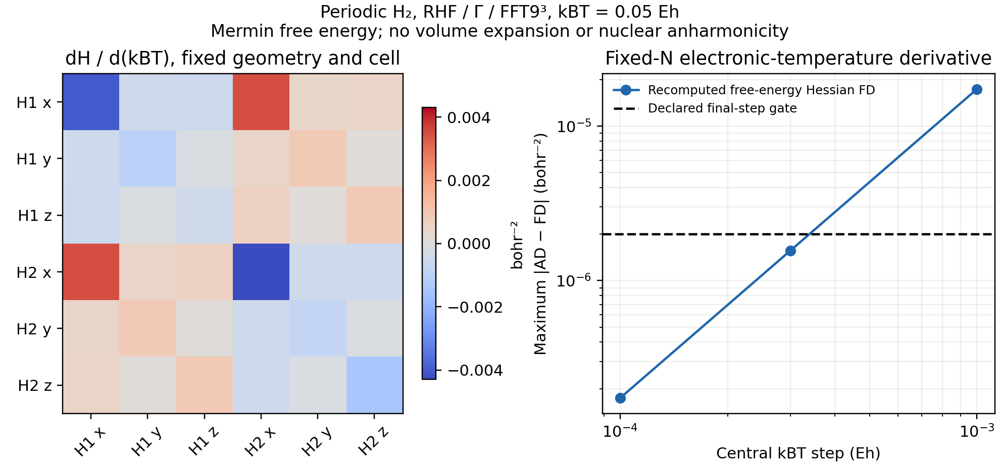

# P07: fixed-cell electronic-temperature curvature response

The [ordinary example](../../../examples/pbc/h2_temperature_response.py)
extends the small [periodic H2 strain gate](../P07_periodic_strain/README.md)
to **positive electronic temperature at fixed cell and geometry**. It uses
the fixed-N Mermin free energy, not the internal energy, for force constants.
No SCF, response or eigensolver is added. The
[separate plot](../../../examples/pbc/plot_h2_temperature_response.py)
uses saved tensors and finite-difference records.

The model is RHF/GTH-SZV/GTH-Pade, Gamma, FFT9³, a 6-bohr cubic cell and the
same unoptimized H2 geometry as the strain example. It has two explicit
electrons with fixed spin populations (1,1). The derivative is taken at
theta=kBT=0.05 Eh. Theta varies; nuclear coordinates, lattice, basis and grid
do not. The raw curvature again has three negative eigenvalues, which remain
in JSON. This is a local finite-model derivative check, not a stable crystal
or a converged thermal phonon prediction.

## Differentiation and verification

At fixed electron number, the stationary objective is

\[
F(R,\theta)=E(R,\theta)-\theta S(R,\theta)/k_B.
\]

Its density, orbitals, occupations and chemical potential respond through
the existing implicit SCF. AD forms H=F_RR and H_theta. The six Cartesian
columns of the existing thermal `atomic_problem` give the separate DFPT
assembly. The maximum difference is **2.04e-13 Eh/bohr²**.

The computed free energy is -1.2297096613641776 Eh, internal energy
-1.2296981842421504 Eh and entropy S/kB=0.0002295424405436.
AD gives F_theta=-0.0002295424370734, agreeing with -S/kB within 3.5e-12.
The occupation pair per spin is approximately
(0.999995703968, 0.000004296032), and the fixed electron counts pass.
The identity F=E-theta*S/kB is checked independently in the example.

| Central theta step / Eh | Max H_theta AD-FD error / bohr^-2 | Isolated omega_theta error |
| --- | ---: | ---: |
| 1e-3 | 1.73938e-5 | 3.91096e-7 |
| 3e-4 | 1.56550e-6 | 3.52040e-8 |
| 1e-4 | 1.73946e-7 | 3.91164e-9 |

The final gates, fixed before the formal calculation, are 2e-6 bohr^-2 and
2e-8 for the dimensionless frequency slope. Both sequences show the expected
central-difference decrease. Every displaced Hessian uses a reconverged thermal
SCF state. Independent numerical diagonalization and mode overlap checks keep
the same isolated highest mode, rather than assigning a derivative across
a root crossing.

The selected local mode has omega=0.0215933447721773 Eh and
**d omega/d(kBT)=-9.88168908582e-5**. This slope is dimensionless because
both omega and kBT are expressed as energies. For a Kelvin derivative,
multiply by kB in Eh/K. It is distinct from the fixed-temperature volume
derivative in the strain example. No thermal expansion, nuclear temperature,
anharmonicity or transport lifetime is included.

## Reproducibility and scope

The formal run completed on `jy_gpu_1`, CPU float64/JAX 0.10.0, in
95.537 s including compilation, with peak RSS 2,519,812 KiB (2.40 GiB).
An initial curvature-only probe passed separately in 82.972 s. Commands,
software, exact source hashes, [execution copies](../../../artifacts/ad_showcase/provenance/P07_periodic_temperature/executed) and
[actual logs/exits](validation/) are recorded in the
[manifest](source_manifest.json). The production source is the same frozen
crystal-response tree as the strain example; no core fix was required.

This checks positive-temperature, fixed-N derivatives only. The zero-temperature
fixed-occupation branch is not differentiated by treating `None` as theta=0.
Converged-material and XC-parameter sensitivities remain separate work, and
complete-subspace invariants are required for degenerate modes.
