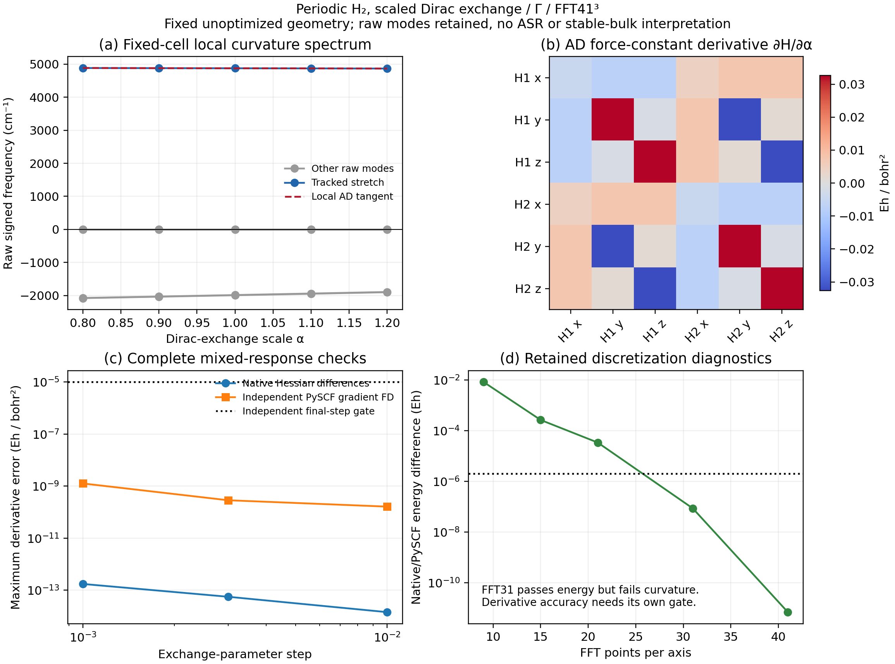

# Periodic curvature response to an external XC parameter

This example differentiates the fully relaxed periodic SCF energy with respect
to two nuclear displacements and an external functional parameter. It completes
the XC-parameter companion to the separate volume and electronic-temperature
examples. All numerical calculations and plotting ran on `jy_gpu_1` (`c20`).

```bash
PYTHONPATH=src python examples/pbc/h2_xc_response.py
PYTHONPATH=src python examples/pbc/compare_h2_xc_response.py
python examples/pbc/plot_h2_xc_response.py
```

The external functional is
\(E_x[\rho;\alpha]=-\alpha\frac34(3/\pi)^{1/3}\int\rho^{4/3}\,dr\),
with no correlation. GradSCF supplies the evolving total density and takes the
potential and kernel derivatives. Define the stationary energy
\(E^*(R,\alpha)=E[D^*(R,\alpha);R,\alpha]\). The reported quantity is
\(\partial_\alpha H_{ab}\), where
\(H_{ab}=\partial_{R_a}\partial_{R_b}E^*\). The shared implicit SCF response
therefore includes density relaxation; the example does not differentiate a
frozen-density approximation. A separate projector DFPT Hessian checks the
complete energy Hessian before its parameter derivative is evaluated.

The fixed model is H₂ at `(0.4,0.5,0.6)` and `(1.8,0.8,0.9)` bohr in a cubic
6-bohr cell, Gamma sampling, Cartesian GTH-SZV/GTH-Pade and a uniform `41³`
FFT grid. SCF energy/density/orbital-gradient tolerances are respectively
`1e-12`, `1e-11`, `1e-11`; all arrays use float64. This two-AO homonuclear
model has unusually weak density variation with alpha. It checks the derivative
chain, not the expressivity of a neural functional or nonlinear training.

| Check | Measured maximum error | Units |
|---|---:|---|
| Complete Hessian vs projector DFPT | 3.66e-15 | Eh/bohr² |
| Native parameter FD, h=0.01 / 0.003 / 0.001 | 1.43e-14 / 5.58e-14 / 1.73e-13 | Eh/bohr² |
| Independent PySCF total energy | 6.83e-12 | Eh |
| Independent gradient FD Hessian, h=0.0003 / 0.0001 bohr | 3.95e-8 / 1.00e-8 | Eh/bohr² |
| Independent parameter-Hessian FD, h=0.01 / 0.003 / 0.001 | 1.63e-10 / 2.86e-10 / 1.26e-9 | Eh/bohr² |

All original gates passed: `2e-6 Eh` for independent energy and `1e-5 Eh/bohr²`
for independent Hessian and parameter-Hessian comparisons. The PySCF reference
uses its own one-k KRKS SCF, analytic gradients, FFTDF and uniform grids; its
inputs do not include GradSCF densities or orbitals. Raw endpoint evaluations
are retained in [pyscf.json](pyscf.json).

The geometry is not optimized. All six raw mass-weighted curvatures, including
negative values and small translation defects, remain in [gradscf.json](gradscf.json).
The isolated positive stretch is tracked by mode overlap. Its derivative follows
\(\partial_\alpha\omega=u^T M^{-1/2}(\partial_\alpha H)M^{-1/2}u/(2\omega)\).
No acoustic sum rule, stable-bulk interpretation, thermal expansion or
anharmonic approximation is applied.



[PDF figure](h2_xc_response.pdf). The failed FFT9 and FFT31 records remain in
[coarse_fft9](coarse_fft9) and [fft31](fft31). FFT31 passed the energy gate but
failed the original curvature gate with about `4.00e-5 Eh/bohr²` error; grid
refinement to 41 resolved it. [Forward diagnostics](forward_mesh_diagnostics.json)
separate AO/one-electron discretization error from functional differentiation.
Initial PySCF API setup failures are retained under [validation](validation).

On the Intel Xeon Platinum 8457C CPU with JAX 0.10.0, the native first Hessian,
first parameter derivative and warm derivative took `17.17`, `20.88`, `4.28 s`.
The complete native example took `113.46 s`, peak RSS `6,890,432 KiB`; the
independent PySCF 2.13.0 comparison took `1300.44 s`, peak RSS `168,512 KiB`.
These workflows perform different amounts of work, so their totals are not a
speed ratio. BLAS/OpenMP were limited to two threads without CPU affinity.
Executed scripts, command lines, resource records and zero exits are archived;
[public_comments.json](validation/public_comments.json) confirms that subsequent
measured-output comments did not change the executed Python AST.
