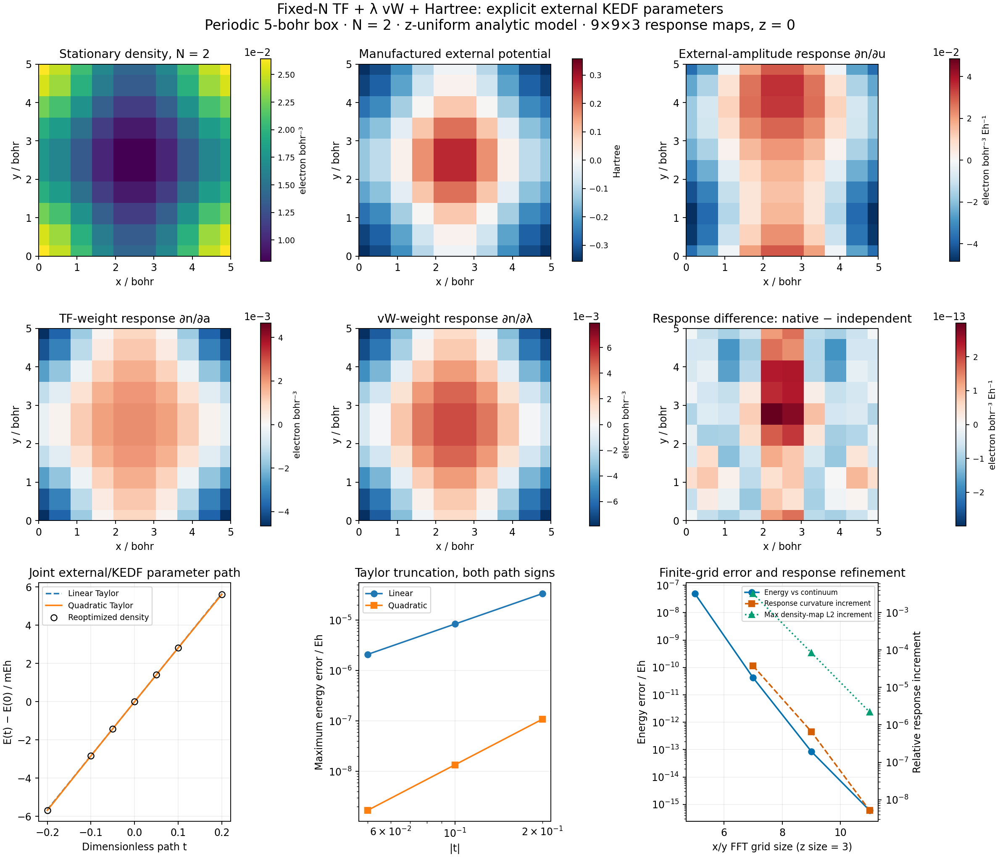

# P08 — fixed-electron OFDFT parameter and density response

This reproducible **analytic periodic model** verifies an external TF/vW kinetic
functional, density response, and normalized second-order Taylor coefficients
using the existing OFDFT optimizer and DFPT solvers. It contains two electrons
in a 5-bohr cubic cell, a manufactured smooth local potential and a neutralizing
Hartree background. There are no atoms, pseudopotentials or XC. It is not a
material benchmark or evidence of the chemical accuracy of TF/vW.



[Native results](gradscf.json) · [independent analytic checks](independent.json) ·
[density/response CSV](density_response_maps.csv) · [PDF](density_parameter_response.pdf) ·
[ordinary calculation script](../../../examples/ofdft/parameter_density_response.py) ·
[independent comparison](../../../examples/ofdft/compare_parameter_density_response.py) ·
[plot](../../../examples/ofdft/plot_parameter_density_response.py)

## Functional, constraint and external parameter interface

In atomic units the declared model is

```
E[n] = a C_TF integral n^(5/3) + (lambda/8) integral |grad n|²/n
       + integral v_ext n + (1/2) integral n v_H[n]
C_TF = (3/10) (3 pi²)^(2/3)
integral n = N = 2
```

With the real amplitude `phi=sqrt(n)`, the vW term is
`(lambda/2) integral |grad phi|²` and its potential is
`−lambda Delta phi/(2 phi)`. These are the standard spin-unpolarized TF and
vW conventions; the latter potential is also directly inspectable in
[DFTpy's implementation](https://github.com/shaoxc/dftpy/blob/master/src/dftpy/functional/kedf/vw.py).
The independent calculation here uses mathematical formulas and NumPy/SciPy,
not a DFTpy optimization run.

The Hartree kernel is `4 pi/G²` at nonzero G and **zero at G=0**. The fixed
uniform compensating background removes that electrostatic zero mode.
This convention does not discard a constant external potential: at fixed N,
adding `t` to the potential changes the chemical potential by `t` and the
energy by `N t`, while leaving the density unchanged.

`external_kinetic(parameters, features)` is an ordinary external callback
that delegates the two kinetic terms to `ofdft.KineticFunctional('tfvw')`.
Its nested `parameters['weights']['tf'/'vw']` are explicit PyTree leaves.
No traced trainable weight is captured in a closure. `run_ofdft` relaxes the
density for each parameter value; `dfpt.ofdft_problem` supplies constrained
linear response and Taylor propagation. No optimizer, response solver or
KEDF implementation was added to `src`.

## A manufactured nonuniform density with a known chemical potential

Let `k=2 pi/5`, `b=0.18`, `c=0.12`, and

```
phi = A (1 + b cos(kx) + c cos(ky))
A² = (N/V) / [1 + (b²+c²)/2]
n_star = phi²
Delta phi = −A k² [b cos(kx)+c cos(ky)]
v_ext = mu_star − (5/3) a C_TF n_star^(2/3)
        + (lambda/2) Delta phi/phi − v_H[n_star]
```

The baseline coefficients are `a=0.8`, `lambda=0.6`, and
`mu_star=0.17 Eh`. The amplitude is strictly positive. Its Fourier support
ends at index one, and the density/Hartree support at index two, so odd x/y
meshes of size at least five represent those fields without aliasing. The
calculation starts from a uniform amplitude rather than the manufactured
solution: the four solves require 56, 117, 131 and 101 iterations.

Once the external potential has been constructed, it is **held fixed when
kinetic parameters change**. Rebuilding the manufactured potential with the
changed weights would instead cancel the intended density response. The
perturbed potential is `v_ext+u p(r)`, with
`p=cos(kx)+0.4 sin(ky)`, and `u` in Hartree. The other two parameters are
dimensionless. Density units are electron/bohr³; its derivatives with
respect to u additionally carry `Eh^-1`.

The model is uniform in z. The grids are `(5,5,3)`, `(7,7,3)`, `(9,9,3)` and
`(11,11,3)`; only x/y cutoffs are refined. The main maps use `(9,9,3)` and
show nearest sampled values at z=0, with periodic boundary samples duplicated
for display. No visual smoothing is interpreted as numerical refinement.

## Independent fixed-N response

For a homogeneous density `n0=N/V` and nonzero Fourier wavevector G, the
analytic response to a potential component is

```
delta n_G = −delta v_G /
    [(10/9) a C_TF n0^(-1/3) + lambda |G|²/(4 n0) + 4 pi/|G|²].
```

Three focused cases check TF-only, vW-only and TF+vW **kinetic terms**, with
Hartree retained in all cases. The constrained zero Fourier component is
zero; no division by G=0 is used. Constant-potential response separately
checks `delta n=0`, `delta mu=1` and `delta E=N`.

For the nonuniform reference, the independent code constructs dense Fourier
Laplacian `Delta` and Coulomb `H` matrices using NumPy, then forms the
functional-derivative Hessian

```
K = diag[(10/9) a C_TF n^(-1/3)] + H
    − (lambda/4) diag(1/phi) Delta diag(1/phi)
    + (lambda/4) diag(Delta phi/phi³).
```

SciPy solves the bordered system
`[K,−1; 1.T,0] [delta n,delta mu] = [−source,0]`.
Uniform voxel weights make `1.T delta n=0` equivalent to fixed integrated N.
The sources are p for u, `(5/3) C_TF n^(2/3)` for a, and
`−Delta phi/(2 phi)` for lambda. This comparison imports no GradSCF physics,
AD derivatives or optimizer.

At the main grid, the complete three-column implicit density Jacobian agrees
with this independent KKT result within **5.73e-13**. The implicit/DFPT
Jacobians agree within `1.18e-16`, and the density-observable JVP/VJP adjoint
identity within `1.78e-15`. The derivative of integrated N is checked for
every parameter. Across all grids, the manufactured density differs by at
most `9.68e-13 electron/bohr³`, the electron count by `3.2e-15`, and the
chemical potential by `9.3e-13 Eh`.

## Taylor convention and finite differences

The joint dimensionless path is

```
(u/Eh, a, lambda)(t) = (0, 0.8, 0.6) + t (0.03, 0.05, −0.04).
E(t) = E0 + c1 t + c2 t² + ...
c1 = 0.0282497967358199 Eh
c2 = −0.000835141384583721 Eh = E''(0)/2!
```

Density coefficients use the same `derivative/k!` convention. Both stored
density orders integrate to zero. For this affine parameter path, the
independent response gives
`E''=dtheta.T source.T W density_jacobian dtheta`; its half reproduces c2.
Both energy coefficients agree with the independent result within `1.05e-16 Eh`.
The independently assembled energy parameter Hessian is symmetric and
negative semidefinite, as expected for minimizing an energy affine in these
parameters under a fixed constraint.

Every parameter is checked with central steps `1e-3`, `3e-4`, `1e-4`, in its
declared units. The finest maximum density-response and energy-gradient errors
are `4.95e-9` and `1.70e-9`. Joint-path second coefficients use steps `0.02`,
`0.01`, `0.005`; the finest density/energy coefficient errors are `2.33e-8`
and `3.76e-11`. Density second differences stop improving at the smallest
steps, consistent with the finite forward accuracy divided by step squared.
The complete nonmonotone sequence is retained and is not presented as an
asymptotic truncation-error estimate.

At `|t|=0.2`, the worst quadratic energy prediction error is about `1.08e-7 Eh`,
versus `3.36e-5 Eh` for the linear approximation. Halving |t| gives approximately
the expected cubic versus quadratic truncation trend. These local expansions
do not establish reliability across density nodes or changes in the solution
branch.

## Discrete agreement versus grid error

The analytic manufactured density is stationary on each selected grid, but
the nonpolynomial TF energy and the response still have discretization error.
An independent 2D Gauss–Legendre integral of the known smooth density provides
the continuum TF energy; the Hartree energy is a finite analytic Fourier sum.
Orders 48 and 80 agree within `9.16e-16 Eh`. The manufactured identity is
`E=mu_star*N−(2/3) a T_TF−E_H`; the vW terms cancel only because this particular
external potential was constructed from the baseline solution.

| x/y size; z size=3 | Energy / Eh | Difference from continuum quadrature / Eh | Potential-response curvature / Eh^-1 |
| ---: | ---: | ---: | ---: |
| 5 | 0.124417330510597 | 4.92e-8 | −2.092717042641 |
| 7 | 0.124417281338339 | 4.19e-11 | −2.092638431423 |
| 9 | 0.124417281296526 | 8.59e-14 | −2.092637050669 |
| 11 | 0.124417281296441 | 6.11e-16 | −2.092637039796 |

The last energy difference is at the quadrature/float64 floor; it is not a
general accuracy claim. The last scalar-curvature increment is `5.20e-9`
relative. Separately, Parseval norms compare the **entire Fourier-interpolated
density responses** on successive grids. For potential/a/lambda, the last
relative L2 changes are `1.21e-6`, `6.83e-7` and `2.21e-6`, all below the
`2e-5` increment gate. These are refinement increments, not rigorous bounds
on unknown continuum-response errors. The `5.73e-13` KKT agreement is strictly
a same-grid implementation check and must not be substituted for these grid
errors.

## Validation and reproduction

Five new focused tests passed in **71.05 s**, following five expected failures
before the new example entrypoints existed. The existing kinetic/OFDFT/DFPT
response regressions passed: **17 passed in 283.58 s**. No tests were skipped.
The four-grid native run took **151.52 s**, peak RSS **3,040,204 KiB**, on
`jy_gpu_1`/c20, Intel Xeon Platinum 8457C, Python 3.11.15, JAX 0.10.0, CPU float64.
Numerical calculations and plotting were remote; local checks were static
syntax/hash/link validation and visual QA.

The independent snapshot is
`/home/yjiao/gradscf_checks/ad-showcase-p08-20261016`, cloned from the frozen
integration source, with no OFDFT/core modifications. Its Python source SHA256
is `c792320a88f24c695049469ac317d26953efc0888cd3236c44cb0fb393220abc`.

```bash
export CUDA_VISIBLE_DEVICES= JAX_PLATFORMS=cpu JAX_ENABLE_X64=1
export JAX_ENABLE_COMPILATION_CACHE=false OMP_NUM_THREADS=2 OPENBLAS_NUM_THREADS=2
export PYTHONPATH=src
PYTHON=/home/yjiao/opt/miniconda3/envs/jax_scf/bin/python
timeout 900 "$PYTHON" -m pytest -q tests/ofdft/test_showcase_response.py
timeout 1800 "$PYTHON" examples/ofdft/parameter_density_response.py
timeout 300 "$PYTHON" examples/ofdft/compare_parameter_density_response.py
timeout 300 "$PYTHON" examples/ofdft/plot_parameter_density_response.py
```

The four raw mesh NPZ files and independent response NPZ are included in this
compact result bundle. [Source manifest](source_manifest.json),
[verification manifest](verification_manifest.json), red/green/regression logs
and the two calculation records preserve the executed source, parameters,
thresholds and evidence. No empirical fit, trained functional, atomistic
accuracy, physical crystal response or material convergence is implied.

The [Al WGC material and size extension](large_system_scaling/README.md) uses a
later frozen source snapshot for fixed-resolution supercells, synchronized
forward/JVP/VJP/HVP costs, independent DFTpy plus NumPy WGC comparisons, and
separate grid and finite-KS checks. Its records and solver-scale regressions
are distinct from the manufactured-model snapshot documented above.
