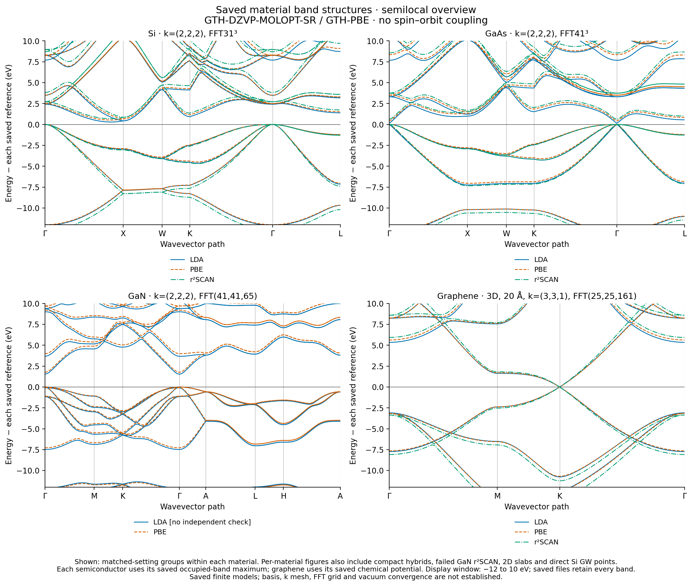

# All saved material band structures

These figures read the existing calculation records; no SCF, GW, mesh scan or
new material calculation is performed. The inventory contains **17 complete
native material cases**: 5 Si, 3 GaAs, 3 GaN and 6 graphene. Thirteen have a
passed independent same-input PySCF check, three have no saved independent
check, and one has a failed check. Three additional incomplete native records
remain in the manifest and have no band arrays to plot.

| Figure | Included saved calculations |
|---|---|
| [Si](silicon_all.png) ([PDF](silicon_all.pdf)) | Matched LDA/PBE/r²SCAN pilots; compact PBE/PBE0; original discrete GW and new generic-query GW in separate panels |
| [GaAs](gaas_all.png) ([PDF](gaas_all.pdf)) | Matched LDA/PBE/r²SCAN cases |
| [GaN](gan_all.png) ([PDF](gan_all.pdf)) | LDA/PBE; separate compact r²SCAN panel with a prominent **reference mismatch / unvalidated** label |
| [Graphene](graphene_all.png) ([PDF](graphene_all.pdf)) | 3D repeated-slab LDA/PBE/r²SCAN; separate 2D-cutoff PBE at cell heights 12, 16 and 20 Å |
| [Overview](materials_overview.png) ([PDF](materials_overview.pdf)) | The matched semilocal groups within each material; additional protocols appear in the material figures |

All material KS/GKS cases use GTH-DZVP-MOLOPT-SR / GTH-PBE without spin–orbit
coupling. The figures separate different k meshes, FFT grids, electrostatic
boundaries and basis families. Compact Si PBE uses `exxdiv=ewald`, while PBE0
uses `vcut_sph`; this is not a comparison that varies only the functional.
The historical semilocal pilot records do not contain an `exxdiv` field; the
manifest reports that absence rather than inventing a value.

The GaN LDA case and graphene 12/16 Å cutoff cases have no saved independent
reference. The compact GaN r²SCAN case completed its native calculation but
failed its independent comparison: total-energy difference 0.465132 Ha and
maximum frontier-band difference 0.00335491 Ha (about 91.3 meV). Its native
curves are shown as unvalidated, and its original failed comparison remains
in the case directory. The r²SCAN panel also differs from the LDA/PBE panel
in k mesh, FFT grid and path sampling.

The Si GW panels use GTH-SZV, PBE, source k=(2,1,1), FFT21³, Ewald exchange
and eta=0.001 Ha. They show **only directly computed points**, with no
connecting lines or interpolated QP curves. The older `fc=True`, folded-OV,
nw=8 record has three accepted QPs out of four requests; its failed candidate
is omitted and explicitly labelled. The newer full-OV+VO, `fc=False`, nw=16
record has six accepted QPs at three generic k points. These are distinct
finite models and neither is an independent material GW benchmark.

Semiconductor energies are aligned separately to each case's saved maximum
occupied energy on its SCF mesh and displayed path. Graphene uses its saved
SCF chemical potential at electronic temperature 0.0002 Ha. Each GW panel
uses the maximum saved KS band-3 energy in that panel. The KS/GKS display
window is −12 to 10 eV; all original bands remain in the input NPZ files.
Straight KS/GKS segments join saved path samples; they are not new evaluations.
None of these figures establishes basis, k mesh, FFT, frequency or vacuum
convergence, or an experimental material gap.

[plot_manifest.json](plot_manifest.json) lists all 20 native records, each
figure's case coverage, validation status, input hashes and the plotted GW
masks. [plot_resources.json](plot_resources.json) records the bounded remote
plotting execution and verifies that the numerical inputs were unchanged.
The final render ran on `jy_gpu_1` (`c20`), CPU 48–63, with two OpenMP/BLAS
threads and no GPU, under the 120 s / 8 GiB RSS limits. Plotting took 4.762 s;
plotting plus five PDF preview renders took 7.57 s, with peak RSS 191,348 KiB.
All five PNGs and PDF previews were visually inspected, including a second
review of the Si and GaN panels. The initial render and a later two-line
label-layout correction are retained in the ignored archive.
[delivery_validation.json](delivery_validation.json) verifies all 12 downloaded
outputs, all 75 original input-file hashes, complete case coverage and the
final plotting-source hash. The numerical calculations were not rerun.

The ordinary source entry point is
[plot_bands.py](../../../../examples/pbc/band_structures/plot_bands.py): from
the repository root, call `plot_saved()` or run that file directly. It imports
only plotting/data libraries and does not invoke any electronic-structure API.

Plot source snapshots and execution logs are kept outside this data package
in the ignored archive
`artifacts/ad_showcase/development/completion_20261016/band_plots/`.
