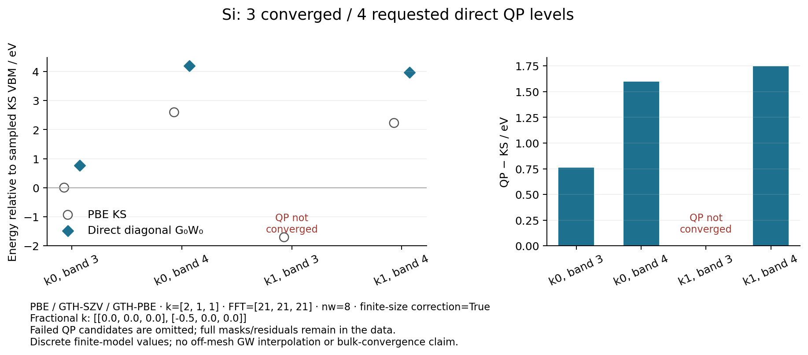

# Si: three converged direct QP levels and one retained failure

This small periodic GradSCF calculation requested four diagonal G₀W₀ levels.
Three converged and one did not. The complete original record therefore keeps
`complete=True`, **`passed=False`**, all four computed-mask entries, all
convergence flags, candidates and actual Dyson residuals. The figure plots
only the three computed and converged QP energies and labels the fourth
request as not converged; its candidate is not plotted.

The fixed model is the two-atom diamond Si primitive cell, a=5.431 Å,
PBE / Cartesian GTH-SZV / GTH-PBE, electronic k=(2,1,1), FFT21³, no smearing,
Ewald exchange, nw=8 and eta=1e-3 Eh. The existing finite-size head/wing
correction is enabled. GradSCF SCF converged to −7.41142105705312 Eh, with
sampled KS gap 0.08198841607873208 Eh. There are eight orbitals, four occupied
per spin, and all 32 occupied–virtual screening transitions are retained.
All eight internal self-energy orbitals are retained at both k points.
Only the output QP window is restricted to zero-based bands 3 and 4.

| Fractional k | Band | KS / Eh | Accepted QP / Eh | Dyson residual / Eh |
|---|---:|---:|---:|---:|
| (0,0,0) | 3 | 0.265536461156 | 0.293492157767 | −2.50e-14 |
| (0,0,0) | 4 | 0.361088711887 | 0.419783234666 | 2.22e-15 |
| (−1/2,0,0) | 3 | 0.202623502514 | not converged | −4.30449e-3 |
| (−1/2,0,0) | 4 | 0.347524877235 | 0.411692357167 | 3.71e-11 |

The unchanged shared scalar-root configuration requires residual and secant
step tolerances of 1e-6 Eh; no tolerance was loosened. The failed candidate
0.19126506128080156 Eh remains in [results.json](results.json) and
[levels.npz](levels.npz), but is not treated as a QP prediction. Unrequested
entries retain mean-field energies and have `qp_computed_mask=False`.

This is a functionality demonstration of diagonal QP energies in the
converged KS basis, not a converged bulk Si gap, a degenerate-subspace
self-energy diagonalization, or a continuous GW band structure. There is no
off-mesh GW interpolation, basis/grid/frequency scan, or periodic AD claim.
The existing finite-eta opposite-wing prescription is preserved. The
dense/transition algebraic tests validate its compression; they do not supply
an independent physical validation of that pre-existing prescription.

## Execution and sources

The numerical job ran once on c20, Intel Xeon Platinum 8457C, JAX CPU
float64/complex128, in the shared CPU16–31 pool with
OMP/OpenBLAS/MKL/NUMEXPR=2. Allocation: 1800 s and 8 GiB actual RSS. Wrapper
time was 49.324 s, peak RSS 2,001,128 KiB; SCF took 26.606 s and GW 19.847 s.
The estimated additional primary GW arrays were 31,240,352 bytes, distinct
from the measured whole-process peak. The original strict-all-requested
script exited1 because one QP did not converge; its full log and unchanged
script are retained under `artifacts/ad_showcase/provenance/PBC_silicon_gw/si-szv-k211-direct-qp` and `artifacts/ad_showcase/provenance/PBC_silicon_gw/executed`.

Only plotting was subsequently rerun, taking 3.254 s / 272,036 KiB. It reads
the unchanged numerical data and writes a separate
[plot_validation.json](plot_validation.json) with input hashes and the
plotted mask. The revised public example reports partial convergence with an
explicit warning and returns the full report, allowing the figure to remain
usable while preserving `passed=False`. The SCF/GW computation was not rerun.

The exact transition reduction reuses the existing complex linear and scalar
QP solvers. It streams grid-space factors one q at a time; strict contour
zero terms are skipped before their dielectric solves. The focused streaming
baseline had 40 passing tests; the subsequent minimal mask change passed
10 focused tests, including actual solve counts, independent dense body
contractions, real periodic H₂ fc off/on, and preserved toy nonconvergence.
Those stage-specific sources and failed intermediate records remain under
`artifacts/ad_showcase/development/gw_transition/{streaming,residue_mask}/`.

[source_verification.json](source_verification.json) confirms all twelve
recorded source hashes against the archived executed files. This frozen 3D
SCF/FFT snapshot predates the current local low-dimensional integration; those
local files are deliberately not presented as the executed source. The public
example's SCF/GW computation-body AST is unchanged by its later partial-result
warning/plot handling, and the plot's input JSON/NPZ hashes remain unchanged.

The parent integration separately guards periodic GW facades against
non-Ewald HF/hybrid references while their exchange self-energy assumes
Ewald. This example uses pure PBE/Ewald and does not change those facades.

The ordinary public entry point is
[pbc_silicon_qp.py](../../../examples/gw/pbc_silicon_qp.py). From the repository
root with `PYTHONPATH=src:.`, call `run(output="a/fresh/output/folder")` in a
bounded process. To regenerate this figure without an electronic calculation,
call `plot("reproducibility/ad_showcase/PBC_silicon_gw")`. Neither uses a CLI
parser. The remote snapshot is
`/home/yjiao/gradscf_checks/ad-showcase-periodic-gw-transition-20261016-agent`.
