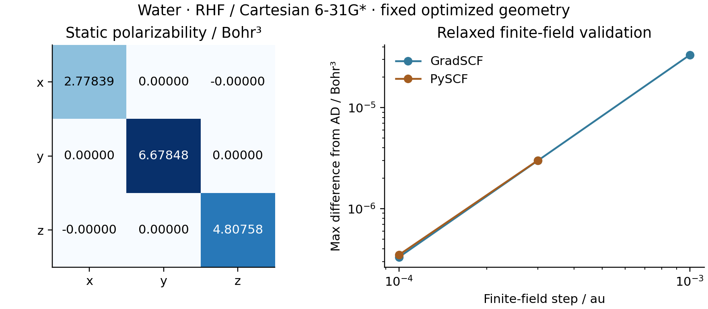

# R01/R02: water electric response



RHF / Cartesian 6-31G* at the G04 optimized geometry. The energy includes
`+F.r` in the electronic one-body Hamiltonian and `-F.sum(Z R)` for the nuclei,
with the same fixed origin. Dipole and polarizability are `-dE/dF` and
`-d2E/dF2`. The shared implicit orbital response is retained at both orders.

- Permanent dipole: `(0, 0, 0.86511021)` e bohr.
- Polarizability diagonal: `(2.77839338, 6.67847834, 4.80758276)` bohr cubed;
  off-diagonal entries are below `1e-12`. This C2v-oriented geometry already
  places its principal axes along the Cartesian axes.
- GradSCF dipole finite differences converge to the AD polarizability with
  maximum errors `3.320e-5`, `2.988e-6`, `3.320e-7` bohr cubed for fields
  `1e-3`, `3e-4`, `1e-4` au. Independently assembled DFPT also agrees below
  the specified `1e-7` bohr-cubed threshold.
- Independent PySCF reconverged finite-field differences give `3.005e-6`
  and `3.499e-7` bohr-cubed errors at `3e-4` and `1e-4` au. Its zero-field
  dipole also passes the independent `1e-7` e-bohr check.

This is a finite-basis derivative demonstration. Polarizability basis-set
convergence, especially diffuse functions, has not been established here.

```sh
PYTHONPATH=src python examples/response/water_electric_response.py
python examples/response/compare_water_electric_pyscf.py
python examples/response/plot_water_electric.py
```

Measured on `jy_gpu_1` (c20), Xeon Platinum 8457C, CPU float64, 2026-10-15.
Python 3.11.15, JAX 0.10.0, NumPy 2.4.4 and PySCF 2.13.0; OMP/OpenBLAS
threads 2; persistent compilation cache disabled. Source base `8f8c93d` plus
the new `MolecularEnergy` adapter and examples. SCF tolerances: energy `1e-12`,
density `1e-11`; orbital residual `1e-9`, implicit solve `1e-10`.
Cold dipole-plus-polarizability time was **41.347 s**; a synchronized warm
polarizability call was **2.465 s**. The two timings have different scopes.

The adapter's H2 regression independently checks DFPT agreement, finite fields,
neutral-molecule translation in a field and a mixed geometry/field derivative.
The translation regression caught and corrected an electronic/nuclear origin
mismatch during development. The production calculations use the corrected
fixed-origin convention.
