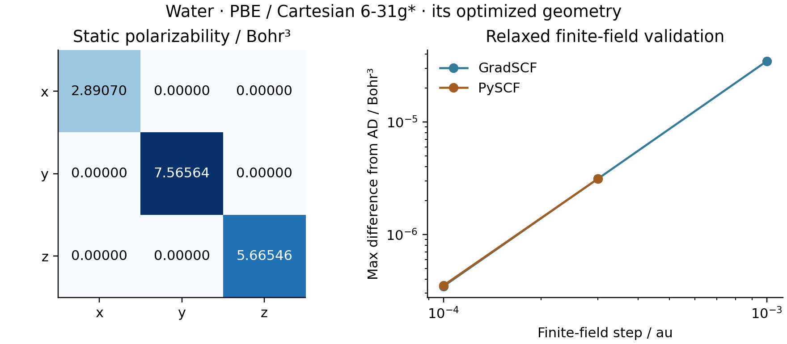

# R01/R02: water PBE dipole and static polarizability

Measured on 2026-10-15 on `jy_gpu_1` (hostname `c20`), CPU float64.
This case uses the [G04 PBE optimized geometry](../G04_water_pbe_optimization/README.md)
and Cartesian 6-31G*. The [RHF result](../R01_R02_water_electric/README.md)
retains its own RHF optimized geometry. Comparing the two saved cases changes
both functional and equilibrium geometry; it is not a fixed-geometry method
comparison.



The permanent dipole is `(0, 0, 0.813705437905)` e Bohr, with x/y components
below `1e-13`. The static polarizability diagonal is
`(2.890701635528, 7.565644817735, 5.665455617353)` Bohr cubed. Off-diagonal
components are below `2e-14` Bohr cubed in the saved C2v orientation.

| Validation quantity | Measured value |
| --- | ---: |
| Maximum AD–PySCF dipole difference / (e Bohr) | 2.230e-12 |
| Maximum AD–DFPT polarizability difference / Bohr³ | 1.088e-10 |
| Polarizability symmetry residual / Bohr³ | 4.775e-15 |
| GradSCF finite-field error, step 1e-3 au / Bohr³ | 3.468e-5 |
| GradSCF finite-field error, step 3e-4 au / Bohr³ | 3.121e-6 |
| GradSCF finite-field error, step 1e-4 au / Bohr³ | 3.468e-7 |
| Independent PySCF finite-field error, step 3e-4 au / Bohr³ | 3.121e-6 |
| Independent PySCF finite-field error, step 1e-4 au / Bohr³ | 3.530e-7 |
| Cold dipole plus polarizability / seconds | 457.727 |
| Synchronized warm polarizability / seconds | 153.619 |

## Calculation and validation

The complete relaxed molecular energy includes `+F.r` in the electronic
one-body Hamiltonian and `-F.sum(Z R)` for the nuclei. Both use the same
fixed origin `(0,0,0)`. Dipole and polarizability are computed as `-dE/dF`
and `-d2E/dF2`, retaining the shared implicit orbital response. Geometry is
fixed while varying the field; it is not reoptimized in each field.

The level-3 grid uses Treutler-Ahlrichs radial integration, Lebedev angular
points with NWChem pruning, original Becke partitioning and Treutler radii
adjustment. The `MolecularEnergy` adapter retains all geometry dependence of
the grid and AO values for subsequent mixed derivatives. This electric
response example checks the fixed-geometry field derivatives themselves.

Seed RKS tolerances are `1e-12` Hartree for energy, `1e-11` for density and
`1e-10` for orbital residual. The shared orbital stationarity threshold is
`1e-9`; implicit response tolerance is `1e-10`. Failed or nonfinite responses
stop the script. An independently assembled GradSCF DFPT response agrees
within `1e-7` Bohr cubed; tensor symmetry is checked at `1e-9` Bohr cubed.

Central differences of independently relaxed dipoles check the full tensor
at field steps `1e-3`, `3e-4` and `1e-4` atomic units. The observed decrease
is consistent with second-order truncation. The smallest-step acceptance
threshold is `2e-5` Bohr cubed.

The separate PySCF script builds its own Cartesian basis, integrals and
matching level-3 grids. It disables density-based grid pruning and padding,
and reconverges the SCF at every field. Its tolerances are `1e-13` Hartree
and `1e-11` for orbital gradient. The zero-field dipole is checked within
`1e-7` e Bohr, and the smallest-step polarizability within `2e-5` Bohr cubed.
The two finite-field curves overlap closely in the plot.

These are finite-basis, finite-grid electronic properties. Diffuse-basis
convergence, grid convergence of polarizability, vibrational averaging and
frequency-dependent response have not been established by this example.

## Reproduce and provenance

The three shared scripts select HF/PBE with the top-level `METHODS` or
`CASES` tuples. Their ordinary entry points run both water methods. The
measured PBE-only invocations called the same `run` functions:

```sh
export CUDA_VISIBLE_DEVICES=
export JAX_PLATFORMS=cpu
export JAX_ENABLE_X64=1
export JAX_ENABLE_COMPILATION_CACHE=false
export OMP_NUM_THREADS=2
export OPENBLAS_NUM_THREADS=2
export PYTHONPATH=src

python -c 'import runpy; runpy.run_path("examples/response/water_electric_response.py")["run"]("PBE")'
python -c 'import runpy; runpy.run_path("examples/response/compare_water_electric_pyscf.py")["run"]("reproducibility/ad_showcase/R01_R02_water_pbe_electric")'
python -c 'import runpy; runpy.run_path("examples/response/plot_water_electric.py")["run"]("reproducibility/ad_showcase/R01_R02_water_pbe_electric")'
```

Use `/home/yjiao/opt/miniconda3/envs/jax_scf/bin/python` from the repository
root. The main calculation used a 3600-second timeout; the independent
reference and plotting invocation together used a 600-second timeout.
All numerical calculations and plotting were remote; only inspection and
visual review were local.

The cold timing includes compilation and both dipole/polarizability calls;
the warm timing is one synchronized polarizability call. Neither isolates a
backward operation. The separate PySCF reference took 22.313 seconds for 13
SCF/dipole evaluations. These are different scopes, and no speed comparison
is claimed. Concurrent validation jobs also prevent interpreting timings as
a controlled throughput benchmark.

Runtime: Intel Xeon Platinum 8457C, Python 3.11.15, JAX 0.10.0, NumPy 2.4.4,
PySCF 2.13.0; device `cpu:0`. Thread environment variables do not imply a
process-wide JAX thread cap. Persistent compilation caching was disabled.
The isolated remote snapshot is
`/home/yjiao/gradscf_checks/ad-showcase-pbe-response-20261015`, copied from
base `8f8c93d` plus the documented showcase helpers/AO correction. It includes
the parity-checked scalar-energy objective implementation and the matching
core hashes in [source_hashes.sha256](source_hashes.sha256). The H2 PBE mixed
RFF gate also passed with these recorded files: **1 passed, 3 deselected in
908.65 seconds**. It does not establish completed water Raman results.

The shared-script HF regression retained the original dipole, polarizability,
IR and Raman values in isolated check outputs; existing HF result files were
not overwritten. Raw logs are in ignored
`artifacts/ad_showcase/development/R01_R02_water_pbe_electric/` and
`artifacts/ad_showcase/development/shared_response_refactor/` directories.
Measured comment blocks were added after execution.

Full values: [gradscf.json](gradscf.json), [pyscf.json](pyscf.json).
Figures: [PNG](electric_response.png), [PDF](electric_response.pdf).
Tables: [dipole](dipole.csv), [polarizability](polarizability.csv),
[finite-field checks](finite_field_checks.csv).
