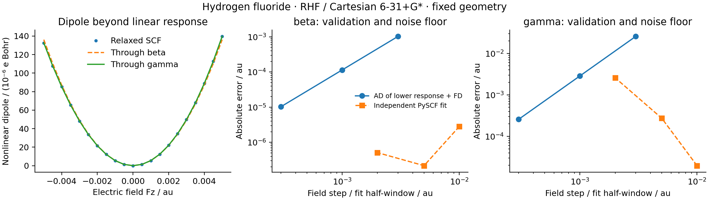

# R03: nonlinear field response of hydrogen fluoride



The molecule is H at `(0,0,0)` and F at `(0,0,1.7328)` bohr, treated with
RHF / Cartesian 6-31+G*. This fixed geometry is not optimized in this example.
All fields and response coefficients below are in atomic units. The energy
convention is

`E(Fz) = E0 - mu_z*Fz - alpha_zz*Fz^2/2 - beta_zzz*Fz^3/6 - gamma_zzzz*Fz^4/24`.

| Quantity | AD result |
| --- | ---: |
| mu_z | -0.82079529 |
| alpha_zz | 4.55004223 |
| beta_zzz | 10.89022317 |
| gamma_zzzz | 169.95012676 |

These are derivatives of the fully relaxed SCF energy, through fourth field
order. This does not imply support for fourth nuclear-coordinate derivatives.
The complete third field tensor is also evaluated to check index-permutation
symmetry. Every energy/field derivative includes the implicit state response.

Central differences of the lower-order response provide a step-convergence
window. At field steps `3e-3`, `1e-3`, `3e-4` au, beta errors are `1.031e-3`,
`1.145e-4`, `1.031e-5`; gamma errors are `2.573e-2`, `2.859e-3`, `2.573e-4` au.

The independent PySCF reference fits reconverged dipoles to a degree-five
polynomial in the scaled field. Its `(beta, gamma)` values are:

| Field half-window / au | beta_zzz | gamma_zzzz |
| --- | ---: | ---: |
| 0.010 | 10.89022599 | 169.95014639 |
| 0.005 | 10.89022339 | 169.94985376 |
| 0.002 | 10.89022368 | 169.95270689 |

Shrinking the fit window eventually amplifies SCF/dipole noise in the cubic
coefficient. All windows are retained rather than selecting a favorable one.
The plot subtracts the permanent and linear dipole terms to show the weak
nonlinear contribution. No experimental claim or basis-convergence claim is
made; one diffuse basis is a reproducible derivative benchmark.

```sh
PYTHONPATH=src python examples/response/hf_hyperpolarizability.py
python examples/response/compare_hf_hyperpolarizability_pyscf.py
python examples/response/plot_hf_hyperpolarizability.py
```

Measured on `jy_gpu_1` (c20), CPU float64, 2026-10-15, using the
[water electric-response environment](../R01_R02_water_electric/README.md).
The PySCF field-fit SCF tolerances are energy `1e-13` and orbital gradient
`1e-11`. The GradSCF adapter uses an implicit tolerance of `1e-10` and orbital
stationarity `1e-9`. The JSON stores the cold four-response time, full third
tensor, finite-field checks and all sampled dipoles. All plotted data are saved.
