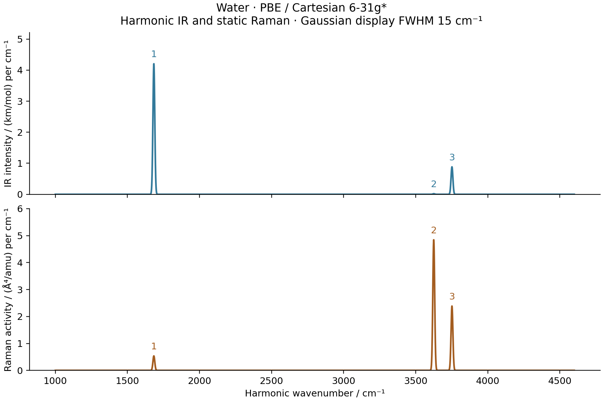

# V01/V02: harmonic water PBE IR and static Raman

Measured on 2026-10-15 on `jy_gpu_1`, CPU float64.



| Mode | Wavenumber / cm^-1 | IR / km mol^-1 | Raman / Angstrom^4 amu^-1 | Depolarization |
| --- | ---: | ---: | ---: | ---: |
| Bend | 1683.3362 | 67.17111 | 8.54600 | 0.554866 |
| Symmetric stretch | 3625.1150 | 0.31577 | 77.41465 | 0.179837 |
| Antisymmetric stretch | 3751.5086 | 14.11963 | 38.09181 | 0.750000 |

This case uses the [PBE optimized geometry](../G04_water_pbe_optimization/README.md)
and [AD Hessian and normal modes](../G05_water_pbe_hessian/README.md), with
Cartesian 6-31G* and the level-3 molecular grid. The
[RHF case](../V01_V02_water_rhf_spectra/README.md) uses its own equilibrium
geometry. Comparing these two cases changes both functional and geometry.

## Response construction

The shared `MolecularEnergy` adapter assembles the complete relaxed energy
`E(R,F)`, including the electronic field term `+F.r` and nuclear term
`-F.sum(Z R)` at the same fixed origin `(0,0,0)`. At electronic stationarity,

```
mu(R,F) = -dE/dF = sum(Z R) - Tr[D(R,F) r(R)]
alpha(R,F) = dmu/dF
```

The density remains an implicitly differentiated relaxed SCF state. Its
field and geometry derivatives are retained when differentiating the
stationary identity. A JVP along each normal direction gives `dmu/dQ` and
`dalpha/dQ`. The latter is the mixed third energy derivative
`-d3E/(dQ dF dF)`. The spectrum is generated by AD; finite differences only
validate the derivatives. There is no copied SCF or response solver in the
example.

The coordinate dependence includes native overlap, kinetic, nuclear,
electron-repulsion and position integrals, nuclear repulsion, the moving
molecular grid, Becke weights, AO values and AO gradients. The grid uses
Treutler-Ahlrichs radial integration, NWChem-pruned Lebedev angular points,
original Becke partitioning and Treutler radius adjustment.

The seed RKS thresholds are `1e-12` Hartree in energy, `1e-11` in density
and `1e-10` in orbital gradient. The shared orbital optimizer uses a
`1e-9` gradient threshold, with `1e-10` implicit-response tolerance. Failed
stationarity or nonfinite derivatives stop the calculation.

## Normal coordinates and units

Normal directions obey `V.T M V = I`, with masses in electron masses and
`Q` in bohr times the square root of electron mass. For these units,
the conversion of `|dmu/dQ|^2` to km/mol is
`N_A*pi*alpha_fs^2*a0/3000`. The independent PySCF comparison recomputes the
same conversion from SI charge, permittivity, electron mass and light speed.

For `a = trace(dalpha/dQ)/3` and
`gamma_squared = 3/2 * ||dalpha/dQ - a I||_F^2`, the Raman activity is
`45*a^2 + 7*gamma_squared`, converted to Angstrom^4/amu by multiplying by
`bohr_in_angstrom^4 * amu_in_electron_mass`. The polarized depolarization
ratio is `3*gamma_squared/(45*a^2 + 4*gamma_squared)`.

The plotting script uses unit-area Gaussian profiles with a display FWHM
of 15 cm^-1. Integrated IR areas are intensities; integrated Raman areas
are activities. The display width is not a lifetime. Static Raman
activities exclude laser-frequency, temperature and experimental geometry
factors. These finite-basis harmonic predictions are not experimental
fundamentals, and no empirical frequency scaling is applied.

## Independent checks and limits

The stationary expression was checked against the saved direct-energy AD
water electric responses. Maximum dipole/polarizability differences were
`6.55e-15` / `9.15e-14` for RHF and `2.55e-15` / `2.38e-13` for PBE, in
their atomic units. Across all three RHF modes, maximum dipole-derivative
and Raman-component differences were `4.81e-16` and `4.05e-15`.
The saved [identity comparison](stationary_identity_check.json) contains
these measured values and the helper hash.

| Maximum AD–GradSCF finite-difference error | Step 1e-3 bohr | Step 3e-4 bohr |
| --- | ---: | ---: |
| Dipole derivative, atomic normal-coordinate units | 4.567e-9 | 4.114e-10 |
| Raman tensor component, atomic normal-coordinate units | 4.032e-8 | 3.629e-9 |

All three Raman tensors passed the symmetry check at `1e-9` in atomic
normal-coordinate units. The smaller-step dipole/Raman checks use absolute
tolerances `1e-6`/`3e-5` and relative tolerances `1e-4`/`3e-4`.

The normal-mode check displaces each geometry in both directions, with
maximum Cartesian displacement `1e-3` or `3e-4` bohr, and independently
relaxes every displaced state. The actual normal-coordinate step is the
maximum Cartesian displacement divided by the largest normal-direction
component. The independent PySCF script reconstructs its own molecule,
integrals, matching grid and electronic states. Its polarizability uses
an inner finite field of `1e-4` au; mode differences then check the Raman
derivative. Thus this independent oracle is a finite-difference reference,
not a PySCF analytic third derivative.

PySCF uses energy/orbital-gradient tolerances `1e-13`/`1e-11`, disables
density-based grid pruning and padding, and checks the actual orbital
gradient norm against `1e-10`. Its zero-field initial density is the mean
of independently converged positive/negative z-field densities; that
initial guess is reconverged at zero field under the same tolerances.

The independent calculation completed all 84 SCF/dipole evaluations without
Newton retries. Its largest actual orbital-gradient norm was `1.760e-11`.
At the smaller mode displacement, the measured differences are:

| Independent PySCF comparison | Maximum difference |
| --- | ---: |
| Dipole derivative, atomic normal-coordinate units | 5.036e-10 |
| Raman tensor component, atomic normal-coordinate units | 1.826e-6 |
| IR intensity / (km/mol) | 4.124e-6 |
| Raman activity / (Angstrom^4/amu) | 4.012e-4 |

The independent Raman-component difference is `3.496e-7` at the larger
mode displacement and `1.826e-6` at the smaller one. Reducing this outer
step amplifies finite-field/SCF numerical noise; monotonic convergence of
the nested reference is not claimed. The raw reference tensors are saved
without symmetrizing away their finite-difference noise. In comparison,
the AD Raman tensors have a maximum symmetry residual of `6.620e-16`.

The underlying finite-grid Hessian has a raw rotational-covariance residual
of `6.4334e-5` Hartree/bohr, independently reproduced by PySCF. The three
normal modes come from the projected internal subspace; six exact raw
zero modes are not claimed. The grid orientation error has not been
removed by increasing the quadrature level. Diffuse-basis convergence,
grid convergence of intensities, anharmonic effects and dynamic Raman
response are outside this example's verified scope.

## Reproduction and provenance

From the repository root, with the G04/G05 PBE outputs available:

```sh
export CUDA_VISIBLE_DEVICES=
export JAX_PLATFORMS=cpu
export JAX_ENABLE_X64=1
export JAX_ENABLE_COMPILATION_CACHE=false
export OMP_NUM_THREADS=2
export OPENBLAS_NUM_THREADS=2
export PYTHONPATH=src

python -c 'import runpy; runpy.run_path("examples/vibrations/water_ir_raman.py")["run"]("PBE")'
python -c 'import runpy; runpy.run_path("examples/vibrations/compare_water_spectra_pyscf.py")["run"]("reproducibility/ad_showcase/V01_V02_water_pbe_spectra")'
python -c 'import runpy; runpy.run_path("examples/vibrations/plot_water_spectra.py")["run"]("reproducibility/ad_showcase/V01_V02_water_pbe_spectra")'
```

The ordinary scripts also run both HF/PBE cases through their top-level
`METHODS`/`CASES` tuples; they do not use a CLI framework. The shared
comparison and plotting functions also support the CO2 selection-rule
case. Saved RHF numerical results were retained during this extension.

All numerical work and plotting run on `jy_gpu_1` (hostname `c20`), using
`/home/yjiao/opt/miniconda3/envs/jax_scf/bin/python`, CPU float64. The
machine has an Intel Xeon Platinum 8457C; the environment uses Python
3.11.15, JAX 0.10.0, NumPy 2.4.4 and PySCF 2.13.0. Persistent compilation
caching is disabled. The thread variables above do not impose a
process-wide JAX thread cap. Concurrent jobs prevent treating wall times
as controlled performance benchmarks.

The first direct-energy third-derivative job was deliberately stopped
after 56m01s, once the stationary-identity comparison passed. It completed
mode 1 but was still evaluating mode 2. Its exit code was 143 (SIGTERM),
not a numerical failure or timeout; it did not produce a final spectrum.
The old source, partial output and cancellation record are retained under
the ignored `artifacts/ad_showcase/development/V01_V02_water_pbe_spectra/` directory.

The complete stationary-identity run took **1764.087 seconds**, including
first-call compilation, both AD tensors and both displacement checks for
each mode, excluding the seed SCF. It had a 7200-second limit. This timing
has a different scope from a single derivative call or the independent
reference and is not a speed comparison.
The independent PySCF reference took **111.337 seconds**; its combined
reference/plotting invocation had a 1200-second limit. All numerical
calculations and plotting were remote, with local inspection of the
retrieved PNG and CSVs.

The isolated snapshot was
`/home/yjiao/gradscf_checks/ad-showcase-pbe-response-20261015`, based on
`8f8c93d` with the documented AO derivative correction, scalar-energy
objective path and stationary-dipole helper. The measured helper precedes
the later UHF/UKS dispatch extension; no running source was overwritten.
[Source hashes](source_hashes.sha256) record the actual core and example
versions, as well as the G04/G05 input JSONs. Measured comment blocks were
added after execution.

Full data: [GradSCF](gradscf.json), [PySCF](pyscf.json).
Figures: [PNG](ir_raman.png), [PDF](ir_raman.pdf).
Tables: [sticks](sticks.csv), [broadened display curves](broadened.csv).
