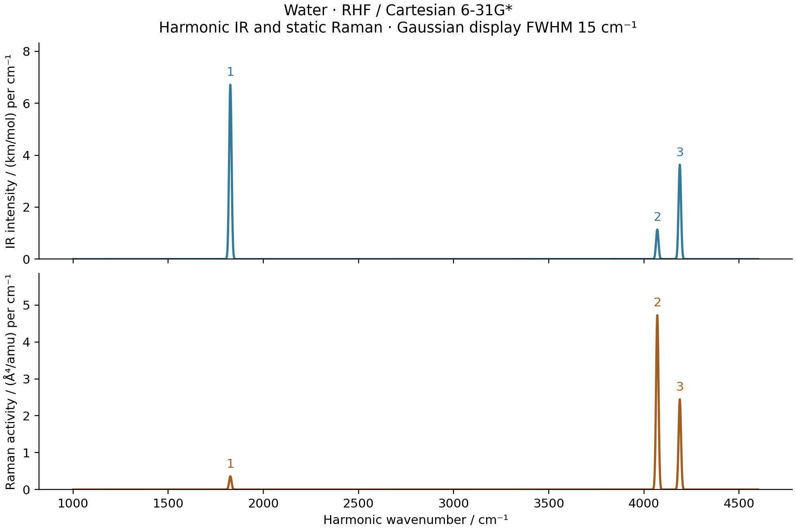

# V01/V02: harmonic water IR and static Raman



Both spectra use the G04/G05 optimized RHF / Cartesian 6-31G* energy surface,
its analytic self-consistent Hessian and its mass-normalized normal directions.
The complete relaxed energy `E(R,F)` supplies dipole and polarizability by AD;
JVPs along each mode then give the IR derivative and Raman tensor. The Raman
calculation retains reference relaxation and represents the mixed third
derivative `-d3E/(dQ dF dF)`, not three nuclear derivatives of the AO integrals.

| Mode | Wavenumber / cm^-1 | IR / km mol^-1 | Raman / Angstrom^4 amu^-1 | Depolarization |
| --- | ---: | ---: | ---: | ---: |
| Bend | 1826.5534 | 107.27054 | 5.72358 | 0.529983 |
| Symmetric stretch | 4070.4599 | 18.20900 | 75.53655 | 0.183017 |
| Antisymmetric stretch | 4188.7049 | 58.11053 | 39.08640 | 0.750000 |

The displayed Gaussian FWHM of **15 cm^-1** is an illustrative convolution,
not a computed lifetime. Its profile has unit integral, so each IR area is
the listed integrated intensity and each Raman area is the listed activity.
Raman activity does not include laser-frequency, thermal or experimental
geometry factors. These harmonic RHF predictions are not experimental
fundamentals. No empirical frequency scaling was used, and basis convergence
has not been established.

## Validation

Every mode derivative is checked against independently reoptimized electronic
states at maximum Cartesian displacements of `1e-3` and `3e-4` bohr. At the
smaller step, the largest GradSCF AD-versus-difference Raman component error
is **7.523e-9** in atomic normal-coordinate units. Independent PySCF mode
differences, with an inner electric-field step of `1e-4` au, have maximum
dipole-derivative and Raman-component errors **2.649e-10** and **6.827e-8**.
All three Cartesian polarizability matrices and their mode derivatives pass
their symmetry checks. The independent comparison also verifies the IR unit
conversion using SI constants.

The normal coordinate Q uses bohr*sqrt(electron mass), with `V.T M V = I`.
For `a = trace(dalpha/dQ)/3` and
`gamma_squared = 3/2 * ||dalpha/dQ - a I||_F^2`, the activity is
`45*a^2 + 7*gamma_squared`; the polarized depolarization ratio is
`3*gamma_squared/(45*a^2 + 4*gamma_squared)`. Converting the activity to
Angstrom^4/amu multiplies by `bohr_in_angstrom^4 * amu_in_electron_mass`.
For these Q units the IR conversion is `N_A*pi*alpha_fs^2*a0/3000`.
This is consistent with the explicitly amu-based convention in
[Psi4's harmonic-analysis implementation](https://github.com/psi4/psi4/blob/master/psi4/driver/qcdb/vib.py).

## Reproduction

```sh
PYTHONPATH=src python examples/vibrations/water_ir_raman.py
python examples/vibrations/compare_water_spectra_pyscf.py
python examples/vibrations/plot_water_spectra.py
```

Run G04/G05 first. All calculations and plotting were performed on `jy_gpu_1`
(c20), CPU float64, 2026-10-15, using the [electric-response runtime settings](../R01_R02_water_electric/README.md).
The calculation JSON records every derivative tensor, finite-difference step,
conversion factor and wall time. `sticks.csv` and `broadened.csv` retain the
data behind PNG/PDF. No external electronic solver participates in the GradSCF
calculation; the PySCF comparison is a separate executable script.
