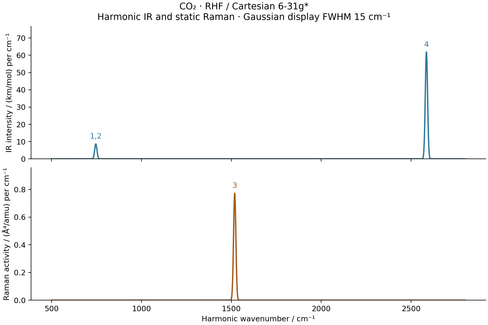

# V03: complementary IR and Raman selection rules of CO2



The linear molecule is C at the origin and O at `(0,0,+/-2.160441777)` bohr,
treated with RHF / Cartesian 6-31G*. The symmetric C-O distance is optimized
by solving its analytic bond force for zero. The full Cartesian gradient is
below `3.2e-12` Eh/Bohr. The full Hessian, including bends, has four positive
internal modes after five rigid motions are removed; no stability conclusion
is inferred from a one-dimensional bond optimization alone.

| Mode | Wavenumber / cm^-1 | IR / km mol^-1 | Raman activity / Angstrom^4 amu^-1 |
| --- | ---: | ---: | ---: |
| Bend 1 | 745.806276 | 68.931862 | below 1e-6 |
| Bend 2 | 745.806276 | 68.931862 | below 1e-6 |
| Symmetric stretch | 1518.495782 | below 1e-6 | 12.331153 |
| Antisymmetric stretch | 2585.031479 | 988.589746 | below 1e-6 |

Normal coordinates use bohr times the square root of electron mass, with
12C and 16O masses 12 and 15.99491461957 u. IR and Raman tensors are relaxed
electronic derivatives along these normal displacements. Inversion swaps the
oxygen atoms and reverses displacement vectors. The gerade mode is Raman
active, whereas the ungerade modes are IR active. The code determines parity
from the mass-normalized vectors and checks forbidden strengths explicitly.
Rotating the degenerate bending basis preserves its summed response strength;
an individual bending vector has no preferred orientation.

The independent PySCF analytic Hessian differs by at most `4.0203e-8`
Eh/Bohr^2, giving a maximum frequency difference of `3.4733e-5` cm^-1.
The separate PySCF intensity calculation recomputes dipoles and finite-field
polarizabilities at normal displacements whose largest Cartesian component
is `1e-3` or `3e-4` bohr. Its field step is `1e-4` au. At the smaller
displacement, maximum differences are `2.054e-9` for dmu/dQ and `1.034e-7`
for dalpha/dQ in atomic units with the stated Q normalization. The IR SI
conversion and Raman rotational invariants are checked independently.

A first default-guess displaced PySCF zero-field solve failed near
stationarity; an official Newton retry also failed the convergence gate.
Those results were rejected. The accepted reference starts zero-field SCF
from the mean of its already converged positive/negative field densities,
then reconverges at the **same** energy/gradient thresholds (`1e-13`/`1e-11`).
The largest actual orbital-gradient norm across all accepted calculations is
`5.985e-12`. No unsuccessful density is used as a reference result.

The plot uses normalized Gaussian profiles with FWHM 15 cm^-1. That width is
display broadening, not a molecular lifetime. Raman activities are not
experimental scattering intensities. Depolarization ratios for zero-activity
channels are undefined and appear as `nan` in the exported CSV; the AD
response tensors themselves are finite. These are harmonic finite-basis
predictions without empirical frequency scaling or an experimental fit.

```sh
PYTHONPATH=src python examples/vibrations/co2_selection_rules.py
python examples/vibrations/compare_co2_hessian_pyscf.py
# The shared intensity reference and plot expose run(case_path):
PYTHONPATH=examples/vibrations python -c 'from compare_water_spectra_pyscf import run; run("reproducibility/ad_showcase/V03_co2_selection_rules")'
python examples/vibrations/plot_water_spectra.py
```

Measured on `jy_gpu_1` / c20, Intel Xeon Platinum 8457C, CPU float64,
2026-10-15, Python 3.11.15, JAX/JAXlib 0.10.0, NumPy 2.4.4, PySCF 2.13.0.
The independent full intensity check took 40.00 s. The direct third-energy
graph reached its 900 s limit during a native multistep validation after mode
1. The final implementation uses the stationary identity
`mu = sum(Z*R) - Tr[D(R,F)*r(R)]`, retaining the relaxed density's complete
implicit response. Dipoles, polarizabilities and mixed mode derivatives were
checked against the direct-energy construction before switching. The complete
CO2 AD calculation plus two-step native differences then finished in 738.53 s.
At the smaller step its maximum dmu/dQ and dalpha/dQ errors are `2.054e-9`
and `9.156e-10` in the stated atomic units. All four mode tensors remain
finite, including the forbidden channels.
