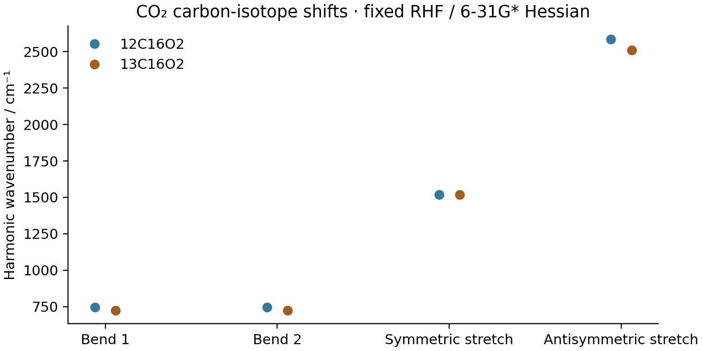

# V04: carbon-isotope shifts in CO2



This example changes the carbon mass in the **same** electronic RHF /
Cartesian 6-31G* Hessian from [V03](../V03_co2_selection_rules/README.md).
It does not rerun SCF or change the equilibrium structure. The nuclear masses
are 12 and 13.00335483507 u for carbon, and 15.99491461957 u for oxygen.
Normal displacements satisfy `V.T @ M @ V = I` with masses in electron masses.

| Mode | 12C16O2 / cm^-1 | 13C16O2 / cm^-1 |
| --- | ---: | ---: |
| Bend 1 | 745.806276 | 724.579723 |
| Bend 2 | 745.806276 | 724.579723 |
| Symmetric stretch | 1518.495782 | 1518.495782 |
| Antisymmetric stretch | 2585.031479 | 2511.458339 |

In the gerade symmetric stretch, the carbon remains stationary, so its mass
does not change the harmonic frequency. For an ungerade displacement of
symmetric linear O-C-O, translational invariance leaves a single internal
coordinate per Cartesian direction. Its squared frequency is proportional to
`1/M_O + 2/M_C`. The independent expected 13C/12C frequency ratio is therefore
`sqrt((1/M_O + 2/M_13C)/(1/M_O + 2/M_12C)) = 0.9715387837589528`.
Both bends and the antisymmetric stretch satisfy this check.

These are mass effects in the Born-Oppenheimer harmonic model. No anharmonic
shift, isotope-dependent equilibrium geometry, or experimental fit is included.
The parent electronic Hessian agrees with the independent PySCF Hessian to
`4.0203e-8` Eh/Bohr^2. This is separate from the algebraic mass-scaling check.

```sh
PYTHONPATH=src python examples/vibrations/co2_selection_rules.py
PYTHONPATH=src python examples/vibrations/co2_carbon_isotope.py
```

Recorded on `jy_gpu_1` / c20, CPU float64, 2026-10-15, JAX 0.10.0 and
NumPy 2.4.4. This script only diagonalizes the small mass-weighted Hessian
and plots saved force constants; its runtime is not a new electronic-structure
benchmark. `gradscf.json` records both mass sets, all frequencies and the
source Hessian path. H2O/D2O is demonstrated separately in the
[water RHF](../G05_water_rhf_hessian/README.md) and
[water PBE](../G05_water_pbe_hessian/README.md) Hessian examples.
