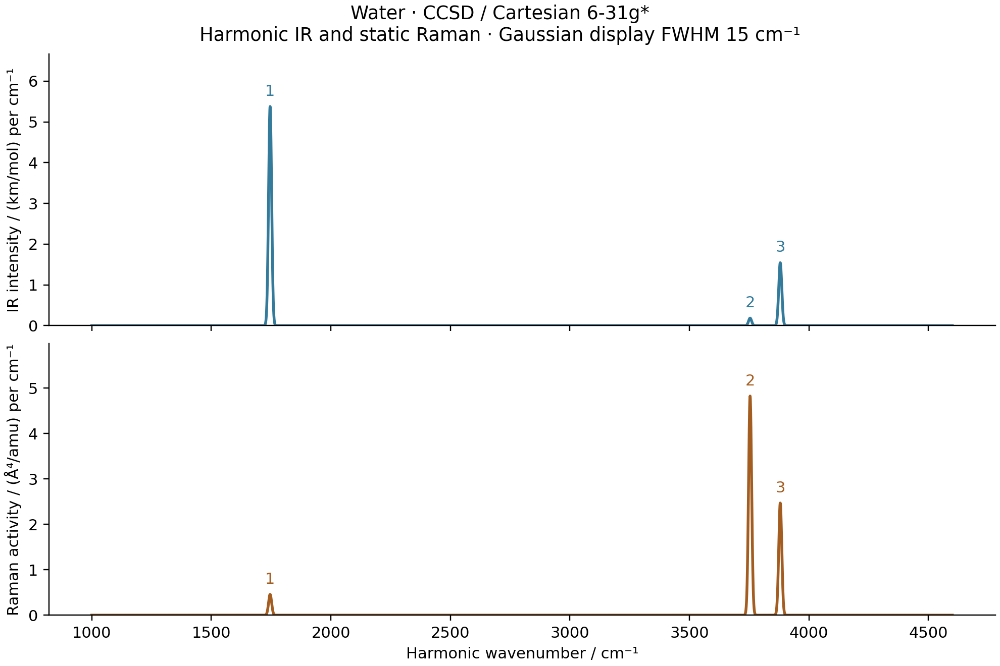

# V05: water CCSD harmonic IR and static Raman



The native CCSD optimization, complete Cartesian AD Hessian, normal modes,
IR strengths and static Raman activities passed their directional-difference
and independent PySCF checks on `jy_gpu_1`. All electrons are correlated in
Cartesian 6-31G*, using a real RHF reference and native full AO integrals.
The geometry and electronic response are both CCSD level. No HF density is
substituted for the correlated dipole.

## Results

BFGS converged in 8 iterations and 9 objective evaluations to
`E = -76.20807348173228 Eh`, with maximum Cartesian gradient
`2.5240e-8 Eh/bohr`. The two OH lengths are `1.83196717777` bohr and the HOH
angle is `104.04719846` degrees. This is a finite-basis harmonic calculation,
without frequency scaling, anharmonicity or experimental fitting.

| Mode | H2O / cm^-1 | D2O / cm^-1 | IR / km mol^-1 | Raman / Angstrom^4 amu^-1 | Depolarization |
| --- | ---: | ---: | ---: | ---: | ---: |
| Bend | 1745.874830 | 1277.749205 | 85.866849 | 7.297537 | 0.526532 |
| Symmetric stretch | 3753.895170 | 2706.172920 | 2.936203 | 77.046786 | 0.179212 |
| Antisymmetric stretch | 3880.051705 | 2842.425283 | 24.644882 | 39.445379 | 0.750000 |

The isotope calculation changes only the nuclear masses. Mass-normalized
directions use `Q` in bohr times the square root of the electron mass.
The spectrum uses unit-area Gaussian profiles with display FWHM 15 cm^-1.
That width is not a lifetime; static Raman activities are not absolute
scattering cross sections. Raw strengths are in [sticks.csv](sticks.csv).

[Optimization](optimization.png), [Hessian checks](harmonic_checks.png) and
[mode animation](water_modes.gif) read saved data. The animation uses a common
display cycle and maximum displacement 0.25 bohr, not a thermal amplitude
or the actual relative oscillation rates.

## Differentiated calculation

For every coordinate and field point, `CorrelatedEnergy` assembles native AO
integrals, solves the stationary HF orbital problem, transforms into the
relaxed MO frame, and solves the existing CCSD amplitude equations. It uses
the transported noncanonical occupied/virtual frame directly. Its total
energy is differentiated through both the reference and amplitude roots.

For amplitude residual `R(T,p)=0`, the shared root derivative satisfies

```
J dT = -R_p dp,       J = dR/dT,
dE/dp = E_p - z^T R_p,       J^T z = E_T.
```

Here `p` includes the relaxed reference and molecular inputs; the upstream HF
root contributes its own response. Higher AD differentiates these equations
again. It does not differentiate the numerical DIIS trajectory. The shared
nonlinear solver now stops the initial guess and all inputs captured by the
numerical forward loop before attaching the original physical residual.
This closes the nested-SCF-to-CC response boundary without changing the CCSD
equations or their convergence tolerances.

With field convention `E(F)=E(0)-mu.F-F.alpha.F/2+...`, the example computes

```
mu(R,F) = -grad_F E_CCSD(R,F),
alpha(R) = d mu/dF at F=0,
IR: d mu/dQ,
static Raman: d alpha/dQ.
```

The first two quantities contain reference and amplitude relaxation. In
particular, the stationary HF density identity alone is insufficient for the
CCSD dipole. Mode derivatives use JVPs of the full dipole/polarizability maps.
The shared HF/PBE spectrum routine supplies the same mass conventions and
intensity conversions; only the electronic energy/dipole implementation changes.

## Verification and the independent reference

| Check | Maximum discrepancy |
| --- | ---: |
| Native HVP versus gradient differences, h=1e-4 bohr | 5.13e-9 Eh/bohr^2 |
| Complete AD Hessian versus independent PySCF gradient differences | 5.27e-9 Eh/bohr^2 |
| Native mode dipole derivative versus displaced dipoles | 1.64e-10 au |
| Native mode polarizability derivative versus displaced polarizabilities | 2.29e-9 au |
| Independent total-energy field/geometry differences, dmu/dQ | 3.78e-7 au |
| Independent total-energy field/geometry differences, dalpha/dQ | 2.90e-6 au |

The raw Hessian asymmetry is `1.95e-13 Eh/bohr^2` and translation residual
`1.15e-12 Eh/bohr^2`. The raw rotational residual `2.52e-8 Eh/bohr` is retained
alongside the finite final gradient; rigid-mode projection is not used to hide
these diagnostics.

The independent Hessian uses 37 fully reconverged PySCF HF/CCSD calculations
and analytic gradients, with displacement steps `3e-4` and `1e-4` bohr.
Its original default CPHF solve did not meet the accuracy needed for gradient
differences: measured true response residuals were about `2.51e-6`, and the
Hessian discrepancy plateaued near `1.29e-5 Eh/bohr^2`. A controlled directional
probe changed only CPHF precision; the HVP discrepancy decreased to `4.61e-9`.

The accepted comparison sets CPHF tolerance `1e-13`, maximum 100 iterations,
and Krylov squared-dependence threshold `1e-26`. It checks the unpreconditioned
response equation against `1e-10`; the largest observed residual was
`4.49e-12`. The original public PySCF callables are restored after each gradient,
including on exceptions. The physical Hessian acceptance threshold was not
loosened. Original failed and accepted logs are both retained.

The independent IR/Raman check uses total energies in finite electric fields,
including `-F dot sum(Z_A R_A)` for the nuclear contribution. It does not use
an orbital-unrelaxed CC density. Two paired windows use maximum Cartesian
displacements `1e-3/3e-4` bohr and field steps `4e-3/2e-3` au, for 156 SCF/CC
calculations. Both window results remain in [pyscf.json](pyscf.json); the
smaller-window errors above include finite-field truncation and cancellation.
They are independent validation errors, not corrections applied to native AD.

## Reproduction and provenance

The three ordinary scripts are:

```sh
PYTHONPATH=src python examples/vibrations/water_correlated_spectra.py
python examples/vibrations/compare_water_correlated_pyscf.py
python examples/vibrations/plot_water_correlated_spectra.py
```

`METHOD="ccsd"` is the default. The native `optimize`, `harmonic` and `spectra`
functions also run separately so every remote job remains bounded. Numerical
work and plots were produced only on `jy_gpu_1` / c20, Intel Xeon Platinum
8457C, CPU float64, Python 3.11.15, JAX/JAXlib 0.10.0, NumPy 2.4.4 and
PySCF 2.13.0, with `CUDA_VISIBLE_DEVICES=`, `JAX_PLATFORMS=cpu`,
`JAX_ENABLE_X64=1`, persistent compilation caching disabled, and OMP/BLAS
thread settings 2. Those settings do not cap all JAX runtime threads.

Native geometry optimization took 51.213 s; the nine Hessian columns took
100.829 s, including their first compilation; three spectral modes plus both
native difference windows took 530.118 s. Seed SCF and earlier stages are
outside these individual timers. Independent geometry/Hessian and spectral
checks took 56.706 s and 196.614 s. These phases perform different work on a
shared node and are not software speedup ratios.

The executed source/results are preserved at
`/home/yjiao/gradscf_checks/ad-showcase-correlated-ccsd-20261015`, copied from
the working integration snapshot before the subsequent Hermitian nested-JIT
fix was integrated. CCSD here does not use the MP2 canonical-orbital response.
Runtime source hashes are embedded in the native JSON. Larger basis sets,
CO, triples corrections, FCI vibrational spectra and full basis convergence
remain outside this water CCSD component.

[source_manifest.json](source_manifest.json) records the frozen source tree,
native library, scripts and generated outputs, including the 40 distinct-cycle
animation frames. Subsequent trailing-output comments in the public script
do not change the recorded calculation.
