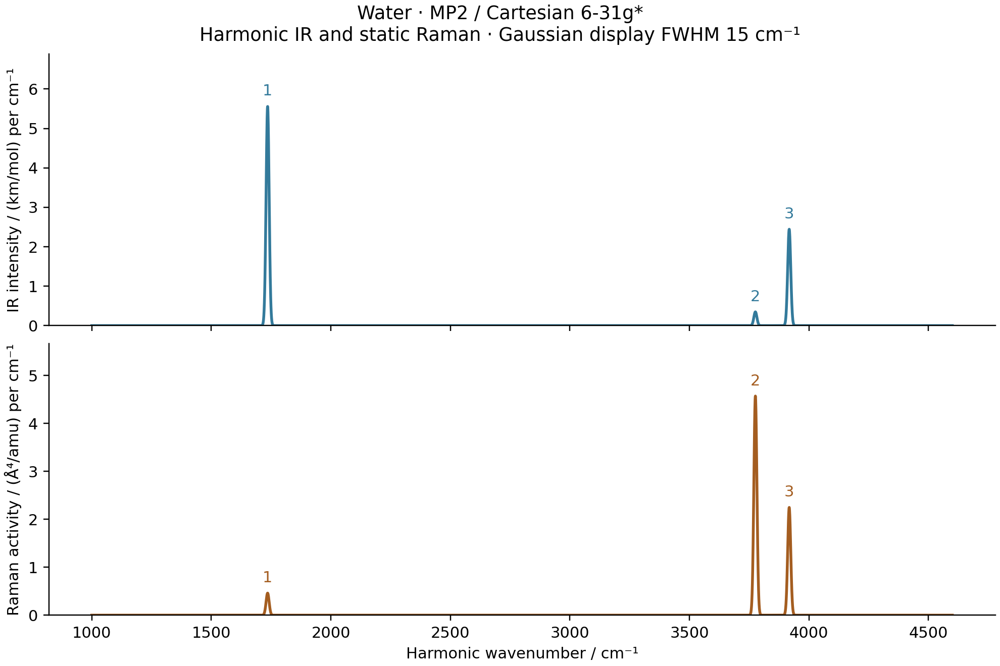

# V05: water MP2 harmonic IR and static Raman



This calculation optimizes water at all-electron MP2/Cartesian 6-31G*, then
computes the complete Cartesian Hessian, harmonic modes, IR strengths and
static Raman activities by AD. The RHF orbitals respond to every coordinate
and electric-field perturbation. Native differences and independent PySCF
total-response checks passed on `jy_gpu_1`; this is a finite-basis harmonic
benchmark, without frequency scaling or experimental fitting.

## Results

BFGS converged in 8 iterations and 9 objective evaluations to
`E = -76.1992441658066 Eh`, with maximum Cartesian gradient
`2.1654e-8 Eh/bohr`. Both OH lengths are `1.83032922013` bohr and the HOH angle
is `103.99982108` degrees.

| Mode | H2O / cm^-1 | D2O / cm^-1 | IR / km mol^-1 | Raman / Angstrom^4 amu^-1 | Depolarization |
| --- | ---: | ---: | ---: | ---: | ---: |
| Bend | 1735.455210 | 1270.145103 | 88.805127 | 7.347279 | 0.526428 |
| Symmetric stretch | 3776.019747 | 2722.076003 | 5.564386 | 73.017178 | 0.177377 |
| Antisymmetric stretch | 3917.528928 | 2869.822045 | 39.036548 | 35.906141 | 0.750000 |

H2O and D2O share the same electronic Hessian. Normal-coordinate directions
use `Q` in bohr times the square root of the electron mass. The plotted
Gaussian profiles have unit area and display FWHM 15 cm^-1; their widths are
not lifetimes. Static Raman activities are not absolute scattering cross
sections. Raw values are in [sticks.csv](sticks.csv).

[Optimization](optimization.png), [Hessian checks](harmonic_checks.png) and
[mode animation](water_modes.gif) use saved data. The animation has 40 frames,
a common display cycle and maximum displacement 0.25 bohr; it does not encode
thermal amplitudes or the relative physical oscillation periods.

## Differentiated calculation

`CorrelatedEnergy` shares the molecular input, integral and HF-response path
with the other geometry examples. For each perturbed geometry and field it
solves the stationary HF problem, canonicalizes its Fock matrix with the
shared Hermitian solver, transforms the AO integrals, and evaluates the
existing canonical MP2 energy. All electrons are correlated. There is no
density fitting, frozen orbital response or DFT reference in this example.

With occupied indices i,j and virtual indices a,b, the restricted energy is

```
E_MP2 = E_HF + sum_ijab (ia|jb) [2(ia|jb) - (ib|ja)]
                       / (epsilon_i + epsilon_j - epsilon_a - epsilon_b).
```

AD differentiates the integrals, orbital coefficients and orbital energies
through the converged reference. The canonical MO roots are checked to be
isolated at the sampled points. This result does not establish arbitrary
degenerate-MO MP2 response.

The shared Hermitian response now retains rotations between separate
requested eigenvectors in its higher-order chart. Each isolated column still
uses the existing n-dimensional checked linear solve. The nested-JIT
regression specifically verifies a geometry derivative of the full electric
polarizability tensor; a first-order eigenvalue test alone would not verify
the Raman path.

For `E(F)=E(0)-mu.F-F.alpha.F/2+...`,

```
mu = -grad_F E_MP2,
alpha = d mu/dF,
IR uses d mu/dQ,
static Raman uses d alpha/dQ.
```

The MP2 dipole is a total-energy derivative, including reference relaxation.
It is not the HF density dipole. The mass and intensity conversions are
shared with the HF/DFT and [CCSD example](../V05_water_ccsd_spectra/README.md).

## Validation

| Check | Maximum discrepancy |
| --- | ---: |
| Native HVP versus gradient differences, h=1e-4 bohr | 3.40e-9 Eh/bohr^2 |
| Full Hessian versus independent PySCF gradient differences | 5.24e-9 Eh/bohr^2 |
| Native mode dipole derivative versus displaced dipoles | 3.13e-10 au |
| Native mode polarizability derivative versus displaced polarizabilities | 1.12e-8 au |
| Independent total-energy field/geometry differences, dmu/dQ | 3.40e-7 au |
| Independent total-energy field/geometry differences, dalpha/dQ | 3.50e-6 au |

Native HVP errors decrease from `3.48e-7` through `3.13e-8` to `3.40e-9`
Eh/bohr^2 for steps `1e-3`, `3e-4` and `1e-4` bohr. The raw Hessian asymmetry
is `6.43e-12 Eh/bohr^2`, its translation residual `4.70e-12 Eh/bohr^2`, and
its rotational residual `2.17e-8 Eh/bohr`, consistent with the finite final
geometry gradient. These raw diagnostics precede rigid-mode projection.

The independent Hessian uses reconverged PySCF HF/MP2 analytic gradients at
two displacement sizes. The same controlled CPHF precision settings as the
CCSD comparison are used: tolerance `1e-13`, 100 iterations and Krylov squared
dependence threshold `1e-26`. The true unpreconditioned response residual is
checked against `1e-10`; its largest measured value is `1.01e-11`. The public
PySCF callables are restored after every gradient. The physical Hessian
acceptance threshold remains `3e-6 Eh/bohr^2`.

The independent IR/Raman check uses 156 reconverged total-energy calculations,
including the nuclear field term `-F dot sum(Z_A R_A)`. Two paired windows use
maximum Cartesian displacements `1e-3/3e-4` bohr and field steps `4e-3/2e-3`
au. Both are retained in [pyscf.json](pyscf.json). Their finite-field
truncation/cancellation errors are validation diagnostics, not corrections
to the native AD strengths.

## Reproduction and source record

Use the ordinary functions in
[water_correlated_spectra.py](../../../examples/vibrations/water_correlated_spectra.py),
setting `METHOD="mp2"`, followed by the independent comparison and plot scripts
with the same method. The `optimize`, `harmonic` and `spectra` stages also run
as separate bounded jobs. There is no command-line interface.

Calculations and plots ran only on `jy_gpu_1` / c20, Intel Xeon Platinum 8457C,
CPU float64, Python 3.11.15, JAX/JAXlib 0.10.0, NumPy 2.4.4 and PySCF 2.13.0.
The environment used `CUDA_VISIBLE_DEVICES=`, `JAX_PLATFORMS=cpu`,
`JAX_ENABLE_X64=1`, disabled persistent compilation caching and OMP/BLAS thread
settings 2. These do not cap all JAX runtime threads.

Optimization took 28.569 s, nine Hessian columns 45.762 s, and three spectral
modes with both native difference windows 240.718 s. Seed SCF lies outside
these timers; each includes its own first compilation where applicable.
Independent geometry/Hessian and spectral checks took 9.739 s and 30.238 s.
These different workloads on a shared node do not define a software speedup.

The frozen snapshot is
`/home/yjiao/gradscf_checks/ad-showcase-correlated-mp2-20261016`.
[source_manifest.json](source_manifest.json) verifies the runtime physics
hashes, native library, scripts, saved outputs and distinct animation frames.
It includes the final Hermitian nested-JIT correction. Larger bases, CO,
higher perturbation orders and anharmonic spectra remain separate work.
