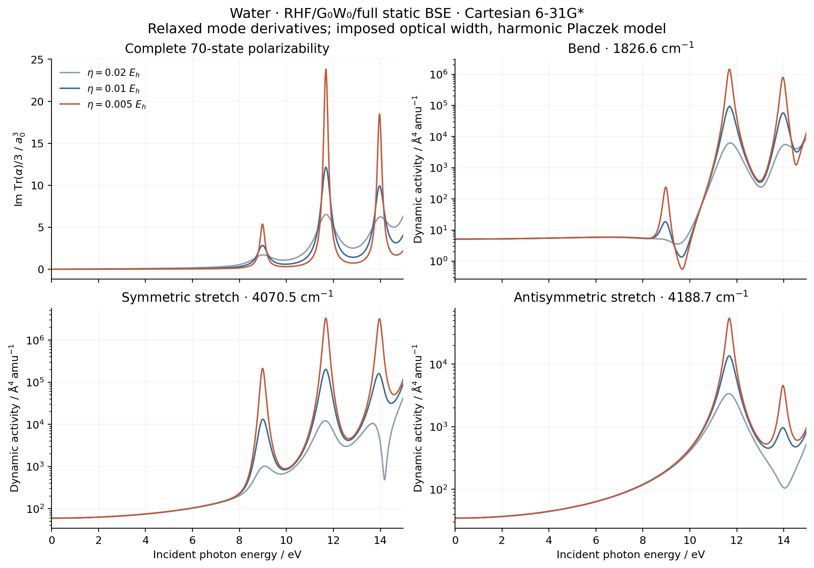
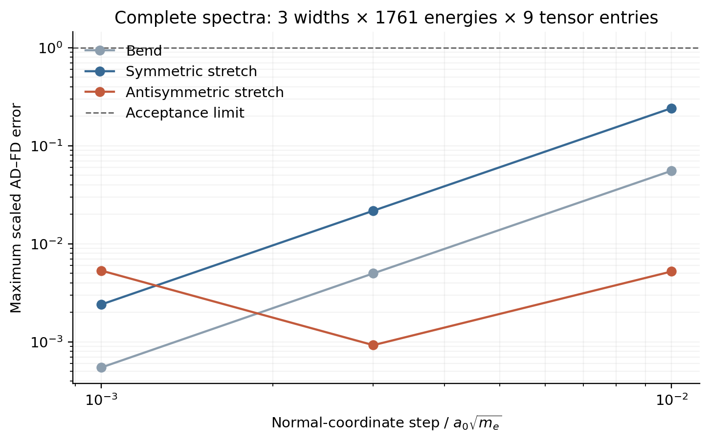

# Water: dynamic BSE polarizability and normal-mode response

This extends the TDHF V06 example to RHF/G0W0/full static BSE at the saved
RHF/Cartesian 6-31G* minimum. All 19 orbitals enter G, W and QP refinement;
all 70 occupied-virtual states enter the optical sum. The RHF normal modes
are fixed mass-normalized directions. This is not a GW total-energy minimum
or a BSE excited-state force calculation.

## Calculation and verification

Run the ordinary scripts, in order, from the repository root on `jy_gpu_1`:

```sh
PYTHONPATH=src python examples/vibrations/water_bse_dynamic_raman.py
PYTHONPATH=src python examples/vibrations/compare_water_bse_resolvent.py
PYTHONPATH=src python examples/vibrations/plot_water_bse_dynamic_raman.py
```

The electronic calculation reuses `MolecularGW`, `bse.polarizability` and
the shared RPA response solver. It caches three geometry tangents and
composes them with the frequency-dependent property. Orbitals, the AO
metric, position integrals, QP roots, W0 and X/Y amplitudes all move in
each tangent and in every independently reconverged displacement.

With real spatial transition integrals d and unit-RPA-norm X/Y, the
singlet transition moment is mu_s=sqrt(2) d^T(X_s+Y_s). In atomic units,

\[
\alpha_{ab}(\omega)=\sum_s\mu_{sa}\mu_{sb}
\left[\frac{1}{\Omega_s-\omega-i\eta}
+\frac{1}{\Omega_s+\omega+i\eta}\right].
\]

The second script independently solves the complex 140-dimensional linear
system with SciPy at every frequency, then checks completeness, spin and
normalization factors, stability, true residuals and the static identity
alpha(0)=4 d^T(A+B)^(-1)d. It uses saved native A/B and dipole inputs;
this is an independent linear-algebra check, not a second GW calculation.

For each mode, R=R0+V_nu Q_nu with V^T M_e V=I. Q is in
bohr sqrt(electron mass). The differentiated polarizability enters the
complex symmetric Placzek invariant, reusing the TDHF example's conversion
to angstrom^4/amu. The geometry gate compares complete tensors at 3 widths
and 1761 frequencies with central steps 0.01, 0.003 and 0.001 in Q units.
The fixed elementwise scale is 3e-5 + 3e-4 |dalpha/dQ|; the final maximum
scaled error must be below one.

Frequency convergence compares 441, 881 and 1761 points on [0,0.55] Eh.
Both integrated imaginary polarizability and every integrated mode activity
must change by less than 2e-4 between the final two grids. Widths are
0.02, 0.01 and 0.005 Eh, distinct from the GW self-energy eta=1e-5 Eh.

## Measured validation

The molecular and independent resolvent calculations both completed with
exit code zero. All three modes pass the complete spectral derivative gate.
At the final Q step 0.001, maximum errors are:

| Mode | Absolute tensor derivative error / atomic units | Scaled error (limit 1) | Static activity / angstrom^4 amu^-1 |
| --- | ---: | ---: | ---: |
| Bend | 4.80e-6 | 5.48e-4 | 5.11025004 |
| Symmetric stretch | 3.14e-5 | 2.41e-3 | 59.61947644 |
| Antisymmetric stretch | 1.60e-7 | 5.34e-3 | 34.73846244 |

The bend and symmetric-stretch errors decrease approximately quadratically.
The antisymmetric mode reaches a finite-convergence noise floor in small or
symmetry-forced tensor entries: its maximum scaled error is smallest at
Q step 0.003, while its absolute error still decreases at 0.001. No entries
are projected out or set to zero to pass the gate.

The independent complex resolvent agrees with all 5283 spectral tensors to
`4.98e-12 bohr^3`, with maximum true residual `2.91e-15`. The static identity
agrees to `1.36e-13 bohr^3`. The minimum eigenvalues of A-B and A+B are
`0.31441077` and `0.34561138 Eh`. Final frequency-grid changes are at most
`1.86e-9` for integrated imaginary alpha and `2.32e-8` for mode activities,
both below the original `2e-4` gate.





The final native calculation took `125.114 s`, with process peak RSS
`4,401,268 KiB = 4.20 GiB`; the independent all-frequency resolvent check
took `6.299 s`. After the QP anchor, cold/warm optical calls took
`12.146/0.235 s`, and cold/warm complete geometry JVPs took
`19.380/0.761 s`. The final script adds these separated timing fields;
every saved numerical NPZ array is bitwise identical to the earlier passing
version. That earlier version and its complete outputs remain archived.
These are recorded
shared-node CPU timings, not exclusive-hardware scaling measurements.

The snapshot is `jy_gpu_1:/home/yjiao/gradscf_checks/ad-showcase-gw-diis-20261016`,
with float64, JAX/JAXlib 0.10.0, OMP threads 2 and BLAS threads 1. No affinity
settings were changed. [gradscf.json](gradscf.json), [scipy.json](scipy.json)
and [source_manifest.json](source_manifest.json) record results and exact
input/source hashes. The [executed native script](../../../artifacts/ad_showcase/provenance/V06_water_bse_dynamic_raman/executed/water_bse_dynamic_raman.py)
and NPZ hashes were checked after pulling them locally. The public scripts
subsequently gained measured-output comments; their parsed code is unchanged.
The [final native log](../../../artifacts/ad_showcase/provenance/V06_water_bse_dynamic_raman/validation/native_v3.log),
[process resource record](../../../artifacts/ad_showcase/provenance/V06_water_bse_dynamic_raman/validation/native_v3_resources.log) and
[final independent check](../../../artifacts/ad_showcase/provenance/V06_water_bse_dynamic_raman/validation/scipy_v3.log) distinguish the timing
revision from the earlier passing version.
The full source archive is retained under the
local ignored `artifacts/ad_showcase/development/V06_bse_dynamic/jobs/water-bse-dynamic-v3/`;
its SHA-256 is `4ef7111fc8cc20c255d61859110d76c485114cf042666a3941a2e329f0ff0a0a`.
The source-tree Python hash is
`c9fe0d27165c35e731042e04d7c9c11f7e54e03559bdb97d1b96609de2186d01`.
The initial job exited during import because this frozen snapshot lacked
an existing helper; no numerical calculation had started in that attempt.
Its failure log is retained alongside the successful run.

## Physical limits

These are frequency-dependent harmonic Placzek activities. The optical
width is imposed, not a phonon lifetime. No excited-surface Franck-Condon
sum, KHD vibronic denominator, thermal population, scattered-photon factor
or absolute Raman cross section is included. Complete 70-state sums mean
complete within this basis and model, not basis convergence or an exact
Thomas-Reiche-Kuhn sum. Isolated QP/BSE response and a fixed local root
branch remain required.
