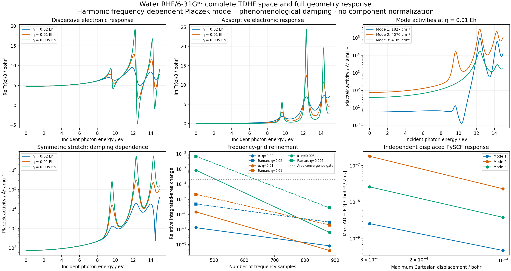

# V06 — dynamic electronic polarizability and Raman mode response

This calculation uses the complete occupied/virtual TDHF space of water
RHF/Cartesian 6-31G*, at the independently checked
[G05 minimum and harmonic modes](../G05_water_rhf_hessian/README.md).
It evaluates the retarded electronic polarizability and its complete geometry
JVP along each of the three fixed normal directions. The resulting quantity
is a **frequency-dependent Placzek activity** with phenomenological damping.
It is not a complete resonant Kramers–Heisenberg vibronic scattering spectrum.



[Native record](gradscf.json) · [independent checks](pyscf.json) ·
[complex tensors and mode derivatives](response.npz) ·
[frequency/activities CSV](frequency_response.csv) · [PDF](dynamic_raman.pdf) ·
[native script](../../../examples/vibrations/water_dynamic_raman.py) ·
[independent script](../../../examples/vibrations/compare_water_dynamic_raman_pyscf.py) ·
[plot](../../../examples/vibrations/plot_water_dynamic_raman.py)

The distinction matters near electronic poles. A polarizability derivative
can describe a frequency-dependent one-quantum Placzek model, while explicit
vibronic intermediate states and multiple vibrational excitations require
additional physics. See [Walter and Moseler, J. Chem. Theory Comput. (2019)](https://doi.org/10.1021/acs.jctc.9b00584)
and its [author preprint](https://arxiv.org/abs/1806.03840).

## Shared response, noncanonical orbitals and normalization

The existing restricted TDHF/TDDFT builder supplies the real operator

```
L = [[A, B], [-B, -A]].
```

For canonical references its one-body term remains `X*(epsilon_v-epsilon_o)`.
The molecular orbital optimizer produces a relaxed occupied/virtual frame
with internal gauge freedom. Supplying the optional dynamic AO `fock_matrix`
therefore changes that one-body action to `X Fvv-Foo X`, where the complete
blocks are projected from `C.T F C`. The diagonal is only a preconditioner;
discarding off-diagonal block entries is not a canonicalization. The default
`None` preserves the previous canonical path.

The Coulomb, exact-exchange and local XC response expressions are reused
unchanged. Original omegaB97X-D's existing full/LR exchange construction remains
available to that builder, but the measured dynamic examples here are HF,
PBE and PBE0. No new electronic A/B formula or iterative solver is introduced.
The public PySCF A/B convention used independently is documented in
[PySCF's restricted TD implementation](https://pyscf.org/_modules/pyscf/tdscf/rhf.html).

Let `d_x` be the occupied/virtual matrix of the AO position operator, with
unscaled spatial orbitals. For each Cartesian driving direction,

```
z = omega + i eta
(L-z I) Z_x = (d_x, -d_x)
alpha_xy(z) = 2 d_x.T (Z_y,upper + Z_y,lower)
alpha_xy(0) = 4 d_x.T (A+B)^-1 d_y
```

Both resonant and antiresonant terms are present. There is no finite-root
spectral sum or missing-root correction. The existing real kernel is extended
as `L(Re Z)+i L(Im Z)` so its real dtype conversions cannot discard the
imaginary response. The shared `solve_complex` uses the checked real linear
representation, including primal/transpose residuals and implicit AD. Its
bounded direct dimension is `4*nocc*nvir`.

`MolecularEnergy.solve_with_inputs` rebuilds and relaxes overlap, one-/two-body
integrals and the density; the dynamic adapter also rebuilds fixed-origin AO
dipoles and passes the relaxed full AO Fock matrix. DFT additionally carries
moving grid weights, AO values and AO derivatives. The mode JVP first produces
this complete reference tangent and then applies the response JVP, reusing
that tangent across frequencies. This is a chain-rule decomposition, not a
frozen orbital or frozen transition-operator approximation. Only the harmonic
mode direction itself is held fixed. DFT response uses the existing default
SCF density floor; arbitrary nondefault density-floor equivalence is not claimed.

## Units, damping and scope

Geometry is in bohr, `omega` and `eta` in Hartree, and polarizability in bohr³.
Normal coordinates use `Q` in `bohr sqrt(electron mass)`, with `V.T M V=I`.
Thus a mode derivative has units `bohr³/(bohr sqrt(electron mass))`.
For its complex symmetric tensor `R`, define

```
a = Tr(R)/3
gamma² = (3/2) sum_ij |R_ij-a delta_ij|²
activity = (45 |a|² + 7 gamma²) * bohr_in_angstrom^4 * amu_in_electron_mass.
```

The modulus squares are required for a complex response. These activities
are in Å⁴/amu. They exclude temperature/population, scattered-frequency,
experimental polarization geometry and absolute cross-section factors. The
imaginary polarizability panel is not labeled as an absorption cross section.
No empirical frequency scaling or component normalization is applied.

The scan uses `eta=0.02,0.01,0.005 Eh`. These are adjustable numerical/model
broadening parameters, not calculated lifetimes. The eta→0 limit is checked
away from poles at `omega=0.11 Eh`. Resonance heights retain explicit damping
dependence; no finite, converged zero-damping peak is claimed. Positive
eigenvalues of both `A-B` and `A+B` are separately checked because a converged
driven linear solve alone does not establish ground-state stability.

## Focused implementation gates

All tests ran on `jy_gpu_1`/c20 with CPU float64 and persistent compilation
cache disabled. The new focused evidence is split into three completed groups:

| Gate group | Result |
| --- | --- |
| Full operator covariance under occupied/virtual rotations; default-path equality; Fock pytree/JVP; complex response and negative-frequency conjugation | 4 passed in 11.87 s |
| H2/6-31G and water/STO-3G HF: independent response, static total-energy AD, full geometry JVP and two-step native/independent FD | 2 passed in 75.22 s |
| H2/6-31G PBE and PBE0, grid level 0: the same complete-chain gates | 2 passed in 357.67 s |

The initial four tests failed before implementation: the rotated full operator
lost Fock-block contributions, and the dynamic payload/helper did not exist.
Two molecular tests separately failed on the missing helper. Those red logs
are retained; a missing test-file collection attempt is recorded separately
from numerical failures.

| Method / system | Max dynamic alpha error vs PySCF / bohr³ | Zero-frequency error vs `−d²E/dF²` / bohr³ | Finest independent geometry JVP error |
| --- | ---: | ---: | ---: |
| HF / H2 | 1.19e-12 | 4.44e-15 | 2.47e-8 |
| HF / water | 8.57e-12 | 9.28e-15 | 1.13e-8 |
| PBE / H2 | 4.32e-12 | 1.94e-12 | 6.43e-8 |
| PBE0 / H2 | 8.13e-12 | 1.45e-12 | 6.43e-8 |

These are real full molecular derivatives at `omega+i eta=0.11+0.015i Eh`,
not fixed-reference ERI perturbations. Independent values use freshly
converged PySCF orbitals, public `get_ab`, independently evaluated AO dipoles
and SciPy complex solves. Each finite-difference displacement rebuilds that
entire reference. The directional displacement scale is specified in the tests;
the final water demonstration instead uses normalized G05 modes.

The first water scan with 441 frequency points failed the unchanged `2e-4`
relative integral-convergence gate for the narrowest damping. Independent
PySCF/SciPy confirmed changes of `8.349e-4` for 221→441 points, `6.441e-8`
for 441→881, and `5.42e-11` for 881→1761. The grid was refined to 881 points;
the damping, geometry, physical response and acceptance tolerance were kept.

## Reproduction

The real water calculation uses **70 occupied–virtual pairs** (140 RPA
coordinates, 280 real linear-solve coordinates) with no root truncation.
The smallest eigenvalues of `A-B` and `A+B` are `0.338308` and `0.368265 Eh`;
the first positive electronic root is `0.354336 Eh`. The largest driven
linear residual over the full grid is `7.93e-15`.

| Water validation | Measured maximum |
| --- | ---: |
| Static alpha versus complete total-energy AD / bohr³ | 1.58e-13 |
| Static mode tensors versus frozen V01/V02 / atomic Q units | 3.53e-15 |
| Full frequency/damping alpha versus independent PySCF / bohr³ | 2.072e-7 |
| Finest native mode FD error / atomic Q units | 2.009e-8 |
| Finest independent mode FD error / atomic Q units | 2.322e-8 |
| Last relative integrated-alpha frequency-grid change | 6.441e-8 |
| Last relative integrated-activity frequency-grid change, all three modes | 2.691e-6 |

The independent alpha comparison uses `atol=2e-7, rtol=2e-7`, combined
elementwise; the maximum absolute error is near a resonant response and is
not claimed to be below the absolute tolerance alone. Mode differences use
maximum Cartesian steps `3e-4` and `1e-4 bohr`, at `0.11+0.01i Eh` and
`0.85*first_root+0.005i Eh`, with `atol=3e-5, rtol=3e-4`. All raw complex
arrays must be finite. The electronic-response and **Raman-activity** grid
integrals are tested separately at each damping, because differentiated
response peaks can be sharper than alpha itself. The existing TDDFT,
PySCF-comparison, original wB97X-D, complex-linear and pytree regressions also
passed: **65 passed in 213.56 s**.

The final molecular scan took **255.85 s**, with peak RSS **3,362,672 KiB**,
on c20 / Intel Xeon Platinum 8457C. Python 3.11.15 and JAX 0.10.0 were used.
Its frozen Python source SHA256 is
`fcc5487b0791943005011b8bb4e1186d165ee2ea8e4945245ecef6f8a15e73bd`.
Later unrelated workflow changes are not included in this timing record.

The isolated source is
`/home/yjiao/gradscf_checks/ad-showcase-v06-20261016`, cloned from the frozen
integration source before adding the three V06 implementation files. The
existing G05 and V01/V02 inputs remain unchanged and are hash-bound by the run.
Numerical work and plotting run remotely; local checks are static and visual.

```bash
export CUDA_VISIBLE_DEVICES= JAX_PLATFORMS=cpu JAX_ENABLE_X64=1
export JAX_ENABLE_COMPILATION_CACHE=false OMP_NUM_THREADS=2 OPENBLAS_NUM_THREADS=2
export PYTHONPATH=src
PYTHON=/home/yjiao/opt/miniconda3/envs/jax_scf/bin/python
timeout 1800 "$PYTHON" -m pytest -q tests/test_molecular_dynamic_response.py
timeout 1800 "$PYTHON" examples/vibrations/water_dynamic_raman.py
timeout 600 "$PYTHON" examples/vibrations/compare_water_dynamic_raman_pyscf.py
timeout 300 "$PYTHON" examples/vibrations/plot_water_dynamic_raman.py
```

[Source manifest](source_manifest.json) and
[verification manifest](verification_manifest.json) retain exact source,
test/script, native-library, input and artifact hashes. The raw complex NPZ
is included in the compact bundle. Red, initial-grid-failure, refinement,
focused-test, independent and plotting logs remain alongside the final data.
