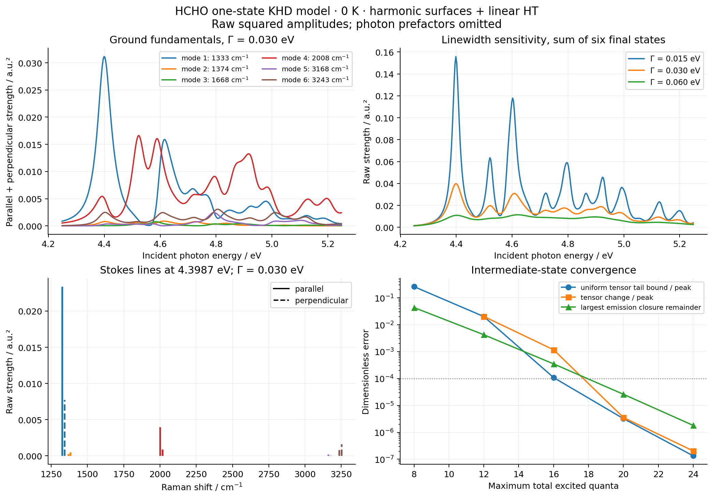
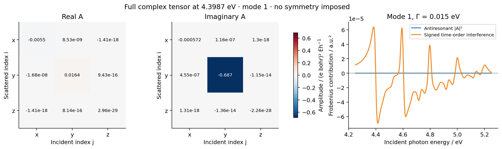

# V07 — single-state vibronic KHD Raman for formaldehyde

This is a **0 K, single-local-well, single-intermediate-electronic-state model**
using the frozen [X11 common-Eckart harmonic surfaces](../X11_formaldehyde_franck_condon/README.md)
and [X12 linear Herzberg–Teller dipole](../X12_formaldehyde_herzberg_teller/README.md).
The final states are the six ground-state fundamentals. All signed Cartesian
vertices and both time orderings are retained, giving a complex tensor that
is not forced to be symmetric. Results are raw squared amplitudes in atomic
units, without photon prefactors or absolute cross-section conversion.

[Main script](../../../examples/vibrations/formaldehyde_khd_raman.py) ·
[Independent resolvent reference](../../../examples/vibrations/compare_khd_resolvent.py) ·
[Plot](../../../examples/vibrations/plot_formaldehyde_khd.py) ·
[Shared KHD helper](../../../src/gradscf_tools/khd_raman.py) ·
[Tests](../../../tests/test_khd_raman.py)

## Fixed molecular input and AD boundary

The electronic inputs are Cartesian 6-31+G* RHF/CIS singlet S1, with the C/O/H/H
ordering and isotope masses used by X10–X12. X12 already converted its mode
derivatives to `Q_g` in `bohr sqrt(electron mass)`. V07 reads those exact values
and the entire saved harmonic model; it performs no second mass conversion or
frame rotation. The model uses a common ground Eckart slice with kinetic energy
`−∇Q²/2`. Its excited coordinate map is `Q_e=J Q_g+K`, with orthogonal `J`.
This is the declared slice model, not an orthogonalized version of the raw
overlap between two different projected vibrational subspaces.

The saved model 0–0 is `0.1616478747012267 Eh` (4.398663 eV). It already includes
the full quadratic constant, minimum offset and ZPE difference. Intermediate
energies are `Delta_n=E00_model+sum(n_j omega_e,j)`; no further ZPE is added.
The largest inherited excited-frequency change from the original X10 modes
is −54.8728 cm⁻¹. The original X10 and modeled X11/X12 0–0 values are distinct.

The electronic dipole Jacobian reused from X07 includes relaxed HF orbitals,
CIS eigenpair response and moving AO dipole integrals, with an independent
PySCF displacement check. V07 adds a host-side vibronic sum; it does **not**
claim end-to-end differentiation through geometry optimization, mode alignment,
occupation enumeration, or the complete spectrum.

## Scattering amplitude and linewidth convention

We define `a_n,j=<n_e|mu_j|0_g>` and `b_n,k,j=<n_e|mu_j|1_g,k>`. The first tensor
index is the scattered polarization and the second the incident polarization.
For positive Stokes photon energy `omega_S=omega_L−omega_g,k`, the implemented
amplitude is

```
A_k,ij(omega_L) = sum_n [
    conj(b_n,k,i) a_n,j / (Delta_n−omega_L−i Gamma)
  + conj(b_n,k,j) a_n,i / (Delta_n+omega_S−i Gamma)
]
```

This is the scattering S-matrix convention: both time orderings use the same
`G(E)=(E−H+i Gamma)^−1`. The displayed `A` is minus the bare two-photon T-matrix
amplitude, an overall convention that leaves the squared amplitude unchanged.
The two terms retain their relative sign and Cartesian index order. The
distinction from a retarded induced-polarization response, which also uses
`G†` and has opposite damping signs, is explicit in Mukamel's Eqs. 5, 11–14.
[Mukamel, Phys. Rev. A 76, 021803 (2007)](https://doi.org/10.1103/PhysRevA.76.021803)

The inelastic KHD form and Stokes energy conservation follow the same
scattering convention as Chen et al., Eq. 2. Here `Gamma` is a positive
phenomenological **energy HWHM**, common to all intermediate states. Its
variation is model sensitivity, not a calculated decay rate or a convergence
parameter. Both time orderings are included even near resonance.
[Chen et al., arXiv:1809.04498](https://arxiv.org/abs/1809.04498)

Amplitude units are `(e bohr)^2/Eh`, and squared-strength units are their square.
No incident/scattered photon-frequency factor, electromagnetic-unit conversion,
or instrument factor is applied. The output therefore represents model
polarization strengths, **not absolute scattering cross sections**. At finite
Gamma it is not the V06 retarded polarizability and is not tested against that
function's conjugate-frequency identity. The elastic off-resonance real
principal-value limit is checked as Gamma tends to zero.

## Reused Gaussian moments and signed interference

The existing FC generator is `F(z)=C exp(r.z+z.R.z/2)`, whose normalized
coefficients are `S_n=<n_e|0_g>`. In initial coordinates its product-Gaussian
mean, source and covariance are

```
M = diag(omega_g) + J.T diag(omega_e) J
m = solve(M, −J.T diag(omega_e) K)
B = sqrt(2) solve(M, J.T diag(sqrt(omega_e)))
Sigma = solve(M, I)
X_a(z) = (m_a+B_a.z) F(z)
Y_ab(z) = [Sigma_ab+(m_a+B_a.z)(m_b+B_b.z)] F(z)
```

The new quadratic-moment API reuses the existing vacuum and first-moment
recurrences. In particular, the `Sigma` term is essential. With the linear
electronic transition dipole `mu(Q)=mu0+D Q`,

```
a_n,j   = mu0_j S_n + sum_a D_j,a X_n,a
b_n,k,j = sqrt(2 omega_g,k) [mu0_j X_n,k + sum_a D_j,a Y_n,k,a]
```

The second coordinate insertion is needed because the final vibrational state
is one quantum; it does not introduce a quadratic electronic dipole surface.
No absolute values, per-state normalization or channel normalization are used
before summing amplitudes. The resonant/antiresonant contributions and their
signed interference remain separately available. X12's near-zero planar
Condon dipole is retained at its actual scale, without an enhancement ratio.

## General complex-tensor orientational average

For uniformly distributed molecular orientations and real linear analyzer
vectors, set `S=sum_ij |A_ij|²`, `T=sum_ij A_ij conj(A_ji)`. Then

```
parallel      = (|Tr A|²+S+T)/15
perpendicular = (4S−|Tr A|²−T)/30
```

`T` is real by pairing its transposed terms. These identities apply to a
general complex, nonsymmetric tensor and were independently tested by an
Euler-angle Haar integral (16×10×16 points), including a purely antisymmetric
example. They do not impose a molecular rotational spectrum or a symmetric
Placzek tensor approximation.

## Verification and convergence

The initial missing-API test run failed in all eight new cases. The implemented
moment/KHD tests and old FC/HT regressions then passed **24 tests in 15.76 s**.
Checks cover independent 64×64 Gauss–Hermite integration of second moments,
both vertex closures, an exact one-mode nonsymmetric tensor, electronic phase,
mode sign/permutation and Cartesian gauges, chunking, rotational averages,
and the elastic principal-value limit. Input-type review subsequently added
explicit complex-energy and nonscalar-Gamma rejection tests.
Those six new cases first failed against the calculation helper, then the
final combined suite passed **30 tests in 13.68 s**. The change only rejects
invalid input types. A subsequent parity check reproduced all 3,003 N=8
prefix vertices exactly and both full 593,775-state tensors at three laser
energies with **zero measured difference**. See
[input-guard parity](input_guard_parity.json) and the preserved
[test log](validation/input-green.txt).

The separate reference builds the excited quadratic Hamiltonian directly in a
ground HO product basis and solves complex resolvents with SciPy. It constructs
neither Hamiltonian nor vertices from FC overlaps. Coordinate powers use
padding before projection so the highest retained diagonal is correct. The
toy has two mixed-frequency displaced modes, complex noncollinear dipoles,
three laser energies and both time orderings:

| HO states per axis | Resonant max error | Antiresonant max error |
| ---: | ---: | ---: |
| 8 | 3.91e−2 | 1.90e−9 |
| 12 | 7.25e−4 | 2.24e−12 |
| 18 | 1.12e−6 | 2.10e−16 |
| 24 | 1.30e−9 | 6.18e−18 |

The final actual relative linear residual is `9.22e−16`; the predeclared
amplitude gates are `2e−9` and `2e−11`. This is an independent small-model
resolvent oracle, not a second HCHO electronic calculation.

Completeness gives the exact vertex Gram matrices

```
sum_n conj(a_n,i) a_n,j = conj(mu0_i) mu0_j
                      + sum_l conj(D_i,l) D_j,l/(2 omega_g,l)
sum_n conj(b_n,k,i) b_n,k,j = previous + conj(D_i,k) D_j,k/omega_g,k
```

Their raw trace deficits `delta_a,delta_b,k`, together with the omitted-energy
floor `E00+(N+1)min(omega_e)`, bound the missing tensor's Frobenius norm by
Cauchy–Schwarz and the minimum denominator distances. The reported uniform
bound covers every laser energy in the displayed window. A declared absolute
`64*float64 epsilon` is added to each raw deficit as a roundoff budget; this
is a numerical estimate, not an interval-arithmetic certificate.

At total occupation **N=24**, all **593,775** intermediate states are retained.
The absorption closure remainder is `1.35388e−7` relative, the largest emission
remainder is `1.80903e−6`, the N20→24 tensor change is `2.04200e−7` relative to
the global coarse-grid tensor peak, and the uniform omitted-tensor bound is
`1.33908e−7` on that same scale. This global scale avoids meaningless relative
errors at cancellations or symmetry zeros; it is not a per-mode relative-error
claim. Earlier cutoffs and their failures to meet the final gates are retained.

The final 321-point laser window is `E00 + [-0.15, 0.85] eV`. Its integrated
raw polarization strengths were compared with the nested 161-point grid at
fixed Gamma; all three pass the predeclared `1e-4` gate:

| Gamma (energy HWHM, eV) | Largest integral change / global integral scale |
| ---: | ---: |
| 0.015 | 2.27521e−5 |
| 0.030 | 4.22897e−6 |
| 0.060 | 1.14623e−5 |

The complete molecular workflow took **355.69 s** with a peak RSS of
**1,496,436 KiB** (1.43 GiB) on a Xeon Platinum 8457C CPU. This time includes
vertex construction, cutoff checks, all three frequency grids and serialization;
it is not an electronic SCF or a dedicated warm-kernel timing. The independent
two-mode reference took 3.20 s, and the input-guard parity check took 4.34 s.
The source/runtime record identifies Python 3.11.15, JAX 0.10.0, NumPy 2.4.4
and CPU float64. No exclusive-core performance claim is made.

## Saved figures and numerical records



The profiles retain the absolute model scale. Mode 1 near 1333 cm⁻¹ dominates
the model's first resonance; other fundamentals have distinct excitation
profiles. Reducing Gamma sharpens the intermediate-state resonances and changes
their height; Gamma is an imposed linewidth, not an independently computed
vibrational or electronic lifetime. The sticks use the fundamental frequencies
directly, with small opposite horizontal offsets only to distinguish the two
polarizations.



The tensor retains its imaginary part and nonsymmetric Cartesian entries. The
right panel shows the small antiresonant square and the signed interference
between time orderings, rather than adding their separate intensities. No
positive clipping or symmetry projection is used.

- [Native report](gradscf.json): full physical inputs, raw closure deficits,
  convergence thresholds, units, timings and source hashes.
- [Independent resolvent comparison](resolvent_reference.json): all four basis
  sizes, both amplitudes and actual linear residuals.
- [Complex tensors](khd_tensors.npz) and [raw profiles](excitation_profiles.csv):
  both time orderings, their sum and parallel/perpendicular strengths.
- [Source manifest](source_manifest.json) and
  [calculation runtime](calculation_runtime.json): executed and final helper
  versions, commands, input identity and artifact hashes.
- [Validation records](validation/): failing API/input controls, passing test
  logs, calculation logs, parity script and recorded exit codes.

The 104,625,438-byte `intermediate_vertices.npz` remains in the remote result
directory; its SHA-256 is recorded in the manifest. It contains every signed
vertex and occupation without truncation beyond the declared N=24 cutoff.
The local compact tensor archive is sufficient to reproduce both saved figures.

The actual calculation used KHD helper SHA-256
`15c420f92d440110f5f7078feccba906f45ebf49dc0b5487f96932f35e015958`.
Its source archive is preserved remotely and in the local ignored audit folder,
with SHA-256
`9a523233327655f9f774d643514503a63e74613838cab731c695cab569f33680`.
The final input-guard helper has SHA-256
`816df911eb723f038d41ecdf9eb6517b403d71b1771876cbd299ae5d2c7f4e9e`;
the exact valid-input parity check above bridges these versions. The main
example subsequently gained only measured-output comments. Earlier X11/X12
input files and numerical records were not rewritten.

## Scope

Numerical convergence establishes the stated finite electronic-state model.
Other electronic intermediate states, including bright states important away
from this resonance, are omitted. It is one local excited-state well, with no
tunneling/global-parity completion, anharmonicity, finite-temperature initial
populations, rotational structure or solvent/environment effects. The linear
dipole expansion is not independently certified over the full wavefunction.
The six final fundamentals exclude Rayleigh scattering, overtones and
combinations. These limitations preclude an experimental HCHO Raman prediction.

All numerical work uses the separate remote snapshot
`/home/yjiao/gradscf_checks/ad-showcase-v07-20261016` on `jy_gpu_1`, CPU float64.
OMP/BLAS threads are set to two; this does not cap every JAX runtime/compiler
thread. No integral/SCF/mathematical solver core or earlier X11/X12/G08/V08
scientific record is changed.

```bash
export CUDA_VISIBLE_DEVICES= JAX_PLATFORMS=cpu JAX_ENABLE_X64=1
export JAX_ENABLE_COMPILATION_CACHE=false OMP_NUM_THREADS=2 OPENBLAS_NUM_THREADS=2
export PYTHONPATH=src
PYTHON=/home/yjiao/opt/miniconda3/envs/jax_scf/bin/python
timeout 900 "$PYTHON" -m pytest -q tests/test_khd_raman.py tests/test_franck_condon.py tests/test_herzberg_teller.py
timeout 900 "$PYTHON" examples/vibrations/compare_khd_resolvent.py
timeout 5400 "$PYTHON" examples/vibrations/formaldehyde_khd_raman.py
timeout 300 "$PYTHON" examples/vibrations/plot_formaldehyde_khd.py
```
