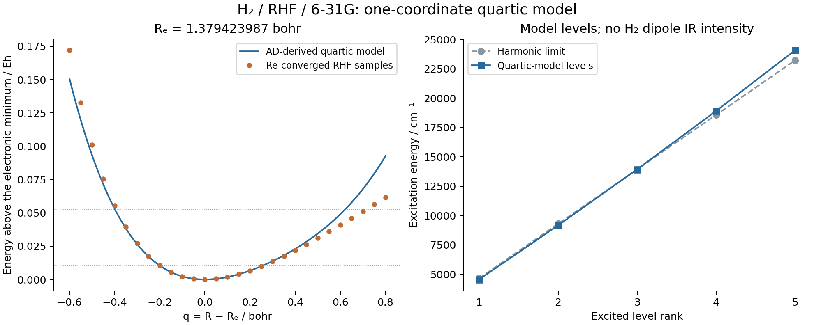
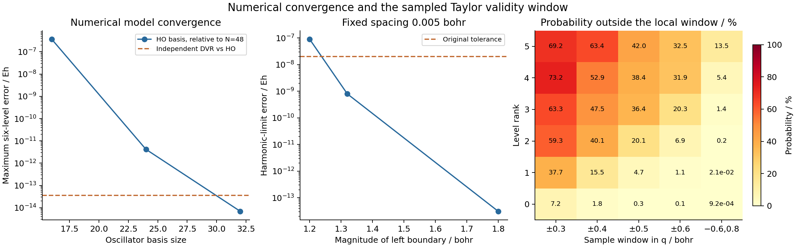

# V08 — a bounded H₂ quartic vibrational model

This is a one-coordinate model derived from fully relaxed RHF/6-31G energies.
Its finite vibrational eigenproblem is numerically validated. Its extrapolated
quartic potential is **not an accurate global H₂ potential**, and the higher
model levels must not be presented as measured or quantitatively converged H₂
overtones. The sampled electronic-energy errors and wavefunction tails below
make this distinction explicit. No electric-dipole IR strengths are assigned
to homonuclear H₂.

The coordinate is the bond-length change `q = R − Re`, with the two Cartesian
centers at `z = ±R/2`. An actual AD nuclear-gradient root search gives
`Re = 1.3794239869227614 Bohr`, rather than minimizing a fitted polynomial.
The retained residual gradient is −2.082e−16 Eh/Bohr. The isotope convention
uses neutral-atom hydrogen mass 1.00782503223 amu, consistently with the other
showcase vibration examples. Consequently
`μ = Σ_A m_A |dR_A/dR|² = m_H/2 = 918.5763237198094 electron masses`, and the
one-dimensional kinetic energy is `−(2μ)⁻¹ d²/dq²`. Rotations and nonadiabatic
mass corrections are not included.

The electronic energy at the minimum is −1.1268278290098817 Eh. Native AD,
including moving basis/nuclear integrals and implicit orbital response, gives:

| Derivative | Value | Unit |
|---|---:|---|
| E″ | 0.4116596065025233 | Eh Bohr⁻² |
| E‴ | −1.4142092727177094 | Eh Bohr⁻³ |
| E⁗ | 4.785027113105025 | Eh Bohr⁻⁴ |

The model is `V(q)=E′q+E″q²/2+E‴q³/6+E⁗q⁴/24`; the tiny linear term is
retained. Its positive quartic and radial-curvature inequality certify a
single global stationary point. The certified radial curvature lower bound
is 0.25492163356894737 Eh/Bohr², and every stationary point lies within
8.166e−16 Bohr of q=0. This certificate concerns the supplied floating-point
polynomial, not the uncertainty of the force constants or Taylor remainder.

`gradscf_tools.anharmonic` only assembles polynomial oscillator matrices and
checks the polynomial. Every coordinate power is formed with four additional
oscillator states before projection. The existing shared `solve_hermitian`
performs diagonalization. Sizes 16, 24, 32 and 48 retain six levels; the last
two agree within the fixed 1e−8 Eh gate. The harmonic limit recovers
`ω(n+1/2)`, with `ω=0.021169544018867593 Eh`. The force constants use AD;
the optimization and host-side model construction are not presented as one
differentiable end-to-end workflow.

| Model excitation | Quartic / cm⁻¹ | Harmonic / cm⁻¹ |
|---|---:|---:|
| Level 1, fundamental gap | 4547.6669388 | 4646.1778697 |
| Level 2, first overtone gap | 9160.4095261 | 9292.3557393 |

All six energies and gaps are in [levels.csv](levels.csv). At higher ranks,
the quartic model stiffens; this behavior is visible in the plot and is not
claimed as realistic H₂ overtone behavior.



The separate reference script imports PySCF and SciPy, without importing a
GradSCF solver. Independent PySCF nuclear optimization agrees within
7.803e−13 Bohr. Differences of its analytic relaxed Hessians at steps
3e−3, 1e−3 and 3e−4 Bohr validate the force constants. At the smallest step,
cubic/quartic errors are 2.721e−7 Eh/Bohr³ and 1.286e−6 Eh/Bohr⁴. SCF energy,
gradient and CPHF tolerances are 1e−13, 1e−11 and 1e−12; every actual PySCF
orbital gradient must be below 1e−10. The 29 native electronic-energy samples
are also independently checked against PySCF.

An independent sinc DVR diagonalizes the **same saved quartic polynomial**.
This isolates vibrational representation error from electronic force-constant
error. Grid sizes 201/301/401/601 use q∈[−1.2,1.8] Bohr; separate domain tests
hold the spacing at 0.01 Bohr. The final DVR and oscillator levels agree within
3.610e−14 Eh. These quartic DVR intervals have R>0 throughout.

The pure harmonic-limit test exposed a boundary error in level 5: at left
boundary −1.2 Bohr its error was 9.049e−8 Eh, above the original 2e−8 gate.
Keeping spacing 0.005 Bohr and moving the left boundary to −1.32 and −1.8
reduces the error to 7.964e−10 and 3.108e−14 Eh. All three results and the
initial failed log are retained. The last is a mathematical whole-line
harmonic-limit check; it is distinct from the positive-R quartic comparison.

Numerical convergence does not remove the local expansion's limitations:

| Sample window / Bohr | Maximum sampled energy error / Eh | Ground-state probability outside | Level-1 probability outside |
|---|---:|---:|---:|
| [−0.3,0.3] | 4.755e−4 | 7.204% | 37.682% |
| [−0.4,0.4] | 2.217e−3 | 1.759% | 15.490% |
| [−0.6,0.8] | 3.099e−2 | 0.000923% | 0.020735% |

These are finite-grid sampled maxima, not rigorous continuum remainder
bounds. Wider windows capture more probability while exposing larger Taylor
errors. Level 5 still has 13.52% probability outside [−0.6,0.8]. Within the
N=48 wavefunction reconstruction, probability at R≤0 is below 1.98e−22 for
all six states; local potential
accuracy is the much stronger limitation here. Full raw windows and
normalizations are in [spectrum.json](spectrum.json) and
[locality_windows.csv](locality_windows.csv); no probabilities were renormalized
to fit a window.



Run the ordinary scripts from the repository root:

```sh
export CUDA_VISIBLE_DEVICES= JAX_PLATFORMS=cpu JAX_ENABLE_X64=1
export JAX_ENABLE_COMPILATION_CACHE=false OMP_NUM_THREADS=2 OPENBLAS_NUM_THREADS=2
export PYTHONPATH=src
export LD_LIBRARY_PATH=/home/yjiao/opt/miniconda3/envs/jax_scf/lib/python3.11/site-packages/pyscf/lib
python examples/vibrations/h2_quartic_levels.py
python examples/vibrations/compare_h2_quartic_pyscf.py
python examples/vibrations/plot_h2_quartic_levels.py
```

The main script also exposes `build_model()` and `spectrum()` for separately
bounded stages. It contains no replacement SCF or eigenvalue solver. No
finite differences generate the native force constants. Seven focused helper
tests cover padding at the top retained oscillator state, one/two-coordinate
harmonic energies, mixed monomial conventions, exact linear-dipole selection
rules, capacity rejection and certificate outcomes; all passed on jy_gpu_1
in 11.93 s.

Measurements were made on jy_gpu_1 in CPU float64 on 2026-10-16. OMP and BLAS
thread settings were 2; this does not limit all JAX runtime/compiler threads.
The isolated snapshot is
`/home/yjiao/gradscf_checks/ad-showcase-v08-20261016`, using the verified G08
native library with SHA256
`8176ca97f9758ba3810b727c5a2e90572ac4f8f205e4a16e0d7a7177221b1829`.
G08's source/library and physical records were not replaced. Raw bounded-job
logs and exit files are retained in the snapshot's `artifacts/` and the ignored
local `artifacts/ad_showcase/development/V08_anharmonic/`. This is a finite-basis, fixed-rotor
quartic model, not full VPT2, a dissociation model, or an experimental prediction.

[Environment](environment.json), [runtime source hashes](source_sha256.txt),
[script/test/input hashes](example_input_sha256.txt), and
[selected artifact hashes](artifact_sha256.txt) identify the exact record.
A compressed runtime-source archive is retained with the ignored raw logs.
