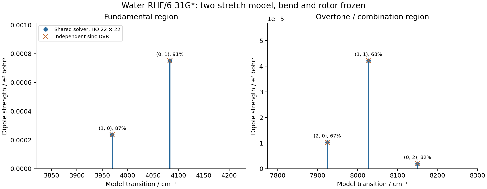
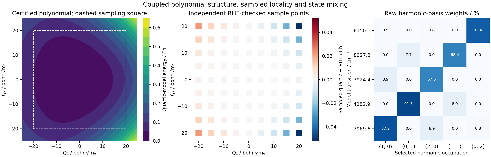
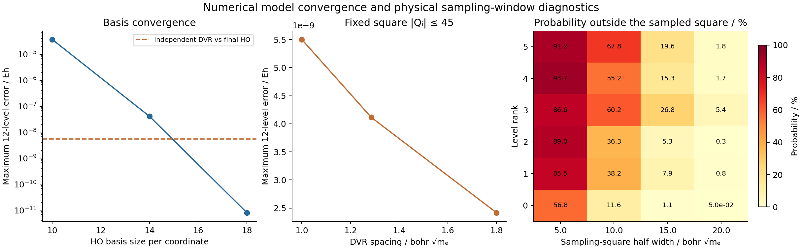

# V08 — two-stretch water quartic and quadratic-dipole model

This finite model produces fundamentals, overtone gaps and a combination gap
from native AD force constants and a fully relaxed dipole surface. It uses the
two OH-stretch normal coordinates at the existing RHF/Cartesian 6-31G* minimum.
**The bend coordinate and rotor are frozen.** Bend–stretch resonances, Watson
and Coriolis terms, other electronic methods and experimental accuracy are
outside this calculation. The polynomial and dipole Taylor surfaces have
substantial finite-window limitations, quantified below.

The geometry and mode directions are read from
[G05](../G05_water_rhf_hessian/gradscf.json), selecting modes 1 and 2, without
changing their phases or fitting new directions. `R(Q)=R0+VQ`, and the stored
mass metric satisfies `Vᵀ M V=I` with masses in electron-mass units. Thus each
Q has units Bohr√mₑ, and the kinetic energy is `−½(∂₁²+∂₂²)`. Freezing the bend
normal coordinate does not impose an exactly constant internal bond angle at
large displacements. The negative bend quartic found in G08 is unchanged.

Native overlap, kinetic, nuclear-attraction and full Coulomb integrals move
with the geometry. The shared stationary SCF response remains in all
derivative orders. Four independent cubic and five quartic derivatives are
computed, with mixed permutations checked. The raw derivatives include:

| Powers (a,b) in ∂^(a+b)E/∂Q₁^a∂Q₂^b | Value in Eh/Q^(a+b) |
|---|---:|
| (2,0) | 3.439682074668588e−4 |
| (0,2) | 3.642427098070063e−4 |
| (3,0) | 2.116141347347398e−5 |
| (1,2) | 2.225020147651791e−5 |
| (4,0) | 1.200506971541390e−6 |
| (2,2) | 1.263064149341261e−6 |
| (0,4) | 1.316820146580360e−6 |

Each monomial coefficient is its derivative divided by `a! b!`; for example,
the (2,2) derivative multiplies `Q₁²Q₂²/4`. Tiny odd-symmetry residues and
linear terms are retained, including E₁=2.590e−12 and E₂=−1.942e−16 Eh/Q.
The full arrays are in [model.json](model.json).

The helper certifies the supplied polynomial over all angular directions
using exact rational Bernstein bounds, with no angular sampling substituted
for a positivity proof. Both the quartic form D and `8KD−3C²` are positive.
The certified D lower bound is 3.0013e−7 Eh/Q⁴, and a radial curvature lower
bound is 1.0803e−6 Eh/Q². Retaining the linear residual confines every stationary
point to a ball of radius 2.3979e−6 Q; the Hessian lower bound within that ball
is positive, proving uniqueness. This is a statement about the floating-point
polynomial, not about the true molecular potential, derivative uncertainty,
or a Taylor remainder.

The total dipole is computed from the stationary density identity, keeping
its implicit electronic response and moving position integrals. Its complete
three-component linear and quadratic Q derivatives define
`μ(Q)=μ0+μa Qa+½ μab Qa Qb`. The finite Hamiltonian and dipole matrices use
padded oscillator powers before projection. All electronic force constants
are AD results; the subsequent optimization, fixed-mode selection and
host-side model assembly are not claimed as one differentiable workflow.

The existing shared Hermitian solver diagonalizes 10×10, 14×14, 18×18 and
22×22 product bases, retaining twelve levels. All couplings remain in the
matrix; no perturbative resonance denominators or manual intensity weights
are introduced. A harmonic/linear-dipole test independently recovers the two
allowed fundamentals and their exact strengths. For the final model:

| Dominant harmonic component | Weight | Gap / cm⁻¹ | Raw dipole strength / e² Bohr² |
|---|---:|---:|---:|
| (1,0), fundamental-like | 87.23% | 3969.63813 | 2.370024227e−4 |
| (0,1), fundamental-like | 91.34% | 4082.94957 | 7.516320415e−4 |
| (2,0), overtone-like | 67.47% | 7924.43794 | 1.030135506e−5 |
| (1,1), combination-like | 68.44% | 8027.20840 | 4.216259212e−5 |
| (0,2), overtone-like | 82.38% | 8150.12952 | 1.985313077e−6 |

Labels describe the largest harmonic-basis component, not exact quantum
numbers. Raw weights are not renormalized over the few displayed components.
Each strength is `Σ_xyz |<0|μ_a|n>|²`; all Cartesian components are retained.
Dimensionless oscillator strengths `2 ΔE strength/3` are also saved. These
are model transition moments, not experimental cross sections or lifetimes.




The separate PySCF script reconstructs every geometry and solves its own RHF
state. It uses analytic relaxed Hessians and dipoles with central Q steps
0.3, 0.1 and 0.03. At the smallest step, maximum independent cubic/quartic
errors are 1.114e−11 Eh/Q³ and 2.675e−13 Eh/Q⁴. Linear/quadratic dipole errors
are 4.355e−10 and 4.540e−10 in the corresponding atomic units. Native curvature
differences give 1.110e−11 and 3.460e−13 for cubic/quartic derivatives.

All 81 displaced energy/dipole samples also pass independent checks. Across
105 distinct PySCF points, the largest actual orbital gradient is 5.604e−12;
sampled native/PySCF energy and dipole differences are at most 1.080e−12 Eh
and 7.655e−12 e Bohr. These compare the two electronic engines at identical
geometries. The Taylor-approximation errors are separately reported below.
SCF energy/gradient/CPHF tolerances remain 1e−13/1e−11/1e−12, with a true
orbital-gradient gate of 1e−10. The corner Q=(−20,−20) did not converge within
the default 50 iterations; a controlled 200-iteration run reached a true
gradient 4.708e−12. The complete reference therefore uses max_cycle=200.
No tolerance or convergence flag was overridden, and no Newton fallback
was needed. The initial failure and single-point diagnosis are retained.

An independent two-coordinate sinc DVR uses SciPy and the same supplied
potential/dipole polynomials. Grids of 51, 71 and 91 points per axis hold
the half-width at 45 Q; separate domain checks hold spacing at 1 Q. The
final 8281-dimensional DVR agrees with the 484-dimensional oscillator model
to 5.502e−9 Eh in the twelve levels and 1.108e−14 e² Bohr² in transition
strengths. Its harmonic-limit error is 1.680e−12 Eh. Narrower boxes are not
quietly accepted: half-widths 30 and 37 have maximum errors 8.883e−4 and
1.244e−5 Eh. The additional half-width 43 gives 4.994e−8 Eh; both final
domains 43 and 45 satisfy the unchanged 2e−7 Eh gate without increasing the
maximum 91×91 capacity. All grid/domain values remain in
[dvr_reference.json](dvr_reference.json).

Real-space oscillator wavefunctions are reconstructed on a 601×601 grid
over [−60,60]² Q. Their normalization errors are below 1.67e−15. The native
electronic and dipole surfaces are sampled on the smaller 9×9 grid
Qᵢ=−20,−15,…,20; sampled maxima are not continuum remainder bounds:

| Sample-square half width / Q | Max sampled energy error / Eh | Max sampled dipole error / e Bohr | Ground-state probability outside | Combination-like state probability outside |
|---|---:|---:|---:|---:|
| 5 | 3.446e−5 | 1.089e−4 | 56.78% | 93.75% |
| 10 | 1.233e−3 | 1.168e−3 | 11.63% | 55.24% |
| 15 | 1.064e−2 | 5.160e−3 | 1.063% | 15.29% |
| 20 | 5.208e−2 | 1.534e−2 | 0.04985% | 1.744% |

Widening the sampled square captures more model probability while exposing
larger potential/dipole Taylor errors. Therefore basis/DVR convergence of
this polynomial model does not establish accurate water band positions or
intensities. The frozen bend also excludes bend–stretch resonance physics.
All twelve-state tails and unmodified sample values are provided in JSON and
[locality_windows.csv](locality_windows.csv).



Run the ordinary stage functions from the repository root:

```sh
export CUDA_VISIBLE_DEVICES= JAX_PLATFORMS=cpu JAX_ENABLE_X64=1
export JAX_ENABLE_COMPILATION_CACHE=false OMP_NUM_THREADS=2 OPENBLAS_NUM_THREADS=2
export PYTHONPATH=src
export LD_LIBRARY_PATH=/home/yjiao/opt/miniconda3/envs/jax_scf/lib/python3.11/site-packages/pyscf/lib
python -c 'from examples.vibrations.water_stretch_anharmonic import build_model; build_model()'
python -c 'from examples.vibrations.water_stretch_anharmonic import dipole_surface; dipole_surface()'
python -c 'from examples.vibrations.water_stretch_anharmonic import spectrum; spectrum()'
python -c 'from examples.vibrations.compare_water_stretch_pyscf import electronic_reference; electronic_reference()'
python -c 'from examples.vibrations.compare_water_stretch_pyscf import dvr_reference; dvr_reference()'
python examples/vibrations/plot_water_stretch_anharmonic.py
```

The main file also runs its three stages in order when executed directly;
there is no CLI or configuration framework. Stage results are not silently
reused. The helper has seven passing focused tests, including top-state
padding, harmonic energies and linear-dipole selection, mixed monomials,
capacity limits, and certificate outcomes. No integral or shared solver core
was changed for V08.

Measurements were made on jy_gpu_1, CPU float64, 2026-10-16. OMP/BLAS settings
were 2, without claiming a limit on all JAX threads. The source snapshot is
`/home/yjiao/gradscf_checks/ad-showcase-v08-20261016`, copied from the verified
G08 source/library and augmented by the workflow helper. Native library SHA256:
`8176ca97f9758ba3810b727c5a2e90572ac4f8f205e4a16e0d7a7177221b1829`.
Measured force-constant/model and dipole stages took 360.98 and 118.95 s,
including compilation after seed construction; finite-model spectrum and
independent electronic reference took 17.62 and 28.06 s. These are different
stages, not matched performance comparisons. Every job had a limit of at most
7200 s. Raw logs, failed attempts and exit codes are retained in the snapshot's
`artifacts/` and local ignored `artifacts/ad_showcase/development/V08_anharmonic/`.

[Environment](environment.json), [runtime source hashes](source_sha256.txt),
[script/test/input hashes](example_input_sha256.txt), and
[selected artifact hashes](artifact_sha256.txt) identify the actual source and
results. A compressed runtime-source archive is retained with the ignored logs.
