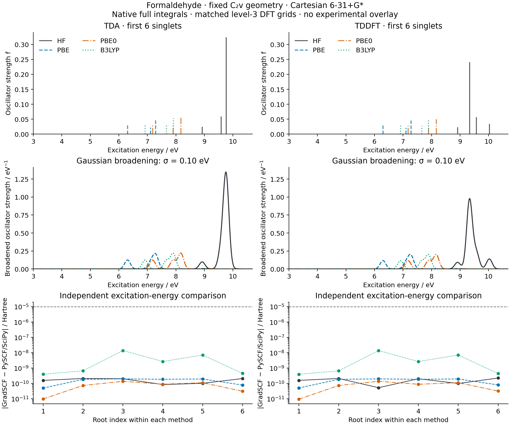

# X01: formaldehyde vertical singlet absorption

Measured on **2026-10-15**, on `jy_gpu_1` (`c20`), CPU float64.
All eight calculations and 48 transitions pass the predefined independent
comparison gates. This is a fixed-geometry, single-basis/grid demonstration;
basis and grid convergence, experimental agreement and excited-state
derivatives are outside these results.



## Physical and numerical settings

The chosen neutral, closed-shell C2v geometry has C=O = 1.21 Angstrom,
C-H = 1.10 Angstrom and H-C-H = 116 degrees. It is neither an optimized
geometry nor a claimed experimental structure. Coordinates are Angstrom:

```text
C  0.0   0.0000000000000000   0.0000000000000000
O  0.0   0.0000000000000000   1.2100000000000000
H  0.0   0.9328529057720686  -0.5829111906565254
H  0.0  -0.9328529057720686  -0.5829111906565254
```

- Cartesian **6-31+G***: 42 AOs, eight occupied orbitals and 272 single
  excitations. Diffuse functions are included; diffuse/basis convergence is
  not inferred from their presence.
- RHF, PBE, PBE0 and B3LYP; each supplies the first six singlet TDA and full
  TD states. HF/TDA is CIS and HF/full TD is TDHF.
- Native full two-electron integrals, without density fitting. DFT uses JAX
  AO values on a level-3 Treutler-Ahlrichs/Lebedev grid with NWChem pruning,
  original Becke partitioning and Treutler atomic-radii adjustment.
  Both implementations use **47,816 physical DFT quadrature points**.
- SCF energy/density/orbital-gradient tolerances: `1e-12`, `1e-10`, `1e-9`;
  at most 180 cycles. TD residual tolerance: `1e-9`, at most 150 iterations,
  subspace capacity 80 and an explicit **32-vector initial guess**.
- Length-gauge transition dipoles are in Bohr, energies in Hartree/eV,
  oscillator strengths dimensionless. The conversion is
  `1 Hartree = 27.211386245988 eV`.
- Gaussian broadening has sigma = **0.10 eV**. It is a display choice, not
  a calculated lifetime. Curves retain the included oscillator strengths
  without separate per-method normalization; this six-state subset is not a
  complete absorption spectrum or oscillator-strength sum-rule test.

## Independent verification

The separate reference script imports no GradSCF code or reference arrays.
PySCF independently builds the integrals, matched grids, converged SCF and
public `get_ab()` matrices. Existing SciPy dense `eigh`/`eig` routines solve
the 272-dimensional TDA and 544-dimensional RPA problems. These are
**PySCF-matrix/SciPy-dense references**, not claims of PySCF iterative TD
convergence. PySCF public optical-property functions evaluate the resulting
metric-normalized states.

The reference checks A/B symmetry, positive eigenvalues of A-B and A+B,
a real positive RPA spectrum, positive metric, metric orthonormality and
selected eigen-residuals <= `1e-9 Hartree`. The largest observed selected
eigen-residual is **2.114e-14 Hartree**. Individual roots are separated by more
than `1e-5 Hartree`; dipole outer products remove arbitrary state-sign changes.

Acceptance limits were set before comparison: ground energy `1e-8 Hartree`,
excitation energy `1e-5 Hartree`, oscillator strength `1e-5`, and any component
of the dipole outer product `1e-5 Bohr^2`, all absolute errors.

| Method | Response | Max excitation error / Hartree | Max strength error | Max dipole-outer error / Bohr^2 |
| --- | --- | ---: | ---: | ---: |
| HF | TDA | 2.116e-10 | 2.787e-10 | 8.435e-10 |
| HF | Full TD | 2.262e-10 | 2.264e-10 | 1.107e-9 |
| PBE | TDA | 1.993e-10 | 1.989e-11 | 1.213e-10 |
| PBE | Full TD | 1.991e-10 | 2.011e-11 | 1.153e-10 |
| PBE0 | TDA | 1.385e-10 | 1.277e-10 | 6.760e-10 |
| PBE0 | Full TD | 1.384e-10 | 1.212e-10 | 6.432e-10 |
| B3LYP | TDA | 1.392e-8 | 4.125e-9 | 1.640e-8 |
| B3LYP | Full TD | 1.388e-8 | 3.960e-9 | 1.515e-8 |

The largest ground-state energy difference is `3.468e-12 Hartree`.
Unrounded per-state results and errors are in [gradscf.json](gradscf.json),
[pyscf.json](pyscf.json) and [comparison.csv](comparison.csv).

## State description and root coverage

The JSON records the three largest normalized `X^2+Y^2` contributions for
every root, with one-based occupied/virtual MO indices. These weights describe
the chosen orbital frame; they are not full-TD configuration probabilities.
The CSV includes the dominant contribution. Chemical orbital labels remain
unassigned without further orbital analysis.

| Method | S1 TDA / eV | S1 full TD / eV | Leading S1 configuration |
| --- | ---: | ---: | --- |
| HF | 4.579150 | 4.410553 | HOMO -> LUMO |
| PBE | 3.880092 | 3.863236 | HOMO -> LUMO |
| PBE0 | 4.005166 | 3.979480 | HOMO -> LUMO |
| B3LYP | 3.997989 | 3.978222 | HOMO -> LUMO |

These first roots are dark at the displayed intensity scale. Root numbers are
local to each method. For example, HF/TDA S4 is predominantly HOMO-1 -> LUMO,
whereas PBE/TDA S4 is HOMO -> LUMO+3. Equal root indices therefore do not
automatically identify the same state across methods.

An initial six-vector full-TD calculation reported converged roots but missed
lower states in disconnected symmetry sectors. HF omitted the 9.579133 eV
state and included 10.418410 eV in its first six. The existing facade's
`davidson_initial_guess_count` was not forwarded to full TD; the minimal fix
passes it through Casida to the shared RPA solver. The example explicitly uses
32 seeds. The independent dense reference verifies the resulting first six
states for all four methods. Larger seeds are **not a general completeness
proof** for arbitrary systems.

[root_coverage.json](root_coverage.json) preserves the before/after root lists
and source hashes. The disconnected-subspace regression failed twice before
the fix, returning 1.396424 instead of 0.295804. After the fix, the focused
regression and existing TD/RPA suites passed **33 tests in 205.35 s**:

```sh
python -m pytest -q tests/test_tddft_initial_subspace.py \
  tests/test_tddft_eigensolvers.py tests/solvers/test_stable_rpa.py
```

See [red evidence](initial_subspace_red.txt) and
[passing regression output](initial_subspace_green.txt). Earlier PySCF
iterative attempts did not meet their convergence flags: the default
linear-dependence truncation stopped some residuals near `1e-7`, while an
overly small truncation threshold destabilized the PBE trial space. Those
attempts were rejected; the accepted reference uses the dense route above.

A follow-up input-boundary check requires `initial_guess_count` to be a
positive `numbers.Integral`, excluding booleans. Zero, negative, floating-point
and string counts are rejected. The new checks first gave seven expected
failures and three passes, then **10 passed in 10.31 s** after validation was
added. Default `None`, NumPy integer counts and counts larger than the space
retain their existing behavior. Only this focused test file was rerun;
the previous 33-test result remains the numerical regression evidence.
This guard was added after the recorded source-hash calculation and does not
change the accepted positive-integer path used for the spectra.

## Reproduction and provenance

From the repository root on `jy_gpu_1`, using
`/home/yjiao/opt/miniconda3/envs/jax_scf/bin/python`:

```sh
export CUDA_VISIBLE_DEVICES=
export JAX_PLATFORMS=cpu JAX_ENABLE_X64=1 JAX_ENABLE_COMPILATION_CACHE=false
export OMP_NUM_THREADS=2 OPENBLAS_NUM_THREADS=2 PYTHONPATH=src
timeout 3600 python examples/tdscf/formaldehyde_absorption.py
timeout 1800 python examples/tdscf/compare_formaldehyde_pyscf.py
timeout 300 python examples/tdscf/plot_formaldehyde_absorption.py
```

Hardware: Intel Xeon Platinum 8457C. Software: Python 3.11.15, JAX 0.10.0,
NumPy 2.4.4, PySCF 2.13.0 and SciPy 1.17.1. OMP/OpenBLAS thread counts are
two. Native calculation elapsed time is **161.42 s**, including first calls
and warm repeats; peak process RSS is **4,951,896 KiB**. The independent
calculation takes **18.86 s**. These are implementation timings, not a matched
performance benchmark. The JSON records first-call and warm TD times
separately; compilation is included in first calls and not isolated as a
standalone phase. No backward timing is claimed by this forward example.

Remote snapshot:
`/home/yjiao/gradscf_checks/ad-showcase-excited-20261015`, based on
`8f8c93d25fcc150aace9ad5c6a8e070c4f2937af` plus the initial-count forwarding fix.
The executed Python source-tree SHA256 is
`53c09a10b44229dea9be673f1754cf7de3bc1b59c5986ec9066b9bf60460acd0`.
JSON also records executed script hashes; trailing measured-output comments
were added after execution. No numerical calculation or plotting was run
locally.

Files include raw [sticks](sticks.csv), [broadened data](broadened.csv),
[plot settings](plot_settings.json), and [vector PDF](absorption_comparison.pdf).
The plot script reads saved data only and rejects incomplete, failed or stale
reference comparisons. No experimental overlay, energy shift or fitted width
is used.
