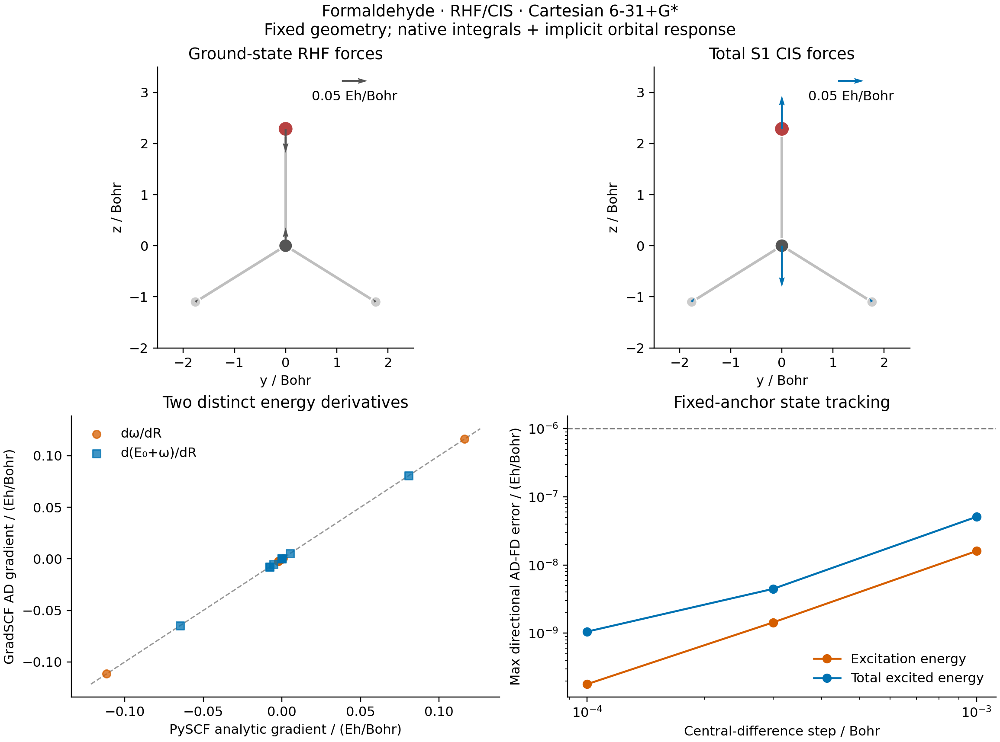

# X02: excitation and total excited-state nuclear gradients

Measured on **2026-10-15**, on `jy_gpu_1` (`c20`), CPU float64. Native CIS
first derivatives agree with separately reconverged finite differences and
independent PySCF analytic gradients. The two differentiated energies are
kept distinct throughout:

```text
omega(R)        = E_CIS(R) - E_RHF(R)
E_excited(R)    = E_RHF(R) + omega(R)
excited force  = -dE_excited/dR
```



## Calculation and state identity

The fixed formaldehyde geometry and Cartesian 6-31+G* basis match
[X01](../X01_formaldehyde_absorption/README.md): C=O 1.21 Angstrom,
C-H 1.10 Angstrom, H-C-H 116 degrees, neutral closed shell, 42 AOs and
eight occupied orbitals. Coordinates are recorded in Bohr in the JSON.
The selected state is the first singlet CIS root; six roots are retained for
tracking and gap diagnostics. This geometry is not an excited-state minimum.

`MolecularEnergy.solve_with_inputs` assembles moving native full AO integrals
once and relaxes the RHF orbitals through the shared implicit orbital solver.
The existing `transform_integrals` and `ci.solve_cis` then construct the
noncanonical CIS problem. Its occupied/virtual Fock blocks remain intact;
individual orbital eigenvectors are not rediagonalized under geometry AD.
The shared dense Hermitian solver supplies first-order eigenvalue response.
`jax.jacrev` returns both energy gradients from this chain.

SCF energy tolerance is `1e-12 Hartree`; the initial density tolerance is
`1e-11`, stationary orbital-gradient tolerance `1e-10`, implicit linear
response tolerance `1e-10`, and CIS residual tolerance `1e-10 Hartree`.
The largest recorded CIS residual is `1.803e-14 Hartree`.

State matching uses the normalized absolute overlap of AO transition-density
operators `C_occ X C_vir.T`, evaluated with the cross-geometry AO overlap.
It is invariant to consistent occupied/virtual rotations and state signs.
It is a **transition-density tracking metric**, not a many-electron CIS
wavefunction overlap. Matches are rejected below overlap 0.85, best-versus-
runner-up margin 0.20, or an excited-state gap of `1e-4 Hartree`.
All 18 displaced calculations use the same undisplaced anchor.
The smallest observed overlap is **0.9999991434** and the smallest selected
state gap is **0.1594712 Hartree**. Every displaced point selects S1.

## Verified results

| Quantity | Result |
| --- | ---: |
| Excitation energy omega | 0.168280654334 Hartree |
| Total excited-state energy | -113.701633304838 Hartree |
| Max excitation-gradient error versus PySCF | 9.548e-9 Hartree/Bohr |
| Max total-excited-gradient error versus PySCF | 9.549e-9 Hartree/Bohr |
| Max ground-gradient error versus PySCF | 2.842e-12 Hartree/Bohr |
| Excitation-energy error versus PySCF | 1.044e-11 Hartree |

Three fixed, normalized Cartesian directions use seed 1022. Each plus/minus
energy reconverges RHF and CIS and is matched to the fixed anchor. The maximum
error across both derivatives and all three directions is:

| Central-difference step / Bohr | Max AD-FD error / (Hartree/Bohr) |
| ---: | ---: |
| 1e-3 | 5.096e-8 |
| 3e-4 | 4.466e-9 |
| 1e-4 | 1.055e-9 |

Both smaller steps pass the predefined `1e-6 Hartree/Bohr` absolute target.
Raw translational and torque residuals for both gradients pass `1e-7` in their
respective atomic units; no rigid-motion projection was applied.

The reference script imports no GradSCF code or electronic arrays. PySCF
independently converges RHF, constructs the CIS A matrix through `get_ab`,
and receives the SciPy dense eigenvector in its public analytic gradient API:
`td.nuc_grad_method().kernel(xy=..., state=1)`. The excitation gradient is
independently obtained by subtracting the PySCF ground gradient from its
total excited-state gradient. The analytic CPHF tolerance is `1e-10` with
at most 100 cycles. This does not claim PySCF iterative TD convergence.

The separate tracking tests cover orbital-gauge/state-sign invariance,
low-overlap rejection, ambiguous matches and near-degenerate-state rejection:
**4 passed in 1.57 s** on the same remote environment.

## Reproduce and inspect

From the repository root on `jy_gpu_1`, with
`/home/yjiao/opt/miniconda3/envs/jax_scf/bin/python`:

```sh
export CUDA_VISIBLE_DEVICES=
export JAX_PLATFORMS=cpu JAX_ENABLE_X64=1 JAX_ENABLE_COMPILATION_CACHE=false
export OMP_NUM_THREADS=2 OPENBLAS_NUM_THREADS=2 PYTHONPATH=src
timeout 3600 python examples/tdscf/formaldehyde_cis_gradients.py
timeout 600 python examples/tdscf/compare_formaldehyde_cis_gradients.py
timeout 300 python examples/tdscf/plot_formaldehyde_cis_gradients.py
python -m pytest -q tests/test_excited_geometry_tracking.py
```

Native elapsed time is **132.11 s**; the first paired-gradient call takes
**28.865 s**, its warm repeat **12.777 s**. First-call timing includes JAX
compilation, which is not isolated as a separate phase. Peak process RSS is
**2,458,556 KiB**. The independent reference takes **1.63 s**. Hardware is
Intel Xeon Platinum 8457C; Python 3.11.15, JAX 0.10.0 and PySCF 2.13.0.

The isolated snapshot is
`/home/yjiao/gradscf_checks/ad-showcase-excited-20261015`, based on `8f8c93d`
with the recorded example/helper changes. Executed Python source-tree SHA256:
`70aaecb436d6039730504eeca7c6f4cd9dfc24a292a838e637c84879b010ca16`.
The snapshot retains the validated first-order shared spectral response;
no second derivative of the CIS eigenvalue rule is used. Executed script
hashes precede the subsequently added measured-output comments.

Inspect [native results](gradscf.json), [independent results](pyscf.json),
[Cartesian components](gradients.csv), and [vector figure](gradient_checks.pdf).
All numerical calculations and plots were generated remotely. Basis/grid
convergence, DFT excited-state derivatives, exact many-electron state overlaps
and excited-state Hessian AD are outside this component.
