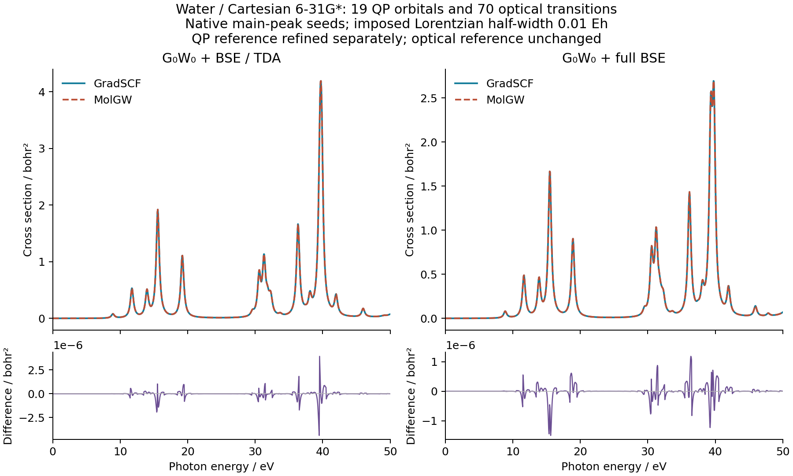
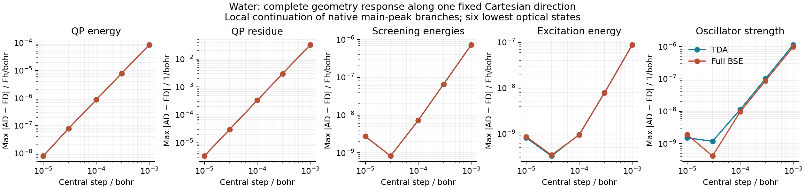

# Water: native GW/BSE spectra and nuclear response

The reference is real closed-shell RHF water, Cartesian 6-31G*, at
`O (0,0,0); H (0,1.43,1.11); H (0,-1.43,1.11)` bohr. It has 19 orbitals,
5 occupied orbitals and 70 occupied–virtual transitions. All orbitals enter
G, W and the QP calculation. There is no fitted auxiliary basis: full AO
integrals are factorized in the symmetric AO-pair space.

These are derivatives of QP and optical observables. No variational GW+BSE
excited-state total energy, excited-state force or geometry optimization is
defined by this example. The fixed RHF geometry is not a GW/BSE equilibrium.





## Runnable examples

- [Native calculation](../../../examples/gw/water_primary_qp.py): native
  RHF/RPA main-weight seeds, finite-eta G0W0 refinement, all 70 TDA/full-BSE
  roots, oscillator strengths, complete finite-basis static polarizability
  and absorption cross sections.
- [Independent comparison](../../../examples/gw/compare_water_molgw.py):
  reads saved native results and the pinned MolGW reference. It never adjusts
  the native roots to match reference energies. QP and optical reference
  directories are explicit, including when only the graphical QP grid is
  refined.
- [Complete geometry response](../../../examples/gw/water_geometry_response.py):
  AD directional derivatives and reconverged central differences; explicit
  QP branch anchors and transition-density/orbital matching.
- [Plotting](../../../examples/gw/plot_water_molgw.py): reads saved comparison
  tables and derivative records. It performs no electronic calculation.

Run ordinary Python scripts from the repository root with `PYTHONPATH=src`.
The geometry script exposes an ordinary `run()` function so each selected
method/TDA/full case can be a separate bounded process. There is no CLI.
For example, after the native main-peak calculation, add `examples/gw` to the
Python import path and select its saved branch explicitly:

```python
import json
from pathlib import Path
from water_geometry_response import run

folder = Path("reproducibility/ad_showcase/X02_water_gw_bse_response/primary")
reference = json.loads((folder / "nw200/native.json").read_text())
run("g0w0", nw=200, tda=False,
    qp_anchor=reference["qp_energy_hartree"], output=folder)
```

All recorded numerical work ran on `jy_gpu_1`, CPU float64. OMP/OpenBLAS
were set to two threads; those settings do not cap every JAX worker thread.

## Differentiated calculation

The moving-coordinate map is

```
R -> AO integrals/overlap -> stationary RHF -> canonical orbitals
  -> symmetric ERI factors -> G/W -> QP roots -> static BSE -> optical moments.
```

Both the AO position operator and its MO transformation move. The QP equation
uses `eta=1e-5 Eh`, 100 or 200 imaginary-axis quadrature points and a requested
root tolerance of `1e-11 Eh`. For a local root of `f(omega,R)=0`, the shared
implicit rule returns `domega/dR=-f_R/f_omega`. The residue also responds:
`Z=[1-partial_omega Re Sigma]^-1`. A numerical seed supplies the branch, not
an additional differentiated term.

The dense small-system BSE forward path and its bounded direct response use
the common solver module. This choice is explicit because default restarted
GMRES did not meet the true response residual on two water roots. The physical
equation and tolerances are unchanged; see the
[solver and failed-branch evidence](../GW_BSE_response_gates/README.md).

## Main-peak and local-branch records

The top-level `g0w0_*_continued.json` files retain an earlier local branch.
Some high virtual roots are satellites. They are useful local derivative
checks and are not interchangeable with the `primary/` results.

The primary calculation obtains eta=0 starting roots from the native
RHF/direct-RPA arrowhead representation. The shared Hermitian solver ranks
complete spectral groups by central-projector weight. All selected water
groups are isolated singletons. It then solves the actual finite-eta CD
equation. This is not a global maximum-residue proof at finite eta, nor an
AD rule for a discontinuous main-peak selector.

`primary/nw200/native.json` contains the complete primary forward result.
The maximum QP residual is `6.25e-16 Eh`. The lowest TDA/full-BSE excitations
are `8.9072377826 / 8.8696124579 eV`, with maximum 70-root residuals
`6.92e-14 / 2.15e-13 Eh`. The plotted Lorentzian half-width `0.01 Eh` is an
imposed resolution, not a calculated lifetime or vibrational broadening.

The normalized Cartesian direction uses seed `20261016` with its mean
translation removed. Five central steps are `1e-3`, `3e-4`, `1e-4`, `3e-5`
and `1e-5` bohr. Primary TDA/full-BSE checks at the final step give:

| Observable | TDA maximum AD–FD error | Full-BSE maximum AD–FD error |
| --- | ---: | ---: |
| All QP energies / Eh bohr^-1 | 7.87e-9 | 7.87e-9 |
| All QP residues / bohr^-1 | 3.34e-6 | 3.34e-6 |
| W0 orbital energies / Eh bohr^-1 | 2.73e-9 | 2.73e-9 |
| Lowest six optical energies / Eh bohr^-1 | 8.20e-10 | 8.66e-10 |
| Their oscillator strengths / bohr^-1 | 1.50e-9 | 1.90e-9 |

Orbital and transition-density identities pass the stated 0.99 overlap gates.
Residue errors decrease quadratically over the step sequence. The earlier
final step of `3e-5 bohr` gave `2.996e-5 /bohr` and failed the unchanged
`2e-5` gate; its complete result is retained in `primary/failed-step-3e-5/`.
This gate applies to the specified mixed vector of observables in atomic
units; the individual errors and units remain separately reported above.

The warm six-root directional derivative took 0.847 s for TDA and 0.807 s
for full BSE in separate recorded jobs; corresponding cold calls were
22.15/21.43 s. These shared-node small-system timings are not an asymptotic
scaling or exclusive-hardware comparison. Every record carries its source
hashes and cold/warm boundaries.

The [cutoff audit](reference_boundaries.json) samples all eleven geometries.
The retained AO-pair rank is 165 throughout; the smallest canonical MO gap
is about `0.00367 Eh`. An initial conservative `64*eps*||ERI_pair||` margin
check rejected the `1e-12` cutoff because its separation was only about
`3.48e-13`, even though no rank changed. A fixed cutoff of `6.7e-13` lies
farther inside the same gap and passes that margin. Direct factor values and
their geometry JVPs at both cutoffs are exactly equal at every sampled point.
The reported GW runs retain their original `1e-12` setting. This is a
same-subspace robustness check, not a proof over a continuous geometry interval
or a basis/compression-convergence study.

## Independent reference and remaining checks

The [MolGW archive](../MolGW_reference_build/README.md) pins its source,
build and graphical-root settings. With its original `5e-6 Eh` graphical
step, native/reference QP energies agree to `3.16e-8 Eh`; TDA/full-BSE energies,
strengths, static polarizabilities and cross sections pass their original
independent comparison gates. The QP residue discrepancy `1.65e-4` exceeds
the `5e-5` gate, so `primary/nw200/comparison.json` correctly reports failure.
MolGW uses an adjacent-grid self-energy slope for this quantity. An independent
`1e-6 Eh` grid still fails at `6.39e-5`. The final actual 4,000,001-point
`5e-7 Eh` run passes at `3.53e-5`, without changing the frequency interval,
eta or the `5e-5` gate. Native/reference QP energies then agree to `3.12e-8 Eh`.
Both failed reference grids remain in the MolGW archive.

[comparison_refined.json](primary/nw200/comparison_refined.json) passes every
original gate, explicitly combining the finer **QP-only** reference with the
original optical reference. The finer directories contain no BSE calculation;
their results must not be described as a fine-grid optical rerun. The
[original coarse diagnostic figure](primary/nw200/water_molgw_spectra.png)
retains its failed-residue label. The native root solution was never fitted
to an external energy or residue.

The forward and response source snapshots are named
`ad-showcase-gw-response-20261016` and `ad-showcase-gw-outer-20261016`.
The latter adds only optional numerical outer-iteration controls to the
adapter, preserving G0W0 behavior. Full-source integration with the separate
native fourth-derivative/PBC developments has not yet been validated.
The [executed forward script](../../../artifacts/ad_showcase/provenance/X02_water_gw_bse_response/executed/water_primary_qp.py) matches the native
JSON's script hash; the public example subsequently gained measured-output
comments without changing its numerical body.

## Self-consistent QP spectra and complete local response

The four records in [outer_diis](outer_diis/) now pass for evGW0 and evGW,
each followed by TDA or full BSE. They retain all 19 QP/G/W orbitals, six
optical roots, `nw=100`, `eta=1e-5 Eh`, DIIS space 8, damping 0.3, at most
200 iterations and the original `1e-10 Eh` outer residual tolerance.
The same five displacement steps and `2e-5` mixed-observable gate apply.
Final-step errors at `1e-5 bohr` are:

| Method | QP energy / Eh bohr^-1 | QP residue / bohr^-1 | Optical energy / Eh bohr^-1 | Oscillator strength / bohr^-1 |
| --- | ---: | ---: | ---: | ---: |
| evGW0/TDA | 5.75e-7 | 2.62e-6 | 3.85e-7 | 2.16e-7 |
| evGW0/full BSE | 5.75e-7 | 2.62e-6 | 3.94e-7 | 1.64e-7 |
| evGW/TDA | 3.67e-8 | 1.23e-6 | 1.54e-8 | 1.91e-8 |
| evGW/full BSE | 3.70e-8 | 1.25e-6 | 1.53e-8 | 1.40e-8 |

For evGW0, W0 moves with the geometry even though it is fixed inside the
outer QP iteration; its derivative error is `2.73e-9 Eh/bohr`. For evGW,
the W spectrum is the self-consistent QP spectrum, so its error equals the
QP energy error. The evGW0 small-step errors have a finite-convergence
noise floor and are not monotonically quadratic.

Warm TDA/full-BSE directional calls took `0.799/0.711 s` for evGW0 and
`1.039/1.065 s` for evGW. Cold calls took `24.10/26.66 s` and
`31.10/26.70 s`. These shared-node CPU timings include the complete
HF/GW/BSE directional map, but are not an exclusive-hardware comparison.

These are **continued local root branches**. The updated-W calculation
starting directly from MF energies previously failed with an OpenBLAS
memory-region error. A staged run with one BLAS thread produced a native
converged center, which initializes the final calculations with two BLAS
threads. Both final jobs, all displaced geometries and all response gates
passed. This validates the local-root calculation; it does not establish
global root selection, repair the earlier runtime failure or guarantee
convergence from arbitrary seeds. The seed and actual finite-eta roots
are saved in every JSON; failed attempts are retained separately.

These outer-response jobs use `ad-showcase-gw-diis-20261016`. Wider basis
convergence, EOM Dyson weights and relaxed GW/BSE electron-vibration spectra
remain separate gates. Full-source integration remains pending.
