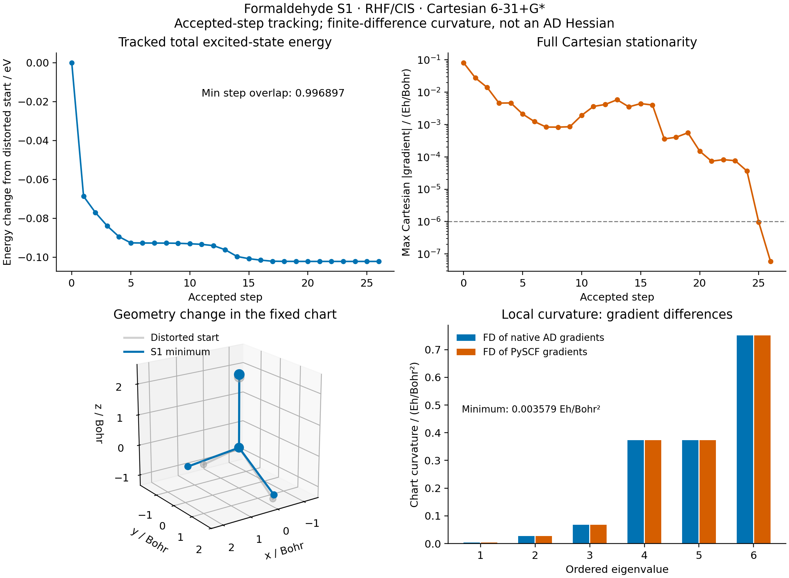

# X03: a tracked formaldehyde CIS excited-state minimum

Measured on **2026-10-15**, on `jy_gpu_1` (`c20`), CPU float64. Optimizing
`E_excited(R) = E_RHF(R) + omega_CIS(R)` gives a local S1 minimum with a maximum
full Cartesian gradient of **5.877e-8 Hartree/Bohr**. Independent PySCF analytic
gradients confirm stationarity, and finite differences of both gradient
implementations give positive local curvature in all six internal directions.
The curvature calculation is **finite differences of first derivatives**, not
an AD Hessian or a mass-weighted vibrational analysis.



## Model, coordinates and state tracking

The calculation uses neutral closed-shell formaldehyde, RHF/singlet CIS,
Cartesian 6-31+G*, 42 AOs, eight occupied orbitals and six CIS roots. The planar
starting geometry is the same fixed geometry as [X01](../X01_formaldehyde_absorption/README.md)
and [X02](../X02_formaldehyde_cis_gradients/README.md): C=O 1.21 Angstrom,
C-H 1.10 Angstrom, H-C-H 116 degrees. It is not an optimized ground-state
geometry. X02's native result and independent validation must pass and have
matching hashes before this optimization starts.

A six-coordinate Cartesian chart removes rigid translations and rotations:
C is at the origin, O is on positive z, H1 lies in the yz plane, and H2 is free.
The coordinates are `[O_z, H1_y, H1_z, H2_x, H2_y, H2_z]`, in Bohr. Setting
the initial H2 x coordinate to 0.15 Bohr breaks planar symmetry. SciPy's existing
L-BFGS-B optimizer uses the native total excited-state gradient, with `gtol=3e-7`,
`ftol=1e-15`, `maxiter=100`, `maxls=30`, and `maxcor=10`. The explicit chart
bounds are recorded in [the native JSON](gradscf.json); the final geometry must
be at least `1e-4 Bohr` inside every bound.

The native physics chain is the same shared implementation as X02:
`MolecularEnergy.solve_with_inputs`, native moving AO integrals, implicit RHF
orbital relaxation, `transform_integrals`, noncanonical `ci.solve_cis`, and
the shared Hermitian first-derivative rule. No SCF, CIS, response or optimization
solver is duplicated in the example. RHF energy, density, and orbital-gradient
tolerances are `1e-12 Hartree`, `1e-11`, and `1e-10`; the implicit response and
CIS residual tolerances are `1e-10` in their respective atomic units.

State matching uses normalized absolute **transition-density overlaps** with
cross-geometry AO overlaps. It is invariant to consistent orbital rotations
and state signs, but is not a many-electron CIS wavefunction overlap. The
minimum overlap, best-versus-runner-up margin and gap are 0.85, 0.20 and
`1e-4 Hartree`. Trial geometries use the last accepted anchor; only the optimizer
callback updates that anchor. Curvature displacements use the fixed final anchor.
All tested points select S1. The smallest accepted-step overlap is 0.996897;
the smallest overlap across all trial points is 0.988089, and the smallest
curvature-displacement overlap is 0.999999271. The smallest trial-state gap is
0.159645 Hartree.

## Verified minimum and curvature

The optimizer takes **26 iterations and 34 objective calls**, terminating with
`CONVERGENCE: NORM OF PROJECTED GRADIENT <= PGTOL`. A separate full Cartesian
gradient check requires `max|g| <= 1e-6 Hartree/Bohr`; raw total force and torque
must each be below `1e-7` in atomic units. No rigid-motion projection conceals
these residuals.

| Quantity at the local minimum | Result |
| --- | ---: |
| RHF ground-state energy at this geometry | -113.853881915695 Hartree |
| Vertical CIS excitation at this geometry | 0.148519357834 Hartree |
| Total excited-state energy | -113.705362557861 Hartree |
| C=O distance | 1.255289 Angstrom |
| C-H distances | 1.085359, 1.085359 Angstrom |
| H-C-H angle | 118.283542 degrees |
| Angle between C=O and the plane of the two C-H bonds | 24.817631 degrees |
| Maximum full Cartesian gradient | 5.877e-8 Hartree/Bohr |
| Max gradient difference versus independent PySCF | 3.811e-13 Hartree/Bohr |
| Max chart-curvature difference versus independent PySCF | 7.942e-10 Hartree/Bohr^2 |

The excitation in this table is a vertical gap at the excited-state minimum;
it is not an adiabatic gap between separately optimized ground and excited
minima. [Geometry metrics](geometry_metrics.json) also record the planar and
distorted starting structures.

Central differences of first AD gradients use steps `1e-3` and `3e-4 Bohr`
in each chart direction, with independently reconverged electronic states at
all 24 displacements. The raw matrices are checked for symmetry **before**
symmetrization: maximum antisymmetric differences are `2.780e-7` and
`2.496e-8 Hartree/Bohr^2`, both below `2e-5`. The two step sizes differ by at
most `1.057e-6 Hartree/Bohr^2`, also below `2e-5`. Eigenvalues of the symmetrized
smaller-step matrix, in Hartree/Bohr^2, are:

```text
0.00357898  0.02695368  0.06842896  0.37284961  0.37378598  0.75102089
```

All exceed the predefined positive-curvature threshold `1e-6 Hartree/Bohr^2`.
These are coordinate-chart curvature eigenvalues; their magnitudes are not
vibrational frequencies. This establishes a local minimum from one starting
distortion, without establishing a global minimum, basis convergence, or
experimental agreement.

## Independent reference precision

The separate reference imports no GradSCF electronic arrays or solver. PySCF
independently converges RHF and supplies its public `get_ab` matrix to SciPy
dense diagonalization. The eigenvector is passed into PySCF's public analytic
CIS gradient API. Its final point and 12 chart displacements use the same
`3e-4 Bohr` step. The reference checks CIS residuals and state gaps, stationarity,
raw curvature symmetry, positive curvature and agreement with the native result.

The first reference attempt failed the unchanged `2e-5 Hartree/Bohr^2`
curvature gate: its curvature difference was `2.034e-5`, with raw asymmetry
`2.239e-5`. Tightening only the requested CPHF tolerance or SCF stationarity
did not remove this discrepancy. The cause was the independent solver's
Krylov linear-dependence cutoff: its default `lindep=1e-13` stops on a squared
trial norm before the requested tighter residual tolerance is met. At the
same geometry, basis and CPHF tolerance `1e-12`, changing only this cutoff
from `1e-13` to `1e-20` reduced the actual unpreconditioned Z-equation residual
norm from `2.111e-6` to `6.175e-9 Hartree`, and the gradient difference from
`6.508e-8` to `6.640e-11 Hartree/Bohr`.

The final reference uses SCF energy/gradient tolerances `1e-12`, CPHF tolerance
`1e-13`, at most 100 CPHF cycles, and `lindep=tol^2=1e-26`. A narrow
`pyscf.lib.temporary_env` context applies this public `lib.krylov` parameter
only during each analytic gradient call. It also records the actual Z residual
and checks restoration of both library functions afterward. The residual
equation is `(epsilon_a-epsilon_i) Z_ai + fvind(Z)_ai + rhs_ai = 0`; its norm
must be below `1e-10 Hartree` at every reference point. The largest measured
norm is **2.242e-11 Hartree**. No native tolerance, physical gate, geometry,
curvature step, or solver implementation was changed to obtain agreement.

The [reference-precision record](reference_precision.json) retains the failed
controls and the paired cutoff experiment. The [independent energy-only finite
difference check](energy_fd_validation.json) independently supports the diagnosis:
native gradient errors decrease to `3.576e-9 Hartree/Bohr` at `1e-4 Bohr`,
while the initial reference analytic gradient retains an approximately
`6.53e-8 Hartree/Bohr` discrepancy. Final independent errors are recorded in
[pyscf.json](pyscf.json); the raw final reference curvature asymmetry is
`2.498e-8 Hartree/Bohr^2`. This validates the dense-matrix reference and its
analytic gradients, without claiming convergence of PySCF's iterative TD solver.

## Reproduce and inspect

Run X02 and its reference first. From the repository root on `jy_gpu_1`, use
`/home/yjiao/opt/miniconda3/envs/jax_scf/bin/python`:

```sh
export CUDA_VISIBLE_DEVICES=
export JAX_PLATFORMS=cpu JAX_ENABLE_X64=1 JAX_ENABLE_COMPILATION_CACHE=false
export OMP_NUM_THREADS=2 OPENBLAS_NUM_THREADS=2 PYTHONPATH=src
timeout 7200 python examples/tdscf/formaldehyde_cis_optimization.py
timeout 600 python examples/tdscf/compare_formaldehyde_cis_optimization.py
timeout 300 python examples/tdscf/plot_formaldehyde_cis_optimization.py
```

Native runtime is **622.66 s**, including compilation, optimization and curvature
validation; peak process RSS is **3,263,804 KiB**. The independent final reference
takes **17.13 s**. Hardware is Intel Xeon Platinum 8457C, Python 3.11.15,
JAX 0.10.0 and PySCF 2.13.0. All calculations and plots were generated remotely.

The snapshot is `/home/yjiao/gradscf_checks/ad-showcase-excited-20261015`, based
on `8f8c93d` with the recorded example/helper changes. Executed Python source-tree
SHA-256 is `70aaecb436d6039730504eeca7c6f4cd9dfc24a292a838e637c84879b010ca16`.
It retains the independently validated first-order shared spectral response;
the separate higher-order spectral development was not used for these numbers.
Executed script hashes in the JSON precede subsequently added measured-output
comments. The native JSON also binds the exact validated X02 input by hash.

Inspect [accepted steps](history.csv), [Angstrom trajectory](trajectory.xyz),
[raw chart curvature](chart_curvature.csv), and [vector figure](optimization_checks.pdf).
DFT/TDDFT geometry response, other starting basins, basis convergence, and an
AD excited-state Hessian remain separate gates.
